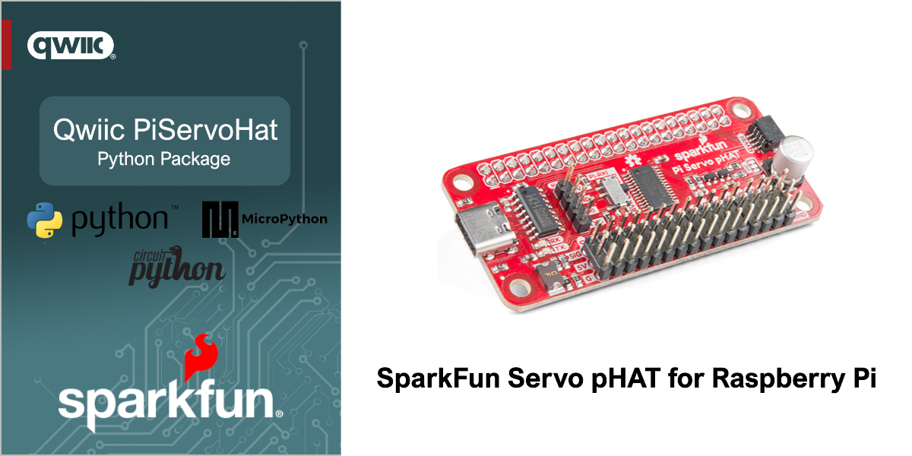

# SparkFun Pi Servo HAT - Python Package


[](https://docs.sparkfun.com/Qwiic_Py/pi_servo_hat/)

The SparkFun Pi Servo HAT and Servo pHAT drive up to 16 servos from a Raspberry Pi with a PCA9685 PWM controller, and have a Qwiic connector to chain other Qwiic boards.

This package is the Python driver for the SparkFun Pi Servo HAT and Servo pHAT. It works on CPython (Linux), MicroPython and CircuitPython, and is part of the [SparkFun Qwiic Python package](https://github.com/sparkfun/Qwiic_Py).

## Contents

* [About the Package](#about-the-package)
* [Supported Platforms](#supported-platforms)
* [Installation](#installation)
* [Example Use](#example-use)
* [Documentation](#documentation)
* [Migrating from 2.x](#migrating-from-2x)

## About the Package

This package moves servos to a position in degrees, reads back the estimated position, sets duty cycles and the PWM frequency, and puts the servos to sleep. It is built on the [qwiic_pca9685](../qwiic_pca9685) driver. Each feature is demonstrated in the [examples](examples/README.md).

New to Qwiic? Take a look at the entire [SparkFun Qwiic ecosystem](https://www.sparkfun.com/qwiic).

### Supported SparkFun Products

* [SparkFun Pi Servo HAT](https://www.sparkfun.com/products/14328)
* [SparkFun Servo pHAT for Raspberry Pi](https://www.sparkfun.com/products/15316)

## Supported Platforms

| Python | Platform | Boards |
| --- | --- | --- |
| CPython | Linux | [Raspberry Pi](https://www.sparkfun.com/raspberry-pi-5-8gb.html), [NVIDIA Jetson Orin Nano](https://www.sparkfun.com/nvidia-jetson-orin-nano-developer-kit.html) via the [SparkFun Qwiic SHIM](https://www.sparkfun.com/sparkfun-qwiic-shim-for-raspberry-pi.html) |
| MicroPython | Raspberry Pi RP2, ESP32 | [SparkFun Pro Micro RP2350](https://www.sparkfun.com/sparkfun-pro-micro-rp2350.html), [SparkFun IoT RedBoard ESP32](https://www.sparkfun.com/sparkfun-iot-redboard-esp32-development-board.html), [SparkFun IoT RedBoard RP2350](https://www.sparkfun.com/sparkfun-iot-redboard-rp2350.html) |
| CircuitPython | Raspberry Pi RP2, ESP32 | [SparkFun Pro Micro RP2350](https://www.sparkfun.com/sparkfun-pro-micro-rp2350.html), [SparkFun IoT RedBoard ESP32](https://www.sparkfun.com/sparkfun-iot-redboard-esp32-development-board.html), [SparkFun IoT RedBoard RP2350](https://www.sparkfun.com/sparkfun-iot-redboard-rp2350.html) |

> [!NOTE]
> These are the primary platforms tested. The package is expected to work on most Python-enabled systems.

## Installation

### CPython (pip)

```sh
python3 -m venv ~/sparkfun_venv
~/sparkfun_venv/bin/pip install sparkfun-pi-servo-hat
```

Run any example or script that does `import pi_servo_hat` with `~/sparkfun_venv/bin/python3 example_script.py`.

### MicroPython (mip)

Install [mpremote](https://docs.micropython.org/en/latest/reference/mpremote.html), connect your board, then install the driver (this also installs `qwiic_pca9685` and `qwiic_i2c`):

```sh
mpremote mip install github:sparkfun/Qwiic_Py/drivers/pi_servo_hat
```

To install the examples too:

```sh
mpremote mip install --target "" github:sparkfun/Qwiic_Py/drivers/pi_servo_hat/examples
```

Add `@pi_servo_hat-<version>` to either command to install a specific release.

### CircuitPython (circup)

Install [CircUp](https://docs.circuitpython.org/projects/circup/en/latest/#installation), add the SparkFun Qwiic bundle once, then install the driver:

```sh
circup bundle-add sparkfun/Qwiic_Py
circup install pi_servo_hat
```

To copy an example to the board:

```sh
circup example pi_servo_hat/pi_servo_hat_ex1_full_sweep_90_deg_servo
```

## Example Use

Below is a quickstart program that sweeps a 90 degree servo on channel 0. See the [examples directory](examples) for more, and [examples/README.md](examples/README.md) for a summary of each.

```python
import sys
import qwiic_i2c
import pi_servo_hat


def run_example():
    print("\nSparkFun Pi Servo HAT Example 1\n")
    hat = pi_servo_hat.PiServoHAT()

    if not hat.is_connected():
        print("The Pi Servo HAT isn't connected to the system. Please check your connection", file=sys.stderr)
        return

    hat.begin()
    hat.restart()

    while True:
        for i in range(0, 90):
            hat.move_servo_position(0, i)
            qwiic_i2c.delay_ms(10)
        for i in range(90, 0, -1):
            hat.move_servo_position(0, i)
            qwiic_i2c.delay_ms(10)


if __name__ == "__main__":
    try:
        run_example()
    except (KeyboardInterrupt, SystemExit):
        print("\nEnding Example 1")
        sys.exit(0)
```

## Documentation

The API reference is at [docs.sparkfun.com/Qwiic_Py/pi_servo_hat](https://docs.sparkfun.com/Qwiic_Py/pi_servo_hat/).

## Servo Range

`move_servo_position(channel, position, swing)` maps 0 to `swing` degrees onto pulses of 1 ms to 2 ms by default. Many servos need wider pulses for their full range (for example 0.5 ms to 2.5 ms); pass them as `PiServoHAT(min_pt=0.5, max_pt=2.5)` or call `set_pulse_time(0.5, 2.5)`.

## Migrating from 2.x

Version 3 has no `debug` option and never prints, and the constructor no longer talks to the board: call `begin()`.

| 2.x | 3.0 |
| --- | --- |
| `PiServoHat` | `PiServoHAT` |
| `PiServoHat(address, debug, min_pt, max_pt)` | `PiServoHAT(address, i2c_bus, min_pt, max_pt)`: the `debug` argument and attribute are gone |
| The constructor set the PWM frequency and started the PCA9685 | call `hat.begin()`, which returns `True` on success |
| `hat.PCA9685` | `hat.pca9685` |
| `hat.gcAddr`, `hat.acAddr`, `hat.subAddr_1`, `hat.subAddr_2`, `hat.subAddr_3` | `hat.GC_ADDR`, `hat.AC_ADDR`, `hat.SUB_ADDR_1`, `hat.SUB_ADDR_2`, `hat.SUB_ADDR_3` |
| An invalid `swing` raised `Exception` | raises `ValueError` |
| `get_servo_position()` assumed 1 ms to 2 ms pulses | uses the pulse times set with `min_pt`/`max_pt` or `set_pulse_time()` (same result for the defaults) |
| "Bit number is outside the bounds" printed from qwiic_pca9685 ([PiServoHat_Py#10](https://github.com/sparkfun/PiServoHat_Py/issues/10)) | nothing is printed |

<p align="center">

</p>
