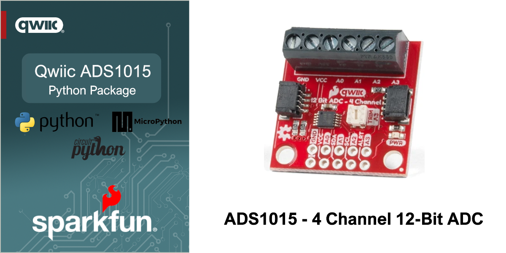

# SparkFun Qwiic ADS1015 - Python Package


[](https://docs.sparkfun.com/Qwiic_Py/qwiic_ads1015/)

The SparkFun Qwiic Analog to Digital Converter ADS1015 Module provides a simple and cost effective solution for adding Analog to Digital Converter capabilities to your project. Implementing a SparkFun Qwiic I2C interface, these sensors can be rapidly added to any project with boards that are part of the SparkFun Qwiic ecosystem.

This package is the Python driver for the ADS1015. It works on CPython (Linux), MicroPython and CircuitPython, and is part of the [SparkFun Qwiic Python package](https://github.com/sparkfun/Qwiic_Py).

## Contents

* [About the Package](#about-the-package)
* [Supported Platforms](#supported-platforms)
* [Installation](#installation)
* [Example Use](#example-use)
* [Documentation](#documentation)
* [Migrating from 2.x](#migrating-from-2x)

## About the Package

This package reads single-ended and differential voltages from the ADS1015 over a single Qwiic cable, and sets its gain, sample rate and comparator. Each feature is demonstrated in the [examples](examples/README.md).

New to Qwiic? Take a look at the entire [SparkFun Qwiic ecosystem](https://www.sparkfun.com/qwiic).

### Supported SparkFun Products

* [SparkFun Analog to Digital Converter Sensor - ADS1015](https://www.sparkfun.com/products/15334)

## Supported Platforms

| Python | Platform | Boards |
| --- | --- | --- |
| CPython | Linux | [Raspberry Pi](https://www.sparkfun.com/raspberry-pi-5-8gb.html), [NVIDIA Jetson Orin Nano](https://www.sparkfun.com/nvidia-jetson-orin-nano-developer-kit.html) via the [SparkFun Qwiic SHIM](https://www.sparkfun.com/sparkfun-qwiic-shim-for-raspberry-pi.html) |
| MicroPython | Raspberry Pi RP2, ESP32 | [SparkFun Pro Micro RP2350](https://www.sparkfun.com/sparkfun-pro-micro-rp2350.html), [SparkFun IoT RedBoard ESP32](https://www.sparkfun.com/sparkfun-iot-redboard-esp32-development-board.html), [SparkFun IoT RedBoard RP2350](https://www.sparkfun.com/sparkfun-iot-redboard-rp2350.html) |
| CircuitPython | Raspberry Pi RP2, ESP32 | [SparkFun Pro Micro RP2350](https://www.sparkfun.com/sparkfun-pro-micro-rp2350.html), [SparkFun IoT RedBoard ESP32](https://www.sparkfun.com/sparkfun-iot-redboard-esp32-development-board.html), [SparkFun IoT RedBoard RP2350](https://www.sparkfun.com/sparkfun-iot-redboard-rp2350.html) |

> [!NOTE]
> These are the primary platforms tested. The package is expected to work on most Python-enabled systems.

## Installation

### CPython (pip)

```sh
python3 -m venv ~/sparkfun_venv
~/sparkfun_venv/bin/pip install sparkfun-qwiic-ads1015
```

Run any example or script that does `import qwiic_ads1015` with `~/sparkfun_venv/bin/python3 example_script.py`.

### MicroPython (mip)

Install [mpremote](https://docs.micropython.org/en/latest/reference/mpremote.html), connect your board, then install the driver (this also installs `qwiic_i2c`):

```sh
mpremote mip install github:sparkfun/Qwiic_Py/drivers/qwiic_ads1015
```

To install the examples too:

```sh
mpremote mip install --target "" github:sparkfun/Qwiic_Py/drivers/qwiic_ads1015/examples
```

Add `@qwiic_ads1015-<version>` to either command to install a specific release.

### CircuitPython (circup)

Install [CircUp](https://docs.circuitpython.org/projects/circup/en/latest/#installation), add the SparkFun Qwiic bundle once, then install the driver:

```sh
circup bundle-add sparkfun/Qwiic_Py
circup install qwiic_ads1015
```

To copy an example to the board:

```sh
circup example qwiic_ads1015/qwiic_ads1015_ex1_read_basic
```

## Example Use

Below is a quickstart program that prints readings from channel A3 of the ADS1015. See the [examples directory](examples) for more, and [examples/README.md](examples/README.md) for a summary of each.

```python
import sys
import qwiic_ads1015
import qwiic_i2c


def run_example():
    print("\nQwiic ADS1015 Example 1 - Basic Readings\n")
    my_ads = qwiic_ads1015.QwiicADS1015()

    if not my_ads.is_connected():
        print("The device isn't connected to the system. Please check your connection", file=sys.stderr)
        return

    my_ads.begin()

    while True:
        print("A3: ", my_ads.get_single_ended(3))
        qwiic_i2c.delay_ms(50)


if __name__ == "__main__":
    try:
        run_example()
    except (KeyboardInterrupt, SystemExit):
        print("\nEnding Example 1")
        sys.exit(0)
```

## Documentation

The API reference is at [docs.sparkfun.com/Qwiic_Py/qwiic_ads1015](https://docs.sparkfun.com/Qwiic_Py/qwiic_ads1015/).

## Migrating from 2.x

Version 3 has one name per method and no properties, so it also runs on MicroPython builds without `property()`. It also fixes four differences from the Arduino library, which change some readings.

| 2.x | 3.0 |
| --- | --- |
| `adc.connected` | `adc.is_connected()` |
| `get_calibration(channel, hiLo)`, `set_calibration(channel, hiLo, value)` | `get_calibration(channel, hi_lo)`, `set_calibration(channel, hi_lo, value)` |
| `get_single_ended()` in the default mode read the result without waiting for the conversion | waits for the conversion, as `get_differential()` does |
| `get_single_ended_signed()` raised `UnboundLocalError` | returns the sign-extended reading |
| `get_single_ended_millivolts()` used the unsigned reading (one count below ground read as 4095 mV) | uses the signed reading, as the Arduino library does |
| `get_last_conversion_results()` read the config register | reads the conversion register |
| `set_comparator_single_ended()` wrote the threshold to the config register | writes it to the high-threshold register |
| `calibrate()` covered channels 0 and 1 only, so `get_scaled_analog_data(2)` and `(3)` raised `IndexError` | all four channels |
| `k`-prefixed constants (`kPointerConvert`, `kPointerConfig`, ...) | UPPER_CASE without the `k` (`POINTER_CONVERT`, `POINTER_CONFIG`, ...); every rename is listed below |

<details>
<summary>Every renamed constant</summary>

| 2.x | 3.0 |
| --- | --- |
| `kPointerConvert` | `POINTER_CONVERT` |
| `kPointerConfig` | `POINTER_CONFIG` |
| `kPointerLowThresh` | `POINTER_LOW_THRESH` |
| `kPointerHiThresh` | `POINTER_HI_THRESH` |
| `kConfigOsNo` | `CONFIG_OS_NO` |
| `kConfigOsSingle` | `CONFIG_OS_SINGLE` |
| `kConfigOsNotReady` | `CONFIG_OS_NOT_READY` |
| `kConfigOsReady` | `CONFIG_OS_READY` |
| `kConfigModeCont` | `CONFIG_MODE_CONT` |
| `kConfigModeSingle` | `CONFIG_MODE_SINGLE` |
| `kConfigMuxSingle0` | `CONFIG_MUX_SINGLE_0` |
| `kConfigMuxSingle1` | `CONFIG_MUX_SINGLE_1` |
| `kConfigMuxSingle2` | `CONFIG_MUX_SINGLE_2` |
| `kConfigMuxSingle3` | `CONFIG_MUX_SINGLE_3` |
| `kConfigMuxDiffP0N1` | `CONFIG_MUX_DIFF_P0N1` |
| `kConfigMuxDiffP0N3` | `CONFIG_MUX_DIFF_P0N3` |
| `kConfigMuxDiffP1N3` | `CONFIG_MUX_DIFF_P1N3` |
| `kConfigMuxDiffP2N3` | `CONFIG_MUX_DIFF_P2N3` |
| `kConfigRateMask` | `CONFIG_RATE_MASK` |
| `kConfigRate128Hz` | `CONFIG_RATE_128HZ` |
| `kConfigRate250Hz` | `CONFIG_RATE_250HZ` |
| `kConfigRate490Hz` | `CONFIG_RATE_490HZ` |
| `kConfigRate920Hz` | `CONFIG_RATE_920HZ` |
| `kConfigRate1600Hz` | `CONFIG_RATE_1600HZ` |
| `kConfigRate2400Hz` | `CONFIG_RATE_2400HZ` |
| `kConfigRate3300Hz` | `CONFIG_RATE_3300HZ` |
| `kConfigPgaMask` | `CONFIG_PGA_MASK` |
| `kConfigPgaTwoThirds` | `CONFIG_PGA_TWO_THIRDS` |
| `kConfigPga1` | `CONFIG_PGA_1` |
| `kConfigPga2` | `CONFIG_PGA_2` |
| `kConfigPga4` | `CONFIG_PGA_4` |
| `kConfigPga8` | `CONFIG_PGA_8` |
| `kConfigPga16` | `CONFIG_PGA_16` |
| `kConfigCmodeTrad` | `CONFIG_CMODE_TRAD` |
| `kConfigCmodeWindow` | `CONFIG_CMODE_WINDOW` |
| `kConfigCpolActvLow` | `CONFIG_CPOL_ACTV_LOW` |
| `kConfigCpolActvHi` | `CONFIG_CPOL_ACTV_HI` |
| `kConfigClatNonLat` | `CONFIG_CLAT_NON_LAT` |
| `kConfigClatLatch` | `CONFIG_CLAT_LATCH` |
| `kConfigCque1Conv` | `CONFIG_CQUE_1_CONV` |
| `kConfigCque2Conv` | `CONFIG_CQUE_2_CONV` |
| `kConfigCque4Conv` | `CONFIG_CQUE_4_CONV` |
| `kConfigCqueNone` | `CONFIG_CQUE_NONE` |

</details>

<p align="center">

</p>
