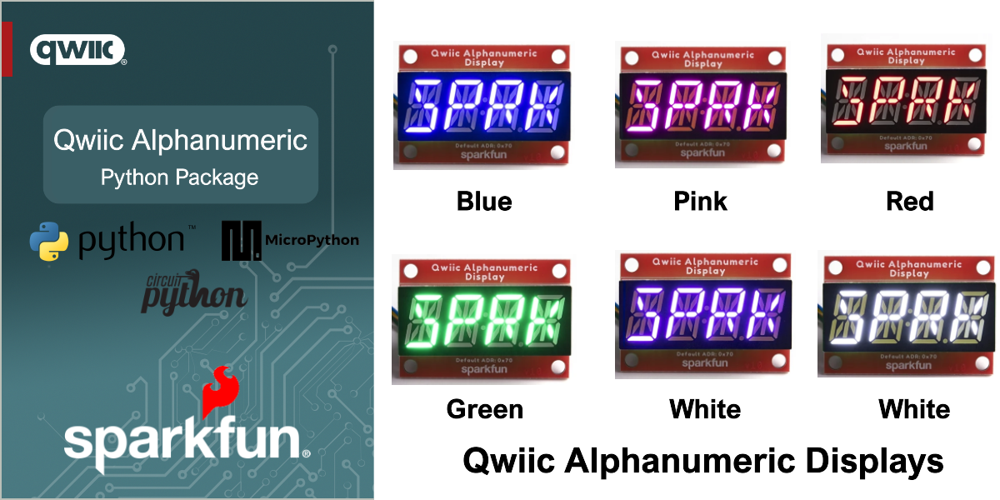

# SparkFun Qwiic Alphanumeric - Python Package


[](https://docs.sparkfun.com/Qwiic_Py/qwiic_alphanumeric/)

The SparkFun Qwiic Alphanumeric Display provides a simple and cost effective solution for adding a four character, 14-segment display to your project. Implementing a SparkFun Qwiic I2C interface, it can be rapidly added to any project with boards that are part of the SparkFun Qwiic ecosystem.

This package is the Python driver for the Qwiic Alphanumeric display (HT16K33). It works on CPython (Linux), MicroPython and CircuitPython, and is part of the [SparkFun Qwiic Python package](https://github.com/sparkfun/Qwiic_Py).

## Contents

* [About the Package](#about-the-package)
* [Supported Platforms](#supported-platforms)
* [Installation](#installation)
* [Example Use](#example-use)
* [Documentation](#documentation)
* [Migrating from 2.x](#migrating-from-2x)

## About the Package

This package prints strings and characters, lights individual segments, the colon and the decimal point, and sets brightness and blink rate on up to four displays over a single Qwiic cable. Each feature is demonstrated in the [examples](examples/README.md).

New to Qwiic? Take a look at the entire [SparkFun Qwiic ecosystem](https://www.sparkfun.com/qwiic).

### Supported SparkFun Products

* [SparkFun Qwiic Alphanumeric Display](https://www.sparkfun.com/products/16916)

## Supported Platforms

| Python | Platform | Boards |
| --- | --- | --- |
| CPython | Linux | [Raspberry Pi](https://www.sparkfun.com/raspberry-pi-5-8gb.html), [NVIDIA Jetson Orin Nano](https://www.sparkfun.com/nvidia-jetson-orin-nano-developer-kit.html) via the [SparkFun Qwiic SHIM](https://www.sparkfun.com/sparkfun-qwiic-shim-for-raspberry-pi.html) |
| MicroPython | Raspberry Pi RP2, ESP32 | [SparkFun Pro Micro RP2350](https://www.sparkfun.com/sparkfun-pro-micro-rp2350.html), [SparkFun IoT RedBoard ESP32](https://www.sparkfun.com/sparkfun-iot-redboard-esp32-development-board.html), [SparkFun IoT RedBoard RP2350](https://www.sparkfun.com/sparkfun-iot-redboard-rp2350.html) |
| CircuitPython | Raspberry Pi RP2, ESP32 | [SparkFun Pro Micro RP2350](https://www.sparkfun.com/sparkfun-pro-micro-rp2350.html), [SparkFun IoT RedBoard ESP32](https://www.sparkfun.com/sparkfun-iot-redboard-esp32-development-board.html), [SparkFun IoT RedBoard RP2350](https://www.sparkfun.com/sparkfun-iot-redboard-rp2350.html) |

> [!NOTE]
> These are the primary platforms tested. The package is expected to work on most Python-enabled systems.

## Installation

### CPython (pip)

```sh
python3 -m venv ~/sparkfun_venv
~/sparkfun_venv/bin/pip install sparkfun-qwiic-alphanumeric
```

Run any example or script that does `import qwiic_alphanumeric` with `~/sparkfun_venv/bin/python3 example_script.py`.

### MicroPython (mip)

Install [mpremote](https://docs.micropython.org/en/latest/reference/mpremote.html), connect your board, then install the driver (this also installs `qwiic_i2c`):

```sh
mpremote mip install github:sparkfun/Qwiic_Py/drivers/qwiic_alphanumeric
```

To install the examples too:

```sh
mpremote mip install --target "" github:sparkfun/Qwiic_Py/drivers/qwiic_alphanumeric/examples
```

Add `@qwiic_alphanumeric-<version>` to either command to install a specific release.

### CircuitPython (circup)

Install [CircUp](https://docs.circuitpython.org/projects/circup/en/latest/#installation), add the SparkFun Qwiic bundle once, then install the driver:

```sh
circup bundle-add sparkfun/Qwiic_Py
circup install qwiic_alphanumeric
```

To copy an example to the board:

```sh
circup example qwiic_alphanumeric/qwiic_alphanumeric_ex1_print_string
```

## Example Use

Below is a quickstart program that prints a string on the display. See the [examples directory](examples) for more, and [examples/README.md](examples/README.md) for a summary of each.

```python
import sys
import qwiic_alphanumeric


print("\nSparkFun Qwiic Alphanumeric - Example 1: Print String")
my_display = qwiic_alphanumeric.QwiicAlphanumeric()

if not my_display.begin():
    print("\nThe Qwiic Alphanumeric isn't connected to the system. Please check your connection.", file=sys.stderr)
    sys.exit(1)

print("\nQwiic Alphanumeric ready!")

my_display.print("Milk")
```

## Documentation

The API reference is at [docs.sparkfun.com/Qwiic_Py/qwiic_alphanumeric](https://docs.sparkfun.com/Qwiic_Py/qwiic_alphanumeric/).

## Migrating from 2.x

Version 3 follows PEP 8 names throughout and adds `__version__`, so `circup` now reports the installed version.

| 2.x | 3.0 |
| --- | --- |
| `write_RAM(address, reg, buff)` | `write_ram(address, reg, buff)` |
| `write_RAM_byte(address, data)` | `write_ram_byte(address, data)` |
| `display.display_RAM` (shared by every instance) | `display.display_ram` (one per instance; `display_content` is also per instance now) |
| `is_connected(display_number)` | `is_connected(display_number=1)`: the display number is optional |
| `begin()` returned `None` on success and always used address 0x70 for the first display | `begin()` returns `True` on success; the first display defaults to the constructor's address |
| `write_ram()`, `write_ram_byte()` returned `None` | They return `True` (a bus error raises `OSError`) |
| `disable_system_clock()` raised `TypeError` | Fixed |
| `update_display()` sent 15 of the 16 display RAM bytes | It sends all 16 |
| Examples `qwiic_alphanumeric_ex01_...` to `ex09_...` | `qwiic_alphanumeric_ex1_...` to `ex9_...` |
| `display_on()` and `display_off()` turned blinking off | they keep the blink rate set with `set_blink_rate()` |

<p align="center">

</p>
