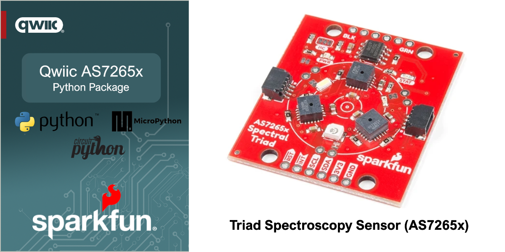

# SparkFun Qwiic AS7265X - Python Package


[](https://docs.sparkfun.com/Qwiic_Py/qwiic_as7265x/)

The SparkFun Qwiic Triad Spectral Sensing AS7265X Module provides a simple and cost effective solution for adding triad spectral sensing to your project. Implementing a SparkFun Qwiic I2C interface, these sensors can be rapidly added to any project with boards that are part of the SparkFun Qwiic ecosystem.

This package is the Python driver for the AS7265X. It works on CPython (Linux), MicroPython and CircuitPython, and is part of the [SparkFun Qwiic Python package](https://github.com/sparkfun/Qwiic_Py).

## Contents

* [About the Package](#about-the-package)
* [Supported Platforms](#supported-platforms)
* [Installation](#installation)
* [Example Use](#example-use)
* [Documentation](#documentation)
* [Migrating from 2.x](#migrating-from-2x)

## About the Package

This package reads all 18 channels of the AS7265X triad, from 410 nm to 940 nm, over a single Qwiic cable, raw or calibrated, and controls its gain, integration cycles, measurement mode and the white, IR and UV LEDs. Each feature is demonstrated in the [examples](examples/README.md).

New to Qwiic? Take a look at the entire [SparkFun Qwiic ecosystem](https://www.sparkfun.com/qwiic).

### Supported SparkFun Products

* [SparkFun Triad Spectroscopy Sensor - AS7265x (Qwiic)](https://www.sparkfun.com/products/15050)

## Supported Platforms

| Python | Platform | Boards |
| --- | --- | --- |
| CPython | Linux | [Raspberry Pi](https://www.sparkfun.com/raspberry-pi-5-8gb.html), [NVIDIA Jetson Orin Nano](https://www.sparkfun.com/nvidia-jetson-orin-nano-developer-kit.html) via the [SparkFun Qwiic SHIM](https://www.sparkfun.com/sparkfun-qwiic-shim-for-raspberry-pi.html) |
| MicroPython | Raspberry Pi RP2, ESP32 | [SparkFun Pro Micro RP2350](https://www.sparkfun.com/sparkfun-pro-micro-rp2350.html), [SparkFun IoT RedBoard ESP32](https://www.sparkfun.com/sparkfun-iot-redboard-esp32-development-board.html), [SparkFun IoT RedBoard RP2350](https://www.sparkfun.com/sparkfun-iot-redboard-rp2350.html) |
| CircuitPython | Raspberry Pi RP2, ESP32 | [SparkFun Pro Micro RP2350](https://www.sparkfun.com/sparkfun-pro-micro-rp2350.html), [SparkFun IoT RedBoard ESP32](https://www.sparkfun.com/sparkfun-iot-redboard-esp32-development-board.html), [SparkFun IoT RedBoard RP2350](https://www.sparkfun.com/sparkfun-iot-redboard-rp2350.html) |

> [!NOTE]
> These are the primary platforms tested. The package is expected to work on most Python-enabled systems.

## Installation

### CPython (pip)

```sh
python3 -m venv ~/sparkfun_venv
~/sparkfun_venv/bin/pip install sparkfun-qwiic-as7265x
```

Run any example or script that does `import qwiic_as7265x` with `~/sparkfun_venv/bin/python3 example_script.py`.

### MicroPython (mip)

Install [mpremote](https://docs.micropython.org/en/latest/reference/mpremote.html), connect your board, then install the driver (this also installs `qwiic_i2c`):

```sh
mpremote mip install github:sparkfun/Qwiic_Py/drivers/qwiic_as7265x
```

To install the examples too:

```sh
mpremote mip install --target "" github:sparkfun/Qwiic_Py/drivers/qwiic_as7265x/examples
```

Add `@qwiic_as7265x-<version>` to either command to install a specific release.

### CircuitPython (circup)

Install [CircUp](https://docs.circuitpython.org/projects/circup/en/latest/#installation), add the SparkFun Qwiic bundle once, then install the driver:

```sh
circup bundle-add sparkfun/Qwiic_Py
circup install qwiic_as7265x
```

To copy an example to the board:

```sh
circup example qwiic_as7265x/qwiic_as7265x_ex1_basic
```

## Example Use

Below is a quickstart program that prints all 18 calibrated channels as comma-separated values. See the [examples directory](examples) for more, and [examples/README.md](examples/README.md) for a summary of each.

```python
import sys
import qwiic_as7265x


print("\nQwiic Spectral Triad Example 1 - Basic\n")
my_as7265x = qwiic_as7265x.QwiicAS7265x()

if not my_as7265x.begin():
    print("Unable to initialize the AS7265x. Please check your connection", file=sys.stderr)
    sys.exit(1)

print("A,B,C,D,E,F,G,H,R,I,S,J,T,U,V,W,K,L")

while True:
    my_as7265x.take_measurements()
    print(",".join(str(value) for value in [
        my_as7265x.get_calibrated_a(), my_as7265x.get_calibrated_b(), my_as7265x.get_calibrated_c(),
        my_as7265x.get_calibrated_d(), my_as7265x.get_calibrated_e(), my_as7265x.get_calibrated_f(),
        my_as7265x.get_calibrated_g(), my_as7265x.get_calibrated_h(), my_as7265x.get_calibrated_r(),
        my_as7265x.get_calibrated_i(), my_as7265x.get_calibrated_s(), my_as7265x.get_calibrated_j(),
        my_as7265x.get_calibrated_t(), my_as7265x.get_calibrated_u(), my_as7265x.get_calibrated_v(),
        my_as7265x.get_calibrated_w(), my_as7265x.get_calibrated_k(), my_as7265x.get_calibrated_l(),
    ]))
```

## Documentation

The API reference is at [docs.sparkfun.com/Qwiic_Py/qwiic_as7265x](https://docs.sparkfun.com/Qwiic_Py/qwiic_as7265x/).

## Migrating from 2.x

Version 3 has one name per method and no properties, so it also runs on MicroPython builds without `property()`.

| 2.x | 3.0 |
| --- | --- |
| `sensor.connected` | `sensor.is_connected()` |
| `set_integration_cycles(cycleValue=...)` | `set_integration_cycles(cycle_value=...)` |
| `get_channel(channelReg, device)`, `get_calibrated_value(calAddress, device)`, `convert_bytes_to_float(myLong)` | `get_channel(channel_reg, device)`, `get_calibrated_value(cal_address, device)`, `convert_bytes_to_float(my_long)` |
| `virtual_read_register(virtualAddr)`, `virtual_write_register(virtualAddr, data)` | `virtual_read_register(virtual_addr)`, `virtual_write_register(virtual_addr, data)` |
| `k`-prefixed constants (`kStatusReg`, `kWriteReg`, ...) | UPPER_CASE without the `k` (`STATUS_REG`, `WRITE_REG`, ...); every rename is listed below |

<details>
<summary>Every renamed constant</summary>

| 2.x | 3.0 |
| --- | --- |
| `kStatusReg` | `STATUS_REG` |
| `kWriteReg` | `WRITE_REG` |
| `kReadReg` | `READ_REG` |
| `kTxValid` | `TX_VALID` |
| `kRxValid` | `RX_VALID` |
| `kHwVersionHigh` | `HW_VERSION_HIGH` |
| `kHwVersionLow` | `HW_VERSION_LOW` |
| `kFwVersionHigh` | `FW_VERSION_HIGH` |
| `kFwVersionLow` | `FW_VERSION_LOW` |
| `kConfig` | `CONFIG` |
| `kIntegrationTime` | `INTEGRATION_TIME` |
| `kDeviceTemp` | `DEVICE_TEMP` |
| `kLedConfig` | `LED_CONFIG` |
| `kRGA` | `RGA` |
| `kSHB` | `SHB` |
| `kTIC` | `TIC` |
| `kUJD` | `UJD` |
| `kVKE` | `VKE` |
| `kWLF` | `WLF` |
| `kRGACal` | `RGA_CAL` |
| `kSHBCal` | `SHB_CAL` |
| `kTICCal` | `TIC_CAL` |
| `kUJDCal` | `UJD_CAL` |
| `kVKECal` | `VKE_CAL` |
| `kWLFCal` | `WLF_CAL` |
| `kDevSelectControl` | `DEV_SELECT_CONTROL` |
| `kCoefData0` | `COEF_DATA0` |
| `kCoefData1` | `COEF_DATA1` |
| `kCoefData2` | `COEF_DATA2` |
| `kCoefData3` | `COEF_DATA3` |
| `kCoefDataRead` | `COEF_DATA_READ` |
| `kCoefDataWrite` | `COEF_DATA_WRITE` |
| `kConfigSRSTShift` | `CONFIG_SRST_SHIFT` |
| `kConfigSRSTMask` | `CONFIG_SRST_MASK` |
| `kConfigIntShift` | `CONFIG_INT_SHIFT` |
| `kConfigIntMask` | `CONFIG_INT_MASK` |
| `kConfigGainShift` | `CONFIG_GAIN_SHIFT` |
| `kConfigGainMask` | `CONFIG_GAIN_MASK` |
| `kConfigModeShift` | `CONFIG_MODE_SHIFT` |
| `kConfigModeMask` | `CONFIG_MODE_MASK` |
| `kConfigDataReadyShift` | `CONFIG_DATA_READY_SHIFT` |
| `kConfigDataReadyMask` | `CONFIG_DATA_READY_MASK` |
| `kConfigFRSTShift` | `CONFIG_FRST_SHIFT` |
| `kConfigFRSTMask` | `CONFIG_FRST_MASK` |
| `kDevSelSecondSlaveShift` | `DEV_SEL_SECOND_SLAVE_SHIFT` |
| `kDevSelSecondSlaveMask` | `DEV_SEL_SECOND_SLAVE_MASK` |
| `kDevSelFirstSlaveShift` | `DEV_SEL_FIRST_SLAVE_SHIFT` |
| `kDevSelFirstSlaveMask` | `DEV_SEL_FIRST_SLAVE_MASK` |
| `kDevSelSelectShift` | `DEV_SEL_SELECT_SHIFT` |
| `kDevSelSelectMask` | `DEV_SEL_SELECT_MASK` |
| `kLedConfigLedDrvShift` | `LED_CONFIG_LED_DRV_SHIFT` |
| `kLedConfigLedDrvMask` | `LED_CONFIG_LED_DRV_MASK` |
| `kLedConfigLedEnableShift` | `LED_CONFIG_LED_ENABLE_SHIFT` |
| `kLedConfigLedEnableMask` | `LED_CONFIG_LED_ENABLE_MASK` |
| `kLedConfigIndCurrentShift` | `LED_CONFIG_IND_CURRENT_SHIFT` |
| `kLedConfigIndCurrentMask` | `LED_CONFIG_IND_CURRENT_MASK` |
| `kLedConfigIndEnableShift` | `LED_CONFIG_IND_ENABLE_SHIFT` |
| `kLedConfigIndEnableMask` | `LED_CONFIG_IND_ENABLE_MASK` |
| `kPollingDelay` | `POLLING_DELAY` |
| `kAS72651Nir` | `AS72651_NIR` |
| `kAS72652Visible` | `AS72652_VISIBLE` |
| `kAS72653Uv` | `AS72653_UV` |
| `kLedWhite` | `LED_WHITE` |
| `kLedIr` | `LED_IR` |
| `kLedUv` | `LED_UV` |
| `kLedCurrentLimit12_5mA` | `LED_CURRENT_LIMIT_12_5MA` |
| `kLedCurrentLimit25mA` | `LED_CURRENT_LIMIT_25MA` |
| `kLedCurrentLimit50mA` | `LED_CURRENT_LIMIT_50MA` |
| `kLedCurrentLimit100mA` | `LED_CURRENT_LIMIT_100MA` |
| `kIndicatorCurrentLimit1mA` | `INDICATOR_CURRENT_LIMIT_1MA` |
| `kIndicatorCurrentLimit2mA` | `INDICATOR_CURRENT_LIMIT_2MA` |
| `kIndicatorCurrentLimit4mA` | `INDICATOR_CURRENT_LIMIT_4MA` |
| `kIndicatorCurrentLimit8mA` | `INDICATOR_CURRENT_LIMIT_8MA` |
| `kGain1x` | `GAIN_1X` |
| `kGain37x` | `GAIN_37X` |
| `kGain16x` | `GAIN_16X` |
| `kGain64x` | `GAIN_64X` |
| `kMeasurementMode4Chan` | `MEASUREMENT_MODE_4CHAN` |
| `kMeasurementMode4Chan2` | `MEASUREMENT_MODE_4CHAN2` |
| `kMeasurementMode6ChanContinuous` | `MEASUREMENT_MODE_6CHAN_CONTINUOUS` |
| `kMeasurementMode6ChanOneShot` | `MEASUREMENT_MODE_6CHAN_ONE_SHOT` |

</details>

<p align="center">

</p>
