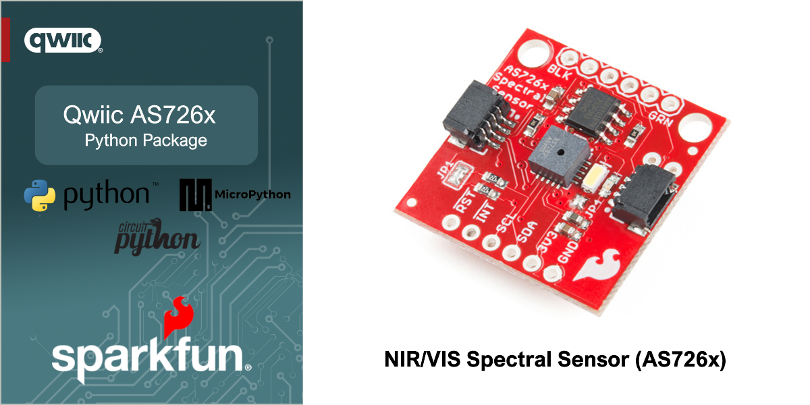

# SparkFun Qwiic AS726X - Python Package


[](https://docs.sparkfun.com/Qwiic_Py/qwiic_as726x/)

The SparkFun Qwiic NIR/VIS Spectral Sensing AS726X Module provides a simple and cost effective solution for adding NIR/VIS spectral sensing to your project. Implementing a SparkFun Qwiic I2C interface, these sensors can be rapidly added to any project with boards that are part of the SparkFun Qwiic ecosystem.

This package is the Python driver for the AS726X. It works on CPython (Linux), MicroPython and CircuitPython, and is part of the [SparkFun Qwiic Python package](https://github.com/sparkfun/Qwiic_Py).

## Contents

* [About the Package](#about-the-package)
* [Supported Platforms](#supported-platforms)
* [Installation](#installation)
* [Example Use](#example-use)
* [Documentation](#documentation)
* [Migrating from 2.x](#migrating-from-2x)

## About the Package

This package reads the six visible (AS7262) or near-infrared (AS7263) channels of the AS726X over a single Qwiic cable, raw or calibrated, and controls its gain, integration time, measurement mode and LEDs. Each feature is demonstrated in the [examples](examples/README.md).

New to Qwiic? Take a look at the entire [SparkFun Qwiic ecosystem](https://www.sparkfun.com/qwiic).

### Supported SparkFun Products

* [SparkFun Spectral Sensor Breakout - AS7262 Visible / AS7263 NIR (Qwiic)](https://www.sparkfun.com/products/14347)

## Supported Platforms

| Python | Platform | Boards |
| --- | --- | --- |
| CPython | Linux | [Raspberry Pi](https://www.sparkfun.com/raspberry-pi-5-8gb.html), [NVIDIA Jetson Orin Nano](https://www.sparkfun.com/nvidia-jetson-orin-nano-developer-kit.html) via the [SparkFun Qwiic SHIM](https://www.sparkfun.com/sparkfun-qwiic-shim-for-raspberry-pi.html) |
| MicroPython | Raspberry Pi RP2, ESP32 | [SparkFun Pro Micro RP2350](https://www.sparkfun.com/sparkfun-pro-micro-rp2350.html), [SparkFun IoT RedBoard ESP32](https://www.sparkfun.com/sparkfun-iot-redboard-esp32-development-board.html), [SparkFun IoT RedBoard RP2350](https://www.sparkfun.com/sparkfun-iot-redboard-rp2350.html) |
| CircuitPython | Raspberry Pi RP2, ESP32 | [SparkFun Pro Micro RP2350](https://www.sparkfun.com/sparkfun-pro-micro-rp2350.html), [SparkFun IoT RedBoard ESP32](https://www.sparkfun.com/sparkfun-iot-redboard-esp32-development-board.html), [SparkFun IoT RedBoard RP2350](https://www.sparkfun.com/sparkfun-iot-redboard-rp2350.html) |

> [!NOTE]
> These are the primary platforms tested. The package is expected to work on most Python-enabled systems.

## Installation

### CPython (pip)

```sh
python3 -m venv ~/sparkfun_venv
~/sparkfun_venv/bin/pip install sparkfun-qwiic-as726x
```

Run any example or script that does `import qwiic_as726x` with `~/sparkfun_venv/bin/python3 example_script.py`.

### MicroPython (mip)

Install [mpremote](https://docs.micropython.org/en/latest/reference/mpremote.html), connect your board, then install the driver (this also installs `qwiic_i2c`):

```sh
mpremote mip install github:sparkfun/Qwiic_Py/drivers/qwiic_as726x
```

To install the examples too:

```sh
mpremote mip install --target "" github:sparkfun/Qwiic_Py/drivers/qwiic_as726x/examples
```

Add `@qwiic_as726x-<version>` to either command to install a specific release.

### CircuitPython (circup)

Install [CircUp](https://docs.circuitpython.org/projects/circup/en/latest/#installation), add the SparkFun Qwiic bundle once, then install the driver:

```sh
circup bundle-add sparkfun/Qwiic_Py
circup install qwiic_as726x
```

To copy an example to the board:

```sh
circup example qwiic_as726x/qwiic_as726x_ex1_basic
```

## Example Use

Below is a quickstart program that prints the calibrated readings for an AS7262 or AS7263. See the [examples directory](examples) for more, and [examples/README.md](examples/README.md) for a summary of each.

```python
import sys
import qwiic_as726x


def run_example():
    print("\nQwiic AS726x Example 1 - Basic\n")
    my_as726x = qwiic_as726x.QwiicAS726x()

    if not my_as726x.begin():
        print("The device isn't connected to the system. Please check your connection", file=sys.stderr)
        return

    while True:
        my_as726x.take_measurements()
        if my_as726x.get_version() == my_as726x.SENSOR_TYPE_AS7262:
            print("V[{}] B[{}] G[{}] Y[{}] O[{}] R[{}]".format(
                my_as726x.get_calibrated_violet(), my_as726x.get_calibrated_blue(),
                my_as726x.get_calibrated_green(), my_as726x.get_calibrated_yellow(),
                my_as726x.get_calibrated_orange(), my_as726x.get_calibrated_red()), end="")
        elif my_as726x.get_version() == my_as726x.SENSOR_TYPE_AS7263:
            print("R[{}] S[{}] T[{}] U[{}] V[{}] W[{}]".format(
                my_as726x.get_calibrated_r(), my_as726x.get_calibrated_s(),
                my_as726x.get_calibrated_t(), my_as726x.get_calibrated_u(),
                my_as726x.get_calibrated_v(), my_as726x.get_calibrated_w()), end="")

        print(" tempF[{}]".format(my_as726x.get_temperature_f()))


if __name__ == "__main__":
    try:
        run_example()
    except (KeyboardInterrupt, SystemExit):
        print("\nEnding Example")
        sys.exit(0)
```

## Documentation

The API reference is at [docs.sparkfun.com/Qwiic_Py/qwiic_as726x](https://docs.sparkfun.com/Qwiic_Py/qwiic_as726x/).

## Migrating from 2.x

Version 3 has one name per method and no properties, so it also runs on MicroPython builds without `property()`.

| 2.x | 3.0 |
| --- | --- |
| `sensor.connected` | `sensor.is_connected()` |
| `get_temperature(device)` (the argument was required but unused) | `get_temperature()` |
| `begin(gain, measurementMode=...)` | `begin(gain, measurement_mode=...)` |
| `set_integration_time(integrationValue=...)` | `set_integration_time(integration_value=...)` |
| `get_channel(channelReg)`, `get_calibrated_value(calAddress)`, `convert_bytes_to_float(myLong)` | `get_channel(channel_reg)`, `get_calibrated_value(cal_address)`, `convert_bytes_to_float(my_long)` |
| `virtual_read_register(virtualAddr)`, `virtual_write_register(virtualAddr, dataToWrite)` | `virtual_read_register(virtual_addr)`, `virtual_write_register(virtual_addr, data_to_write)` |
| `clear_data_available()` wrote to physical register 0x04 instead of the virtual control register | writes the virtual control register, as the Arduino library does |
| `k`-prefixed constants (`kStatusReg`, `kWriteReg`, ...) | UPPER_CASE without the `k` (`STATUS_REG`, `WRITE_REG`, ...); every rename is listed below |

<details>
<summary>Every renamed constant</summary>

| 2.x | 3.0 |
| --- | --- |
| `kStatusReg` | `STATUS_REG` |
| `kWriteReg` | `WRITE_REG` |
| `kReadReg` | `READ_REG` |
| `kTxValid` | `TX_VALID` |
| `kRxValid` | `RX_VALID` |
| `kDeviceType` | `DEVICE_TYPE` |
| `kHwVersion` | `HW_VERSION` |
| `kConfig` | `CONFIG` |
| `kIntegrationTime` | `INTEGRATION_TIME` |
| `kDeviceTemp` | `DEVICE_TEMP` |
| `kLedConfig` | `LED_CONFIG` |
| `kAs7262V` | `AS7262V` |
| `kAs7262B` | `AS7262B` |
| `kAs7262G` | `AS7262G` |
| `kAs7262Y` | `AS7262Y` |
| `kAs7262O` | `AS7262O` |
| `kAs7262R` | `AS7262R` |
| `kAs7262VCal` | `AS7262V_CAL` |
| `kAs7262BCal` | `AS7262B_CAL` |
| `kAs7262GCal` | `AS7262G_CAL` |
| `kAs7262YCal` | `AS7262Y_CAL` |
| `kAs7262OCal` | `AS7262O_CAL` |
| `kAs7262RCal` | `AS7262R_CAL` |
| `kAs7263R` | `AS7263R` |
| `kAs7263S` | `AS7263S` |
| `kAs7263T` | `AS7263T` |
| `kAs7263U` | `AS7263U` |
| `kAs7263V` | `AS7263V` |
| `kAs7263W` | `AS7263W` |
| `kAs7263RCal` | `AS7263R_CAL` |
| `kAs7263SCal` | `AS7263S_CAL` |
| `kAs7263TCal` | `AS7263T_CAL` |
| `kAs7263UCal` | `AS7263U_CAL` |
| `kAs7263VCal` | `AS7263V_CAL` |
| `kAs7263WCal` | `AS7263W_CAL` |
| `kAs7261X` | `AS7261X` |
| `kAs7261Y` | `AS7261Y` |
| `kAs7261Z` | `AS7261Z` |
| `kAs7261Nir` | `AS7261_NIR` |
| `kAs7261Dark` | `AS7261_DARK` |
| `kAs7261Clear` | `AS7261_CLEAR` |
| `kAs7261XCal` | `AS7261X_CAL` |
| `kAs7261YCal` | `AS7261Y_CAL` |
| `kAs7261ZCal` | `AS7261Z_CAL` |
| `kAs7261X1931Cal` | `AS7261X1931_CAL` |
| `kAs7261Y1931Cal` | `AS7261Y1931_CAL` |
| `kAs7261UpriCal` | `AS7261_UPRI_CAL` |
| `kAs7261VpriCal` | `AS7261_VPRI_CAL` |
| `kAs7261UCal` | `AS7261U_CAL` |
| `kAs7261VCal` | `AS7261V_CAL` |
| `kAs7261DuvCal` | `AS7261_DUV_CAL` |
| `kAs7261LuxCal` | `AS7261_LUX_CAL` |
| `kAs7261CctCal` | `AS7261_CCT_CAL` |
| `kSensorTypeAs7261` | `SENSOR_TYPE_AS7261` |
| `kSensorTypeAs7262` | `SENSOR_TYPE_AS7262` |
| `kSensorTypeAs7263` | `SENSOR_TYPE_AS7263` |
| `kPollingDelay` | `POLLING_DELAY` |
| `kMaxRetries` | `MAX_RETRIES` |
| `kTimeout` | `TIMEOUT` |
| `kConfigSRSTShift` | `CONFIG_SRST_SHIFT` |
| `kConfigSRSTMask` | `CONFIG_SRST_MASK` |
| `kConfigIntShift` | `CONFIG_INT_SHIFT` |
| `kConfigIntMask` | `CONFIG_INT_MASK` |
| `kConfigGainShift` | `CONFIG_GAIN_SHIFT` |
| `kConfigGainMask` | `CONFIG_GAIN_MASK` |
| `kConfigModeShift` | `CONFIG_MODE_SHIFT` |
| `kConfigModeMask` | `CONFIG_MODE_MASK` |
| `kConfigDataReadyShift` | `CONFIG_DATA_READY_SHIFT` |
| `kConfigDataReadyMask` | `CONFIG_DATA_READY_MASK` |
| `kConfigFRSTShift` | `CONFIG_FRST_SHIFT` |
| `kConfigFRSTMask` | `CONFIG_FRST_MASK` |
| `kLedConfigLedDrvShift` | `LED_CONFIG_LED_DRV_SHIFT` |
| `kLedConfigLedDrvMask` | `LED_CONFIG_LED_DRV_MASK` |
| `kLedConfigLedEnableShift` | `LED_CONFIG_LED_ENABLE_SHIFT` |
| `kLedConfigLedEnableMask` | `LED_CONFIG_LED_ENABLE_MASK` |
| `kLedConfigIndCurrentShift` | `LED_CONFIG_IND_CURRENT_SHIFT` |
| `kLedConfigIndCurrentMask` | `LED_CONFIG_IND_CURRENT_MASK` |
| `kLedConfigIndEnableShift` | `LED_CONFIG_IND_ENABLE_SHIFT` |
| `kLedConfigIndEnableMask` | `LED_CONFIG_IND_ENABLE_MASK` |
| `kLedCurrentLimit12_5mA` | `LED_CURRENT_LIMIT_12_5MA` |
| `kLedCurrentLimit25mA` | `LED_CURRENT_LIMIT_25MA` |
| `kLedCurrentLimit50mA` | `LED_CURRENT_LIMIT_50MA` |
| `kLedCurrentLimit100mA` | `LED_CURRENT_LIMIT_100MA` |
| `kIndicatorCurrentLimit1mA` | `INDICATOR_CURRENT_LIMIT_1MA` |
| `kIndicatorCurrentLimit2mA` | `INDICATOR_CURRENT_LIMIT_2MA` |
| `kIndicatorCurrentLimit4mA` | `INDICATOR_CURRENT_LIMIT_4MA` |
| `kIndicatorCurrentLimit8mA` | `INDICATOR_CURRENT_LIMIT_8MA` |
| `kGain1x` | `GAIN_1X` |
| `kGain37x` | `GAIN_37X` |
| `kGain16x` | `GAIN_16X` |
| `kGain64x` | `GAIN_64X` |
| `kMeasurementMode4Chan` | `MEASUREMENT_MODE_4CHAN` |
| `kMeasurementMode4Chan2` | `MEASUREMENT_MODE_4CHAN2` |
| `kMeasurementMode6ChanContinuous` | `MEASUREMENT_MODE_6CHAN_CONTINUOUS` |
| `kMeasurementMode6ChanOneShot` | `MEASUREMENT_MODE_6CHAN_ONE_SHOT` |

</details>

<p align="center">

</p>
