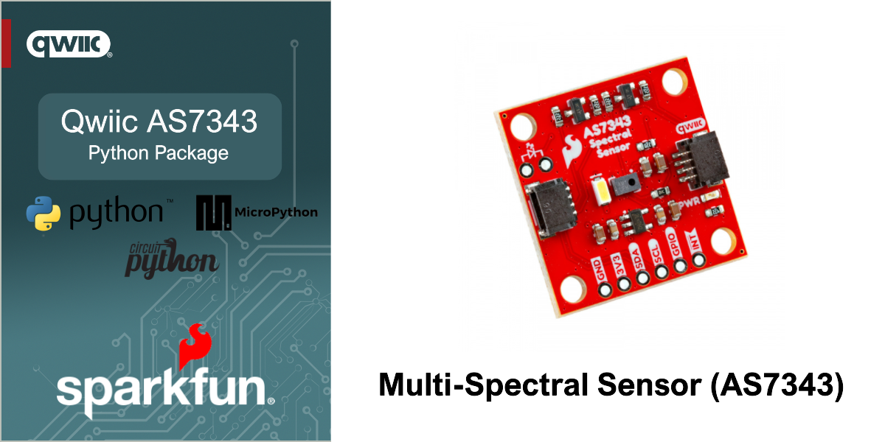

# SparkFun Qwiic AS7343 - Python Package


[](https://docs.sparkfun.com/Qwiic_Py/qwiic_as7343/)

The SparkFun Qwiic Multi-Spectral Sensor AS7343 Module provides a simple and cost effective solution for adding multi-spectral sensing to your project. Implementing a SparkFun Qwiic I2C interface, these sensors can be rapidly added to any project with boards that are part of the SparkFun Qwiic ecosystem.

This package is the Python driver for the AS7343. It works on CPython (Linux), MicroPython and CircuitPython, and is part of the [SparkFun Qwiic Python package](https://github.com/sparkfun/Qwiic_Py).

## Contents

* [About the Package](#about-the-package)
* [Supported Platforms](#supported-platforms)
* [Installation](#installation)
* [Example Use](#example-use)
* [Documentation](#documentation)
* [Migrating from 2.x](#migrating-from-2x)

## About the Package

This package reads RGB, NIR and all 18 spectral channels from the AS7343 over a single Qwiic cable, and controls its gain, LED, flicker detection, interrupts and power modes. Each feature is demonstrated in the [examples](examples/README.md).

New to Qwiic? Take a look at the entire [SparkFun Qwiic ecosystem](https://www.sparkfun.com/qwiic).

### Supported SparkFun Products

* [SparkFun Spectral Sensor - AS7343 (Qwiic)](https://www.sparkfun.com/sparkfun-spectral-sensor-as7343-qwiic.html)

## Supported Platforms

| Python | Platform | Boards |
| --- | --- | --- |
| CPython | Linux | [Raspberry Pi](https://www.sparkfun.com/raspberry-pi-5-8gb.html), [NVIDIA Jetson Orin Nano](https://www.sparkfun.com/nvidia-jetson-orin-nano-developer-kit.html) via the [SparkFun Qwiic SHIM](https://www.sparkfun.com/sparkfun-qwiic-shim-for-raspberry-pi.html) |
| MicroPython | Raspberry Pi RP2, ESP32 | [SparkFun Pro Micro RP2350](https://www.sparkfun.com/sparkfun-pro-micro-rp2350.html), [SparkFun IoT RedBoard ESP32](https://www.sparkfun.com/sparkfun-iot-redboard-esp32-development-board.html), [SparkFun IoT RedBoard RP2350](https://www.sparkfun.com/sparkfun-iot-redboard-rp2350.html) |
| CircuitPython | Raspberry Pi RP2, ESP32 | [SparkFun Pro Micro RP2350](https://www.sparkfun.com/sparkfun-pro-micro-rp2350.html), [SparkFun IoT RedBoard ESP32](https://www.sparkfun.com/sparkfun-iot-redboard-esp32-development-board.html), [SparkFun IoT RedBoard RP2350](https://www.sparkfun.com/sparkfun-iot-redboard-rp2350.html) |

> [!NOTE]
> These are the primary platforms tested. The package is expected to work on most Python-enabled systems.

## Installation

### CPython (pip)

```sh
python3 -m venv ~/sparkfun_venv
~/sparkfun_venv/bin/pip install sparkfun-qwiic-as7343
```

Run any example or script that does `import qwiic_as7343` with `~/sparkfun_venv/bin/python3 example_script.py`.

### MicroPython (mip)

Install [mpremote](https://docs.micropython.org/en/latest/reference/mpremote.html), connect your board, then install the driver (this also installs `qwiic_i2c`):

```sh
mpremote mip install github:sparkfun/Qwiic_Py/drivers/qwiic_as7343
```

To install the examples too:

```sh
mpremote mip install --target "" github:sparkfun/Qwiic_Py/drivers/qwiic_as7343/examples
```

Add `@qwiic_as7343-<version>` to either command to install a specific release.

### CircuitPython (circup)

Install [CircUp](https://docs.circuitpython.org/projects/circup/en/latest/#installation), add the SparkFun Qwiic bundle once, then install the driver:

```sh
circup bundle-add sparkfun/Qwiic_Py
circup install qwiic_as7343
```

To copy an example to the board:

```sh
circup example qwiic_as7343/qwiic_as7343_ex1_basic_readings
```

## Example Use

Below is a quickstart program that prints the blue, red, green and NIR channels. See the [examples directory](examples) for more, and [examples/README.md](examples/README.md) for a summary of each.

```python
import sys
import qwiic_as7343
import qwiic_i2c


def run_example():
    print("\nQwiic AS7343 Example 1 - Basic Readings\n")
    my_as7343 = qwiic_as7343.QwiicAS7343()

    if not my_as7343.begin():
        print("The device isn't connected to the system. Please check your connection", file=sys.stderr)
        return

    my_as7343.power_on()

    if not my_as7343.set_auto_smux(my_as7343.AUTO_SMUX_18_CHANNELS):
        print("Failed to set AutoSmux", file=sys.stderr)
        return

    if not my_as7343.spectral_measurement_enable():
        print("Failed to enable spectral measurements", file=sys.stderr)
        return

    while True:
        my_as7343.set_led_drive(0)  # 0 = 4mA
        my_as7343.set_led_on()
        qwiic_i2c.delay_ms(100)  # Wait for the LED to fully illuminate the target

        my_as7343.read_all_spectral_data()
        my_as7343.set_led_off()

        print(my_as7343.get_blue(), my_as7343.get_red(), my_as7343.get_green(), my_as7343.get_nir(), sep=",")
        qwiic_i2c.delay_ms(500)


if __name__ == "__main__":
    try:
        run_example()
    except (KeyboardInterrupt, SystemExit):
        print("\nEnding Example")
        sys.exit(0)
```

## Documentation

The API reference is at [docs.sparkfun.com/Qwiic_Py/qwiic_as7343](https://docs.sparkfun.com/Qwiic_Py/qwiic_as7343/).

## Migrating from 2.x

Version 3 has one name per method and no properties, so it also runs on MicroPython builds without `property()`.

| 2.x | 3.0 |
| --- | --- |
| `sensor.connected` | `sensor.is_connected()` |
| `is_connected()` printed "Device not connected" / "Device ID mismatch" | returns `False` without printing |
| `set_spectral_int_threshold_high(spThH=...)`, `set_spectral_int_threshold_low(spThL=...)` | `set_spectral_int_threshold_high(sp_th_h=...)`, `set_spectral_int_threshold_low(sp_th_l=...)` |
| `k`-prefixed constants (`kNumChannels`, `kDefaultAS7343DeviceID`, ...) | UPPER_CASE without the `k` (`NUM_CHANNELS`, `DEFAULT_AS7343_DEVICE_ID`, ...); every rename is listed below |

<details>
<summary>Every renamed constant</summary>

| 2.x | 3.0 |
| --- | --- |
| `kNumChannels` | `NUM_CHANNELS` |
| `kDefaultAS7343DeviceID` | `DEFAULT_AS7343_DEVICE_ID` |
| `kRegBank0` | `REG_BANK0` |
| `kRegBank1` | `REG_BANK1` |
| `kChBlueFz450nm` | `CH_BLUE_FZ_450NM` |
| `kChGreenFy555nm` | `CH_GREEN_FY_555NM` |
| `kChOrangeFxl600nm` | `CH_ORANGE_FXL_600NM` |
| `kChNir855nm` | `CH_NIR_855NM` |
| `kChVis1` | `CH_VIS1` |
| `kChFd1` | `CH_FD1` |
| `kChDarkBlueF2425nm` | `CH_DARK_BLUE_F2_425NM` |
| `kChLightBlueF3475nm` | `CH_LIGHT_BLUE_F3_475NM` |
| `kChBlueF4515nm` | `CH_BLUE_F4_515NM` |
| `kChBrownF6640nm` | `CH_BROWN_F6_640NM` |
| `kChVis2` | `CH_VIS2` |
| `kChFd2` | `CH_FD2` |
| `kChPurpleF1405nm` | `CH_PURPLE_F1_405NM` |
| `kChRedF7690nm` | `CH_RED_F7_690NM` |
| `kChDarkRedF8745nm` | `CH_DARK_RED_F8_745NM` |
| `kChGreenF5550nm` | `CH_GREEN_F5_550NM` |
| `kChVis3` | `CH_VIS3` |
| `kChFd3` | `CH_FD3` |
| `kAgain0_5` | `AGAIN_0_5` |
| `kAgain1` | `AGAIN_1` |
| `kAgain2` | `AGAIN_2` |
| `kAgain4` | `AGAIN_4` |
| `kAgain8` | `AGAIN_8` |
| `kAgain16` | `AGAIN_16` |
| `kAgain32` | `AGAIN_32` |
| `kAgain64` | `AGAIN_64` |
| `kAgain128` | `AGAIN_128` |
| `kAgain256` | `AGAIN_256` |
| `kAgain512` | `AGAIN_512` |
| `kAgain1024` | `AGAIN_1024` |
| `kAgain2048` | `AGAIN_2048` |
| `kFdGain0_5` | `FD_GAIN_0_5` |
| `kFdGain1` | `FD_GAIN_1` |
| `kFdGain2` | `FD_GAIN_2` |
| `kFdGain4` | `FD_GAIN_4` |
| `kFdGain8` | `FD_GAIN_8` |
| `kFdGain16` | `FD_GAIN_16` |
| `kFdGain32` | `FD_GAIN_32` |
| `kFdGain64` | `FD_GAIN_64` |
| `kFdGain128` | `FD_GAIN_128` |
| `kFdGain256` | `FD_GAIN_256` |
| `kFdGain512` | `FD_GAIN_512` |
| `kFdGain1024` | `FD_GAIN_1024` |
| `kFdGain2048` | `FD_GAIN_2048` |
| `kFifoThresholdLvl1` | `FIFO_THRESHOLD_LVL_1` |
| `kFifoThresholdLvl4` | `FIFO_THRESHOLD_LVL_4` |
| `kFifoThresholdLvl8` | `FIFO_THRESHOLD_LVL_8` |
| `kFifoThresholdLvl16` | `FIFO_THRESHOLD_LVL_16` |
| `kSpectralThresholdChannel0` | `SPECTRAL_THRESHOLD_CHANNEL_0` |
| `kSpectralThresholdChannel1` | `SPECTRAL_THRESHOLD_CHANNEL_1` |
| `kSpectralThresholdChannel2` | `SPECTRAL_THRESHOLD_CHANNEL_2` |
| `kSpectralThresholdChannel3` | `SPECTRAL_THRESHOLD_CHANNEL_3` |
| `kSpectralThresholdChannel4` | `SPECTRAL_THRESHOLD_CHANNEL_4` |
| `kSpectralThresholdChannel5` | `SPECTRAL_THRESHOLD_CHANNEL_5` |
| `kAutoSmux6Channels` | `AUTO_SMUX_6_CHANNELS` |
| `kAutoSmux12Channels` | `AUTO_SMUX_12_CHANNELS` |
| `kAutoSmux18Channels` | `AUTO_SMUX_18_CHANNELS` |
| `kGpioModeInput` | `GPIO_MODE_INPUT` |
| `kGpioModeOutput` | `GPIO_MODE_OUTPUT` |
| `kGpioOutputLow` | `GPIO_OUTPUT_LOW` |
| `kGpioOutputHigh` | `GPIO_OUTPUT_HIGH` |
| `kRegAuxID` | `REG_AUX_ID` |
| `kShiftAuxID` | `SHIFT_AUX_ID` |
| `kMaskAuxID` | `MASK_AUX_ID` |
| `kRegRevID` | `REG_REV_ID` |
| `kShiftRevID` | `SHIFT_REV_ID` |
| `kMaskRevID` | `MASK_REV_ID` |
| `kRegID` | `REG_ID` |
| `kRegCfg12` | `REG_CFG12` |
| `kShiftCfg12Reserved` | `SHIFT_CFG12_RESERVED` |
| `kShiftCfg12SpThCh` | `SHIFT_CFG12_SP_TH_CH` |
| `kMaskCfg12Reserved` | `MASK_CFG12_RESERVED` |
| `kMaskCfg12SpThCh` | `MASK_CFG12_SP_TH_CH` |
| `kRegEnable` | `REG_ENABLE` |
| `kShiftEnablePon` | `SHIFT_ENABLE_PON` |
| `kShiftEnableSpEn` | `SHIFT_ENABLE_SP_EN` |
| `kShiftEnableWen` | `SHIFT_ENABLE_WEN` |
| `kShiftEnableSmuxEn` | `SHIFT_ENABLE_SMUX_EN` |
| `kShiftEnableFden` | `SHIFT_ENABLE_FDEN` |
| `kShiftEnableEnable` | `SHIFT_ENABLE_ENABLE` |
| `kMaskEnablePon` | `MASK_ENABLE_PON` |
| `kMaskEnableSpEn` | `MASK_ENABLE_SP_EN` |
| `kMaskEnableWen` | `MASK_ENABLE_WEN` |
| `kMaskEnableSmuxEn` | `MASK_ENABLE_SMUX_EN` |
| `kMaskEnableFden` | `MASK_ENABLE_FDEN` |
| `kMaskEnableEnable` | `MASK_ENABLE_ENABLE` |
| `kRegATime` | `REG_A_TIME` |
| `kRegWTime` | `REG_W_TIME` |
| `kRegSpThL` | `REG_SP_TH_L` |
| `kShiftSpThLSpThLsb` | `SHIFT_SP_TH_L_SP_TH_LSB` |
| `kShiftSpThLSpThMsb` | `SHIFT_SP_TH_L_SP_TH_MSB` |
| `kMaskSpThLSpThLsb` | `MASK_SP_TH_L_SP_TH_LSB` |
| `kMaskSpThLSpThMsb` | `MASK_SP_TH_L_SP_TH_MSB` |
| `kRegSpThH` | `REG_SP_TH_H` |
| `kShiftSpThHSpThLsb` | `SHIFT_SP_TH_H_SP_TH_LSB` |
| `kShiftSpThHSpThMsb` | `SHIFT_SP_TH_H_SP_TH_MSB` |
| `kMaskSpThHSpThLsb` | `MASK_SP_TH_H_SP_TH_LSB` |
| `kMaskSpThHSpThMsb` | `MASK_SP_TH_H_SP_TH_MSB` |
| `kRegStatus` | `REG_STATUS` |
| `kShiftStatusSint` | `SHIFT_STATUS_SINT` |
| `kShiftStatusFint` | `SHIFT_STATUS_FINT` |
| `kShiftStatusAint` | `SHIFT_STATUS_AINT` |
| `kShiftStatusAsat` | `SHIFT_STATUS_ASAT` |
| `kMaskStatusSint` | `MASK_STATUS_SINT` |
| `kMaskStatusFint` | `MASK_STATUS_FINT` |
| `kMaskStatusAint` | `MASK_STATUS_AINT` |
| `kMaskStatusAsat` | `MASK_STATUS_ASAT` |
| `kRegAStatus` | `REG_A_STATUS` |
| `kShiftAStatusAgainStatus` | `SHIFT_A_STATUS_AGAIN_STATUS` |
| `kShiftAStatusAsatStatus` | `SHIFT_A_STATUS_ASAT_STATUS` |
| `kMaskAStatusAgainStatus` | `MASK_A_STATUS_AGAIN_STATUS` |
| `kMaskAStatusAsatStatus` | `MASK_A_STATUS_ASAT_STATUS` |
| `kRegData0` | `REG_DATA0` |
| `kRegData1` | `REG_DATA1` |
| `kRegData2` | `REG_DATA2` |
| `kRegData3` | `REG_DATA3` |
| `kRegData4` | `REG_DATA4` |
| `kRegData5` | `REG_DATA5` |
| `kRegData6` | `REG_DATA6` |
| `kRegData7` | `REG_DATA7` |
| `kRegData8` | `REG_DATA8` |
| `kRegData9` | `REG_DATA9` |
| `kRegData10` | `REG_DATA10` |
| `kRegData11` | `REG_DATA11` |
| `kRegData12` | `REG_DATA12` |
| `kRegData13` | `REG_DATA13` |
| `kRegData14` | `REG_DATA14` |
| `kRegData15` | `REG_DATA15` |
| `kRegData16` | `REG_DATA16` |
| `kRegData17` | `REG_DATA17` |
| `kShiftDataLsb` | `SHIFT_DATA_LSB` |
| `kShiftDataMsb` | `SHIFT_DATA_MSB` |
| `kMaskDataLsb` | `MASK_DATA_LSB` |
| `kMaskDataMsb` | `MASK_DATA_MSB` |
| `kRegStatus2` | `REG_STATUS2` |
| `kShiftStatus2FdsatDig` | `SHIFT_STATUS2_FDSAT_DIG` |
| `kShiftStatus2FdsatAna` | `SHIFT_STATUS2_FDSAT_ANA` |
| `kShiftStatus2AsatAna` | `SHIFT_STATUS2_ASAT_ANA` |
| `kShiftStatus2AsatDig` | `SHIFT_STATUS2_ASAT_DIG` |
| `kShiftStatus2Avalid` | `SHIFT_STATUS2_AVALID` |
| `kMaskStatus2FdsatDig` | `MASK_STATUS2_FDSAT_DIG` |
| `kMaskStatus2FdsatAna` | `MASK_STATUS2_FDSAT_ANA` |
| `kMaskStatus2AsatAna` | `MASK_STATUS2_ASAT_ANA` |
| `kMaskStatus2AsatDig` | `MASK_STATUS2_ASAT_DIG` |
| `kMaskStatus2Avalid` | `MASK_STATUS2_AVALID` |
| `kRegStatus3` | `REG_STATUS3` |
| `kShiftStatus3IntSpL` | `SHIFT_STATUS3_INT_SP_L` |
| `kShiftStatus3IntSpH` | `SHIFT_STATUS3_INT_SP_H` |
| `kMaskStatus3IntSpL` | `MASK_STATUS3_INT_SP_L` |
| `kMaskStatus3IntSpH` | `MASK_STATUS3_INT_SP_H` |
| `kRegStatus4` | `REG_STATUS4` |
| `kShiftStatus4IntBusy` | `SHIFT_STATUS4_INT_BUSY` |
| `kShiftStatus4SaiAct` | `SHIFT_STATUS4_SAI_ACT` |
| `kShiftStatus4SpTrig` | `SHIFT_STATUS4_SP_TRIG` |
| `kShiftStatus4FdTrig` | `SHIFT_STATUS4_FD_TRIG` |
| `kShiftStatus4OvTemp` | `SHIFT_STATUS4_OV_TEMP` |
| `kShiftStatus4FifoOv` | `SHIFT_STATUS4_FIFO_OV` |
| `kMaskStatus4IntBusy` | `MASK_STATUS4_INT_BUSY` |
| `kMaskStatus4SaiAct` | `MASK_STATUS4_SAI_ACT` |
| `kMaskStatus4SpTrig` | `MASK_STATUS4_SP_TRIG` |
| `kMaskStatus4FdTrig` | `MASK_STATUS4_FD_TRIG` |
| `kMaskStatus4OvTemp` | `MASK_STATUS4_OV_TEMP` |
| `kMaskStatus4FifoOv` | `MASK_STATUS4_FIFO_OV` |
| `kRegStatus5` | `REG_STATUS5` |
| `kShiftStatus5SintSmux` | `SHIFT_STATUS5_SINT_SMUX` |
| `kShiftStatus5SintFd` | `SHIFT_STATUS5_SINT_FD` |
| `kShiftStatus5Reserved` | `SHIFT_STATUS5_RESERVED` |
| `kShiftStatus5ReservedOne` | `SHIFT_STATUS5_RESERVED_ONE` |
| `kMaskStatus5SintSmux` | `MASK_STATUS5_SINT_SMUX` |
| `kMaskStatus5SintFd` | `MASK_STATUS5_SINT_FD` |
| `kMaskStatus5Reserved` | `MASK_STATUS5_RESERVED` |
| `kMaskStatus5ReservedOne` | `MASK_STATUS5_RESERVED_ONE` |
| `kRegFdStatus` | `REG_FD_STATUS` |
| `kShiftFdStatusFd100HzDet` | `SHIFT_FD_STATUS_FD_100HZ_DET` |
| `kShiftFdStatusFd120HzDet` | `SHIFT_FD_STATUS_FD_120HZ_DET` |
| `kShiftFdStatusFd100HzValid` | `SHIFT_FD_STATUS_FD_100HZ_VALID` |
| `kShiftFdStatusFd120HzValid` | `SHIFT_FD_STATUS_FD_120HZ_VALID` |
| `kShiftFdStatusFdSaturation` | `SHIFT_FD_STATUS_FD_SATURATION` |
| `kShiftFdStatusFdMeasValid` | `SHIFT_FD_STATUS_FD_MEAS_VALID` |
| `kMaskFdStatusFd100HzDet` | `MASK_FD_STATUS_FD_100HZ_DET` |
| `kMaskFdStatusFd120HzDet` | `MASK_FD_STATUS_FD_120HZ_DET` |
| `kMaskFdStatusFd100HzValid` | `MASK_FD_STATUS_FD_100HZ_VALID` |
| `kMaskFdStatusFd120HzValid` | `MASK_FD_STATUS_FD_120HZ_VALID` |
| `kMaskFdStatusFdSaturation` | `MASK_FD_STATUS_FD_SATURATION` |
| `kMaskFdStatusFdMeasValid` | `MASK_FD_STATUS_FD_MEAS_VALID` |
| `kRegCfg0` | `REG_CFG0` |
| `kShiftCfg0Wlong` | `SHIFT_CFG0_WLONG` |
| `kShiftCfg0RegBank` | `SHIFT_CFG0_REG_BANK` |
| `kShiftCfg0LowPower` | `SHIFT_CFG0_LOW_POWER` |
| `kMaskCfg0Wlong` | `MASK_CFG0_WLONG` |
| `kMaskCfg0RegBank` | `MASK_CFG0_REG_BANK` |
| `kMaskCfg0LowPower` | `MASK_CFG0_LOW_POWER` |
| `kRegCfg1` | `REG_CFG1` |
| `kShiftCfg1Again` | `SHIFT_CFG1_AGAIN` |
| `kMaskCfg1Again` | `MASK_CFG1_AGAIN` |
| `kRegCfg3` | `REG_CFG3` |
| `kShiftCfg3Sai` | `SHIFT_CFG3_SAI` |
| `kMaskCfg3Sai` | `MASK_CFG3_SAI` |
| `kRegCfg6` | `REG_CFG6` |
| `kShiftCfg6SmuxCmd` | `SHIFT_CFG6_SMUX_CMD` |
| `kMaskCfg6SmuxCmd` | `MASK_CFG6_SMUX_CMD` |
| `kRegCfg8` | `REG_CFG8` |
| `kShiftCfg8FifoTh` | `SHIFT_CFG8_FIFO_TH` |
| `kMaskCfg8FifoTh` | `MASK_CFG8_FIFO_TH` |
| `kRegCfg9` | `REG_CFG9` |
| `kShiftCfg9SiencSmux` | `SHIFT_CFG9_SIENC_SMUX` |
| `kShiftCfg9SiencFd` | `SHIFT_CFG9_SIENC_FD` |
| `kMaskCfg9SiencSmux` | `MASK_CFG9_SIENC_SMUX` |
| `kMaskCfg9SiencFd` | `MASK_CFG9_SIENC_FD` |
| `kRegCfg10` | `REG_CFG10` |
| `kShiftCfg10FdPers` | `SHIFT_CFG10_FD_PERS` |
| `kMaskCfg10FdPers` | `MASK_CFG10_FD_PERS` |
| `kRegPers` | `REG_PERS` |
| `kShiftPersApers` | `SHIFT_PERS_APERS` |
| `kMaskPersApers` | `MASK_PERS_APERS` |
| `kRegGpio` | `REG_GPIO` |
| `kShiftGpioIn` | `SHIFT_GPIO_IN` |
| `kShiftGpioOut` | `SHIFT_GPIO_OUT` |
| `kShiftGpioInEn` | `SHIFT_GPIO_IN_EN` |
| `kShiftGpioInv` | `SHIFT_GPIO_INV` |
| `kMaskGpioIn` | `MASK_GPIO_IN` |
| `kMaskGpioOut` | `MASK_GPIO_OUT` |
| `kMaskGpioInEn` | `MASK_GPIO_IN_EN` |
| `kMaskGpioInv` | `MASK_GPIO_INV` |
| `kRegAStep` | `REG_A_STEP` |
| `kShiftAStepL` | `SHIFT_A_STEP_L` |
| `kShiftAStepH` | `SHIFT_A_STEP_H` |
| `kMaskAStepL` | `MASK_A_STEP_L` |
| `kMaskAStepH` | `MASK_A_STEP_H` |
| `kRegCfg20` | `REG_CFG20` |
| `kShiftCfg20AutoSmux` | `SHIFT_CFG20_AUTO_SMUX` |
| `kShiftCfg20FdFifo8b` | `SHIFT_CFG20_FD_FIFO8B` |
| `kMaskCfg20AutoSmux` | `MASK_CFG20_AUTO_SMUX` |
| `kMaskCfg20FdFifo8b` | `MASK_CFG20_FD_FIFO8B` |
| `kRegLed` | `REG_LED` |
| `kShiftLedDrive` | `SHIFT_LED_DRIVE` |
| `kShiftLedAct` | `SHIFT_LED_ACT` |
| `kMaskLedDrive` | `MASK_LED_DRIVE` |
| `kMaskLedAct` | `MASK_LED_ACT` |
| `kRegAgcGainMax` | `REG_AGC_GAIN_MAX` |
| `kShiftAgcGainMax` | `SHIFT_AGC_GAIN_MAX` |
| `kMaskAgcGainMax` | `MASK_AGC_GAIN_MAX` |
| `kRegAzConfig` | `REG_AZ_CONFIG` |
| `kRegFdTime1` | `REG_FD_TIME1` |
| `kRegFdTime2` | `REG_FD_TIME2` |
| `kShiftFdTime2FdTimeH` | `SHIFT_FD_TIME2_FD_TIME_H` |
| `kShiftFdTime2FdGain` | `SHIFT_FD_TIME2_FD_GAIN` |
| `kMaskFdTime2FdTimeH` | `MASK_FD_TIME2_FD_TIME_H` |
| `kMaskFdTime2FdGain` | `MASK_FD_TIME2_FD_GAIN` |
| `kRegFdTimeCfg0` | `REG_FD_TIME_CFG0` |
| `kShiftFdTimeCfg0FifoWriteFd` | `SHIFT_FD_TIME_CFG0_FIFO_WRITE_FD` |
| `kMaskFdTimeCfg0FifoWriteFd` | `MASK_FD_TIME_CFG0_FIFO_WRITE_FD` |
| `kRegIntEnab` | `REG_INT_ENAB` |
| `kShiftIntEnabSein` | `SHIFT_INT_ENAB_SEIN` |
| `kShiftIntEnabFien` | `SHIFT_INT_ENAB_FIEN` |
| `kShiftIntEnabSpIen` | `SHIFT_INT_ENAB_SP_IEN` |
| `kShiftIntEnabAsien` | `SHIFT_INT_ENAB_ASIEN` |
| `kMaskIntEnabSein` | `MASK_INT_ENAB_SEIN` |
| `kMaskIntEnabFien` | `MASK_INT_ENAB_FIEN` |
| `kMaskIntEnabSpIen` | `MASK_INT_ENAB_SP_IEN` |
| `kMaskIntEnabAsien` | `MASK_INT_ENAB_ASIEN` |
| `kRegControl` | `REG_CONTROL` |
| `kShiftControlClearSaiAct` | `SHIFT_CONTROL_CLEAR_SAI_ACT` |
| `kShiftControlFifoClr` | `SHIFT_CONTROL_FIFO_CLR` |
| `kShiftControlSpManAz` | `SHIFT_CONTROL_SP_MAN_AZ` |
| `kShiftControlSwReset` | `SHIFT_CONTROL_SW_RESET` |
| `kMaskControlClearSaiAct` | `MASK_CONTROL_CLEAR_SAI_ACT` |
| `kMaskControlFifoClr` | `MASK_CONTROL_FIFO_CLR` |
| `kMaskControlSpManAz` | `MASK_CONTROL_SP_MAN_AZ` |
| `kMaskControlSwReset` | `MASK_CONTROL_SW_RESET` |
| `kRegFifoMap` | `REG_FIFO_MAP` |
| `kShiftFifoMapFifoWriteAStatus` | `SHIFT_FIFO_MAP_FIFO_WRITE_A_STATUS` |
| `kShiftFifoMapFifoWriteCh0Data` | `SHIFT_FIFO_MAP_FIFO_WRITE_CH0_DATA` |
| `kShiftFifoMapFifoWriteCh1Data` | `SHIFT_FIFO_MAP_FIFO_WRITE_CH1_DATA` |
| `kShiftFifoMapFifoWriteCh2Data` | `SHIFT_FIFO_MAP_FIFO_WRITE_CH2_DATA` |
| `kShiftFifoMapFifoWriteCh3Data` | `SHIFT_FIFO_MAP_FIFO_WRITE_CH3_DATA` |
| `kShiftFifoMapFifoWriteCh4Data` | `SHIFT_FIFO_MAP_FIFO_WRITE_CH4_DATA` |
| `kShiftFifoMapFifoWriteCh5Data` | `SHIFT_FIFO_MAP_FIFO_WRITE_CH5_DATA` |
| `kMaskFifoMapFifoWriteAStatus` | `MASK_FIFO_MAP_FIFO_WRITE_A_STATUS` |
| `kMaskFifoMapFifoWriteCh0Data` | `MASK_FIFO_MAP_FIFO_WRITE_CH0_DATA` |
| `kMaskFifoMapFifoWriteCh1Data` | `MASK_FIFO_MAP_FIFO_WRITE_CH1_DATA` |
| `kMaskFifoMapFifoWriteCh2Data` | `MASK_FIFO_MAP_FIFO_WRITE_CH2_DATA` |
| `kMaskFifoMapFifoWriteCh3Data` | `MASK_FIFO_MAP_FIFO_WRITE_CH3_DATA` |
| `kMaskFifoMapFifoWriteCh4Data` | `MASK_FIFO_MAP_FIFO_WRITE_CH4_DATA` |
| `kMaskFifoMapFifoWriteCh5Data` | `MASK_FIFO_MAP_FIFO_WRITE_CH5_DATA` |
| `kRegFifoLvl` | `REG_FIFO_LVL` |
| `kRegFData` | `REG_F_DATA` |
| `kShiftFDataL` | `SHIFT_F_DATA_L` |
| `kShiftFDataH` | `SHIFT_F_DATA_H` |
| `kMaskFDataL` | `MASK_F_DATA_L` |
| `kMaskFDataH` | `MASK_F_DATA_H` |

</details>

<p align="center">

</p>
