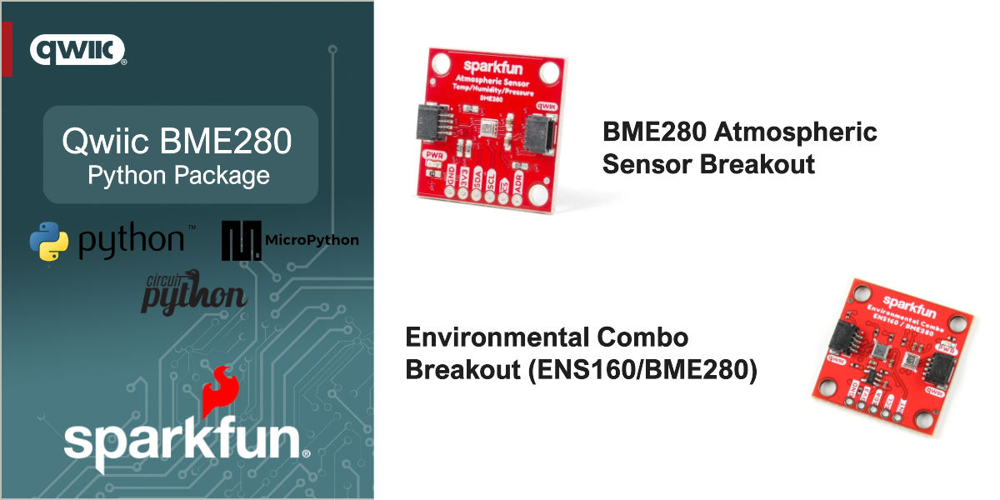

# SparkFun Qwiic BME280 - Python Package


[](https://docs.sparkfun.com/Qwiic_Py/qwiic_bme280/)

The SparkFun Qwiic BME280 Atmospheric Sensor and BME280/ENS160 Environmental Combo Breakout Boards provide a simple and cost effective solution for adding atmospheric sensing to your project. Implementing a SparkFun Qwiic I2C interface, these sensors can be rapidly added to any project with boards that are part of the SparkFun Qwiic ecosystem.

This package is the Python driver for the BME280. It works on CPython (Linux), MicroPython and CircuitPython, and is part of the [SparkFun Qwiic Python package](https://github.com/sparkfun/Qwiic_Py).

## Contents

* [About the Package](#about-the-package)
* [Supported Platforms](#supported-platforms)
* [Installation](#installation)
* [Example Use](#example-use)
* [Documentation](#documentation)
* [Migrating from 2.x](#migrating-from-2x)

## About the Package

This package reads humidity, pressure, altitude and temperature from the BME280 over a single Qwiic cable, and configures its oversampling, filtering and standby settings. Each feature is demonstrated in the [examples](examples/README.md).

New to Qwiic? Take a look at the entire [SparkFun Qwiic ecosystem](https://www.sparkfun.com/qwiic).

### Supported SparkFun Products

* [SparkFun Atmospheric Sensor Breakout - BME280](https://www.sparkfun.com/sparkfun-atmospheric-sensor-breakout-bme280-qwiic.html)
* [SparkFun Environmental Combo Breakout - ENS160/BME280](https://www.sparkfun.com/sparkfun-environmental-combo-breakout-ens160-bme280-qwiic.html)

## Supported Platforms

| Python | Platform | Boards |
| --- | --- | --- |
| CPython | Linux | [Raspberry Pi](https://www.sparkfun.com/raspberry-pi-5-8gb.html), [NVIDIA Jetson Orin Nano](https://www.sparkfun.com/nvidia-jetson-orin-nano-developer-kit.html) via the [SparkFun Qwiic SHIM](https://www.sparkfun.com/sparkfun-qwiic-shim-for-raspberry-pi.html) |
| MicroPython | Raspberry Pi RP2, ESP32 | [SparkFun Pro Micro RP2350](https://www.sparkfun.com/sparkfun-pro-micro-rp2350.html), [SparkFun IoT RedBoard ESP32](https://www.sparkfun.com/sparkfun-iot-redboard-esp32-development-board.html), [SparkFun IoT RedBoard RP2350](https://www.sparkfun.com/sparkfun-iot-redboard-rp2350.html) |
| CircuitPython | Raspberry Pi RP2, ESP32 | [SparkFun Pro Micro RP2350](https://www.sparkfun.com/sparkfun-pro-micro-rp2350.html), [SparkFun IoT RedBoard ESP32](https://www.sparkfun.com/sparkfun-iot-redboard-esp32-development-board.html), [SparkFun IoT RedBoard RP2350](https://www.sparkfun.com/sparkfun-iot-redboard-rp2350.html) |

> [!NOTE]
> These are the primary platforms tested. The package is expected to work on most Python-enabled systems.

## Installation

### CPython (pip)

```sh
python3 -m venv ~/sparkfun_venv
~/sparkfun_venv/bin/pip install sparkfun-qwiic-bme280
```

Run any example or script that does `import qwiic_bme280` with `~/sparkfun_venv/bin/python3 example_script.py`.

### MicroPython (mip)

Install [mpremote](https://docs.micropython.org/en/latest/reference/mpremote.html), connect your board, then install the driver (this also installs `qwiic_i2c`):

```sh
mpremote mip install github:sparkfun/Qwiic_Py/drivers/qwiic_bme280
```

To install the examples too:

```sh
mpremote mip install --target "" github:sparkfun/Qwiic_Py/drivers/qwiic_bme280/examples
```

Add `@qwiic_bme280-<version>` to either command to install a specific release.

### CircuitPython (circup)

Install [CircUp](https://docs.circuitpython.org/projects/circup/en/latest/#installation), add the SparkFun Qwiic bundle once, then install the driver:

```sh
circup bundle-add sparkfun/Qwiic_Py
circup install qwiic_bme280
```

To copy an example to the board:

```sh
circup example qwiic_bme280/qwiic_bme280_ex1_basic_readings
```

## Example Use

Below is a quickstart program that prints humidity, pressure, altitude and temperature. See the [examples directory](examples) for more, and [examples/README.md](examples/README.md) for a summary of each.

```python
import sys
import qwiic_bme280
import qwiic_i2c


def run_example():
    print("\nSparkFun BME280 Sensor Example 1\n")
    my_sensor = qwiic_bme280.QwiicBME280()

    if not my_sensor.is_connected():
        print("The Qwiic BME280 device isn't connected to the system. Please check your connection", file=sys.stderr)
        return

    my_sensor.begin()

    while True:
        print("Humidity:\t%.3f" % my_sensor.read_humidity())
        print("Pressure:\t%.3f" % my_sensor.read_pressure())
        print("Altitude:\t%.3f" % my_sensor.get_altitude_feet())
        print("Temperature:\t%.2f\n" % my_sensor.get_temperature_fahrenheit())
        qwiic_i2c.delay_ms(1000)


if __name__ == "__main__":
    try:
        run_example()
    except (KeyboardInterrupt, SystemExit):
        print("\nEnding Example 1")
        sys.exit(0)
```

## Documentation

The API reference is at [docs.sparkfun.com/Qwiic_Py/qwiic_bme280](https://docs.sparkfun.com/Qwiic_Py/qwiic_bme280/).

## Migrating from 2.x

Version 3 has one name per method and no properties, so it also runs on MicroPython builds without `property()`.

| 2.x | 3.0 |
| --- | --- |
| `QwiicBme280` | `QwiicBME280` |
| `sensor.connected` | `sensor.is_connected()` |
| `sensor.humidity` | `sensor.read_humidity()` |
| `sensor.pressure` | `sensor.read_pressure()` |
| `sensor.temperature_celsius`, `sensor.temperature_fahrenheit` | `sensor.get_temperature_celsius()`, `sensor.get_temperature_fahrenheit()` |
| `sensor.altitude_meters`, `sensor.altitude_feet` | `sensor.get_altitude_meters()`, `sensor.get_altitude_feet()` |
| `sensor.dewpoint_celsius`, `sensor.dewpoint_fahrenheit` | `sensor.get_dewpoint_celsius()`, `sensor.get_dewpoint_fahrenheit()` |
| `sensor.reference_pressure` (get / set) | `sensor.get_reference_pressure()`, `sensor.set_reference_pressure(p)` |
| `sensor.mode` (get / set) | `sensor.get_mode()`, `sensor.set_mode(m)` |
| `sensor.filter = f`, `sensor.standby_time = t` | `sensor.set_filter(f)`, `sensor.set_standby_time(t)` |
| `sensor.pressure_oversample = n`, `sensor.humidity_oversample = n` | `sensor.set_pressure_oversample(n)`, `sensor.set_humidity_oversample(n)` |
| `sensor.tempature_oversample = n`, `set_tempature_oversample(n)` | `sensor.set_temperature_oversample(n)` |
| `begin()` printed "Invalid Chip ID" | `begin()` returns `False` without printing |
| `begin()` raised `OSError` when no device answered | `begin()` returns `False` |

<p align="center">

</p>
