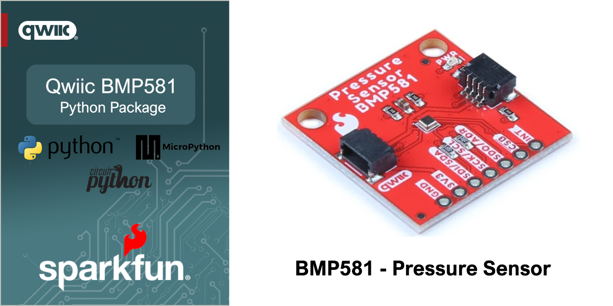

# SparkFun Qwiic BMP581 - Python Package


[](https://docs.sparkfun.com/Qwiic_Py/qwiic_bmp581/)

The SparkFun Qwiic Pressure Sensor BMP581 provides a simple and cost effective solution for adding high accuracy barometric pressure and temperature sensing to your project. Implementing a SparkFun Qwiic I2C interface, these sensors can be rapidly added to any project with boards that are part of the SparkFun Qwiic ecosystem.

This package is the Python driver for the BMP581. It works on CPython (Linux), MicroPython and CircuitPython, and is part of the [SparkFun Qwiic Python package](https://github.com/sparkfun/Qwiic_Py).

## Contents

* [About the Package](#about-the-package)
* [Supported Platforms](#supported-platforms)
* [Installation](#installation)
* [Example Use](#example-use)
* [Documentation](#documentation)
* [Migrating from 2.x](#migrating-from-2x)

## About the Package

This package reads pressure and temperature from the BMP581 over a single Qwiic cable, and sets its filtering, oversampling, output data rate, power modes, interrupts, FIFO and user NVM. Each feature is demonstrated in the [examples](examples/README.md).

New to Qwiic? Take a look at the entire [SparkFun Qwiic ecosystem](https://www.sparkfun.com/qwiic).

### Supported SparkFun Products

* [SparkFun Pressure Sensor - BMP581](https://www.sparkfun.com/sparkfun-pressure-sensor-bmp581-qwiic.html)
* [SparkFun Micro Pressure Sensor - BMP581](https://www.sparkfun.com/sparkfun-micro-pressure-sensor-bmp581-qwiic.html)

## Supported Platforms

| Python | Platform | Boards |
| --- | --- | --- |
| CPython | Linux | [Raspberry Pi](https://www.sparkfun.com/raspberry-pi-5-8gb.html), [NVIDIA Jetson Orin Nano](https://www.sparkfun.com/nvidia-jetson-orin-nano-developer-kit.html) via the [SparkFun Qwiic SHIM](https://www.sparkfun.com/sparkfun-qwiic-shim-for-raspberry-pi.html) |
| MicroPython | Raspberry Pi RP2, ESP32 | [SparkFun Pro Micro RP2350](https://www.sparkfun.com/sparkfun-pro-micro-rp2350.html), [SparkFun IoT RedBoard ESP32](https://www.sparkfun.com/sparkfun-iot-redboard-esp32-development-board.html), [SparkFun IoT RedBoard RP2350](https://www.sparkfun.com/sparkfun-iot-redboard-rp2350.html) |
| CircuitPython | Raspberry Pi RP2, ESP32 | [SparkFun Pro Micro RP2350](https://www.sparkfun.com/sparkfun-pro-micro-rp2350.html), [SparkFun IoT RedBoard ESP32](https://www.sparkfun.com/sparkfun-iot-redboard-esp32-development-board.html), [SparkFun IoT RedBoard RP2350](https://www.sparkfun.com/sparkfun-iot-redboard-rp2350.html) |

> [!NOTE]
> These are the primary platforms tested. The package is expected to work on most Python-enabled systems.

## Installation

### CPython (pip)

```sh
python3 -m venv ~/sparkfun_venv
~/sparkfun_venv/bin/pip install sparkfun-qwiic-bmp581
```

Run any example or script that does `import qwiic_bmp581` with `~/sparkfun_venv/bin/python3 example_script.py`.

### MicroPython (mip)

Install [mpremote](https://docs.micropython.org/en/latest/reference/mpremote.html), connect your board, then install the driver (this also installs `qwiic_i2c`):

```sh
mpremote mip install github:sparkfun/Qwiic_Py/drivers/qwiic_bmp581
```

To install the examples too:

```sh
mpremote mip install --target "" github:sparkfun/Qwiic_Py/drivers/qwiic_bmp581/examples
```

Add `@qwiic_bmp581-<version>` to either command to install a specific release.

### CircuitPython (circup)

Install [CircUp](https://docs.circuitpython.org/projects/circup/en/latest/#installation), add the SparkFun Qwiic bundle once, then install the driver:

```sh
circup bundle-add sparkfun/Qwiic_Py
circup install qwiic_bmp581
```

To copy an example to the board:

```sh
circup example qwiic_bmp581/qwiic_bmp581_ex1_basic
```

## Example Use

Below is a quickstart program that prints temperature and pressure readings. See the [examples directory](examples) for more, and [examples/README.md](examples/README.md) for a summary of each.

```python
import sys
import qwiic_bmp581
import qwiic_i2c


print("\nQwiic BMP581 Example 1 - Basic Readings\n")
my_bmp581 = qwiic_bmp581.QwiicBMP581()

if not my_bmp581.is_connected():
    print("The device isn't connected to the system. Please check your connection", file=sys.stderr)
    sys.exit(1)

if not my_bmp581.begin():
    print("Unable to Initialize device! Please check your connection and try again.", file=sys.stderr)
    sys.exit(1)

while True:
    data = my_bmp581.get_sensor_data()
    print("Temperature (C): ", data.temperature, end="\t\t")
    print("Pressure (Pa): ", data.pressure)
    qwiic_i2c.delay_ms(1000)
```

## Documentation

The API reference is at [docs.sparkfun.com/Qwiic_Py/qwiic_bmp581](https://docs.sparkfun.com/Qwiic_Py/qwiic_bmp581/).

## Migrating from 2.x

Version 3 has no properties, so it also runs on MicroPython builds without `property()`. The method names are unchanged; the camelCase arguments are now snake_case, and the constants are UPPER_CASE without the `k` prefix. The fields of the configuration classes (`OsrOdrPressConfig.osrT`, `IirConfig.setIirT`, ...) keep their names.

| 2.x | 3.0 |
| --- | --- |
| `sensor.connected` | `sensor.is_connected()` |
| `intSourceSelect` | `IntSourceSelect` |
| `set_power_mode(powerMode)` | `set_power_mode(power_mode)` |
| `configure_interrupt(intMode, intPol, intOd, intEn)` | `configure_interrupt(int_mode, int_pol, int_od, int_en)` |
| `extract_fifo_data(fifo, sensorData)` | `extract_fifo_data(fifo, sensor_data)` |
| `nvm_read(nvmAddr)`, `nvm_write(nvmAddr, nvmWriteData)` | `nvm_read(nvm_addr)`, `nvm_write(nvm_addr, nvm_write_data)` |
| `FifoConfig.kFifoNotEnabled` ... `kFifoPressTempData` were 1 to 4 | `FifoConfig.FIFO_NOT_ENABLED` ... `FIFO_PRESS_TEMP_DATA` are 0 to 3, the values the sensor uses |
| `set_fifo_configuration()` read `fifo.decimation` | reads `fifo.decSel`, and returns `ERROR` if the threshold is too large for the frame type |
| `kChipId`, `kDeepDisableMask`, `kDeepDisableShift`, `kDeepDisabled` | `CHIP_ID`, `DEEP_DISABLE_MASK`, `DEEP_DISABLE_SHIFT`, `DEEP_DISABLED` |
| `kDeepEnabled`, `kDelayUsNvmReadyRead`, `kDelayUsNvmReadyWrite`, `kDelayUsSoftReset` | `DEEP_ENABLED`, `DELAY_US_NVM_READY_READ`, `DELAY_US_NVM_READY_WRITE`, `DELAY_US_SOFT_RESET` |
| `kDelayUsStandby`, `kDisable`, `kEnable`, `kError` | `DELAY_US_STANDBY`, `DISABLE`, `ENABLE`, `ERROR` |
| `kFifoCountMask`, `kFifoCountShift`, `kFifoDecSelMask`, `kFifoDecSelShift` | `FIFO_COUNT_MASK`, `FIFO_COUNT_SHIFT`, `FIFO_DEC_SEL_MASK`, `FIFO_DEC_SEL_SHIFT` |
| `kFifoDownsampling128x`, `kFifoDownsampling16x`, `kFifoDownsampling2x`, `kFifoDownsampling32x` | `FIFO_DOWNSAMPLING_128X`, `FIFO_DOWNSAMPLING_16X`, `FIFO_DOWNSAMPLING_2X`, `FIFO_DOWNSAMPLING_32X` |
| `kFifoDownsampling4x`, `kFifoDownsampling64x`, `kFifoDownsampling8x`, `kFifoEmpty` | `FIFO_DOWNSAMPLING_4X`, `FIFO_DOWNSAMPLING_64X`, `FIFO_DOWNSAMPLING_8X`, `FIFO_EMPTY` |
| `kFifoFrameSelMask`, `kFifoFrameSelShift`, `kFifoMaxThresholdPMode`, `kFifoMaxThresholdPTMode` | `FIFO_FRAME_SEL_MASK`, `FIFO_FRAME_SEL_SHIFT`, `FIFO_MAX_THRESHOLD_P_MODE`, `FIFO_MAX_THRESHOLD_PT_MODE` |
| `kFifoModeMask`, `kFifoModeShift`, `kFifoModeStopOnFull`, `kFifoModeStreaming` | `FIFO_MODE_MASK`, `FIFO_MODE_SHIFT`, `FIFO_MODE_STOP_ON_FULL`, `FIFO_MODE_STREAMING` |
| `kFifoNoDownsampling`, `kFifoNotEnabled`, `kFifoPressTempData`, `kFifoPressureData` | `FIFO_NO_DOWNSAMPLING`, `FIFO_NOT_ENABLED`, `FIFO_PRESS_TEMP_DATA`, `FIFO_PRESSURE_DATA` |
| `kFifoTemperatureData`, `kFifoThresholdMask`, `kFifoThresholdShift`, `kIirBypass` | `FIFO_TEMPERATURE_DATA`, `FIFO_THRESHOLD_MASK`, `FIFO_THRESHOLD_SHIFT`, `IIR_BYPASS` |
| `kIirFilterBypass`, `kIirFilterCoeff1`, `kIirFilterCoeff127`, `kIirFilterCoeff15` | `IIR_FILTER_BYPASS`, `IIR_FILTER_COEFF_1`, `IIR_FILTER_COEFF_127`, `IIR_FILTER_COEFF_15` |
| `kIirFilterCoeff3`, `kIirFilterCoeff31`, `kIirFilterCoeff63`, `kIirFilterCoeff7` | `IIR_FILTER_COEFF_3`, `IIR_FILTER_COEFF_31`, `IIR_FILTER_COEFF_63`, `IIR_FILTER_COEFF_7` |
| `kIirFlushForcedEnMask`, `kIirFlushForcedEnShift`, `kIntAssertedDrdy`, `kIntAssertedFifoFull` | `IIR_FLUSH_FORCED_EN_MASK`, `IIR_FLUSH_FORCED_EN_SHIFT`, `INT_ASSERTED_DRDY`, `INT_ASSERTED_FIFO_FULL` |
| `kIntAssertedFifoThres`, `kIntAssertedPorSoftresetComplete`, `kIntAssertedPressureOor`, `kIntDrdyEnMask` | `INT_ASSERTED_FIFO_THRES`, `INT_ASSERTED_POR_SOFTRESET_COMPLETE`, `INT_ASSERTED_PRESSURE_OOR`, `INT_DRDY_EN_MASK` |
| `kIntDrdyEnShift`, `kIntEnMask`, `kIntEnShift`, `kIntFifoFullEnMask` | `INT_DRDY_EN_SHIFT`, `INT_EN_MASK`, `INT_EN_SHIFT`, `INT_FIFO_FULL_EN_MASK` |
| `kIntFifoFullEnShift`, `kIntFifoThresEnMask`, `kIntFifoThresEnShift`, `kIntModeLatched` | `INT_FIFO_FULL_EN_SHIFT`, `INT_FIFO_THRES_EN_MASK`, `INT_FIFO_THRES_EN_SHIFT`, `INT_MODE_LATCHED` |
| `kIntModeMask`, `kIntModePulsed`, `kIntModeShift`, `kIntNvmCmdErr` | `INT_MODE_MASK`, `INT_MODE_PULSED`, `INT_MODE_SHIFT`, `INT_NVM_CMD_ERR` |
| `kIntNvmErr`, `kIntNvmRdy`, `kIntOdMask`, `kIntOdOpenDrain` | `INT_NVM_ERR`, `INT_NVM_RDY`, `INT_OD_MASK`, `INT_OD_OPEN_DRAIN` |
| `kIntOdPushPull`, `kIntOdShift`, `kIntOorPressEnMask`, `kIntOorPressEnShift` | `INT_OD_PUSH_PULL`, `INT_OD_SHIFT`, `INT_OOR_PRESS_EN_MASK`, `INT_OOR_PRESS_EN_SHIFT` |
| `kIntPolActiveHigh`, `kIntPolActiveLow`, `kIntPolMask`, `kIntPolShift` | `INT_POL_ACTIVE_HIGH`, `INT_POL_ACTIVE_LOW`, `INT_POL_MASK`, `INT_POL_SHIFT` |
| `kNoError`, `kNvmAddrMask`, `kNvmAddrShift`, `kNvmDataLsbMask` | `NO_ERROR`, `NVM_ADDR_MASK`, `NVM_ADDR_SHIFT`, `NVM_DATA_LSB_MASK` |
| `kNvmDataLsbShift`, `kNvmDataMsbMask`, `kNvmDataMsbShift`, `kNvmEndAddr` | `NVM_DATA_LSB_SHIFT`, `NVM_DATA_MSB_MASK`, `NVM_DATA_MSB_SHIFT`, `NVM_END_ADDR` |
| `kNvmFirstCmd`, `kNvmProgEnMask`, `kNvmProgEnShift`, `kNvmReadEnableCmd` | `NVM_FIRST_CMD`, `NVM_PROG_EN_MASK`, `NVM_PROG_EN_SHIFT`, `NVM_READ_ENABLE_CMD` |
| `kNvmStartAddr`, `kNvmWriteEnableCmd`, `kOdr01Hz`, `kOdr02Hz` | `NVM_START_ADDR`, `NVM_WRITE_ENABLE_CMD`, `ODR_01HZ`, `ODR_02HZ` |
| `kOdr03Hz`, `kOdr04Hz`, `kOdr05Hz`, `kOdr0_125Hz` | `ODR_03HZ`, `ODR_04HZ`, `ODR_05HZ`, `ODR_0_125HZ` |
| `kOdr0_250Hz`, `kOdr0_5Hz`, `kOdr100_2Hz`, `kOdr10Hz` | `ODR_0_250HZ`, `ODR_0_5HZ`, `ODR_100_2HZ`, `ODR_10HZ` |
| `kOdr110_1Hz`, `kOdr120Hz`, `kOdr129_8Hz`, `kOdr140Hz` | `ODR_110_1HZ`, `ODR_120HZ`, `ODR_129_8HZ`, `ODR_140HZ` |
| `kOdr149_3Hz`, `kOdr15Hz`, `kOdr160Hz`, `kOdr179_2Hz` | `ODR_149_3HZ`, `ODR_15HZ`, `ODR_160HZ`, `ODR_179_2HZ` |
| `kOdr199_1Hz`, `kOdr20Hz`, `kOdr218_5Hz`, `kOdr240Hz` | `ODR_199_1HZ`, `ODR_20HZ`, `ODR_218_5HZ`, `ODR_240HZ` |
| `kOdr25Hz`, `kOdr30Hz`, `kOdr35Hz`, `kOdr40Hz` | `ODR_25HZ`, `ODR_30HZ`, `ODR_35HZ`, `ODR_40HZ` |
| `kOdr45Hz`, `kOdr50Hz`, `kOdr60Hz`, `kOdr70Hz` | `ODR_45HZ`, `ODR_50HZ`, `ODR_60HZ`, `ODR_70HZ` |
| `kOdr80Hz`, `kOdr89_6Hz`, `kOdrIsValidMask`, `kOdrIsValidShift` | `ODR_80HZ`, `ODR_89_6HZ`, `ODR_IS_VALID_MASK`, `ODR_IS_VALID_SHIFT` |
| `kOdrMask`, `kOdrShift`, `kOorCountLimit1`, `kOorCountLimit15` | `ODR_MASK`, `ODR_SHIFT`, `OOR_COUNT_LIMIT_1`, `OOR_COUNT_LIMIT_15` |
| `kOorCountLimit3`, `kOorCountLimit7`, `kOorCountLimitMask`, `kOorCountLimitShift` | `OOR_COUNT_LIMIT_3`, `OOR_COUNT_LIMIT_7`, `OOR_COUNT_LIMIT_MASK`, `OOR_COUNT_LIMIT_SHIFT` |
| `kOorSelIirPressMask`, `kOorSelIirPressShift`, `kOorThrPLsbMask`, `kOorThrPLsbShift` | `OOR_SEL_IIR_PRESS_MASK`, `OOR_SEL_IIR_PRESS_SHIFT`, `OOR_THR_P_LSB_MASK`, `OOR_THR_P_LSB_SHIFT` |
| `kOorThrPMsbMask`, `kOorThrPMsbShift`, `kOorThrPXmsbMask`, `kOorThrPXmsbRegMask` | `OOR_THR_P_MSB_MASK`, `OOR_THR_P_MSB_SHIFT`, `OOR_THR_P_XMSB_MASK`, `OOR_THR_P_XMSB_REG_MASK` |
| `kOorThrPXmsbRegShift`, `kOorThrPXmsbShift`, `kOsrPressEffMask`, `kOsrPressEffShift` | `OOR_THR_P_XMSB_REG_SHIFT`, `OOR_THR_P_XMSB_SHIFT`, `OSR_PRESS_EFF_MASK`, `OSR_PRESS_EFF_SHIFT` |
| `kOsrTempEffMask`, `kOsrTempEffShift`, `kOversampling128x`, `kOversampling16x` | `OSR_TEMP_EFF_MASK`, `OSR_TEMP_EFF_SHIFT`, `OVERSAMPLING_128X`, `OVERSAMPLING_16X` |
| `kOversampling1x`, `kOversampling2x`, `kOversampling32x`, `kOversampling4x` | `OVERSAMPLING_1X`, `OVERSAMPLING_2X`, `OVERSAMPLING_32X`, `OVERSAMPLING_4X` |
| `kOversampling64x`, `kOversampling8x`, `kPowerModeContinuous`, `kPowerModeDeepStandby` | `OVERSAMPLING_64X`, `OVERSAMPLING_8X`, `POWER_MODE_CONTINUOUS`, `POWER_MODE_DEEP_STANDBY` |
| `kPowerModeForced`, `kPowerModeNormal`, `kPowerModeStandby`, `kPowermodeMask` | `POWER_MODE_FORCED`, `POWER_MODE_NORMAL`, `POWER_MODE_STANDBY`, `POWERMODE_MASK` |
| `kPowermodeShift`, `kPressEnMask`, `kPressEnShift`, `kPressOsMask` | `POWERMODE_SHIFT`, `PRESS_EN_MASK`, `PRESS_EN_SHIFT`, `PRESS_OS_MASK` |
| `kPressOsShift`, `kRegChipId`, `kRegChipStatus`, `kRegCmd` | `PRESS_OS_SHIFT`, `REG_CHIP_ID`, `REG_CHIP_STATUS`, `REG_CMD` |
| `kRegDriveConfig`, `kRegDspConfig`, `kRegDspIir`, `kRegFifoConfig` | `REG_DRIVE_CONFIG`, `REG_DSP_CONFIG`, `REG_DSP_IIR`, `REG_FIFO_CONFIG` |
| `kRegFifoCount`, `kRegFifoData`, `kRegFifoSel`, `kRegIntConfig` | `REG_FIFO_COUNT`, `REG_FIFO_DATA`, `REG_FIFO_SEL`, `REG_INT_CONFIG` |
| `kRegIntSource`, `kRegIntStatus`, `kRegNvmAddr`, `kRegNvmDataLsb` | `REG_INT_SOURCE`, `REG_INT_STATUS`, `REG_NVM_ADDR`, `REG_NVM_DATA_LSB` |
| `kRegNvmDataMsb`, `kRegOdrConfig`, `kRegOorConfig`, `kRegOorRange` | `REG_NVM_DATA_MSB`, `REG_ODR_CONFIG`, `REG_OOR_CONFIG`, `REG_OOR_RANGE` |
| `kRegOorThrPLsb`, `kRegOorThrPMsb`, `kRegOsrConfig`, `kRegOsrEff` | `REG_OOR_THR_P_LSB`, `REG_OOR_THR_P_MSB`, `REG_OSR_CONFIG`, `REG_OSR_EFF` |
| `kRegPressDataLsb`, `kRegPressDataMsb`, `kRegPressDataXlsb`, `kRegRevId` | `REG_PRESS_DATA_LSB`, `REG_PRESS_DATA_MSB`, `REG_PRESS_DATA_XLSB`, `REG_REV_ID` |
| `kRegStatus`, `kRegTempDataLsb`, `kRegTempDataMsb`, `kRegTempDataXlsb` | `REG_STATUS`, `REG_TEMP_DATA_LSB`, `REG_TEMP_DATA_MSB`, `REG_TEMP_DATA_XLSB` |
| `kSetFifoIirPressMask`, `kSetFifoIirPressShift`, `kSetFifoIirTempMask`, `kSetFifoIirTempShift` | `SET_FIFO_IIR_PRESS_MASK`, `SET_FIFO_IIR_PRESS_SHIFT`, `SET_FIFO_IIR_TEMP_MASK`, `SET_FIFO_IIR_TEMP_SHIFT` |
| `kSetIirPressMask`, `kSetIirPressShift`, `kSetIirTempMask`, `kSetIirTempShift` | `SET_IIR_PRESS_MASK`, `SET_IIR_PRESS_SHIFT`, `SET_IIR_TEMP_MASK`, `SET_IIR_TEMP_SHIFT` |
| `kShdwSetIirPressMask`, `kShdwSetIirPressShift`, `kShdwSetIirTempMask`, `kShdwSetIirTempShift` | `SHDW_SET_IIR_PRESS_MASK`, `SHDW_SET_IIR_PRESS_SHIFT`, `SHDW_SET_IIR_TEMP_MASK`, `SHDW_SET_IIR_TEMP_SHIFT` |
| `kSoftResetCmd`, `kTempOsMask`, `kTempOsShift` | `SOFT_RESET_CMD`, `TEMP_OS_MASK`, `TEMP_OS_SHIFT` |

<p align="center">

</p>
