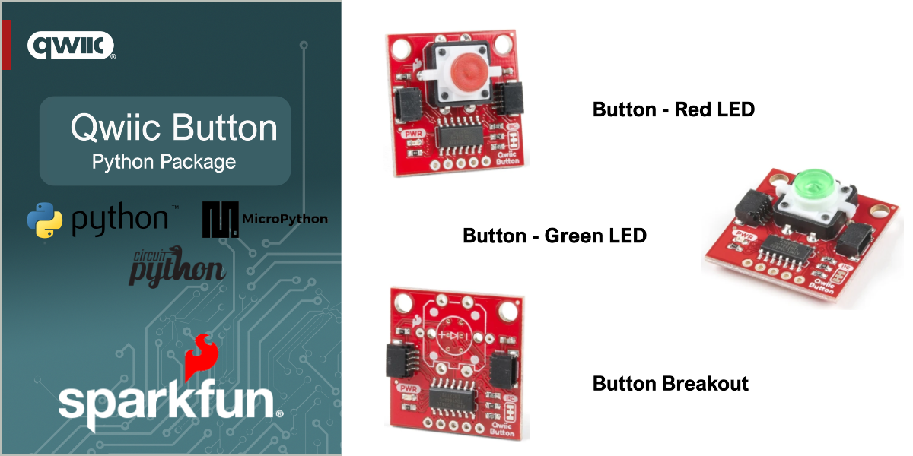

# SparkFun Qwiic Button - Python Package


[](https://docs.sparkfun.com/Qwiic_Py/qwiic_button/)

The SparkFun Qwiic Button provides a simple and cost effective solution for adding a button with a built-in LED to your project. Implementing a SparkFun Qwiic I2C interface, these boards can be rapidly added to any project with boards that are part of the SparkFun Qwiic ecosystem.

This package is the Python driver for the Qwiic Button. It works on CPython (Linux), MicroPython and CircuitPython, and is part of the [SparkFun Qwiic Python package](https://github.com/sparkfun/Qwiic_Py).

## Contents

* [About the Package](#about-the-package)
* [Supported Platforms](#supported-platforms)
* [Installation](#installation)
* [Example Use](#example-use)
* [Documentation](#documentation)
* [Migrating from 2.x](#migrating-from-2x)

## About the Package

This package checks the button state, reads the pressed and clicked queues, configures the button LED, changes the I2C address and more over a single Qwiic cable. Each feature is demonstrated in the [examples](examples/README.md).

New to Qwiic? Take a look at the entire [SparkFun Qwiic ecosystem](https://www.sparkfun.com/qwiic).

### Supported SparkFun Products

* [SparkFun Qwiic Button - Red LED](https://www.sparkfun.com/sparkfun-qwiic-button-red-led.html)
* [SparkFun Qwiic Button - Green LED](https://www.sparkfun.com/sparkfun-qwiic-button-green-led.html)
* [SparkFun Qwiic Button Breakout](https://www.sparkfun.com/sparkfun-qwiic-button-breakout.html)

## Supported Platforms

| Python | Platform | Boards |
| --- | --- | --- |
| CPython | Linux | [Raspberry Pi](https://www.sparkfun.com/raspberry-pi-5-8gb.html), [NVIDIA Jetson Orin Nano](https://www.sparkfun.com/nvidia-jetson-orin-nano-developer-kit.html) via the [SparkFun Qwiic SHIM](https://www.sparkfun.com/sparkfun-qwiic-shim-for-raspberry-pi.html) |
| MicroPython | Raspberry Pi RP2, ESP32 | [SparkFun Pro Micro RP2350](https://www.sparkfun.com/sparkfun-pro-micro-rp2350.html), [SparkFun IoT RedBoard ESP32](https://www.sparkfun.com/sparkfun-iot-redboard-esp32-development-board.html), [SparkFun IoT RedBoard RP2350](https://www.sparkfun.com/sparkfun-iot-redboard-rp2350.html) |
| CircuitPython | Raspberry Pi RP2, ESP32 | [SparkFun Pro Micro RP2350](https://www.sparkfun.com/sparkfun-pro-micro-rp2350.html), [SparkFun IoT RedBoard ESP32](https://www.sparkfun.com/sparkfun-iot-redboard-esp32-development-board.html), [SparkFun IoT RedBoard RP2350](https://www.sparkfun.com/sparkfun-iot-redboard-rp2350.html) |

> [!NOTE]
> These are the primary platforms tested. The package is expected to work on most Python-enabled systems.

## Installation

### CPython (pip)

```sh
python3 -m venv ~/sparkfun_venv
~/sparkfun_venv/bin/pip install sparkfun-qwiic-button
```

Run any example or script that does `import qwiic_button` with `~/sparkfun_venv/bin/python3 example_script.py`.

### MicroPython (mip)

Install [mpremote](https://docs.micropython.org/en/latest/reference/mpremote.html), connect your board, then install the driver (this also installs `qwiic_i2c`):

```sh
mpremote mip install github:sparkfun/Qwiic_Py/drivers/qwiic_button
```

To install the examples too:

```sh
mpremote mip install --target "" github:sparkfun/Qwiic_Py/drivers/qwiic_button/examples
```

Add `@qwiic_button-<version>` to either command to install a specific release.

### CircuitPython (circup)

Install [CircUp](https://docs.circuitpython.org/projects/circup/en/latest/#installation), add the SparkFun Qwiic bundle once, then install the driver:

```sh
circup bundle-add sparkfun/Qwiic_Py
circup install qwiic_button
```

To copy an example to the board:

```sh
circup example qwiic_button/qwiic_button_ex1_button_press
```

## Example Use

Below is a quickstart program that prints whether the button is pressed. See the [examples directory](examples) for more, and [examples/README.md](examples/README.md) for a summary of each.

```python
import sys
import qwiic_button
import qwiic_i2c


print("\nSparkFun Qwiic Button Example 1")
my_button = qwiic_button.QwiicButton()

if not my_button.begin():
    print("The Qwiic Button isn't connected to the system. Please check your connection", file=sys.stderr)
    sys.exit(1)

print("Button ready!")

while True:
    if my_button.is_button_pressed():
        print("The button is pressed!")
    else:
        print("The button is not pressed!")
    qwiic_i2c.delay_ms(100)
```

## Documentation

The API reference is at [docs.sparkfun.com/Qwiic_Py/qwiic_button](https://docs.sparkfun.com/Qwiic_Py/qwiic_button/).

## Migrating from 2.x

Version 3 has one name per method and no properties, so it also runs on MicroPython builds without `property()`.

| 2.x | 3.0 |
| --- | --- |
| `button.LED_config(brightness, cycle_time, off_time, granularity)` | `button.led_config(brightness, cycle_time, off_time, granularity)` |
| `button.LED_on(brightness)` | `button.led_on(brightness)` |
| `button.LED_off()` | `button.led_off()` |
| `button.set_I2C_address(address)` (returned `None` on success) | `button.set_i2c_address(address)` (returns `True` on success) |
| `button.get_I2C_address()` | `button.get_i2c_address()` |
| `disable_clicked_interrupt()` also cleared the pressed interrupt | `disable_clicked_interrupt()` clears only the clicked interrupt |
| `QwiicButton.available_addresses` listed 0x6F twice and left out 0x37 | lists 0x6F first, then every other address from 0x08 to 0x77 |

<p align="center">

</p>
