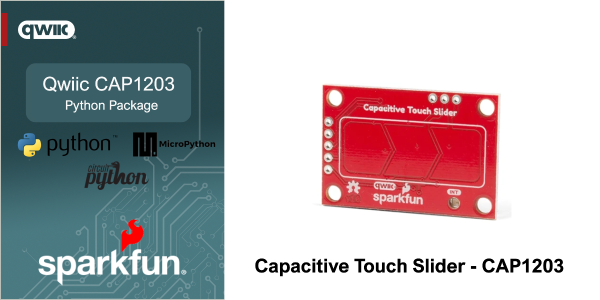

# SparkFun Qwiic CAP1203 - Python Package


[](https://docs.sparkfun.com/Qwiic_Py/qwiic_cap1203/)

The SparkFun Qwiic CAP1203 Capacitive Touch Slider provides a simple and cost effective solution for adding three-input or slider touch input to your project. Implementing a SparkFun Qwiic I2C interface, these sensors can be rapidly added to any project with boards that are part of the SparkFun Qwiic ecosystem.

This package is the Python driver for the CAP1203. It works on CPython (Linux), MicroPython and CircuitPython, and is part of the [SparkFun Qwiic Python package](https://github.com/sparkfun/Qwiic_Py).

## Contents

* [About the Package](#about-the-package)
* [Supported Platforms](#supported-platforms)
* [Installation](#installation)
* [Example Use](#example-use)
* [Documentation](#documentation)
* [Migrating from 2.x](#migrating-from-2x)

## About the Package

This package reads the three touch inputs, detects swipes, sets up a pad as a power button, sets the sensitivity and more over a single Qwiic cable. Each feature is demonstrated in the [examples](examples/README.md).

New to Qwiic? Take a look at the entire [SparkFun Qwiic ecosystem](https://www.sparkfun.com/qwiic).

### Supported SparkFun Products

* [SparkFun Capacitive Touch Slider - CAP1203](https://www.sparkfun.com/sparkfun-capacitive-touch-slider-cap1203-qwiic.html)

## Supported Platforms

| Python | Platform | Boards |
| --- | --- | --- |
| CPython | Linux | [Raspberry Pi](https://www.sparkfun.com/raspberry-pi-5-8gb.html), [NVIDIA Jetson Orin Nano](https://www.sparkfun.com/nvidia-jetson-orin-nano-developer-kit.html) via the [SparkFun Qwiic SHIM](https://www.sparkfun.com/sparkfun-qwiic-shim-for-raspberry-pi.html) |
| MicroPython | Raspberry Pi RP2, ESP32 | [SparkFun Pro Micro RP2350](https://www.sparkfun.com/sparkfun-pro-micro-rp2350.html), [SparkFun IoT RedBoard ESP32](https://www.sparkfun.com/sparkfun-iot-redboard-esp32-development-board.html), [SparkFun IoT RedBoard RP2350](https://www.sparkfun.com/sparkfun-iot-redboard-rp2350.html) |
| CircuitPython | Raspberry Pi RP2, ESP32 | [SparkFun Pro Micro RP2350](https://www.sparkfun.com/sparkfun-pro-micro-rp2350.html), [SparkFun IoT RedBoard ESP32](https://www.sparkfun.com/sparkfun-iot-redboard-esp32-development-board.html), [SparkFun IoT RedBoard RP2350](https://www.sparkfun.com/sparkfun-iot-redboard-rp2350.html) |

> [!NOTE]
> These are the primary platforms tested. The package is expected to work on most Python-enabled systems.

## Installation

### CPython (pip)

```sh
python3 -m venv ~/sparkfun_venv
~/sparkfun_venv/bin/pip install sparkfun-qwiic-cap1203
```

Run any example or script that does `import qwiic_cap1203` with `~/sparkfun_venv/bin/python3 example_script.py`.

### MicroPython (mip)

Install [mpremote](https://docs.micropython.org/en/latest/reference/mpremote.html), connect your board, then install the driver (this also installs `qwiic_i2c`):

```sh
mpremote mip install github:sparkfun/Qwiic_Py/drivers/qwiic_cap1203
```

To install the examples too:

```sh
mpremote mip install --target "" github:sparkfun/Qwiic_Py/drivers/qwiic_cap1203/examples
```

Add `@qwiic_cap1203-<version>` to either command to install a specific release.

### CircuitPython (circup)

Install [CircUp](https://docs.circuitpython.org/projects/circup/en/latest/#installation), add the SparkFun Qwiic bundle once, then install the driver:

```sh
circup bundle-add sparkfun/Qwiic_Py
circup install qwiic_cap1203
```

To copy an example to the board:

```sh
circup example qwiic_cap1203/qwiic_cap1203_ex1_basic_readings
```

## Example Use

Below is a quickstart program that prints which of the three pads is touched. See the [examples directory](examples) for more, and [examples/README.md](examples/README.md) for a summary of each.

```python
import sys
import qwiic_cap1203


def run_example():
    print("\nQwiic CAP1203 Example 1 - Basic Readings\n")
    my_device = qwiic_cap1203.QwiicCAP1203()

    if not my_device.is_connected():
        print("The device isn't connected to the system. Please check your connection", file=sys.stderr)
        return

    my_device.begin()

    while True:
        if my_device.is_left_touched():
            print("Left")
        if my_device.is_middle_touched():
            print("Middle")
        if my_device.is_right_touched():
            print("Right")


if __name__ == "__main__":
    try:
        run_example()
    except (KeyboardInterrupt, SystemExit):
        print("\nEnding Example")
        sys.exit(0)
```

## Documentation

The API reference is at [docs.sparkfun.com/Qwiic_Py/qwiic_cap1203](https://docs.sparkfun.com/Qwiic_Py/qwiic_cap1203/).

## Migrating from 2.x

Version 3 has one name per method and no properties, so it also runs on MicroPython builds without `property()`.

| 2.x | 3.0 |
| --- | --- |
| `sensor.connected` | `sensor.is_connected()` |
| `sensor.millis()` | Removed. Swipe timeouts use `qwiic_i2c` ticks, so they no longer go wrong when the counter wraps, or wait whole seconds on CircuitPython |
| `check_main_control()`, `check_status()` returned `None` | They return the register value, as documented |

<p align="center">

</p>
