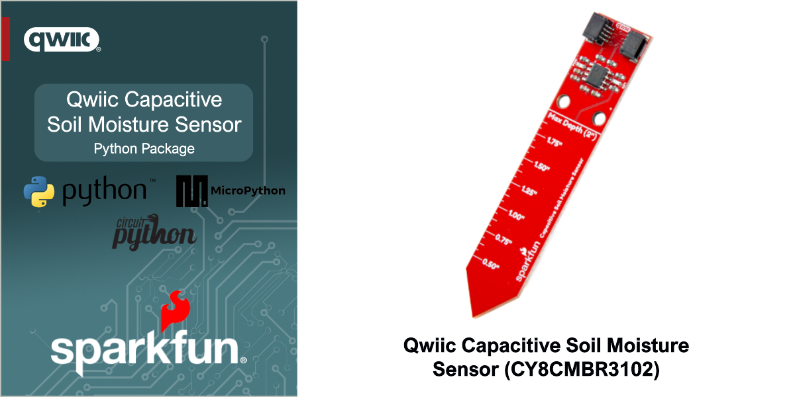

# SparkFun Qwiic CY8CMBR3 - Python Package


[](https://docs.sparkfun.com/Qwiic_Py/qwiic_cy8cmbr3/)

The SparkFun Qwiic Soil Moisture Sensor CY8CMBR3 Module provides a simple and cost effective solution for adding soil moisture sensing to your project. Implementing a SparkFun Qwiic I2C interface, these sensors can be rapidly added to any project with boards that are part of the SparkFun Qwiic ecosystem.

This package is the Python driver for the CY8CMBR3. It works on CPython (Linux), MicroPython and CircuitPython, and is part of the [SparkFun Qwiic Python package](https://github.com/sparkfun/Qwiic_Py).

## Contents

* [About the Package](#about-the-package)
* [Supported Platforms](#supported-platforms)
* [Installation](#installation)
* [Example Use](#example-use)
* [Documentation](#documentation)
* [Migrating from 2.x](#migrating-from-2x)

## About the Package

This package reads soil capacitance from the CY8CMBR3 over a single Qwiic cable, in pF or as raw counts, controls its LED and changes its I2C address. Each feature is demonstrated in the [examples](examples/README.md).

New to Qwiic? Take a look at the entire [SparkFun Qwiic ecosystem](https://www.sparkfun.com/qwiic).

### Supported SparkFun Products

* [SparkFun Qwiic Soil Moisture Sensor (Capacitive) - CY8CMBR3](https://www.sparkfun.com/sparkfun-qwiic-soil-moisture-sensor-capacitive.html)

## Supported Platforms

| Python | Platform | Boards |
| --- | --- | --- |
| CPython | Linux | [Raspberry Pi](https://www.sparkfun.com/raspberry-pi-5-8gb.html), [NVIDIA Jetson Orin Nano](https://www.sparkfun.com/nvidia-jetson-orin-nano-developer-kit.html) via the [SparkFun Qwiic SHIM](https://www.sparkfun.com/sparkfun-qwiic-shim-for-raspberry-pi.html) |
| MicroPython | Raspberry Pi RP2, ESP32 | [SparkFun Pro Micro RP2350](https://www.sparkfun.com/sparkfun-pro-micro-rp2350.html), [SparkFun IoT RedBoard ESP32](https://www.sparkfun.com/sparkfun-iot-redboard-esp32-development-board.html), [SparkFun IoT RedBoard RP2350](https://www.sparkfun.com/sparkfun-iot-redboard-rp2350.html) |
| CircuitPython | Raspberry Pi RP2, ESP32 | [SparkFun Pro Micro RP2350](https://www.sparkfun.com/sparkfun-pro-micro-rp2350.html), [SparkFun IoT RedBoard ESP32](https://www.sparkfun.com/sparkfun-iot-redboard-esp32-development-board.html), [SparkFun IoT RedBoard RP2350](https://www.sparkfun.com/sparkfun-iot-redboard-rp2350.html) |

> [!NOTE]
> These are the primary platforms tested. The package is expected to work on most Python-enabled systems.

## Installation

### CPython (pip)

```sh
python3 -m venv ~/sparkfun_venv
~/sparkfun_venv/bin/pip install sparkfun-qwiic-cy8cmbr3
```

Run any example or script that does `import qwiic_cy8cmbr3` with `~/sparkfun_venv/bin/python3 example_script.py`.

### MicroPython (mip)

Install [mpremote](https://docs.micropython.org/en/latest/reference/mpremote.html), connect your board, then install the driver (this also installs `qwiic_i2c`):

```sh
mpremote mip install github:sparkfun/Qwiic_Py/drivers/qwiic_cy8cmbr3
```

To install the examples too:

```sh
mpremote mip install --target "" github:sparkfun/Qwiic_Py/drivers/qwiic_cy8cmbr3/examples
```

Add `@qwiic_cy8cmbr3-<version>` to either command to install a specific release.

### CircuitPython (circup)

Install [CircUp](https://docs.circuitpython.org/projects/circup/en/latest/#installation), add the SparkFun Qwiic bundle once, then install the driver:

```sh
circup bundle-add sparkfun/Qwiic_Py
circup install qwiic_cy8cmbr3
```

To copy an example to the board:

```sh
circup example qwiic_cy8cmbr3/qwiic_cy8cmbr3_ex1_basic
```

## Example Use

Below is a quickstart program that prints the soil capacitance. See the [examples directory](examples) for more, and [examples/README.md](examples/README.md) for a summary of each.

```python
import sys
import qwiic_cy8cmbr3
import qwiic_i2c


print("\nQwiic CY8CMBR3 Example 1 - Basic\n")
my_soil_sensor = qwiic_cy8cmbr3.QwiicCY8CMBR3()

if not my_soil_sensor.is_connected():
    print("The device isn't connected to the system. Please check your connection", file=sys.stderr)
    sys.exit(1)

my_soil_sensor.begin()

while True:
    print("Soil Capacitance: " + str(my_soil_sensor.get_capacitance_pf()) + " pF")
    qwiic_i2c.delay_ms(1000)
```

## Documentation

The API reference is at [docs.sparkfun.com/Qwiic_Py/qwiic_cy8cmbr3](https://docs.sparkfun.com/Qwiic_Py/qwiic_cy8cmbr3/).

## Migrating from 2.x

Version 3 has one name per method and no properties, so it also runs on MicroPython builds without `property()`. Drivers no longer print, so the debug output is gone.

| 2.x | 3.0 |
| --- | --- |
| `sensor.connected` | `sensor.is_connected()` |
| `QwiicCY8CMBR3(..., enableDebug=True)`, `debug_print()` | removed (drivers don't print) |
| `set_gpo_config(controlByHost, pwmOutput, strongDrive, activeHigh)` | `set_gpo_config(control_by_host, pwm_output, strong_drive, active_high)` |
| `get_raw_count(autoCalibrate=...)` | `get_raw_count(auto_calibrate=...)` |
| `check_saturation(rawCount)` | `check_saturation(raw_count)` |
| `reset(waitForCompletion=...)`, `send_ctrl_command(command, waitForCompletion=...)` | `reset(wait_for_completion=...)`, `send_ctrl_command(command, wait_for_completion=...)` |
| `set_sensor_id()` and commands sent with `send_ctrl_command()` (`save_config()`, `reset()`, ...) waited forever if the device didn't answer | they return `False` after 1 second (sensor ID) or 2 seconds (commands) |
| `set_i2c_address()` returned `True` even if the device never answered at its new address | returns `False` in that case |
| `k`-prefixed constants (`kRegSensorEn`, `kRegFssEn`, ...) | UPPER_CASE without the `k` (`REG_SENSOR_EN`, `REG_FSS_EN`, ...); every rename is listed below |
| `default_address` | `DEFAULT_ADDRESS` |

<details>
<summary>Every renamed constant</summary>

| 2.x | 3.0 |
| --- | --- |
| `default_address` | `DEFAULT_ADDRESS` |
| `kRegSensorEn` | `REG_SENSOR_EN` |
| `kRegFssEn` | `REG_FSS_EN` |
| `kRegToggleEn` | `REG_TOGGLE_EN` |
| `kRegLedOnEn` | `REG_LED_ON_EN` |
| `kRegSensitivity0` | `REG_SENSITIVITY0` |
| `kRegSensitivity1` | `REG_SENSITIVITY1` |
| `kRegSensitivity2` | `REG_SENSITIVITY2` |
| `kRegSensitivity3` | `REG_SENSITIVITY3` |
| `kRegBaseThreshold0` | `REG_BASE_THRESHOLD0` |
| `kRegBaseThreshold1` | `REG_BASE_THRESHOLD1` |
| `kRegFingerThreshold2` | `REG_FINGER_THRESHOLD2` |
| `kRegFingerThreshold3` | `REG_FINGER_THRESHOLD3` |
| `kRegFingerThreshold4` | `REG_FINGER_THRESHOLD4` |
| `kRegFingerThreshold5` | `REG_FINGER_THRESHOLD5` |
| `kRegFingerThreshold6` | `REG_FINGER_THRESHOLD6` |
| `kRegFingerThreshold7` | `REG_FINGER_THRESHOLD7` |
| `kRegFingerThreshold8` | `REG_FINGER_THRESHOLD8` |
| `kRegFingerThreshold9` | `REG_FINGER_THRESHOLD9` |
| `kRegFingerThreshold10` | `REG_FINGER_THRESHOLD10` |
| `kRegFingerThreshold11` | `REG_FINGER_THRESHOLD11` |
| `kRegFingerThreshold12` | `REG_FINGER_THRESHOLD12` |
| `kRegFingerThreshold13` | `REG_FINGER_THRESHOLD13` |
| `kRegFingerThreshold14` | `REG_FINGER_THRESHOLD14` |
| `kRegFingerThreshold15` | `REG_FINGER_THRESHOLD15` |
| `kRegSensorDebounce` | `REG_SENSOR_DEBOUNCE` |
| `kRegButtonHys` | `REG_BUTTON_HYS` |
| `kRegButtonLbr` | `REG_BUTTON_LBR` |
| `kRegButtonNnt` | `REG_BUTTON_NNT` |
| `kRegButtonNt` | `REG_BUTTON_NT` |
| `kRegProxEn` | `REG_PROX_EN` |
| `kRegProxCfg` | `REG_PROX_CFG` |
| `kRegProxCfg2` | `REG_PROX_CFG2` |
| `kRegProxTouchTh0` | `REG_PROX_TOUCH_TH0` |
| `kRegProxTouchTh1` | `REG_PROX_TOUCH_TH1` |
| `kRegProxResolution0` | `REG_PROX_RESOLUTION0` |
| `kRegProxResolution1` | `REG_PROX_RESOLUTION1` |
| `kRegProxHys` | `REG_PROX_HYS` |
| `kRegProxLbr` | `REG_PROX_LBR` |
| `kRegProxNnt` | `REG_PROX_NNT` |
| `kRegProxNt` | `REG_PROX_NT` |
| `kRegProxPositiveTh0` | `REG_PROX_POSITIVE_TH0` |
| `kRegProxPositiveTh1` | `REG_PROX_POSITIVE_TH1` |
| `kRegProxNegativeTh0` | `REG_PROX_NEGATIVE_TH0` |
| `kRegProxNegativeTh1` | `REG_PROX_NEGATIVE_TH1` |
| `kRegLedOnTime` | `REG_LED_ON_TIME` |
| `kRegBuzzerCfg` | `REG_BUZZER_CFG` |
| `kRegBuzzerOnTime` | `REG_BUZZER_ON_TIME` |
| `kRegGpoCfg` | `REG_GPO_CFG` |
| `kRegPwmDutyCycleCfg0` | `REG_PWM_DUTY_CYCLE_CFG0` |
| `kRegPwmDutyCycleCfg1` | `REG_PWM_DUTY_CYCLE_CFG1` |
| `kRegPwmDutyCycleCfg2` | `REG_PWM_DUTY_CYCLE_CFG2` |
| `kRegPwmDutyCycleCfg3` | `REG_PWM_DUTY_CYCLE_CFG3` |
| `kRegPwmDutyCycleCfg4` | `REG_PWM_DUTY_CYCLE_CFG4` |
| `kRegPwmDutyCycleCfg5` | `REG_PWM_DUTY_CYCLE_CFG5` |
| `kRegPwmDutyCycleCfg6` | `REG_PWM_DUTY_CYCLE_CFG6` |
| `kRegPwmDutyCycleCfg7` | `REG_PWM_DUTY_CYCLE_CFG7` |
| `kRegSpoCfg` | `REG_SPO_CFG` |
| `kRegDeviceCfg0` | `REG_DEVICE_CFG0` |
| `kRegDeviceCfg1` | `REG_DEVICE_CFG1` |
| `kRegDeviceCfg2` | `REG_DEVICE_CFG2` |
| `kRegDeviceCfg3` | `REG_DEVICE_CFG3` |
| `kRegI2cAddr` | `REG_I2C_ADDR` |
| `kRegRefreshCtrl` | `REG_REFRESH_CTRL` |
| `kRegStateTimeout` | `REG_STATE_TIMEOUT` |
| `kRegSliderCfg` | `REG_SLIDER_CFG` |
| `kRegSlider1Cfg` | `REG_SLIDER1_CFG` |
| `kRegSlider1Resolution` | `REG_SLIDER1_RESOLUTION` |
| `kRegSlider1Threshold` | `REG_SLIDER1_THRESHOLD` |
| `kRegSlider2Cfg` | `REG_SLIDER2_CFG` |
| `kRegSlider2Resolution` | `REG_SLIDER2_RESOLUTION` |
| `kRegSlider2Threshold` | `REG_SLIDER2_THRESHOLD` |
| `kRegSliderLbr` | `REG_SLIDER_LBR` |
| `kRegSliderNnt` | `REG_SLIDER_NNT` |
| `kRegSliderNt` | `REG_SLIDER_NT` |
| `kRegScratchpad0` | `REG_SCRATCHPAD0` |
| `kRegScratchpad1` | `REG_SCRATCHPAD1` |
| `kRegConfigCrc` | `REG_CONFIG_CRC` |
| `kRegGpoOutputState` | `REG_GPO_OUTPUT_STATE` |
| `kRegSensorId` | `REG_SENSOR_ID` |
| `kRegCtrlCmd` | `REG_CTRL_CMD` |
| `kRegCtrlCmdStatus` | `REG_CTRL_CMD_STATUS` |
| `kRegCtrlCmdErr` | `REG_CTRL_CMD_ERR` |
| `kRegSystemStatus` | `REG_SYSTEM_STATUS` |
| `kRegPrevCtrlCmdCode` | `REG_PREV_CTRL_CMD_CODE` |
| `kRegFamilyId` | `REG_FAMILY_ID` |
| `kRegDeviceId` | `REG_DEVICE_ID` |
| `kRegDeviceRev` | `REG_DEVICE_REV` |
| `kRegCalcCrc` | `REG_CALC_CRC` |
| `kRegTotalWorkingSns` | `REG_TOTAL_WORKING_SNS` |
| `kRegSnsCpHigh` | `REG_SNS_CP_HIGH` |
| `kRegSnsVddShort` | `REG_SNS_VDD_SHORT` |
| `kRegSnsGndShort` | `REG_SNS_GND_SHORT` |
| `kRegSnsSnsShort` | `REG_SNS_SNS_SHORT` |
| `kRegCmodShieldTest` | `REG_CMOD_SHIELD_TEST` |
| `kRegButtonStat` | `REG_BUTTON_STAT` |
| `kRegLatchedButtonStat` | `REG_LATCHED_BUTTON_STAT` |
| `kRegProxStat` | `REG_PROX_STAT` |
| `kRegLatchedProxStat` | `REG_LATCHED_PROX_STAT` |
| `kRegSlider1Position` | `REG_SLIDER1_POSITION` |
| `kRegLiftoffSlider1Position` | `REG_LIFTOFF_SLIDER1_POSITION` |
| `kRegSlider2Position` | `REG_SLIDER2_POSITION` |
| `kRegLiftoffSlider2Position` | `REG_LIFTOFF_SLIDER2_POSITION` |
| `kRegSyncCounter0` | `REG_SYNC_COUNTER0` |
| `kRegDiffCnt0` | `REG_DIFF_CNT0` |
| `kRegDiffCnt1` | `REG_DIFF_CNT1` |
| `kRegDiffCnt2` | `REG_DIFF_CNT2` |
| `kRegDiffCnt3` | `REG_DIFF_CNT3` |
| `kRegDiffCnt4` | `REG_DIFF_CNT4` |
| `kRegDiffCnt5` | `REG_DIFF_CNT5` |
| `kRegDiffCnt6` | `REG_DIFF_CNT6` |
| `kRegDiffCnt7` | `REG_DIFF_CNT7` |
| `kRegDiffCnt8` | `REG_DIFF_CNT8` |
| `kRegDiffCnt9` | `REG_DIFF_CNT9` |
| `kRegDiffCnt10` | `REG_DIFF_CNT10` |
| `kRegDiffCnt11` | `REG_DIFF_CNT11` |
| `kRegDiffCnt12` | `REG_DIFF_CNT12` |
| `kRegDiffCnt13` | `REG_DIFF_CNT13` |
| `kRegDiffCnt14` | `REG_DIFF_CNT14` |
| `kRegDiffCnt15` | `REG_DIFF_CNT15` |
| `kRegGpoData` | `REG_GPO_DATA` |
| `kRegSyncCounter1` | `REG_SYNC_COUNTER1` |
| `kRegDebugSensorId` | `REG_DEBUG_SENSOR_ID` |
| `kRegDebugCp` | `REG_DEBUG_CP` |
| `kRegDebugDiffCnt0` | `REG_DEBUG_DIFF_CNT0` |
| `kRegDebugBaseline0` | `REG_DEBUG_BASELINE0` |
| `kRegDebugRawCnt0` | `REG_DEBUG_RAW_CNT0` |
| `kRegDebugAvgRawCnt0` | `REG_DEBUG_AVG_RAW_CNT0` |
| `kRegSyncCounter2` | `REG_SYNC_COUNTER2` |
| `kSensorEnShiftCs0` | `SENSOR_EN_SHIFT_CS0` |
| `kSensorEnMaskCs0` | `SENSOR_EN_MASK_CS0` |
| `kSensorEnShiftCs1` | `SENSOR_EN_SHIFT_CS1` |
| `kSensorEnMaskCs1` | `SENSOR_EN_MASK_CS1` |
| `kToggleEnShiftGpo0` | `TOGGLE_EN_SHIFT_GPO0` |
| `kToggleEnMaskGpo0` | `TOGGLE_EN_MASK_GPO0` |
| `kLedOnEnShiftGpo0` | `LED_ON_EN_SHIFT_GPO0` |
| `kLedOnEnMaskGpo0` | `LED_ON_EN_MASK_GPO0` |
| `kSensitivity0ShiftCs0` | `SENSITIVITY0_SHIFT_CS0` |
| `kSensitivity0MaskCs0` | `SENSITIVITY0_MASK_CS0` |
| `kGpoCfgShiftGpo0GpoCtl` | `GPO_CFG_SHIFT_GPO0_GPO_CTL` |
| `kGpoCfgMaskGpo0GpoCtl` | `GPO_CFG_MASK_GPO0_GPO_CTL` |
| `kGpoCfgShiftGpo0GpoPwm` | `GPO_CFG_SHIFT_GPO0_GPO_PWM` |
| `kGpoCfgMaskGpo0GpoPwm` | `GPO_CFG_MASK_GPO0_GPO_PWM` |
| `kGpoCfgShiftGpo0DriveMode` | `GPO_CFG_SHIFT_GPO0_DRIVE_MODE` |
| `kGpoCfgMaskGpo0DriveMode` | `GPO_CFG_MASK_GPO0_DRIVE_MODE` |
| `kGpoCfgShiftGpo0ActiveState` | `GPO_CFG_SHIFT_GPO0_ACTIVE_STATE` |
| `kGpoCfgMaskGpo0ActiveState` | `GPO_CFG_MASK_GPO0_ACTIVE_STATE` |
| `kSpoCfgShiftSpo0` | `SPO_CFG_SHIFT_SPO0` |
| `kSpoCfgMaskSpo0` | `SPO_CFG_MASK_SPO0` |
| `kSpoCfgShiftSpo1` | `SPO_CFG_SHIFT_SPO1` |
| `kSpoCfgMaskSpo1` | `SPO_CFG_MASK_SPO1` |
| `kGpoOutputStateShiftGpo0` | `GPO_OUTPUT_STATE_SHIFT_GPO0` |
| `kGpoOutputStateMaskGpo0` | `GPO_OUTPUT_STATE_MASK_GPO0` |
| `kGpoDataShiftGpo0` | `GPO_DATA_SHIFT_GPO0` |
| `kGpoDataMaskGpo0` | `GPO_DATA_MASK_GPO0` |
| `kAutoResetShiftButtonSldArst` | `AUTO_RESET_SHIFT_BUTTON_SLD_ARST` |
| `kAutoResetMaskButtonSldArst` | `AUTO_RESET_MASK_BUTTON_SLD_ARST` |
| `kAutoResetShiftProximityArst` | `AUTO_RESET_SHIFT_PROXIMITY_ARST` |
| `kAutoResetMaskProximityArst` | `AUTO_RESET_MASK_PROXIMITY_ARST` |
| `kDefaultCY8CMBR3102FamilyID` | `DEFAULT_CY8CMBR3102_FAMILY_ID` |
| `kDefaultCY8CMBR3102DeviceID` | `DEFAULT_CY8CMBR3102_DEVICE_ID` |
| `kCsSensitivity500CountsPerPf` | `CS_SENSITIVITY_500_COUNTS_PER_PF` |
| `kCsSensitivity250CountsPerPf` | `CS_SENSITIVITY_250_COUNTS_PER_PF` |
| `kCsSensitivity167CountsPerPf` | `CS_SENSITIVITY_167_COUNTS_PER_PF` |
| `kCsSensitivity125CountsPerPf` | `CS_SENSITIVITY_125_COUNTS_PER_PF` |
| `kRefreshInterval20ms` | `REFRESH_INTERVAL_20MS` |
| `kRefreshInterval40ms` | `REFRESH_INTERVAL_40MS` |
| `kRefreshInterval60ms` | `REFRESH_INTERVAL_60MS` |
| `kRefreshInterval80ms` | `REFRESH_INTERVAL_80MS` |
| `kRefreshInterval100ms` | `REFRESH_INTERVAL_100MS` |
| `kRefreshInterval120ms` | `REFRESH_INTERVAL_120MS` |
| `kRefreshInterval140ms` | `REFRESH_INTERVAL_140MS` |
| `kRefreshInterval160ms` | `REFRESH_INTERVAL_160MS` |
| `kRefreshInterval180ms` | `REFRESH_INTERVAL_180MS` |
| `kRefreshInterval200ms` | `REFRESH_INTERVAL_200MS` |
| `kRefreshInterval220ms` | `REFRESH_INTERVAL_220MS` |
| `kRefreshInterval240ms` | `REFRESH_INTERVAL_240MS` |
| `kRefreshInterval260ms` | `REFRESH_INTERVAL_260MS` |
| `kRefreshInterval280ms` | `REFRESH_INTERVAL_280MS` |
| `kRefreshInterval300ms` | `REFRESH_INTERVAL_300MS` |
| `kRefreshInterval320ms` | `REFRESH_INTERVAL_320MS` |
| `kRefreshInterval340ms` | `REFRESH_INTERVAL_340MS` |
| `kRefreshInterval360ms` | `REFRESH_INTERVAL_360MS` |
| `kRefreshInterval380ms` | `REFRESH_INTERVAL_380MS` |
| `kRefreshInterval400ms` | `REFRESH_INTERVAL_400MS` |
| `kRefreshInterval420ms` | `REFRESH_INTERVAL_420MS` |
| `kRefreshInterval440ms` | `REFRESH_INTERVAL_440MS` |
| `kRefreshInterval460ms` | `REFRESH_INTERVAL_460MS` |
| `kRefreshInterval480ms` | `REFRESH_INTERVAL_480MS` |
| `kRefreshInterval500ms` | `REFRESH_INTERVAL_500MS` |
| `kAutoResetTimeoutDisabled` | `AUTO_RESET_TIMEOUT_DISABLED` |
| `kAutoResetTimeout5Seconds` | `AUTO_RESET_TIMEOUT_5_SECONDS` |
| `kAutoResetTimeout20Seconds` | `AUTO_RESET_TIMEOUT_20_SECONDS` |
| `kCtrlCmdNoOp` | `CTRL_CMD_NO_OP` |
| `kCtrlCmdSaveConfig` | `CTRL_CMD_SAVE_CONFIG` |
| `kCtrlCmdCalcCrc` | `CTRL_CMD_CALC_CRC` |
| `kCtrlCmdDeepSleep` | `CTRL_CMD_DEEP_SLEEP` |
| `kCtrlCmdResetLatch` | `CTRL_CMD_RESET_LATCH` |
| `kCtrlCmdAlpResetPs0` | `CTRL_CMD_ALP_RESET_PS0` |
| `kCtrlCmdAlpResetPs1` | `CTRL_CMD_ALP_RESET_PS1` |
| `kCtrlCmdSwReset` | `CTRL_CMD_SW_RESET` |

</details>

<p align="center">

</p>
