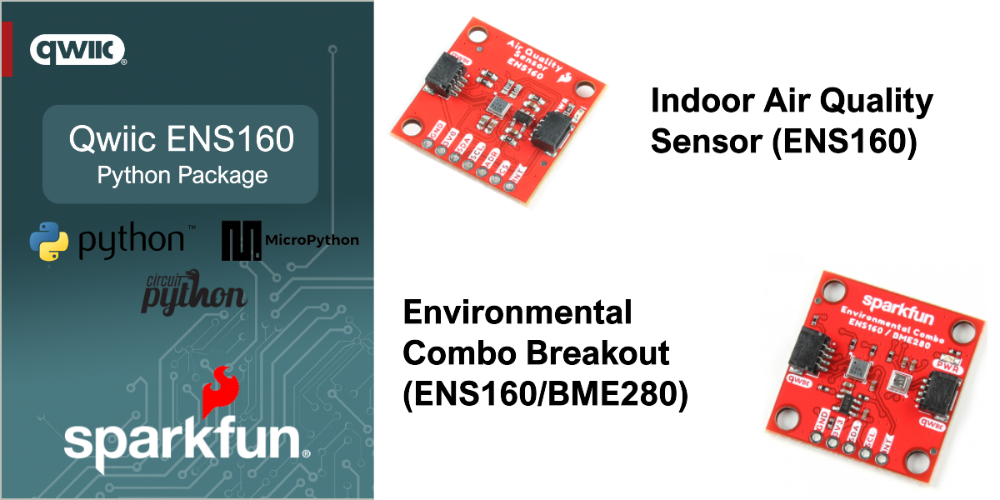

# SparkFun Qwiic ENS160 - Python Package


[](https://docs.sparkfun.com/Qwiic_Py/qwiic_ens160/)

The SparkFun Qwiic Indoor Air Quality Sensor ENS160 provides a simple and cost effective solution for adding air quality sensing to your project. Implementing a SparkFun Qwiic I2C interface, these sensors can be rapidly added to any project with boards that are part of the SparkFun Qwiic ecosystem.

This package is the Python driver for the ENS160. It works on CPython (Linux), MicroPython and CircuitPython, and is part of the [SparkFun Qwiic Python package](https://github.com/sparkfun/Qwiic_Py).

## Contents

* [About the Package](#about-the-package)
* [Supported Platforms](#supported-platforms)
* [Installation](#installation)
* [Example Use](#example-use)
* [Documentation](#documentation)
* [Migrating from 2.x](#migrating-from-2x)

## About the Package

This package reads the air quality index, total volatile organic compounds (TVOC), equivalent CO2 and raw hot plate resistance from the ENS160 over a single Qwiic cable, and sets its temperature and humidity compensation and interrupt pin. Each feature is demonstrated in the [examples](examples/README.md).

New to Qwiic? Take a look at the entire [SparkFun Qwiic ecosystem](https://www.sparkfun.com/qwiic).

### Supported SparkFun Products

* [SparkFun Indoor Air Quality Sensor - ENS160](https://www.sparkfun.com/products/20844)
* [SparkFun Environmental Combo Breakout - ENS160/BME280](https://www.sparkfun.com/sparkfun-environmental-combo-breakout-ens160-bme280-qwiic.html)

## Supported Platforms

| Python | Platform | Boards |
| --- | --- | --- |
| CPython | Linux | [Raspberry Pi](https://www.sparkfun.com/raspberry-pi-5-8gb.html), [NVIDIA Jetson Orin Nano](https://www.sparkfun.com/nvidia-jetson-orin-nano-developer-kit.html) via the [SparkFun Qwiic SHIM](https://www.sparkfun.com/sparkfun-qwiic-shim-for-raspberry-pi.html) |
| MicroPython | Raspberry Pi RP2, ESP32 | [SparkFun Pro Micro RP2350](https://www.sparkfun.com/sparkfun-pro-micro-rp2350.html), [SparkFun IoT RedBoard ESP32](https://www.sparkfun.com/sparkfun-iot-redboard-esp32-development-board.html), [SparkFun IoT RedBoard RP2350](https://www.sparkfun.com/sparkfun-iot-redboard-rp2350.html) |
| CircuitPython | Raspberry Pi RP2, ESP32 | [SparkFun Pro Micro RP2350](https://www.sparkfun.com/sparkfun-pro-micro-rp2350.html), [SparkFun IoT RedBoard ESP32](https://www.sparkfun.com/sparkfun-iot-redboard-esp32-development-board.html), [SparkFun IoT RedBoard RP2350](https://www.sparkfun.com/sparkfun-iot-redboard-rp2350.html) |

> [!NOTE]
> These are the primary platforms tested. The package is expected to work on most Python-enabled systems.

## Installation

### CPython (pip)

```sh
python3 -m venv ~/sparkfun_venv
~/sparkfun_venv/bin/pip install sparkfun-qwiic-ens160
```

Run any example or script that does `import qwiic_ens160` with `~/sparkfun_venv/bin/python3 example_script.py`.

### MicroPython (mip)

Install [mpremote](https://docs.micropython.org/en/latest/reference/mpremote.html), connect your board, then install the driver (this also installs `qwiic_i2c`):

```sh
mpremote mip install github:sparkfun/Qwiic_Py/drivers/qwiic_ens160
```

To install the examples too:

```sh
mpremote mip install --target "" github:sparkfun/Qwiic_Py/drivers/qwiic_ens160/examples
```

Add `@qwiic_ens160-<version>` to either command to install a specific release.

### CircuitPython (circup)

Install [CircUp](https://docs.circuitpython.org/projects/circup/en/latest/#installation), add the SparkFun Qwiic bundle once, then install the driver:

```sh
circup bundle-add sparkfun/Qwiic_Py
circup install qwiic_ens160
```

To copy an example to the board:

```sh
circup example qwiic_ens160/qwiic_ens160_ex1_basic
```

## Example Use

Below is a quickstart program that prints the air quality index, TVOC and equivalent CO2. See the [examples directory](examples) for more, and [examples/README.md](examples/README.md) for a summary of each.

```python
import sys
import qwiic_ens160
import qwiic_i2c


print("\nQwiic ENS160 Example 1 - Basic\n")
my_ens = qwiic_ens160.QwiicENS160()

if not my_ens.is_connected():
    print("The device isn't connected to the system. Please check your connection", file=sys.stderr)
    sys.exit(1)

my_ens.begin()

my_ens.set_operating_mode(my_ens.OP_MODE_RESET)
qwiic_i2c.delay_ms(100)
my_ens.set_operating_mode(my_ens.OP_MODE_STANDARD)

print("Gas Sensor Status Flag (0 - Standard, 1 - Warm up, 2 - Initial Start Up): ", my_ens.get_flags())

while True:
    if my_ens.check_data_status():
        print("Air Quality Index (1-5) : ", my_ens.get_aqi())
        print("Total Volatile Organic Compounds (ppb): ", my_ens.get_tvoc())
        print("CO2 concentration (ppm): ", my_ens.get_eco2())
        print("\n------------------------\n")

    qwiic_i2c.delay_ms(200)
```

## Documentation

The API reference is at [docs.sparkfun.com/Qwiic_Py/qwiic_ens160](https://docs.sparkfun.com/Qwiic_Py/qwiic_ens160/).

## Migrating from 2.x

Version 3 has no properties, so it also runs on MicroPython builds without `property()`. The method names are unchanged; the camelCase arguments are now snake_case, and the constants are UPPER_CASE without the `k` prefix.

| 2.x | 3.0 |
| --- | --- |
| `sensor.connected` | `sensor.is_connected()` |
| `set_interrupt_polarity(activeHigh)` | `set_interrupt_polarity(active_high)` |
| `set_interrupt_drive(pushPull)` | `set_interrupt_drive(push_pull)` |
| `set_temp_compensation(tempKelvin)`, `set_temp_compensation_celsius(tempCelsius)` | `set_temp_compensation(temp_kelvin)`, `set_temp_compensation_celsius(temp_celsius)` |
| `get_app_ver()` waited forever if the sensor didn't answer | raises `OSError` after 1 second, and puts the sensor back in its previous mode |
| `kCommandClearGPR`, `kCommandGetAppVer`, `kCommandNop`, `kMaskConfigIntCfg` | `COMMAND_CLEAR_GPR`, `COMMAND_GET_APP_VER`, `COMMAND_NOP`, `MASK_CONFIG_INT_CFG` |
| `kMaskConfigIntDat`, `kMaskConfigIntEn`, `kMaskConfigIntGPR`, `kMaskConfigIntPol` | `MASK_CONFIG_INT_DAT`, `MASK_CONFIG_INT_EN`, `MASK_CONFIG_INT_GPR`, `MASK_CONFIG_INT_POL` |
| `kMaskDataAqiUba`, `kMaskDeviceStatusNewDat`, `kMaskDeviceStatusNewGpr`, `kMaskDeviceStatusStatAs` | `MASK_DATA_AQI_UBA`, `MASK_DEVICE_STATUS_NEW_DAT`, `MASK_DEVICE_STATUS_NEW_GPR`, `MASK_DEVICE_STATUS_STAT_AS` |
| `kMaskDeviceStatusStatEr`, `kMaskDeviceStatusValidityFlag`, `kOpModeDeepSleep`, `kOpModeIdle` | `MASK_DEVICE_STATUS_STAT_ER`, `MASK_DEVICE_STATUS_VALIDITY_FLAG`, `OP_MODE_DEEP_SLEEP`, `OP_MODE_IDLE` |
| `kOpModeReset`, `kOpModeStandard`, `kPartId`, `kPoly` | `OP_MODE_RESET`, `OP_MODE_STANDARD`, `PART_ID`, `POLY` |
| `kRegCommand`, `kRegConfig`, `kRegDataAqi`, `kRegDataEco2` | `REG_COMMAND`, `REG_CONFIG`, `REG_DATA_AQI`, `REG_DATA_ECO2` |
| `kRegDataEtoh`, `kRegDataMisr`, `kRegDataRh`, `kRegDataT` | `REG_DATA_ETOH`, `REG_DATA_MISR`, `REG_DATA_RH`, `REG_DATA_T` |
| `kRegDataTvoc`, `kRegDeviceStatus`, `kRegGPRRead0`, `kRegGPRRead1` | `REG_DATA_TVOC`, `REG_DEVICE_STATUS`, `REG_GPR_READ_0`, `REG_GPR_READ_1` |
| `kRegGPRRead2`, `kRegGPRRead3`, `kRegGPRRead4`, `kRegGPRRead5` | `REG_GPR_READ_2`, `REG_GPR_READ_3`, `REG_GPR_READ_4`, `REG_GPR_READ_5` |
| `kRegGPRRead6`, `kRegGPRRead7`, `kRegGPRWrite0`, `kRegGPRWrite1` | `REG_GPR_READ_6`, `REG_GPR_READ_7`, `REG_GPR_WRITE_0`, `REG_GPR_WRITE_1` |
| `kRegGPRWrite2`, `kRegGPRWrite3`, `kRegGPRWrite4`, `kRegGPRWrite5` | `REG_GPR_WRITE_2`, `REG_GPR_WRITE_3`, `REG_GPR_WRITE_4`, `REG_GPR_WRITE_5` |
| `kRegGPRWrite6`, `kRegGPRWrite7`, `kRegOpMode`, `kRegPartId` | `REG_GPR_WRITE_6`, `REG_GPR_WRITE_7`, `REG_OP_MODE`, `REG_PART_ID` |
| `kRegRhIn`, `kRegTempIn`, `kShiftConfigIntCfg`, `kShiftConfigIntDat` | `REG_RH_IN`, `REG_TEMP_IN`, `SHIFT_CONFIG_INT_CFG`, `SHIFT_CONFIG_INT_DAT` |
| `kShiftConfigIntEn`, `kShiftConfigIntGPR`, `kShiftConfigIntPol`, `kShiftDataAqiUba` | `SHIFT_CONFIG_INT_EN`, `SHIFT_CONFIG_INT_GPR`, `SHIFT_CONFIG_INT_POL`, `SHIFT_DATA_AQI_UBA` |
| `kShiftDeviceStatusNewDat`, `kShiftDeviceStatusNewGpr`, `kShiftDeviceStatusStatAs`, `kShiftDeviceStatusStatEr` | `SHIFT_DEVICE_STATUS_NEW_DAT`, `SHIFT_DEVICE_STATUS_NEW_GPR`, `SHIFT_DEVICE_STATUS_STAT_AS`, `SHIFT_DEVICE_STATUS_STAT_ER` |
| `kShiftDeviceStatusValidityFlag`, `kValidityFlagInvalid`, `kValidityFlagNormal`, `kValidityFlagStartUp` | `SHIFT_DEVICE_STATUS_VALIDITY_FLAG`, `VALIDITY_FLAG_INVALID`, `VALIDITY_FLAG_NORMAL`, `VALIDITY_FLAG_START_UP` |
| `kValidityFlagWarmUp` | `VALIDITY_FLAG_WARM_UP` |

<p align="center">

</p>
