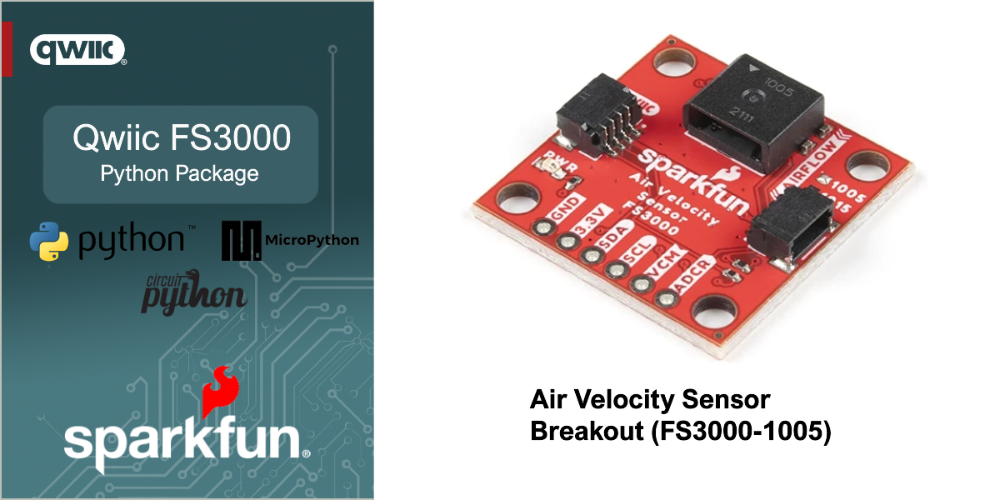

# SparkFun Qwiic FS3000 - Python Package


[](https://docs.sparkfun.com/Qwiic_Py/qwiic_fs3000/)

The SparkFun Qwiic Air Velocity Sensing FS3000 Module provides a simple and cost effective solution for adding air velocity sensing capabilities to your project. Implementing a SparkFun Qwiic I2C interface, these sensors can be rapidly added to any project with boards that are part of the SparkFun Qwiic ecosystem.

This package is the Python driver for the FS3000. It works on CPython (Linux), MicroPython and CircuitPython, and is part of the [SparkFun Qwiic Python package](https://github.com/sparkfun/Qwiic_Py).

## Contents

* [About the Package](#about-the-package)
* [Supported Platforms](#supported-platforms)
* [Installation](#installation)
* [Example Use](#example-use)
* [Documentation](#documentation)
* [Migrating from 2.x](#migrating-from-2x)

## About the Package

This package reads air velocity from the FS3000-1005 and FS3000-1015 over a single Qwiic cable, as a raw value, in meters per second or in miles per hour. Each feature is demonstrated in the [examples](examples/README.md).

New to Qwiic? Take a look at the entire [SparkFun Qwiic ecosystem](https://www.sparkfun.com/qwiic).

### Supported SparkFun Products

* [SparkFun Air Velocity Sensor Breakout - FS3000-1005](https://www.sparkfun.com/sparkfun-air-velocity-sensor-breakout-fs3000-1005-qwiic.html)
* [SparkFun Air Velocity Sensor Breakout - FS3000-1015](https://www.sparkfun.com/sparkfun-air-velocity-sensor-breakout-fs3000-1015-qwiic.html)

## Supported Platforms

| Python | Platform | Boards |
| --- | --- | --- |
| CPython | Linux | [Raspberry Pi](https://www.sparkfun.com/raspberry-pi-5-8gb.html), [NVIDIA Jetson Orin Nano](https://www.sparkfun.com/nvidia-jetson-orin-nano-developer-kit.html) via the [SparkFun Qwiic SHIM](https://www.sparkfun.com/sparkfun-qwiic-shim-for-raspberry-pi.html) |
| MicroPython | Raspberry Pi RP2, ESP32 | [SparkFun Pro Micro RP2350](https://www.sparkfun.com/sparkfun-pro-micro-rp2350.html), [SparkFun IoT RedBoard ESP32](https://www.sparkfun.com/sparkfun-iot-redboard-esp32-development-board.html), [SparkFun IoT RedBoard RP2350](https://www.sparkfun.com/sparkfun-iot-redboard-rp2350.html) |
| CircuitPython | Raspberry Pi RP2, ESP32 | [SparkFun Pro Micro RP2350](https://www.sparkfun.com/sparkfun-pro-micro-rp2350.html), [SparkFun IoT RedBoard ESP32](https://www.sparkfun.com/sparkfun-iot-redboard-esp32-development-board.html), [SparkFun IoT RedBoard RP2350](https://www.sparkfun.com/sparkfun-iot-redboard-rp2350.html) |

> [!NOTE]
> These are the primary platforms tested. The package is expected to work on most Python-enabled systems.

## Installation

### CPython (pip)

```sh
python3 -m venv ~/sparkfun_venv
~/sparkfun_venv/bin/pip install sparkfun-qwiic-fs3000
```

Run any example or script that does `import qwiic_fs3000` with `~/sparkfun_venv/bin/python3 example_script.py`.

### MicroPython (mip)

Install [mpremote](https://docs.micropython.org/en/latest/reference/mpremote.html), connect your board, then install the driver (this also installs `qwiic_i2c`):

```sh
mpremote mip install github:sparkfun/Qwiic_Py/drivers/qwiic_fs3000
```

To install the examples too:

```sh
mpremote mip install --target "" github:sparkfun/Qwiic_Py/drivers/qwiic_fs3000/examples
```

Add `@qwiic_fs3000-<version>` to either command to install a specific release.

### CircuitPython (circup)

Install [CircUp](https://docs.circuitpython.org/projects/circup/en/latest/#installation), add the SparkFun Qwiic bundle once, then install the driver:

```sh
circup bundle-add sparkfun/Qwiic_Py
circup install qwiic_fs3000
```

To copy an example to the board:

```sh
circup example qwiic_fs3000/qwiic_fs3000_ex1_basic
```

## Example Use

Below is a quickstart program that prints the air velocity. See the [examples directory](examples) for more, and [examples/README.md](examples/README.md) for a summary of each.

```python
import sys
import qwiic_fs3000
import qwiic_i2c


def run_example():
    print("\nSparkFun FS3000 Example 1 - Basic\n")
    my_fs3000 = qwiic_fs3000.QwiicFS3000()

    if not my_fs3000.is_connected():
        print("The device isn't connected to the system. Please check your connection", file=sys.stderr)
        return

    my_fs3000.begin()

    # FS3000-1005 (0-7.23 m/sec): AIRFLOW_RANGE_7_MPS
    # FS3000-1015 (0-15 m/sec):   AIRFLOW_RANGE_15_MPS
    my_fs3000.set_range(my_fs3000.AIRFLOW_RANGE_7_MPS)

    while True:
        print("m/s:", my_fs3000.read_meters_per_second(), "\tmph:", my_fs3000.read_miles_per_hour())
        qwiic_i2c.delay_ms(1000)


if __name__ == "__main__":
    try:
        run_example()
    except (KeyboardInterrupt, SystemExit):
        print("\nEnding Example 1")
        sys.exit(0)
```

## Documentation

The API reference is at [docs.sparkfun.com/Qwiic_Py/qwiic_fs3000](https://docs.sparkfun.com/Qwiic_Py/qwiic_fs3000/).

## Migrating from 2.x

Version 3 has one name per method and no properties, so it also runs on MicroPython builds without `property()`.

| 2.x | 3.0 |
| --- | --- |
| `sensor.connected` | `sensor.is_connected()` |
| `kAirflowRange7Mps`, `kAirflowRange15Mps` | `AIRFLOW_RANGE_7_MPS`, `AIRFLOW_RANGE_15_MPS` |

<p align="center">

</p>
