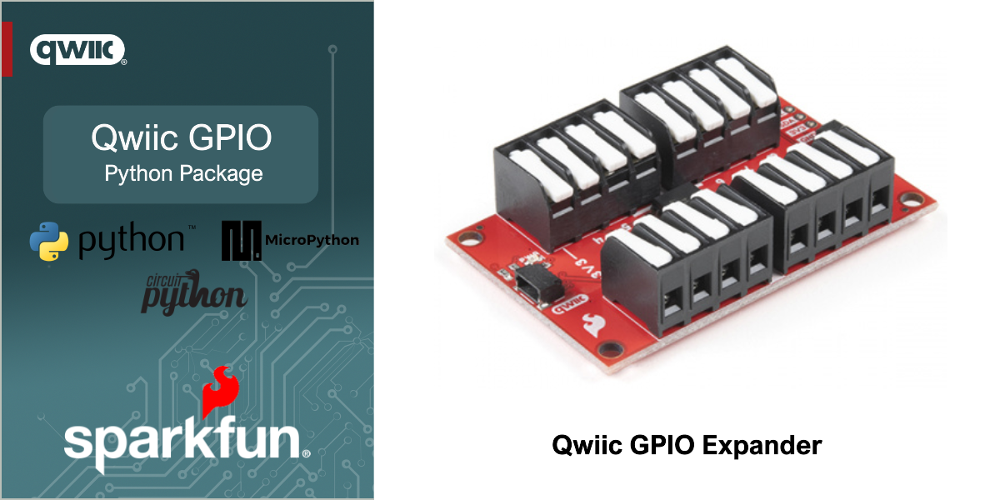

# SparkFun Qwiic GPIO - Python Package


[](https://docs.sparkfun.com/Qwiic_Py/qwiic_gpio/)

The SparkFun Qwiic GPIO provides a simple and cost effective solution for adding eight general purpose inputs and outputs to your project. Implementing a SparkFun Qwiic I2C interface, it can be rapidly added to any project with boards that are part of the SparkFun Qwiic ecosystem.

This package is the Python driver for the Qwiic GPIO (TCA9534). It works on CPython (Linux), MicroPython and CircuitPython, and is part of the [SparkFun Qwiic Python package](https://github.com/sparkfun/Qwiic_Py).

## Contents

* [About the Package](#about-the-package)
* [Supported Platforms](#supported-platforms)
* [Installation](#installation)
* [Example Use](#example-use)
* [Documentation](#documentation)
* [Migrating from 2.x](#migrating-from-2x)

## About the Package

This package sets pin modes, writes and reads pins one at a time or as a whole port, and inverts inputs on the Qwiic GPIO over a single Qwiic cable. Each feature is demonstrated in the [examples](examples/README.md).

New to Qwiic? Take a look at the entire [SparkFun Qwiic ecosystem](https://www.sparkfun.com/qwiic).

### Supported SparkFun Products

* [SparkFun Qwiic GPIO](https://www.sparkfun.com/sparkfun-qwiic-gpio.html)

## Supported Platforms

| Python | Platform | Boards |
| --- | --- | --- |
| CPython | Linux | [Raspberry Pi](https://www.sparkfun.com/raspberry-pi-5-8gb.html), [NVIDIA Jetson Orin Nano](https://www.sparkfun.com/nvidia-jetson-orin-nano-developer-kit.html) via the [SparkFun Qwiic SHIM](https://www.sparkfun.com/sparkfun-qwiic-shim-for-raspberry-pi.html) |
| MicroPython | Raspberry Pi RP2, ESP32 | [SparkFun Pro Micro RP2350](https://www.sparkfun.com/sparkfun-pro-micro-rp2350.html), [SparkFun IoT RedBoard ESP32](https://www.sparkfun.com/sparkfun-iot-redboard-esp32-development-board.html), [SparkFun IoT RedBoard RP2350](https://www.sparkfun.com/sparkfun-iot-redboard-rp2350.html) |
| CircuitPython | Raspberry Pi RP2, ESP32 | [SparkFun Pro Micro RP2350](https://www.sparkfun.com/sparkfun-pro-micro-rp2350.html), [SparkFun IoT RedBoard ESP32](https://www.sparkfun.com/sparkfun-iot-redboard-esp32-development-board.html), [SparkFun IoT RedBoard RP2350](https://www.sparkfun.com/sparkfun-iot-redboard-rp2350.html) |

> [!NOTE]
> These are the primary platforms tested. The package is expected to work on most Python-enabled systems.

## Installation

### CPython (pip)

```sh
python3 -m venv ~/sparkfun_venv
~/sparkfun_venv/bin/pip install sparkfun-qwiic-gpio
```

Run any example or script that does `import qwiic_gpio` with `~/sparkfun_venv/bin/python3 example_script.py`.

### MicroPython (mip)

Install [mpremote](https://docs.micropython.org/en/latest/reference/mpremote.html), connect your board, then install the driver (this also installs `qwiic_i2c`):

```sh
mpremote mip install github:sparkfun/Qwiic_Py/drivers/qwiic_gpio
```

To install the examples too:

```sh
mpremote mip install --target "" github:sparkfun/Qwiic_Py/drivers/qwiic_gpio/examples
```

Add `@qwiic_gpio-<version>` to either command to install a specific release.

### CircuitPython (circup)

Install [CircUp](https://docs.circuitpython.org/projects/circup/en/latest/#installation), add the SparkFun Qwiic bundle once, then install the driver:

```sh
circup bundle-add sparkfun/Qwiic_Py
circup install qwiic_gpio
```

To copy an example to the board:

```sh
circup example qwiic_gpio/qwiic_gpio_ex1a_write
```

## Example Use

Below is a quickstart program that toggles GPIO 0 HIGH and LOW once a second. See the [examples directory](examples) for more, and [examples/README.md](examples/README.md) for a summary of each.

```python
import sys
import qwiic_gpio
import qwiic_i2c


print("\nSparkFun Qwiic GPIO Example 1\n")
my_gpio = qwiic_gpio.QwiicGPIO()

if not my_gpio.is_connected():
    print("The Qwiic GPIO isn't connected to the system. Please check your connection", file=sys.stderr)
    sys.exit(1)

my_gpio.begin()
my_gpio.pin_mode(0, my_gpio.GPIO_OUT)

while True:
    my_gpio.digital_write(0, my_gpio.GPIO_HI)
    print("set pin 0 hi!")
    qwiic_i2c.delay_ms(1000)
    my_gpio.digital_write(0, my_gpio.GPIO_LO)
    print("set pin 0 lo!")
    qwiic_i2c.delay_ms(1000)
```

## Documentation

The API reference is at [docs.sparkfun.com/Qwiic_Py/qwiic_gpio](https://docs.sparkfun.com/Qwiic_Py/qwiic_gpio/).

## Migrating from 2.x

Version 3 uses PEP 8 `snake_case` names, with one name per method.

| 2.x | 3.0 |
| --- | --- |
| `gpio.isConnected()` | `gpio.is_connected()` |
| `setMode()`, `getMode()` | `set_mode()`, `get_mode()` |
| `setInversion()`, `getInversion()` | `set_inversion()`, `get_inversion()` |
| `setGPIO()`, `getGPIO()` | `set_gpio()`, `get_gpio()` |
| `pinMode(pin, mode)`, `pinModePort(modes)` | `pin_mode(pin, mode)`, `pin_mode_port(modes)` |
| `invertPin(pin, invert)`, `invertPinPort(inversions)` | `invert_pin(pin, invert)`, `invert_pin_port(inversions)` |
| `digitalWrite(pin, value)`, `digitalWritePort(values)` | `digital_write(pin, value)`, `digital_write_port(values)` |
| `digitalRead(pin)`, `digitalReadPort()` | `digital_read(pin)`, `digital_read_port()` |
| `isConnected()` checked the platform default bus, not the driver's bus | `is_connected()` checks the bus the driver was given |

<p align="center">

</p>
