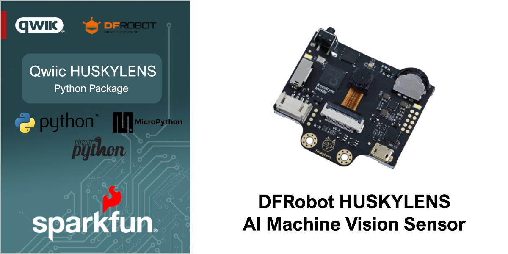

# SparkFun Qwiic HUSKYLENS - Python Package


[](https://docs.sparkfun.com/Qwiic_Py/qwiic_huskylens/)

The DFRobot HUSKYLENS Module provides a simple and cost effective solution for adding AI camera capabilities to your project. Implementing an I2C interface, these sensors can be rapidly added to any project with boards that are part of the SparkFun Qwiic ecosystem.

This package is the Python driver for the HUSKYLENS. It works on CPython (Linux), MicroPython and CircuitPython, and is part of the [SparkFun Qwiic Python package](https://github.com/sparkfun/Qwiic_Py).

## Contents

* [About the Package](#about-the-package)
* [Supported Platforms](#supported-platforms)
* [Installation](#installation)
* [Example Use](#example-use)
* [Documentation](#documentation)
* [Migrating from 2.x](#migrating-from-2x)

## About the Package

This package uses the HUSKYLENS over a single Qwiic cable for face recognition, object tracking, object recognition, line tracking, color recognition, tag recognition and object classification, and lets you teach, name and forget objects and write text to its screen. Each feature is demonstrated in the [examples](examples/README.md).

New to Qwiic? Take a look at the entire [SparkFun Qwiic ecosystem](https://www.sparkfun.com/qwiic).

### Supported SparkFun Products

* [DFRobot HUSKYLENS AI Camera](https://www.dfrobot.com/product-1922.html)

## Supported Platforms

| Python | Platform | Boards |
| --- | --- | --- |
| CPython | Linux | [Raspberry Pi](https://www.sparkfun.com/raspberry-pi-5-8gb.html), [NVIDIA Jetson Orin Nano](https://www.sparkfun.com/nvidia-jetson-orin-nano-developer-kit.html) via the [SparkFun Qwiic SHIM](https://www.sparkfun.com/sparkfun-qwiic-shim-for-raspberry-pi.html) |
| MicroPython | Raspberry Pi RP2, ESP32 | [SparkFun Pro Micro RP2350](https://www.sparkfun.com/sparkfun-pro-micro-rp2350.html), [SparkFun IoT RedBoard ESP32](https://www.sparkfun.com/sparkfun-iot-redboard-esp32-development-board.html), [SparkFun IoT RedBoard RP2350](https://www.sparkfun.com/sparkfun-iot-redboard-rp2350.html) |
| CircuitPython | Raspberry Pi RP2, ESP32 | [SparkFun Pro Micro RP2350](https://www.sparkfun.com/sparkfun-pro-micro-rp2350.html), [SparkFun IoT RedBoard ESP32](https://www.sparkfun.com/sparkfun-iot-redboard-esp32-development-board.html), [SparkFun IoT RedBoard RP2350](https://www.sparkfun.com/sparkfun-iot-redboard-rp2350.html) |

> [!NOTE]
> These are the primary platforms tested. The package is expected to work on most Python-enabled systems.

## Installation

### CPython (pip)

```sh
python3 -m venv ~/sparkfun_venv
~/sparkfun_venv/bin/pip install sparkfun-qwiic-huskylens
```

Run any example or script that does `import qwiic_huskylens` with `~/sparkfun_venv/bin/python3 example_script.py`.

### MicroPython (mip)

Install [mpremote](https://docs.micropython.org/en/latest/reference/mpremote.html), connect your board, then install the driver (this also installs `qwiic_i2c`):

```sh
mpremote mip install github:sparkfun/Qwiic_Py/drivers/qwiic_huskylens
```

To install the examples too:

```sh
mpremote mip install --target "" github:sparkfun/Qwiic_Py/drivers/qwiic_huskylens/examples
```

Add `@qwiic_huskylens-<version>` to either command to install a specific release.

### CircuitPython (circup)

Install [CircUp](https://docs.circuitpython.org/projects/circup/en/latest/#installation), add the SparkFun Qwiic bundle once, then install the driver:

```sh
circup bundle-add sparkfun/Qwiic_Py
circup install qwiic_huskylens
```

To copy an example to the board:

```sh
circup example qwiic_huskylens/qwiic_huskylens_ex1_basic_readings
```

## Example Use

Below is a quickstart program that prints every object and line the HUSKYLENS recognizes with its current algorithm. See the [examples directory](examples) for more, and [examples/README.md](examples/README.md) for a summary of each.

```python
import sys
import qwiic_huskylens
import qwiic_i2c


def run_example():
    print("\nQwiic HuskyLens Example 1 - Basic Readings\n")
    my_husky_lens = qwiic_huskylens.QwiicHuskyLens()

    if not my_husky_lens.begin():
        print("Device not connected, please check your connection", file=sys.stderr)
        return

    while True:
        qwiic_i2c.delay_ms(1000)

        for obj in my_husky_lens.get_objects_of_interest():
            print("Object ID %d at (%d, %d), %d x %d" % (obj.id, obj.x_center, obj.y_center, obj.width, obj.height))

        for line in my_husky_lens.get_lines_of_interest():
            print("Line ID %d from (%d, %d) to (%d, %d)" % (line.id, line.x_origin, line.y_origin, line.x_target, line.y_target))


if __name__ == "__main__":
    try:
        run_example()
    except (KeyboardInterrupt, SystemExit):
        print("\nEnding Example")
        sys.exit(0)
```

## Documentation

The API reference is at [docs.sparkfun.com/Qwiic_Py/qwiic_huskylens](https://docs.sparkfun.com/Qwiic_Py/qwiic_huskylens/).

## Migrating from 2.x

Version 3 has one name per method and no properties, so it also runs on MicroPython builds without `property()`. Attribute names are snake_case.

| 2.x | 3.0 |
| --- | --- |
| `lens.connected` | `lens.is_connected()` |
| `request_algorithm(a)`, `set_algorithm(a)` | `set_algorithm(a)` |
| `request_custom_text(text, x, y)`, `write_to_screen(text, x, y)` | `write_to_screen(text, x, y)` (now returns `False` if the text is longer than 20 characters) |
| `request_clear_text()`, `clear_screen()` | `clear_screen()` |
| `request_forget()`, `forget()` | `forget()` |
| `block.xCenter`, `block.yCenter` | `block.x_center`, `block.y_center` |
| `arrow.xOrigin`, `arrow.yOrigin`, `arrow.xTarget`, `arrow.yTarget` | `arrow.x_origin`, `arrow.y_origin`, `arrow.x_target`, `arrow.y_target` |
| `lens.nLearned`, `lens.idToName` | `lens.n_learned`, `lens.id_to_name` |
| `request_send_knowledges(fileNum)`, `request_receive_knowledges(fileNum)` | `request_send_knowledges(file_num)`, `request_receive_knowledges(file_num)` |
| Waited forever for a response (`is_connected()` hung when the device sent no packet header) | a response that doesn't start within 1 s counts as invalid, so the call returns `False` |
| examples `ex1_basic_readings.py`, ... | `qwiic_huskylens_ex1_basic_readings.py`, ... |
| `k`-prefixed constants (`kCommandRequest`, `kCommandRequestBlocks`, ...) | UPPER_CASE without the `k` (`COMMAND_REQUEST`, `COMMAND_REQUEST_BLOCKS`, ...); every rename is listed below |

<details>
<summary>Every renamed constant</summary>

| 2.x | 3.0 |
| --- | --- |
| `kCommandRequest` | `COMMAND_REQUEST` |
| `kCommandRequestBlocks` | `COMMAND_REQUEST_BLOCKS` |
| `kCommandRequestArrows` | `COMMAND_REQUEST_ARROWS` |
| `kCommandRequestLearned` | `COMMAND_REQUEST_LEARNED` |
| `kCommandRequestBlocksLearned` | `COMMAND_REQUEST_BLOCKS_LEARNED` |
| `kCommandRequestArrowsLearned` | `COMMAND_REQUEST_ARROWS_LEARNED` |
| `kCommandRequestById` | `COMMAND_REQUEST_BY_ID` |
| `kCommandRequestBlocksById` | `COMMAND_REQUEST_BLOCKS_BY_ID` |
| `kCommandRequestArrowsById` | `COMMAND_REQUEST_ARROWS_BY_ID` |
| `kCommandReturnInfo` | `COMMAND_RETURN_INFO` |
| `kCommandReturnBlock` | `COMMAND_RETURN_BLOCK` |
| `kCommandReturnArrow` | `COMMAND_RETURN_ARROW` |
| `kCommandRequestKnock` | `COMMAND_REQUEST_KNOCK` |
| `kCommandRequestAlgorithm` | `COMMAND_REQUEST_ALGORITHM` |
| `kCommandReturnOk` | `COMMAND_RETURN_OK` |
| `kCommandRequestCustomNames` | `COMMAND_REQUEST_CUSTOM_NAMES` |
| `kCommandRequestPhoto` | `COMMAND_REQUEST_PHOTO` |
| `kCommandRequestSendKnowledges` | `COMMAND_REQUEST_SEND_KNOWLEDGES` |
| `kCommandRequestReceiveKnowledges` | `COMMAND_REQUEST_RECEIVE_KNOWLEDGES` |
| `kCommandRequestCustomText` | `COMMAND_REQUEST_CUSTOM_TEXT` |
| `kCommandRequestClearText` | `COMMAND_REQUEST_CLEAR_TEXT` |
| `kCommandRequestLearn` | `COMMAND_REQUEST_LEARN` |
| `kCommandRequestForget` | `COMMAND_REQUEST_FORGET` |
| `kCommandRequestSaveScreenshot` | `COMMAND_REQUEST_SAVE_SCREENSHOT` |
| `kCommandRequestIsPro` | `COMMAND_REQUEST_IS_PRO` |
| `kCommandReturnIsPro` | `COMMAND_RETURN_IS_PRO` |
| `kCommandRequestFirmwareVersion` | `COMMAND_REQUEST_FIRMWARE_VERSION` |
| `kCommandReturnBusy` | `COMMAND_RETURN_BUSY` |
| `kCommandReturnNeedPro` | `COMMAND_RETURN_NEED_PRO` |
| `kAlgorithmFaceRecognition` | `ALGORITHM_FACE_RECOGNITION` |
| `kAlgorithmObjectTracking` | `ALGORITHM_OBJECT_TRACKING` |
| `kAlgorithmObjectRecognition` | `ALGORITHM_OBJECT_RECOGNITION` |
| `kAlgorithmLineTracking` | `ALGORITHM_LINE_TRACKING` |
| `kAlgorithmColorRecognition` | `ALGORITHM_COLOR_RECOGNITION` |
| `kAlgorithmTagRecognition` | `ALGORITHM_TAG_RECOGNITION` |
| `kAlgorithmObjectClassification` | `ALGORITHM_OBJECT_CLASSIFICATION` |

</details>

<p align="center">

</p>
