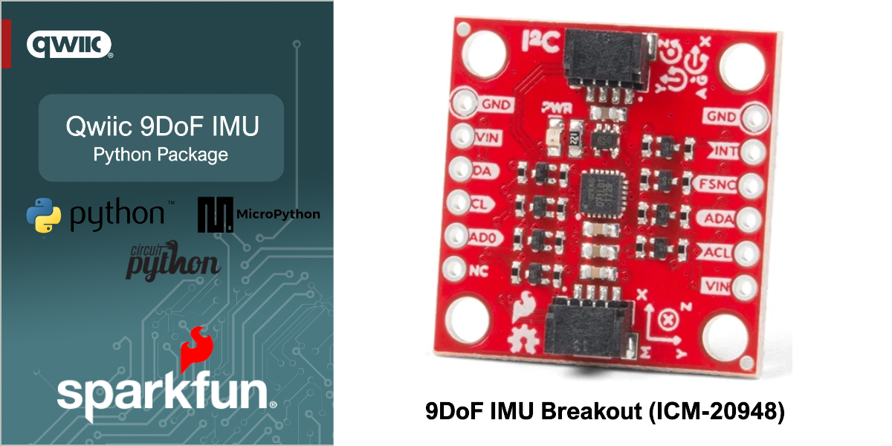

# SparkFun Qwiic ICM-20948 - Python Package


[](https://docs.sparkfun.com/Qwiic_Py/qwiic_icm20948/)

The SparkFun Qwiic 9 Degrees of Freedom IMU Breakout - ICM-20948 provides a simple and cost effective solution for adding 9 Degrees of Freedom IMU capabilities to your project. Implementing a SparkFun Qwiic I2C interface, these sensors can be rapidly added to any project with boards that are part of the SparkFun Qwiic ecosystem.

This package is the Python driver for the ICM-20948. It works on CPython (Linux), MicroPython and CircuitPython, and is part of the [SparkFun Qwiic Python package](https://github.com/sparkfun/Qwiic_Py).

## Contents

* [About the Package](#about-the-package)
* [Supported Platforms](#supported-platforms)
* [Installation](#installation)
* [Example Use](#example-use)
* [Documentation](#documentation)
* [Migrating from 2.x](#migrating-from-2x)

## About the Package

This package reads acceleration, angular rate, magnetic field and temperature from the ICM-20948 over a single Qwiic cable, and configures the full scale ranges, low pass filters and sample modes. Each feature is demonstrated in the [examples](examples/README.md).

Call `begin()` before changing any settings: it resets the sensor and wakes it from sleep (the ICM-20948 powers up asleep), so settings written before `begin()` may not take effect.

New to Qwiic? Take a look at the entire [SparkFun Qwiic ecosystem](https://www.sparkfun.com/qwiic).

### Supported SparkFun Products

* [SparkFun 9DoF IMU Breakout - ICM-20948 (Qwiic)](https://www.sparkfun.com/products/15335)

## Supported Platforms

| Python | Platform | Boards |
| --- | --- | --- |
| CPython | Linux | [Raspberry Pi](https://www.sparkfun.com/raspberry-pi-5-8gb.html), [NVIDIA Jetson Orin Nano](https://www.sparkfun.com/nvidia-jetson-orin-nano-developer-kit.html) via the [SparkFun Qwiic SHIM](https://www.sparkfun.com/sparkfun-qwiic-shim-for-raspberry-pi.html) |
| MicroPython | Raspberry Pi RP2, ESP32 | [SparkFun Pro Micro RP2350](https://www.sparkfun.com/sparkfun-pro-micro-rp2350.html), [SparkFun IoT RedBoard ESP32](https://www.sparkfun.com/sparkfun-iot-redboard-esp32-development-board.html), [SparkFun IoT RedBoard RP2350](https://www.sparkfun.com/sparkfun-iot-redboard-rp2350.html) |
| CircuitPython | Raspberry Pi RP2, ESP32 | [SparkFun Pro Micro RP2350](https://www.sparkfun.com/sparkfun-pro-micro-rp2350.html), [SparkFun IoT RedBoard ESP32](https://www.sparkfun.com/sparkfun-iot-redboard-esp32-development-board.html), [SparkFun IoT RedBoard RP2350](https://www.sparkfun.com/sparkfun-iot-redboard-rp2350.html) |

> [!NOTE]
> These are the primary platforms tested. The package is expected to work on most Python-enabled systems.

## Installation

### CPython (pip)

```sh
python3 -m venv ~/sparkfun_venv
~/sparkfun_venv/bin/pip install sparkfun-qwiic-icm20948
```

Run any example or script that does `import qwiic_icm20948` with `~/sparkfun_venv/bin/python3 example_script.py`.

### MicroPython (mip)

Install [mpremote](https://docs.micropython.org/en/latest/reference/mpremote.html), connect your board, then install the driver (this also installs `qwiic_i2c`):

```sh
mpremote mip install github:sparkfun/Qwiic_Py/drivers/qwiic_icm20948
```

To install the examples too:

```sh
mpremote mip install --target "" github:sparkfun/Qwiic_Py/drivers/qwiic_icm20948/examples
```

Add `@qwiic_icm20948-<version>` to either command to install a specific release.

### CircuitPython (circup)

Install [CircUp](https://docs.circuitpython.org/projects/circup/en/latest/#installation), add the SparkFun Qwiic bundle once, then install the driver:

```sh
circup bundle-add sparkfun/Qwiic_Py
circup install qwiic_icm20948
```

To copy an example to the board:

```sh
circup example qwiic_icm20948/qwiic_icm20948_ex1_basic_readings
```

## Example Use

Below is a quickstart program that prints the raw accelerometer, gyroscope and magnetometer readings. See the [examples directory](examples) for more, and [examples/README.md](examples/README.md) for a summary of each.

```python
import sys
import qwiic_i2c
import qwiic_icm20948


def run_example():
    print("\nSparkFun 9DoF ICM-20948 Sensor Example 1\n")
    imu = qwiic_icm20948.QwiicICM20948()

    if not imu.is_connected():
        print("The Qwiic ICM20948 device isn't connected to the system. Please check your connection", file=sys.stderr)
        return

    imu.begin()

    while True:
        if imu.data_ready():
            imu.get_agmt()  # updates ax_raw, ay_raw, az_raw, gx_raw, ... mz_raw
            print("ax: %6d ay: %6d az: %6d" % (imu.ax_raw, imu.ay_raw, imu.az_raw))
            print("gx: %6d gy: %6d gz: %6d" % (imu.gx_raw, imu.gy_raw, imu.gz_raw))
            print("mx: %6d my: %6d mz: %6d\n" % (imu.mx_raw, imu.my_raw, imu.mz_raw))
            qwiic_i2c.delay_ms(30)
        else:
            print("Waiting for data")
            qwiic_i2c.delay_ms(500)


if __name__ == "__main__":
    try:
        run_example()
    except (KeyboardInterrupt, SystemExit):
        print("\nEnding Example 1")
        sys.exit(0)
```

## Documentation

The API reference is at [docs.sparkfun.com/Qwiic_Py/qwiic_icm20948](https://docs.sparkfun.com/Qwiic_Py/qwiic_icm20948/).

## Migrating from 2.x

Version 3 uses PEP 8 names throughout and has no properties, so it also runs on MicroPython builds without `property()`. The module-level constants are now UPPER_CASE.

| 2.x | 3.0 |
| --- | --- |
| `QwiicIcm20948` | `QwiicICM20948` |
| `imu.connected`, `isConnected()` | `imu.is_connected()` |
| k-prefixed / mixed-case constants | UPPER_CASE (see [Renamed constants](#renamed-constants)) |
| `setBank(b)` | `set_bank(b)` |
| `swReset()` | `sw_reset()` |
| `lowPower(on)` | `low_power(on)` |
| `setSampleMode(sensors, mode)` | `set_sample_mode(sensors, mode)` |
| `setFullScaleRangeAccel(mode)` | `set_full_scale_range_accel(mode)` |
| `setFullScaleRangeGyro(mode)` | `set_full_scale_range_gyro(mode)` |
| `setDLPFcfgAccel(cfg)` | `set_dlpf_cfg_accel(cfg)` |
| `setDLPFcfgGyro(cfg)` | `set_dlpf_cfg_gyro(cfg)` |
| `enableDlpfAccel(on)` | `enable_dlpf_accel(on)` |
| `enableDlpfGyro(on)` | `enable_dlpf_gyro(on)` |
| `dataReady()` | `data_ready()` |
| `ToSignedInt(x)` | `to_signed_int(x)` |
| `getAgmt()` | `get_agmt()` |
| `i2cMasterPassthrough(on)` | `i2c_master_passthrough(on)` |
| `i2cMasterEnable(on)` | `i2c_master_enable(on)` |
| `ICM_20948_i2c_master_slv4_txn(addr, reg, data, Rw, send_reg_addr)` | `i2c_master_slv4_txn(addr, reg, data, rw, send_reg_addr)` |
| `i2cMasterSingleW(addr, reg, data)` | `i2c_master_single_w(addr, reg, data)` |
| `i2cMasterSingleR(addr, reg)` | `i2c_master_single_r(addr, reg)` |
| `writeMag(reg, data)` | `write_mag(reg, data)` |
| `readMag(reg)` | `read_mag(reg)` |
| `magWhoIAm()` | `mag_who_i_am()` |
| `i2cMasterReset()` | `i2c_master_reset()` |
| `i2cMasterConfigureSlave(slave, addr, reg, len, Rw, ...)` | `i2c_master_configure_slave(slave, addr, reg, len, rw, ...)` |
| `startupMagnetometer()` | `startup_magnetometer()` |
| `imu.axRaw`, `ayRaw`, `azRaw` | `imu.ax_raw`, `ay_raw`, `az_raw` |
| `imu.gxRaw`, `gyRaw`, `gzRaw` | `imu.gx_raw`, `gy_raw`, `gz_raw` |
| `imu.mxRaw`, `myRaw`, `mzRaw` | `imu.mx_raw`, `my_raw`, `mz_raw` |
| `imu.tmpRaw`, `magStat1`, `magStat2` | `imu.tmp_raw`, `mag_stat1`, `mag_stat2` |
| Raw reading attributes did not exist until the first `getAgmt()` | They start at `0` |
| Setters returned `None` (the result of the I2C write) | Setters return `True`; the accel/gyro range, DLPF and DLPF-enable setters read the register back and return `False` if the write did not take |
| `begin()` printed "Invalid Chip ID" and returned `True` even if the magnetometer failed to start | `begin()` returns `False` without printing if the chip ID is wrong or the magnetometer does not start |
| `setBank()`, `setSampleMode()`, `startupMagnetometer()` printed errors | They return `False` without printing |
| `begin()` raised `OSError` when no device answered | `begin()` returns `False` |

### Renamed constants

The module-level constants are upper-cased; their values are unchanged.

| 2.x | 3.0 |
| --- | --- |
| `ICM_20948_Internal_Acc`, `ICM_20948_Internal_Gyr`, `ICM_20948_Internal_Mag`, `ICM_20948_Internal_Tmp`, `ICM_20948_Internal_Mst` | `ICM_20948_INTERNAL_ACC`, `ICM_20948_INTERNAL_GYR`, `ICM_20948_INTERNAL_MAG`, `ICM_20948_INTERNAL_TMP`, `ICM_20948_INTERNAL_MST` |
| `ICM_20948_Sample_Mode_Continuous`, `ICM_20948_Sample_Mode_Cycled` | `ICM_20948_SAMPLE_MODE_CONTINUOUS`, `ICM_20948_SAMPLE_MODE_CYCLED` |
| `gpm2`, `gpm4`, `gpm8`, `gpm16` | `GPM2`, `GPM4`, `GPM8`, `GPM16` |
| `dps250`, `dps500`, `dps1000`, `dps2000` | `DPS250`, `DPS500`, `DPS1000`, `DPS2000` |
| `acc_d246bw_n265bw`, `acc_d246bw_n265bw_1`, `acc_d111bw4_n136bw`, `acc_d50bw4_n68bw8`, `acc_d23bw9_n34bw4`, `acc_d11bw5_n17bw` | `ACC_D246BW_N265BW`, `ACC_D246BW_N265BW_1`, `ACC_D111BW4_N136BW`, `ACC_D50BW4_N68BW8`, `ACC_D23BW9_N34BW4`, `ACC_D11BW5_N17BW` |
| `acc_d5bw7_n8bw3`, `acc_d473bw_n499bw` | `ACC_D5BW7_N8BW3`, `ACC_D473BW_N499BW` |
| `gyr_d196bw6_n229bw8`, `gyr_d151bw8_n187bw6`, `gyr_d119bw5_n154bw3`, `gyr_d51bw2_n73bw3`, `gyr_d23bw9_n35bw9`, `gyr_d11bw6_n17bw8` | `GYR_D196BW6_N229BW8`, `GYR_D151BW8_N187BW6`, `GYR_D119BW5_N154BW3`, `GYR_D51BW2_N73BW3`, `GYR_D23BW9_N35BW9`, `GYR_D11BW6_N17BW8` |
| `gyr_d5bw7_n8bw9`, `gyr_d361bw4_n376bw5` | `GYR_D5BW7_N8BW9`, `GYR_D361BW4_N376BW5` |
| `AK09916_mode_power_down`, `AK09916_mode_single`, `AK09916_mode_cont_10hz`, `AK09916_mode_cont_20hz`, `AK09916_mode_cont_50hz`, `AK09916_mode_cont_100hz` | `AK09916_MODE_POWER_DOWN`, `AK09916_MODE_SINGLE`, `AK09916_MODE_CONT_10HZ`, `AK09916_MODE_CONT_20HZ`, `AK09916_MODE_CONT_50HZ`, `AK09916_MODE_CONT_100HZ` |
| `AK09916_mode_self_test` | `AK09916_MODE_SELF_TEST` |
| The raw temperature (`tmp_raw`) was unsigned, so readings below about 21 °C came out near 65000 | signed, like the other readings |

<p align="center">

</p>
