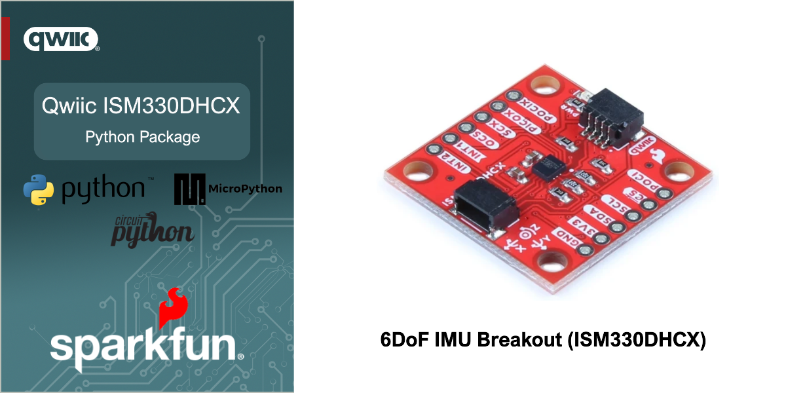

# SparkFun Qwiic ISM330DHCX - Python Package


[](https://docs.sparkfun.com/Qwiic_Py/qwiic_ism330dhcx/)

The SparkFun Qwiic 6DoF IMU ISM330DHCX Module provides a simple and cost effective solution for adding 6DoF IMU capabilities to your project. Implementing a SparkFun Qwiic I2C interface, these sensors can be rapidly added to any project with boards that are part of the SparkFun Qwiic ecosystem.

This package is the Python driver for the ISM330DHCX. It works on CPython (Linux), MicroPython and CircuitPython, and is part of the [SparkFun Qwiic Python package](https://github.com/sparkfun/Qwiic_Py).

## Contents

* [About the Package](#about-the-package)
* [Supported Platforms](#supported-platforms)
* [Installation](#installation)
* [Example Use](#example-use)
* [Documentation](#documentation)
* [Migrating from 2.x](#migrating-from-2x)

## About the Package

This package reads acceleration, angular rate and temperature from the ISM330DHCX over a single Qwiic cable, and configures data rates, full scale ranges, filters, the FIFO, interrupts and the sensor hub. Each feature is demonstrated in the [examples](examples/README.md).

New to Qwiic? Take a look at the entire [SparkFun Qwiic ecosystem](https://www.sparkfun.com/qwiic).

### Supported SparkFun Products

* [SparkFun 6DoF IMU Sensor - ISM330DHCX](https://www.sparkfun.com/products/19764)

## Supported Platforms

| Python | Platform | Boards |
| --- | --- | --- |
| CPython | Linux | [Raspberry Pi](https://www.sparkfun.com/raspberry-pi-5-8gb.html), [NVIDIA Jetson Orin Nano](https://www.sparkfun.com/nvidia-jetson-orin-nano-developer-kit.html) via the [SparkFun Qwiic SHIM](https://www.sparkfun.com/sparkfun-qwiic-shim-for-raspberry-pi.html) |
| MicroPython | Raspberry Pi RP2, ESP32 | [SparkFun Pro Micro RP2350](https://www.sparkfun.com/sparkfun-pro-micro-rp2350.html), [SparkFun IoT RedBoard ESP32](https://www.sparkfun.com/sparkfun-iot-redboard-esp32-development-board.html), [SparkFun IoT RedBoard RP2350](https://www.sparkfun.com/sparkfun-iot-redboard-rp2350.html) |
| CircuitPython | Raspberry Pi RP2, ESP32 | [SparkFun Pro Micro RP2350](https://www.sparkfun.com/sparkfun-pro-micro-rp2350.html), [SparkFun IoT RedBoard ESP32](https://www.sparkfun.com/sparkfun-iot-redboard-esp32-development-board.html), [SparkFun IoT RedBoard RP2350](https://www.sparkfun.com/sparkfun-iot-redboard-rp2350.html) |

> [!NOTE]
> These are the primary platforms tested. The package is expected to work on most Python-enabled systems.

## Installation

### CPython (pip)

```sh
python3 -m venv ~/sparkfun_venv
~/sparkfun_venv/bin/pip install sparkfun-qwiic-ism330dhcx
```

Run any example or script that does `import qwiic_ism330dhcx` with `~/sparkfun_venv/bin/python3 example_script.py`.

### MicroPython (mip)

Install [mpremote](https://docs.micropython.org/en/latest/reference/mpremote.html), connect your board, then install the driver (this also installs `qwiic_i2c`):

```sh
mpremote mip install github:sparkfun/Qwiic_Py/drivers/qwiic_ism330dhcx
```

To install the examples too:

```sh
mpremote mip install --target "" github:sparkfun/Qwiic_Py/drivers/qwiic_ism330dhcx/examples
```

Add `@qwiic_ism330dhcx-<version>` to either command to install a specific release.

### CircuitPython (circup)

Install [CircUp](https://docs.circuitpython.org/projects/circup/en/latest/#installation), add the SparkFun Qwiic bundle once, then install the driver:

```sh
circup bundle-add sparkfun/Qwiic_Py
circup install qwiic_ism330dhcx
```

To copy an example to the board:

```sh
circup example qwiic_ism330dhcx/qwiic_ism330dhcx_ex1_basic
```

## Example Use

Below is a quickstart program that configures the accelerometer and gyroscope and prints their readings. See the [examples directory](examples) for more, and [examples/README.md](examples/README.md) for a summary of each.

```python
import sys
import qwiic_i2c
import qwiic_ism330dhcx


print("\nQwiic ISM330DHCX Example 1 - Basic Readings\n")
my_ism = qwiic_ism330dhcx.QwiicISM330DHCX()

if not my_ism.is_connected():
    print("The device isn't connected to the system. Please check your connection", file=sys.stderr)
    sys.exit(1)

my_ism.begin()
my_ism.device_reset()
while not my_ism.get_device_reset():
    qwiic_i2c.delay_ms(1000)

my_ism.set_device_config()
my_ism.set_block_data_update()
my_ism.set_accel_data_rate(my_ism.XL_ODR_104HZ)
my_ism.set_accel_full_scale(my_ism.XL_FS_4G)
my_ism.set_gyro_data_rate(my_ism.GYRO_ODR_104HZ)
my_ism.set_gyro_full_scale(my_ism.GYRO_FS_500DPS)

while True:
    if my_ism.check_status():
        accel = my_ism.get_accel()
        gyro = my_ism.get_gyro()
        print("Accel X: %f, Y: %f, Z: %f mg" % (accel.x_data, accel.y_data, accel.z_data))
        print("Gyro X: %f, Y: %f, Z: %f mdps" % (gyro.x_data, gyro.y_data, gyro.z_data))
    qwiic_i2c.delay_ms(100)
```

## Documentation

The API reference is at [docs.sparkfun.com/Qwiic_Py/qwiic_ism330dhcx](https://docs.sparkfun.com/Qwiic_Py/qwiic_ism330dhcx/).

## Migrating from 2.x

Version 3 uses snake_case names throughout and has no properties, so it also runs on MicroPython builds without `property()`. The class constants are now UPPER_CASE, and two typo'd register names were fixed.

| 2.x | 3.0 |
| --- | --- |
| `IsmData` (returned by `get_accel()`, `get_gyro()`, `get_raw_accel()`, `get_raw_gyro()`) | `ISMData` |
| `data.xData`, `data.yData`, `data.zData` | `data.x_data`, `data.y_data`, `data.z_data` |
| `ism.connected` | `ism.is_connected()` |
| k-prefixed / mixed-case constants | UPPER_CASE (see [Renamed constants](#renamed-constants)) |
| `setAccelSelfTest(val)` | `set_accel_self_test(val)` |
| `setGyroSelfTest(val)` | `set_gyro_self_test(val)` |
| `set_pin_mode(activeLow)` | `set_pin_mode(active_low)` |
| `set_hub_sensor_read(sensor, address, subAddress, lenData)` | `set_hub_sensor_read(sensor, address, sub_address, len_data)` |
| `set_hub_sensor_write(address, subAddress, data)` | `set_hub_sensor_write(address, sub_address, data)` |
| `set_number_hub_sensors(highestSlave)` | `set_number_hub_sensors(highest_slave)` |
| `kRegEmbFunInt2`, `kRegslv1Config` | `REG_EMB_FUNC_INT2`, `REG_SLV1_CONFIG` |
| `is_connected()` and `begin()` returned `None` when the sensor was found | Return `True` |
| `set_data_ready_mode()` raised `AttributeError`; documented `kDataReadyPulsed` / `kDataReadyLatched` | Works; takes `DRDY_LATCHED` or `DRDY_PULSED` |
| `set_gyro_fifo_batch_set()`, `set_accel_status_to_int2()`, `set_gyro_status_to_int2()`, `set_hub_sensor_read()` (sensors 1-3) and `read_peripheral_sensor()` / `read_mmc_magnetometer()` raised `AttributeError` | Work |
| `set_hub_pass_through()` cleared the wrong bit before setting the pass-through bit | Clears and sets the pass-through bit |
| `get_temp()` was documented as degrees Celsius | Documented as the raw reading it returns; convert with `convert_lsb_to_celsius()` |

### Renamed constants

The leading `k` is dropped and the names are upper-cased with `_` between words; the values are unchanged. Every value you can pass to a method is listed below; the register, shift and mask constants follow the pattern in the last three rows. A fractional rate such as `12Hz5` (12.5 Hz) becomes `12_5HZ`.

| 2.x | 3.0 |
| --- | --- |
| `kDevId` | `DEV_ID` |
| `kXlFs2g`, `kXlFs16g`, `kXlFs4g`, `kXlFs8g` | `XL_FS_2G`, `XL_FS_16G`, `XL_FS_4G`, `XL_FS_8G` |
| `kGyroFs125dps`, `kGyroFs250dps`, `kGyroFs500dps`, `kGyroFs1000dps`, `kGyroFs2000dps`, `kGyroFs4000dps` | `GYRO_FS_125DPS`, `GYRO_FS_250DPS`, `GYRO_FS_500DPS`, `GYRO_FS_1000DPS`, `GYRO_FS_2000DPS`, `GYRO_FS_4000DPS` |
| `kHpPathDisableOnOut`, `kSlopeOdrDiv4`, `kHpOdrDiv10`, `kHpOdrDiv20`, `kHpOdrDiv45` | `HP_PATH_DISABLE_ON_OUT`, `SLOPE_ODR_DIV4`, `HP_ODR_DIV10`, `HP_ODR_DIV20`, `HP_ODR_DIV45` |
| `kHpOdrDiv100`, `kHpOdrDiv200`, `kHpOdrDiv400`, `kHpOdrDiv800` | `HP_ODR_DIV100`, `HP_ODR_DIV200`, `HP_ODR_DIV400`, `HP_ODR_DIV800` |
| `kHpRefMdOdrDiv10`, `kHpRefMdOdrDiv20`, `kHpRefMdOdrDiv45`, `kHpRefMdOdrDiv100` | `HP_REF_MD_ODR_DIV10`, `HP_REF_MD_ODR_DIV20`, `HP_REF_MD_ODR_DIV45`, `HP_REF_MD_ODR_DIV100` |
| `kHpRefMdOdrDiv200`, `kHpRefMdOdrDiv400`, `kHpRefMdOdrDiv800` | `HP_REF_MD_ODR_DIV200`, `HP_REF_MD_ODR_DIV400`, `HP_REF_MD_ODR_DIV800` |
| `kLpOdrDiv10`, `kLpOdrDiv20`, `kLpOdrDiv45`, `kLpOdrDiv100` | `LP_ODR_DIV10`, `LP_ODR_DIV20`, `LP_ODR_DIV45`, `LP_ODR_DIV100` |
| `kLpOdrDiv200`, `kLpOdrDiv400`, `kLpOdrDiv800` | `LP_ODR_DIV200`, `LP_ODR_DIV400`, `LP_ODR_DIV800` |
| `kBwUltraLight`, `kBwVeryLight`, `kBwLight`, `kBwMedium` | `BW_ULTRA_LIGHT`, `BW_VERY_LIGHT`, `BW_LIGHT`, `BW_MEDIUM` |
| `kBwStrong`, `kBwVeryStrong`, `kBwAggressive`, `kBwXtreme` | `BW_STRONG`, `BW_VERY_STRONG`, `BW_AGGRESSIVE`, `BW_XTREME` |
| `kXlOdrOff`, `kXlOdr12Hz5`, `kXlOdr26Hz`, `kXlOdr52Hz`, `kXlOdr104Hz`, `kXlOdr208Hz` | `XL_ODR_OFF`, `XL_ODR_12_5HZ`, `XL_ODR_26HZ`, `XL_ODR_52HZ`, `XL_ODR_104HZ`, `XL_ODR_208HZ` |
| `kXlOdr416Hz`, `kXlOdr833Hz`, `kXlOdr1666Hz`, `kXlOdr3332Hz`, `kXlOdr6667Hz`, `kXlOdr1Hz6` | `XL_ODR_416HZ`, `XL_ODR_833HZ`, `XL_ODR_1666HZ`, `XL_ODR_3332HZ`, `XL_ODR_6667HZ`, `XL_ODR_1_6HZ` |
| `kGyroOdrOff`, `kGyroOdr12Hz5`, `kGyroOdr26Hz`, `kGyroOdr52Hz`, `kGyroOdr104Hz`, `kGyroOdr208Hz` | `GYRO_ODR_OFF`, `GYRO_ODR_12_5HZ`, `GYRO_ODR_26HZ`, `GYRO_ODR_52HZ`, `GYRO_ODR_104HZ`, `GYRO_ODR_208HZ` |
| `kGyroOdr416Hz`, `kGyroOdr833Hz`, `kGyroOdr1666Hz`, `kGyroOdr3332Hz`, `kGyroOdr6667Hz` | `GYRO_ODR_416HZ`, `GYRO_ODR_833HZ`, `GYRO_ODR_1666HZ`, `GYRO_ODR_3332HZ`, `GYRO_ODR_6667HZ` |
| `kMlcOdr12Hz5`, `kMlcOdr26Hz`, `kMlcOdr52Hz`, `kMlcOdr104Hz` | `MLC_ODR_12_5HZ`, `MLC_ODR_26HZ`, `MLC_ODR_52HZ`, `MLC_ODR_104HZ` |
| `kShOdr104Hz`, `kShOdr52Hz`, `kShOdr26Hz`, `kShOdr13Hz` | `SH_ODR_104HZ`, `SH_ODR_52HZ`, `SH_ODR_26HZ`, `SH_ODR_13HZ` |
| `kUserBank`, `kSensorHubBank`, `kEmbeddedFuncBank` | `USER_BANK`, `SENSOR_HUB_BANK`, `EMBEDDED_FUNC_BANK` |
| `kOdrFsm12Hz5`, `kOdrFsm26Hz`, `kOdrFsm52Hz`, `kOdrFsm104Hz` | `ODR_FSM_12_5HZ`, `ODR_FSM_26HZ`, `ODR_FSM_52HZ`, `ODR_FSM_104HZ` |
| `kBypassMode`, `kFifoMode`, `kStreamToFifoMode`, `kBypassToStreamMode`, `kStreamMode`, `kBypassToFifoMode` | `BYPASS_MODE`, `FIFO_MODE`, `STREAM_TO_FIFO_MODE`, `BYPASS_TO_STREAM_MODE`, `STREAM_MODE`, `BYPASS_TO_FIFO_MODE` |
| `kXlNotBatched`, `kXlBatchedAt12Hz5`, `kXlBatchedAt26Hz`, `kXlBatchedAt52Hz`, `kXlBatchedAt104Hz`, `kXlBatchedAt208Hz` | `XL_NOT_BATCHED`, `XL_BATCHED_AT_12_5HZ`, `XL_BATCHED_AT_26HZ`, `XL_BATCHED_AT_52HZ`, `XL_BATCHED_AT_104HZ`, `XL_BATCHED_AT_208HZ` |
| `kXlBatchedAt417Hz`, `kXlBatchedAt833Hz`, `kXlBatchedAt1667Hz`, `kXlBatchedAt3333Hz`, `kXlBatchedAt6667Hz`, `kXlBatchedAt6Hz5` | `XL_BATCHED_AT_417HZ`, `XL_BATCHED_AT_833HZ`, `XL_BATCHED_AT_1667HZ`, `XL_BATCHED_AT_3333HZ`, `XL_BATCHED_AT_6667HZ`, `XL_BATCHED_AT_6_5HZ` |
| `kGyroNotBatched`, `kGyroBatchedAt12Hz5`, `kGyroBatchedAt26Hz`, `kGyroBatchedAt52Hz`, `kGyroBatchedAt104Hz`, `kGyroBatchedAt208Hz` | `GYRO_NOT_BATCHED`, `GYRO_BATCHED_AT_12_5HZ`, `GYRO_BATCHED_AT_26HZ`, `GYRO_BATCHED_AT_52HZ`, `GYRO_BATCHED_AT_104HZ`, `GYRO_BATCHED_AT_208HZ` |
| `kGyroBatchedAt417Hz`, `kGyroBatchedAt833Hz`, `kGyroBatchedAt1667Hz`, `kGyroBatchedAt3333Hz`, `kGyroBatchedAt6667Hz`, `kGyroBatchedAt6Hz5` | `GYRO_BATCHED_AT_417HZ`, `GYRO_BATCHED_AT_833HZ`, `GYRO_BATCHED_AT_1667HZ`, `GYRO_BATCHED_AT_3333HZ`, `GYRO_BATCHED_AT_6667HZ`, `GYRO_BATCHED_AT_6_5HZ` |
| `kNoDecimation`, `kDec1`, `kDec8`, `kDec32` | `NO_DECIMATION`, `DEC1`, `DEC8`, `DEC32` |
| `kAllIntPulsed`, `kBaseLatchedEmbPulsed`, `kBasePulsedEmbLatched`, `kAllIntLatched` | `ALL_INT_PULSED`, `BASE_LATCHED_EMB_PULSED`, `BASE_PULSED_EMB_LATCHED`, `ALL_INT_LATCHED` |
| `kDrdyLatched`, `kDrdyPulsed` | `DRDY_LATCHED`, `DRDY_PULSED` |
| `kHubWriteModeCycle`, `kHubWriteModeSingle` | `HUB_WRITE_MODE_CYCLE`, `HUB_WRITE_MODE_SINGLE` |
| `kSelfTestDisable`, `kSelfTestPositive`, `kSelfTestNegative` | `SELF_TEST_DISABLE`, `SELF_TEST_POSITIVE`, `SELF_TEST_NEGATIVE` |
| Every register address `kReg<Name>`, e.g. `kRegCtrl1XL`, `kRegWhoAmI`, `kRegFifoCtrl4`, `kRegSlv0Config` | `REG_<NAME>`, e.g. `REG_CTRL1_XL`, `REG_WHO_AM_I`, `REG_FIFO_CTRL4`, `REG_SLV0_CONFIG` |
| Every bit-field shift `k<Reg>Shift<Field>`, e.g. `kCtrl1XlShiftOdr`, `kCtrl3CShiftBdu`, `kInt1CtrlShiftInt1DrdyXl` | `<REG>_SHIFT_<FIELD>`, e.g. `CTRL1_XL_SHIFT_ODR`, `CTRL3_C_SHIFT_BDU`, `INT1_CTRL_SHIFT_INT1_DRDY_XL` |
| Every bit-field mask `k<Reg>Mask<Field>`, e.g. `kCtrl1XlMaskFs`, `kMd1CfgMaskInt16d`, `kMasterConfigMaskPassThroughMode` | `<REG>_MASK_<FIELD>`, e.g. `CTRL1_XL_MASK_FS`, `MD1_CFG_MASK_INT1_6D`, `MASTER_CONFIG_MASK_PASS_THROUGH_MODE` |

<p align="center">

</p>
