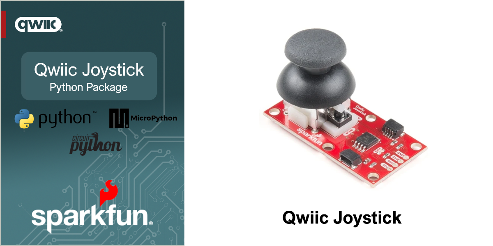

# SparkFun Qwiic Joystick - Python Package


[](https://docs.sparkfun.com/Qwiic_Py/qwiic_joystick/)

The SparkFun Qwiic Joystick provides a simple and cost effective solution for adding joystick capabilities to your project. Implementing a SparkFun Qwiic I2C interface, it can be rapidly added to any project with boards that are part of the SparkFun Qwiic ecosystem.

This package is the Python driver for the Qwiic Joystick. It works on CPython (Linux), MicroPython and CircuitPython, and is part of the [SparkFun Qwiic Python package](https://github.com/sparkfun/Qwiic_Py).

## Contents

* [About the Package](#about-the-package)
* [Supported Platforms](#supported-platforms)
* [Installation](#installation)
* [Example Use](#example-use)
* [Documentation](#documentation)
* [Migrating from 2.x](#migrating-from-2x)

## About the Package

This package reads the joystick's horizontal and vertical position and its button over a single Qwiic cable. Each feature is demonstrated in the [examples](examples/README.md).

New to Qwiic? Take a look at the entire [SparkFun Qwiic ecosystem](https://www.sparkfun.com/qwiic).

### Supported SparkFun Products

* [SparkFun Qwiic Joystick](https://www.sparkfun.com/products/15168)

## Supported Platforms

| Python | Platform | Boards |
| --- | --- | --- |
| CPython | Linux | [Raspberry Pi](https://www.sparkfun.com/raspberry-pi-5-8gb.html), [NVIDIA Jetson Orin Nano](https://www.sparkfun.com/nvidia-jetson-orin-nano-developer-kit.html) via the [SparkFun Qwiic SHIM](https://www.sparkfun.com/sparkfun-qwiic-shim-for-raspberry-pi.html) |
| MicroPython | Raspberry Pi RP2, ESP32 | [SparkFun Pro Micro RP2350](https://www.sparkfun.com/sparkfun-pro-micro-rp2350.html), [SparkFun IoT RedBoard ESP32](https://www.sparkfun.com/sparkfun-iot-redboard-esp32-development-board.html), [SparkFun IoT RedBoard RP2350](https://www.sparkfun.com/sparkfun-iot-redboard-rp2350.html) |
| CircuitPython | Raspberry Pi RP2, ESP32 | [SparkFun Pro Micro RP2350](https://www.sparkfun.com/sparkfun-pro-micro-rp2350.html), [SparkFun IoT RedBoard ESP32](https://www.sparkfun.com/sparkfun-iot-redboard-esp32-development-board.html), [SparkFun IoT RedBoard RP2350](https://www.sparkfun.com/sparkfun-iot-redboard-rp2350.html) |

> [!NOTE]
> These are the primary platforms tested. The package is expected to work on most Python-enabled systems.

## Installation

### CPython (pip)

```sh
python3 -m venv ~/sparkfun_venv
~/sparkfun_venv/bin/pip install sparkfun-qwiic-joystick
```

Run any example or script that does `import qwiic_joystick` with `~/sparkfun_venv/bin/python3 example_script.py`.

### MicroPython (mip)

Install [mpremote](https://docs.micropython.org/en/latest/reference/mpremote.html), connect your board, then install the driver (this also installs `qwiic_i2c`):

```sh
mpremote mip install github:sparkfun/Qwiic_Py/drivers/qwiic_joystick
```

To install the examples too:

```sh
mpremote mip install --target "" github:sparkfun/Qwiic_Py/drivers/qwiic_joystick/examples
```

Add `@qwiic_joystick-<version>` to either command to install a specific release.

### CircuitPython (circup)

Install [CircUp](https://docs.circuitpython.org/projects/circup/en/latest/#installation), add the SparkFun Qwiic bundle once, then install the driver:

```sh
circup bundle-add sparkfun/Qwiic_Py
circup install qwiic_joystick
```

To copy an example to the board:

```sh
circup example qwiic_joystick/qwiic_joystick_ex1_basic_reading
```

## Example Use

Below is a quickstart program that prints the joystick position and button state. See the [examples directory](examples) for more, and [examples/README.md](examples/README.md) for a summary of each.

```python
import sys
import qwiic_joystick
import qwiic_i2c


def run_example():
    print("\nSparkFun Qwiic Joystick Example 1\n")
    my_joystick = qwiic_joystick.QwiicJoystick()

    if not my_joystick.is_connected():
        print("The Qwiic Joystick device isn't connected to the system. Please check your connection", file=sys.stderr)
        return

    my_joystick.begin()
    print("Initialized. Firmware Version: %s" % my_joystick.get_version())

    while True:
        print("X: %d, Y: %d, Button: %d" % (
            my_joystick.get_horizontal(),
            my_joystick.get_vertical(),
            my_joystick.get_button()))
        qwiic_i2c.delay_ms(500)


if __name__ == "__main__":
    try:
        run_example()
    except (KeyboardInterrupt, SystemExit):
        print("\nEnding Example 1")
        sys.exit(0)
```

## Documentation

The API reference is at [docs.sparkfun.com/Qwiic_Py/qwiic_joystick](https://docs.sparkfun.com/Qwiic_Py/qwiic_joystick/).

## Migrating from 2.x

Version 3 has one name per method and no properties, so it also runs on MicroPython builds without `property()`.

| 2.x | 3.0 |
| --- | --- |
| `joystick.connected` | `joystick.is_connected()` |
| `joystick.horizontal`, `joystick.vertical` | `joystick.get_horizontal()`, `joystick.get_vertical()` |
| `joystick.button` | `joystick.get_button()` |
| `joystick.version` | `joystick.get_version()` |

<p align="center">

</p>
