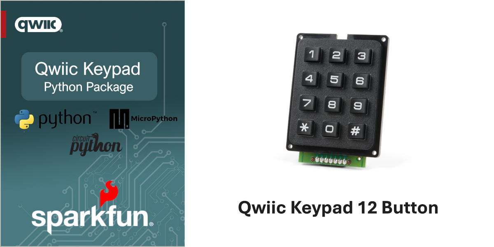

# SparkFun Qwiic Keypad - Python Package


[](https://docs.sparkfun.com/Qwiic_Py/qwiic_keypad/)

The SparkFun Qwiic Keypad provides a simple and cost effective solution for adding button inputs to your project without tying up GPIO lines. Implementing a SparkFun Qwiic I2C interface, it can be rapidly added to any project with boards that are part of the SparkFun Qwiic ecosystem.

This package is the Python driver for the Qwiic Keypad. It works on CPython (Linux), MicroPython and CircuitPython, and is part of the [SparkFun Qwiic Python package](https://github.com/sparkfun/Qwiic_Py).

## Contents

* [About the Package](#about-the-package)
* [Supported Platforms](#supported-platforms)
* [Installation](#installation)
* [Example Use](#example-use)
* [Documentation](#documentation)
* [Migrating from 2.x](#migrating-from-2x)

## About the Package

This package reads key presses and the time since each press from the Qwiic Keypad over a single Qwiic cable. Each feature is demonstrated in the [examples](examples/README.md).

New to Qwiic? Take a look at the entire [SparkFun Qwiic ecosystem](https://www.sparkfun.com/qwiic).

### Supported SparkFun Products

* [SparkFun Qwiic Keypad - 12 Button](https://www.sparkfun.com/sparkfun-qwiic-keypad-12-button.html)

## Supported Platforms

| Python | Platform | Boards |
| --- | --- | --- |
| CPython | Linux | [Raspberry Pi](https://www.sparkfun.com/raspberry-pi-5-8gb.html), [NVIDIA Jetson Orin Nano](https://www.sparkfun.com/nvidia-jetson-orin-nano-developer-kit.html) via the [SparkFun Qwiic SHIM](https://www.sparkfun.com/sparkfun-qwiic-shim-for-raspberry-pi.html) |
| MicroPython | Raspberry Pi RP2, ESP32 | [SparkFun Pro Micro RP2350](https://www.sparkfun.com/sparkfun-pro-micro-rp2350.html), [SparkFun IoT RedBoard ESP32](https://www.sparkfun.com/sparkfun-iot-redboard-esp32-development-board.html), [SparkFun IoT RedBoard RP2350](https://www.sparkfun.com/sparkfun-iot-redboard-rp2350.html) |
| CircuitPython | Raspberry Pi RP2, ESP32 | [SparkFun Pro Micro RP2350](https://www.sparkfun.com/sparkfun-pro-micro-rp2350.html), [SparkFun IoT RedBoard ESP32](https://www.sparkfun.com/sparkfun-iot-redboard-esp32-development-board.html), [SparkFun IoT RedBoard RP2350](https://www.sparkfun.com/sparkfun-iot-redboard-rp2350.html) |

> [!NOTE]
> These are the primary platforms tested. The package is expected to work on most Python-enabled systems.

## Installation

### CPython (pip)

```sh
python3 -m venv ~/sparkfun_venv
~/sparkfun_venv/bin/pip install sparkfun-qwiic-keypad
```

Run any example or script that does `import qwiic_keypad` with `~/sparkfun_venv/bin/python3 example_script.py`.

### MicroPython (mip)

Install [mpremote](https://docs.micropython.org/en/latest/reference/mpremote.html), connect your board, then install the driver (this also installs `qwiic_i2c`):

```sh
mpremote mip install github:sparkfun/Qwiic_Py/drivers/qwiic_keypad
```

To install the examples too:

```sh
mpremote mip install --target "" github:sparkfun/Qwiic_Py/drivers/qwiic_keypad/examples
```

Add `@qwiic_keypad-<version>` to either command to install a specific release.

### CircuitPython (circup)

Install [CircUp](https://docs.circuitpython.org/projects/circup/en/latest/#installation), add the SparkFun Qwiic bundle once, then install the driver:

```sh
circup bundle-add sparkfun/Qwiic_Py
circup install qwiic_keypad
```

To copy an example to the board:

```sh
circup example qwiic_keypad/qwiic_keypad_ex1_basic_readings
```

## Example Use

Below is a quickstart program that prints each key as it is pressed, a space for `*` and a new line for `#`. See the [examples directory](examples) for more, and [examples/README.md](examples/README.md) for a summary of each.

```python
import sys
import qwiic_keypad
import qwiic_i2c


print("\nSparkFun Qwiic Keypad Example 1\n")
my_keypad = qwiic_keypad.QwiicKeypad()

if not my_keypad.is_connected():
    print("The Qwiic Keypad device isn't connected to the system. Please check your connection", file=sys.stderr)
    sys.exit(1)

my_keypad.begin()

print("Initialized. Firmware Version: %s" % my_keypad.get_version())
print("Press a button: * to do a space. # to go to next line.")

while True:
    # Necessary for the keypad to pull a button from the stack to the readable register
    my_keypad.update_fifo()
    button = my_keypad.get_button()

    if button != 0:
        char_button = chr(button)
        if char_button == "#":
            print()
        elif char_button == "*":
            print(" ", end="")
        else:
            print(char_button, end="")

    qwiic_i2c.delay_ms(250)
```

## Documentation

The API reference is at [docs.sparkfun.com/Qwiic_Py/qwiic_keypad](https://docs.sparkfun.com/Qwiic_Py/qwiic_keypad/).

## Migrating from 2.x

Version 3 has one name per method and no properties, so it also runs on MicroPython builds without `property()`.

| 2.x | 3.0 |
| --- | --- |
| `keypad.connected` | `keypad.is_connected()` |
| `keypad.version` | `keypad.get_version()` |
| `update_fifo()` let a bus error propagate on the first failure | `update_fifo()` retries the write up to 3 times, then raises `OSError` |

<p align="center">

</p>
