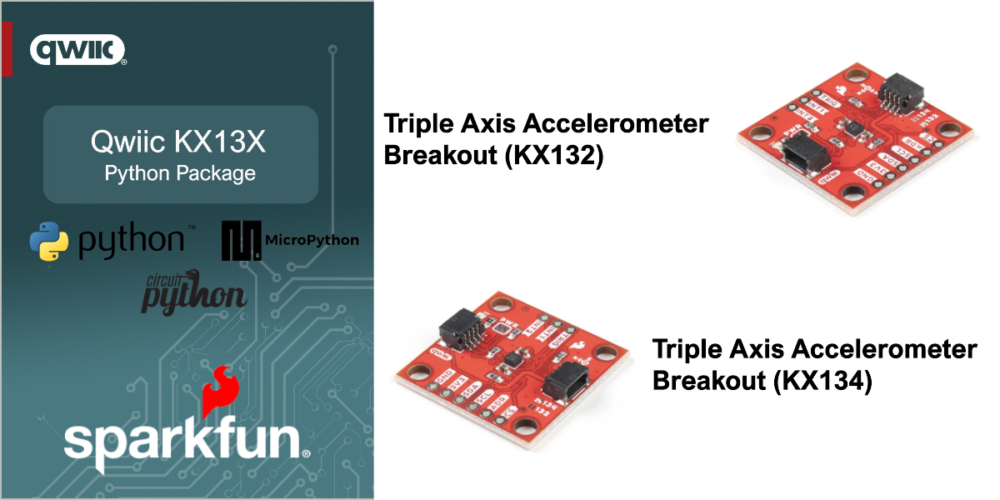

# SparkFun Qwiic KX13X - Python Package


[](https://docs.sparkfun.com/Qwiic_Py/qwiic_kx13x/)

The SparkFun Qwiic KX132 and KX134 Triple Axis Accelerometers provide a simple and cost effective solution for adding acceleration sensing to your project. Implementing a SparkFun Qwiic I2C interface, these sensors can be rapidly added to any project with boards that are part of the SparkFun Qwiic ecosystem.

This package is the Python driver for the KX132 and KX134 accelerometers. It works on CPython (Linux), MicroPython and CircuitPython, and is part of the [SparkFun Qwiic Python package](https://github.com/sparkfun/Qwiic_Py).

## Contents

* [About the Package](#about-the-package)
* [Supported Platforms](#supported-platforms)
* [Installation](#installation)
* [Example Use](#example-use)
* [Documentation](#documentation)
* [Migrating from 2.x](#migrating-from-2x)

## About the Package

This package reads 3-axis acceleration from the KX132 (`QwiicKX132`) and KX134 (`QwiicKX134`), and manages their sample buffer, tap engine and interrupts over a single Qwiic cable. Each feature is demonstrated in the [examples](examples/README.md).

New to Qwiic? Take a look at the entire [SparkFun Qwiic ecosystem](https://www.sparkfun.com/qwiic).

### Supported SparkFun Products

* [SparkFun Triple Axis Accelerometer Breakout - KX132](https://www.sparkfun.com/products/17871)
* [SparkFun Triple Axis Accelerometer Breakout - KX134](https://www.sparkfun.com/products/17589)

## Supported Platforms

| Python | Platform | Boards |
| --- | --- | --- |
| CPython | Linux | [Raspberry Pi](https://www.sparkfun.com/raspberry-pi-5-8gb.html), [NVIDIA Jetson Orin Nano](https://www.sparkfun.com/nvidia-jetson-orin-nano-developer-kit.html) via the [SparkFun Qwiic SHIM](https://www.sparkfun.com/sparkfun-qwiic-shim-for-raspberry-pi.html) |
| MicroPython | Raspberry Pi RP2, ESP32 | [SparkFun Pro Micro RP2350](https://www.sparkfun.com/sparkfun-pro-micro-rp2350.html), [SparkFun IoT RedBoard ESP32](https://www.sparkfun.com/sparkfun-iot-redboard-esp32-development-board.html), [SparkFun IoT RedBoard RP2350](https://www.sparkfun.com/sparkfun-iot-redboard-rp2350.html) |
| CircuitPython | Raspberry Pi RP2, ESP32 | [SparkFun Pro Micro RP2350](https://www.sparkfun.com/sparkfun-pro-micro-rp2350.html), [SparkFun IoT RedBoard ESP32](https://www.sparkfun.com/sparkfun-iot-redboard-esp32-development-board.html), [SparkFun IoT RedBoard RP2350](https://www.sparkfun.com/sparkfun-iot-redboard-rp2350.html) |

> [!NOTE]
> These are the primary platforms tested. The package is expected to work on most Python-enabled systems.

## Installation

### CPython (pip)

```sh
python3 -m venv ~/sparkfun_venv
~/sparkfun_venv/bin/pip install sparkfun-qwiic-kx13x
```

Run any example or script that does `import qwiic_kx13x` with `~/sparkfun_venv/bin/python3 example_script.py`.

### MicroPython (mip)

Install [mpremote](https://docs.micropython.org/en/latest/reference/mpremote.html), connect your board, then install the driver (this also installs `qwiic_i2c`):

```sh
mpremote mip install github:sparkfun/Qwiic_Py/drivers/qwiic_kx13x
```

To install the examples too:

```sh
mpremote mip install --target "" github:sparkfun/Qwiic_Py/drivers/qwiic_kx13x/examples
```

Add `@qwiic_kx13x-<version>` to either command to install a specific release.

### CircuitPython (circup)

Install [CircUp](https://docs.circuitpython.org/projects/circup/en/latest/#installation), add the SparkFun Qwiic bundle once, then install the driver:

```sh
circup bundle-add sparkfun/Qwiic_Py
circup install qwiic_kx13x
```

To copy an example to the board:

```sh
circup example qwiic_kx13x/qwiic_kx13x_ex1_basic_readings
```

## Example Use

Below is a quickstart program that prints the acceleration from a KX132. See the [examples directory](examples) for more, and [examples/README.md](examples/README.md) for a summary of each.

```python
import sys
import qwiic_kx13x
import qwiic_i2c


print("\nSparkFun KX13X Accelerometer Example 1\n")
my_kx = qwiic_kx13x.QwiicKX132()

if not my_kx.is_connected():
    print("The Qwiic KX13X Accelerometer device isn't connected to the system. Please check your connection", file=sys.stderr)
    sys.exit(1)

if my_kx.begin():
    print("Ready.")
else:
    print("Make sure you're using the KX132 and not the KX134")

if my_kx.software_reset():
    print("Reset")

# Many settings can only be changed while the accelerometer is off
my_kx.enable_accel(False)
my_kx.set_range(my_kx.KX132_RANGE16G)
my_kx.enable_data_engine()
my_kx.enable_accel()

while True:
    if my_kx.data_ready():
        my_kx.get_accel_data()
        print("X: {0} Y: {1} Z: {2}".format(my_kx.kx132_accel.x, my_kx.kx132_accel.y, my_kx.kx132_accel.z))
        qwiic_i2c.delay_ms(20)  # 1 / output data rate, which is 50 Hz by default
```

## Documentation

The API reference is at [docs.sparkfun.com/Qwiic_Py/qwiic_kx13x](https://docs.sparkfun.com/Qwiic_Py/qwiic_kx13x/).

## Migrating from 2.x

Version 3 has one name per method and no properties, so it also runs on MicroPython builds without `property()`.

| 2.x | 3.0 |
| --- | --- |
| `kx.connected` | `kx.is_connected()` |
| `kx.output_data_rate` (get / set) | `kx.get_output_data_rate()`, `kx.set_output_data_rate(rate)` |
| `kx.beginCore()` (printed on a wrong chip ID) | `kx.begin_core()` returns the chip ID without printing |
| `kx.accel_control(enable)` | `kx.enable_accel(enable)` |
| `kx.data_trigger()` | `kx.data_ready()` |
| `kx.set_buffer_operation(mode, resolution)` | `kx.set_buffer_operation_and_resolution(mode, resolution)` |
| `kx.get_raw_accel_buffer_data(sixteenBit=...)` | `kx.get_raw_accel_buffer_data(sixteen_bit=...)` |
| `KXI3X_TSCP` | `KX13X_TSCP` |
| `get_output_data_rate()` returned 0 or 99.84 whatever the rate | `get_output_data_rate()` returns the rate in Hz (0.78 * 2^OSA) |
| `set_output_data_rate()` cleared the other ODCNTL bits | `set_output_data_rate()` changes only the rate bits |
| `set_interrupt_pin()` left the accelerometer turned off | `set_interrupt_pin()` restores the accelerometer's power state |
| `set_buffer_threshold()` didn't cap the threshold at 86 in 16-bit mode | it caps the threshold at 86 in 16-bit mode |

<p align="center">

</p>
