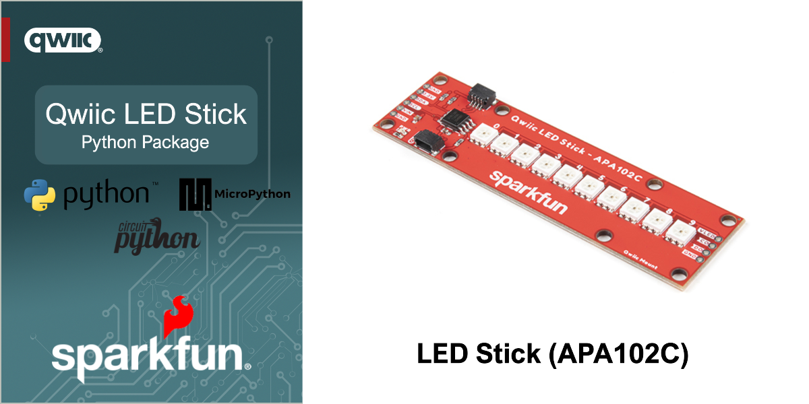

# SparkFun Qwiic LED Stick - Python Package


[](https://docs.sparkfun.com/Qwiic_Py/qwiic_led_stick/)

The SparkFun Qwiic LED Stick provides a simple and cost effective solution for adding a string of addressable RGB LEDs to your project. Implementing a SparkFun Qwiic I2C interface, it can be rapidly added to any project with boards that are part of the SparkFun Qwiic ecosystem.

This package is the Python driver for the Qwiic LED Stick. It works on CPython (Linux), MicroPython and CircuitPython, and is part of the [SparkFun Qwiic Python package](https://github.com/sparkfun/Qwiic_Py).

## Contents

* [About the Package](#about-the-package)
* [Supported Platforms](#supported-platforms)
* [Installation](#installation)
* [Example Use](#example-use)
* [Documentation](#documentation)
* [Migrating from 2.x](#migrating-from-2x)

## About the Package

This package sets the color and brightness of each LED on the LED Stick over a single Qwiic cable, and changes the stick's length and I2C address. Each feature is demonstrated in the [examples](examples/README.md).

New to Qwiic? Take a look at the entire [SparkFun Qwiic ecosystem](https://www.sparkfun.com/qwiic).

### Supported SparkFun Products

* [SparkFun Qwiic LED Stick](https://www.sparkfun.com/products/18354)

## Supported Platforms

| Python | Platform | Boards |
| --- | --- | --- |
| CPython | Linux | [Raspberry Pi](https://www.sparkfun.com/raspberry-pi-5-8gb.html), [NVIDIA Jetson Orin Nano](https://www.sparkfun.com/nvidia-jetson-orin-nano-developer-kit.html) via the [SparkFun Qwiic SHIM](https://www.sparkfun.com/sparkfun-qwiic-shim-for-raspberry-pi.html) |
| MicroPython | Raspberry Pi RP2, ESP32 | [SparkFun Pro Micro RP2350](https://www.sparkfun.com/sparkfun-pro-micro-rp2350.html), [SparkFun IoT RedBoard ESP32](https://www.sparkfun.com/sparkfun-iot-redboard-esp32-development-board.html), [SparkFun IoT RedBoard RP2350](https://www.sparkfun.com/sparkfun-iot-redboard-rp2350.html) |
| CircuitPython | Raspberry Pi RP2, ESP32 | [SparkFun Pro Micro RP2350](https://www.sparkfun.com/sparkfun-pro-micro-rp2350.html), [SparkFun IoT RedBoard ESP32](https://www.sparkfun.com/sparkfun-iot-redboard-esp32-development-board.html), [SparkFun IoT RedBoard RP2350](https://www.sparkfun.com/sparkfun-iot-redboard-rp2350.html) |

> [!NOTE]
> These are the primary platforms tested. The package is expected to work on most Python-enabled systems.

## Installation

### CPython (pip)

```sh
python3 -m venv ~/sparkfun_venv
~/sparkfun_venv/bin/pip install sparkfun-qwiic-led-stick
```

Run any example or script that does `import qwiic_led_stick` with `~/sparkfun_venv/bin/python3 example_script.py`.

### MicroPython (mip)

Install [mpremote](https://docs.micropython.org/en/latest/reference/mpremote.html), connect your board, then install the driver (this also installs `qwiic_i2c`):

```sh
mpremote mip install github:sparkfun/Qwiic_Py/drivers/qwiic_led_stick
```

To install the examples too:

```sh
mpremote mip install --target "" github:sparkfun/Qwiic_Py/drivers/qwiic_led_stick/examples
```

Add `@qwiic_led_stick-<version>` to either command to install a specific release.

### CircuitPython (circup)

Install [CircUp](https://docs.circuitpython.org/projects/circup/en/latest/#installation), add the SparkFun Qwiic bundle once, then install the driver:

```sh
circup bundle-add sparkfun/Qwiic_Py
circup install qwiic_led_stick
```

To copy an example to the board:

```sh
circup example qwiic_led_stick/qwiic_led_stick_ex1_blink
```

## Example Use

Below is a quickstart program that blinks the whole LED Stick. See the [examples directory](examples) for more, and [examples/README.md](examples/README.md) for a summary of each.

```python
import sys
import qwiic_led_stick
import qwiic_i2c


print("\nSparkFun Qwiic LED Stick Example 1")
my_stick = qwiic_led_stick.QwiicLEDStick()

if not my_stick.begin():
    print("\nThe Qwiic LED Stick isn't connected to the system. Please check your connection", file=sys.stderr)
    sys.exit(1)
print("\nLED Stick ready!")

my_stick.set_all_led_brightness(15)

while True:
    my_stick.set_all_led_color(50, 50, 50)
    qwiic_i2c.delay_ms(1000)
    my_stick.led_off()
    qwiic_i2c.delay_ms(1000)
```

## Documentation

The API reference is at [docs.sparkfun.com/Qwiic_Py/qwiic_led_stick](https://docs.sparkfun.com/Qwiic_Py/qwiic_led_stick/).

## Migrating from 2.x

Version 3 follows PEP 8 names throughout, so the methods with `LED` in their names are now lowercase.

| 2.x | 3.0 |
| --- | --- |
| `set_single_LED_color(n, r, g, b)` | `set_single_led_color(n, r, g, b)` |
| `set_all_LED_color(r, g, b)` | `set_all_led_color(r, g, b)` |
| `set_all_LED_unique_color(reds, greens, blues, length)` | `set_all_led_unique_color(reds, greens, blues, length)` |
| `set_single_LED_brightness(n, b)` | `set_single_led_brightness(n, b)` |
| `set_all_LED_brightness(b)` | `set_all_led_brightness(b)` |
| `LED_off()` | `led_off()` |
| `change_address()` returned `None` on success | `change_address()` returns `True` on success |
| `available_addresses` listed 0x23 twice and left out 0x11 | `available_addresses` lists 0x23 (the default) first, then every other address from 0x08 to 0x77 |
| `change_address()` returned immediately, and talking to the stick straight away could lock it up until it was power-cycled | It waits 500 ms for the stick to switch address |

<p align="center">

</p>
