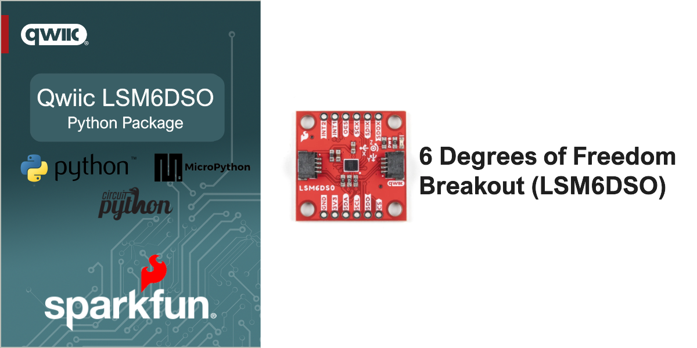

# SparkFun Qwiic LSM6DSO - Python Package


[](https://docs.sparkfun.com/Qwiic_Py/qwiic_lsm6dso/)

The SparkFun Qwiic LSM6DSO 6DoF Accelerometer Breakout provides a simple, powerful, and cost effective solution for adding accelerometer and gyroscope measurements to your project. Implementing a SparkFun Qwiic I2C interface, these sensors can be rapidly added to any project with boards that are part of the SparkFun Qwiic ecosystem.

This package is the Python driver for the LSM6DSO. It works on CPython (Linux), MicroPython and CircuitPython, and is part of the [SparkFun Qwiic Python package](https://github.com/sparkfun/Qwiic_Py).

## Contents

* [About the Package](#about-the-package)
* [Supported Platforms](#supported-platforms)
* [Installation](#installation)
* [Example Use](#example-use)
* [Documentation](#documentation)
* [Migrating from 2.x](#migrating-from-2x)

## About the Package

This package reads acceleration, angular rate and temperature from the LSM6DSO over a single Qwiic cable, and configures the range and data rate of the accelerometer and gyroscope. Each feature is demonstrated in the [examples](examples/README.md).

New to Qwiic? Take a look at the entire [SparkFun Qwiic ecosystem](https://www.sparkfun.com/qwiic).

### Supported SparkFun Products

* [SparkFun 6 Degrees of Freedom Breakout - LSM6DSO (Qwiic)](https://www.sparkfun.com/sparkfun-6-degrees-of-freedom-breakout-lsm6dso-qwiic.html)

## Supported Platforms

| Python | Platform | Boards |
| --- | --- | --- |
| CPython | Linux | [Raspberry Pi](https://www.sparkfun.com/raspberry-pi-5-8gb.html), [NVIDIA Jetson Orin Nano](https://www.sparkfun.com/nvidia-jetson-orin-nano-developer-kit.html) via the [SparkFun Qwiic SHIM](https://www.sparkfun.com/sparkfun-qwiic-shim-for-raspberry-pi.html) |
| MicroPython | Raspberry Pi RP2, ESP32 | [SparkFun Pro Micro RP2350](https://www.sparkfun.com/sparkfun-pro-micro-rp2350.html), [SparkFun IoT RedBoard ESP32](https://www.sparkfun.com/sparkfun-iot-redboard-esp32-development-board.html), [SparkFun IoT RedBoard RP2350](https://www.sparkfun.com/sparkfun-iot-redboard-rp2350.html) |
| CircuitPython | Raspberry Pi RP2, ESP32 | [SparkFun Pro Micro RP2350](https://www.sparkfun.com/sparkfun-pro-micro-rp2350.html), [SparkFun IoT RedBoard ESP32](https://www.sparkfun.com/sparkfun-iot-redboard-esp32-development-board.html), [SparkFun IoT RedBoard RP2350](https://www.sparkfun.com/sparkfun-iot-redboard-rp2350.html) |

> [!NOTE]
> These are the primary platforms tested. The package is expected to work on most Python-enabled systems.

## Installation

### CPython (pip)

```sh
python3 -m venv ~/sparkfun_venv
~/sparkfun_venv/bin/pip install sparkfun-qwiic-lsm6dso
```

Run any example or script that does `import qwiic_lsm6dso` with `~/sparkfun_venv/bin/python3 example_script.py`.

### MicroPython (mip)

Install [mpremote](https://docs.micropython.org/en/latest/reference/mpremote.html), connect your board, then install the driver (this also installs `qwiic_i2c`):

```sh
mpremote mip install github:sparkfun/Qwiic_Py/drivers/qwiic_lsm6dso
```

To install the examples too:

```sh
mpremote mip install --target "" github:sparkfun/Qwiic_Py/drivers/qwiic_lsm6dso/examples
```

Add `@qwiic_lsm6dso-<version>` to either command to install a specific release.

### CircuitPython (circup)

Install [CircUp](https://docs.circuitpython.org/projects/circup/en/latest/#installation), add the SparkFun Qwiic bundle once, then install the driver:

```sh
circup bundle-add sparkfun/Qwiic_Py
circup install qwiic_lsm6dso
```

To copy an example to the board:

```sh
circup example qwiic_lsm6dso/qwiic_lsm6dso_ex1_basic_readings
```

## Example Use

Below is a quickstart program that prints accelerometer, gyroscope and temperature readings. See the [examples directory](examples) for more, and [examples/README.md](examples/README.md) for a summary of each.

```python
import sys
import qwiic_i2c
import qwiic_lsm6dso


print("\nQwiic LSM6DSO Example 1 - Basic Readings\n")
my_imu = qwiic_lsm6dso.QwiicLSM6DSO()

if not my_imu.is_connected():
    print("The device isn't connected to the system. Please check your connection", file=sys.stderr)
    sys.exit(1)

my_imu.begin()

while True:
    acc_x, acc_y, acc_z, gyr_x, gyr_y, gyr_z = my_imu.read_float_accel_gyro_all()
    print("Accelerometer: X:%.2f, Y:%.2f, Z:%.2f g" % (acc_x, acc_y, acc_z))
    print("Gyroscope:     X:%.2f, Y:%.2f, Z:%.2f dps" % (gyr_x, gyr_y, gyr_z))
    print("Temperature:   %.2f C\n" % my_imu.read_temp_c())
    qwiic_i2c.delay_ms(1000)
```

## Documentation

The API reference is at [docs.sparkfun.com/Qwiic_Py/qwiic_lsm6dso](https://docs.sparkfun.com/Qwiic_Py/qwiic_lsm6dso/).

## Migrating from 2.x

Version 3 has no properties, so it also runs on MicroPython builds without `property()`. The method names were already snake_case and are unchanged; the constants are now UPPER_CASE.

| 2.x | 3.0 |
| --- | --- |
| `imu.connected` | `imu.is_connected()` |
| k-prefixed / mixed-case constants | UPPER_CASE (see [Renamed constants](#renamed-constants)) |

### Renamed constants

Unit suffixes are upper-cased; the values are unchanged.

| 2.x | 3.0 |
| --- | --- |
| `FS_XL_2g`, `FS_XL_16g`, `FS_XL_4g`, `FS_XL_8g` | `FS_XL_2G`, `FS_XL_16G`, `FS_XL_4G`, `FS_XL_8G` |
| `FS_G_125dps`, `FS_G_250dps`, `FS_G_500dps`, `FS_G_1000dps`, `FS_G_2000dps` | `FS_G_125DPS`, `FS_G_250DPS`, `FS_G_500DPS`, `FS_G_1000DPS`, `FS_G_2000DPS` |
| `ODR_12_5Hz`, `ODR_26Hz`, `ODR_52Hz`, `ODR_104Hz`, `ODR_208Hz`, `ODR_416Hz` | `ODR_12_5HZ`, `ODR_26HZ`, `ODR_52HZ`, `ODR_104HZ`, `ODR_208HZ`, `ODR_416HZ` |
| `ODR_833Hz`, `ODR_1660Hz`, `ODR_3330Hz`, `ODR_6660Hz`, `ODR_1_6Hz` | `ODR_833HZ`, `ODR_1660HZ`, `ODR_3330HZ`, `ODR_6660HZ`, `ODR_1_6HZ` |

<p align="center">

</p>
