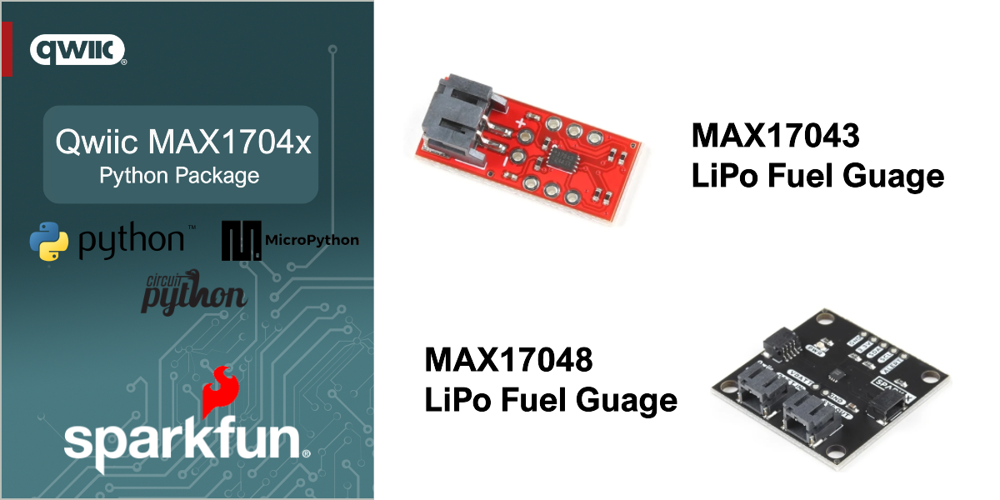

# SparkFun Qwiic MAX1704X - Python Package


[](https://docs.sparkfun.com/Qwiic_Py/qwiic_max1704x/)

The SparkFun Qwiic LiPo Fuel Gauge MAX1704X Sensor provides a simple and cost effective solution for adding LiPo fuel gauge sensing to your project. Implementing a SparkFun Qwiic I2C interface, these sensors can be rapidly added to any project with boards that are part of the SparkFun Qwiic ecosystem.

This package is the Python driver for the MAX1704X. It works on CPython (Linux), MicroPython and CircuitPython, and is part of the [SparkFun Qwiic Python package](https://github.com/sparkfun/Qwiic_Py).

## Contents

* [About the Package](#about-the-package)
* [Supported Platforms](#supported-platforms)
* [Installation](#installation)
* [Example Use](#example-use)
* [Documentation](#documentation)
* [Migrating from 2.x](#migrating-from-2x)

## About the Package

This package reads battery voltage, state of charge and charge rate from the MAX17043, MAX17044, MAX17048 and MAX17049 over a single Qwiic cable, and sets their alert thresholds, sleep and hibernate modes. Each feature is demonstrated in the [examples](examples/README.md).

New to Qwiic? Take a look at the entire [SparkFun Qwiic ecosystem](https://www.sparkfun.com/qwiic).

### Supported SparkFun Products

* [SparkFun LiPo Fuel Gauge Sensor - MAX1704X](https://www.sparkfun.com/products/20680)

## Supported Platforms

| Python | Platform | Boards |
| --- | --- | --- |
| CPython | Linux | [Raspberry Pi](https://www.sparkfun.com/raspberry-pi-5-8gb.html), [NVIDIA Jetson Orin Nano](https://www.sparkfun.com/nvidia-jetson-orin-nano-developer-kit.html) via the [SparkFun Qwiic SHIM](https://www.sparkfun.com/sparkfun-qwiic-shim-for-raspberry-pi.html) |
| MicroPython | Raspberry Pi RP2, ESP32 | [SparkFun Pro Micro RP2350](https://www.sparkfun.com/sparkfun-pro-micro-rp2350.html), [SparkFun IoT RedBoard ESP32](https://www.sparkfun.com/sparkfun-iot-redboard-esp32-development-board.html), [SparkFun IoT RedBoard RP2350](https://www.sparkfun.com/sparkfun-iot-redboard-rp2350.html) |
| CircuitPython | Raspberry Pi RP2, ESP32 | [SparkFun Pro Micro RP2350](https://www.sparkfun.com/sparkfun-pro-micro-rp2350.html), [SparkFun IoT RedBoard ESP32](https://www.sparkfun.com/sparkfun-iot-redboard-esp32-development-board.html), [SparkFun IoT RedBoard RP2350](https://www.sparkfun.com/sparkfun-iot-redboard-rp2350.html) |

> [!NOTE]
> These are the primary platforms tested. The package is expected to work on most Python-enabled systems.

## Installation

### CPython (pip)

```sh
python3 -m venv ~/sparkfun_venv
~/sparkfun_venv/bin/pip install sparkfun-qwiic-max1704x
```

Run any example or script that does `import qwiic_max1704x` with `~/sparkfun_venv/bin/python3 example_script.py`.

### MicroPython (mip)

Install [mpremote](https://docs.micropython.org/en/latest/reference/mpremote.html), connect your board, then install the driver (this also installs `qwiic_i2c`):

```sh
mpremote mip install github:sparkfun/Qwiic_Py/drivers/qwiic_max1704x
```

To install the examples too:

```sh
mpremote mip install --target "" github:sparkfun/Qwiic_Py/drivers/qwiic_max1704x/examples
```

Add `@qwiic_max1704x-<version>` to either command to install a specific release.

### CircuitPython (circup)

Install [CircUp](https://docs.circuitpython.org/projects/circup/en/latest/#installation), add the SparkFun Qwiic bundle once, then install the driver:

```sh
circup bundle-add sparkfun/Qwiic_Py
circup install qwiic_max1704x
```

To copy an example to the board:

```sh
circup example qwiic_max1704x/qwiic_max1704x_ex1_basic
```

## Example Use

Below is a quickstart program that prints the battery voltage and state of charge. See the [examples directory](examples) for more, and [examples/README.md](examples/README.md) for a summary of each.

```python
import sys
import qwiic_max1704x
import qwiic_i2c


print("\nQwiic MAX1704X Example 1 - Simple\n")
# Defaults to the MAX17043. For the MAX17048, pass
# device_type=qwiic_max1704x.QwiicMAX1704X.DEVICE_TYPE_MAX17048
my_lipo = qwiic_max1704x.QwiicMAX1704X()

if not my_lipo.is_connected():
    print("The device isn't connected to the system. Please check your connection", file=sys.stderr)
    sys.exit(1)

my_lipo.begin()
my_lipo.quick_start()
my_lipo.set_threshold(20)

while True:
    print("Voltage: %.2fV" % my_lipo.get_voltage())
    print("State of Charge: %.2f%%" % my_lipo.get_soc())

    if my_lipo.get_alert():
        print("Battery SoC is below threshold!")
    else:
        print("Battery SoC is above threshold.")

    qwiic_i2c.delay_ms(500)
```

## Documentation

The API reference is at [docs.sparkfun.com/Qwiic_Py/qwiic_max1704x](https://docs.sparkfun.com/Qwiic_Py/qwiic_max1704x/).

## Migrating from 2.x

Version 3 has one name per method and no properties, so it also runs on MicroPython builds without `property()`.

| 2.x | 3.0 |
| --- | --- |
| `lipo.connected` | `lipo.is_connected()` |
| `get_hibrt_act_thr_volts(v)` (it set the threshold) | `set_hibrt_act_thr_volts(v)` |
| `get_hibrt_hib_thr_percent(p)` (it set the threshold) | `set_hibrt_hib_thr_percent(p)` |
| `set_compensation(newCompensation=...)` | `set_compensation(new_compensation=...)` |
| `enable_hibernate()`, `disable_hibernate()` raised `AttributeError` | write the HIBRT register as intended |
| `k`-prefixed constants (`kDeviceTypeMAX17043`, `kDeviceTypeMAX17044`, ...) | UPPER_CASE without the `k` (`DEVICE_TYPE_MAX17043`, `DEVICE_TYPE_MAX17044`, ...); every rename is listed below |

<details>
<summary>Every renamed constant</summary>

| 2.x | 3.0 |
| --- | --- |
| `kDeviceTypeMAX17043` | `DEVICE_TYPE_MAX17043` |
| `kDeviceTypeMAX17044` | `DEVICE_TYPE_MAX17044` |
| `kDeviceTypeMAX17048` | `DEVICE_TYPE_MAX17048` |
| `kDeviceTypeMAX17049` | `DEVICE_TYPE_MAX17049` |
| `kRegVcell` | `REG_VCELL` |
| `kRegSoc` | `REG_SOC` |
| `kRegMode` | `REG_MODE` |
| `kRegVersion` | `REG_VERSION` |
| `kRegHibRt` | `REG_HIBRT` |
| `kRegConfig` | `REG_CONFIG` |
| `kRegCValrt` | `REG_CVALRT` |
| `kRegCRate` | `REG_CRATE` |
| `kRegVResetId` | `REG_VRESET_ID` |
| `kRegStatus` | `REG_STATUS` |
| `kRegCommand` | `REG_COMMAND` |
| `kModeQuickStart` | `MODE_QUICK_START` |
| `kModeEnSleep` | `MODE_EN_SLEEP` |
| `kModeHibStat` | `MODE_HIB_STAT` |
| `kVResetIdVResetShift` | `VRESET_ID_VRESET_SHIFT` |
| `kVResetIdVResetMask` | `VRESET_ID_VRESET_MASK` |
| `kVResetIdComparatorDisShift` | `VRESET_ID_COMPARATOR_DIS_SHIFT` |
| `kVResetIdComparatorDisMask` | `VRESET_ID_COMPARATOR_DIS_MASK` |
| `kStatusShift` | `STATUS_SHIFT` |
| `kStatusMask` | `STATUS_MASK` |
| `kStatusRiShift` | `STATUS_RI_SHIFT` |
| `kStatusRiMask` | `STATUS_RI_MASK` |
| `kStatusVhShift` | `STATUS_VH_SHIFT` |
| `kStatusVhMask` | `STATUS_VH_MASK` |
| `kStatusVlShift` | `STATUS_VL_SHIFT` |
| `kStatusVlMask` | `STATUS_VL_MASK` |
| `kStatusVrShift` | `STATUS_VR_SHIFT` |
| `kStatusVrMask` | `STATUS_VR_MASK` |
| `kStatusHdShift` | `STATUS_HD_SHIFT` |
| `kStatusHdMask` | `STATUS_HD_MASK` |
| `kStatusScShift` | `STATUS_SC_SHIFT` |
| `kStatusScMask` | `STATUS_SC_MASK` |
| `kStatusEnVrShift` | `STATUS_EN_VR_SHIFT` |
| `kStatusEnVrMask` | `STATUS_EN_VR_MASK` |
| `kConfigAlertShift` | `CONFIG_ALERT_SHIFT` |
| `kConfigAlertMask` | `CONFIG_ALERT_MASK` |
| `kConfigSocAlertShift` | `CONFIG_SOC_ALERT_SHIFT` |
| `kConfigSocAlertMask` | `CONFIG_SOC_ALERT_MASK` |
| `kConfigSleepShift` | `CONFIG_SLEEP_SHIFT` |
| `kConfigSleepMask` | `CONFIG_SLEEP_MASK` |
| `kConfigThresholdShift` | `CONFIG_THRESHOLD_SHIFT` |
| `kConfigThresholdMask` | `CONFIG_THRESHOLD_MASK` |
| `kConfigCompShift` | `CONFIG_COMP_SHIFT` |
| `kConfigCompMask` | `CONFIG_COMP_MASK` |
| `kMax17048HibRtEnHib` | `MAX17048_HIBRT_EN_HIB` |
| `kMax17048HibRtDisHib` | `MAX17048_HIBRT_DIS_HIB` |

</details>

<p align="center">

</p>
