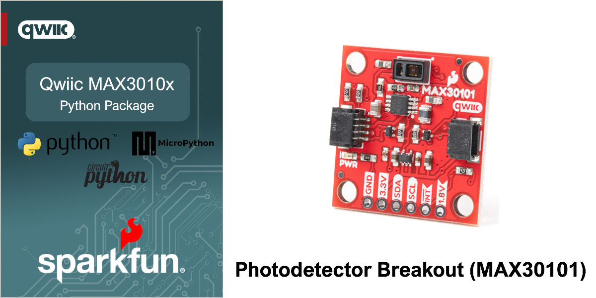

# SparkFun Qwiic MAX3010x - Python Package


[](https://docs.sparkfun.com/Qwiic_Py/qwiic_max3010x/)

The SparkFun Qwiic Photodetector MAX30101 provides a simple and cost effective solution for adding optical heart rate, presence and particle sensing to your project. Implementing a SparkFun Qwiic I2C interface, these sensors can be rapidly added to any project with boards that are part of the SparkFun Qwiic ecosystem.

This package is the Python driver for the MAX3010x family (MAX30101, MAX30102, MAX30105). It works on CPython (Linux), MicroPython and CircuitPython, and is part of the [SparkFun Qwiic Python package](https://github.com/sparkfun/Qwiic_Py).

## Contents

* [About the Package](#about-the-package)
* [Supported Platforms](#supported-platforms)
* [Installation](#installation)
* [Example Use](#example-use)
* [Documentation](#documentation)
* [Migrating from 2.x](#migrating-from-2x)

## About the Package

This package reads red, IR and green values and the die temperature from the MAX3010x over a single Qwiic cable, detects heart beats, and configures its LEDs, sample rate, FIFO and interrupts. Each feature is demonstrated in the [examples](examples/README.md); example 4 (heartbeat plotter) uses matplotlib and runs on CPython only.

New to Qwiic? Take a look at the entire [SparkFun Qwiic ecosystem](https://www.sparkfun.com/qwiic).

### Supported SparkFun Products

* [SparkFun Photodetector Breakout - MAX30101 (Qwiic)](https://www.sparkfun.com/products/16474)

## Supported Platforms

| Python | Platform | Boards |
| --- | --- | --- |
| CPython | Linux | [Raspberry Pi](https://www.sparkfun.com/raspberry-pi-5-8gb.html), [NVIDIA Jetson Orin Nano](https://www.sparkfun.com/nvidia-jetson-orin-nano-developer-kit.html) via the [SparkFun Qwiic SHIM](https://www.sparkfun.com/sparkfun-qwiic-shim-for-raspberry-pi.html) |
| MicroPython | Raspberry Pi RP2, ESP32 | [SparkFun Pro Micro RP2350](https://www.sparkfun.com/sparkfun-pro-micro-rp2350.html), [SparkFun IoT RedBoard ESP32](https://www.sparkfun.com/sparkfun-iot-redboard-esp32-development-board.html), [SparkFun IoT RedBoard RP2350](https://www.sparkfun.com/sparkfun-iot-redboard-rp2350.html) |
| CircuitPython | Raspberry Pi RP2, ESP32 | [SparkFun Pro Micro RP2350](https://www.sparkfun.com/sparkfun-pro-micro-rp2350.html), [SparkFun IoT RedBoard ESP32](https://www.sparkfun.com/sparkfun-iot-redboard-esp32-development-board.html), [SparkFun IoT RedBoard RP2350](https://www.sparkfun.com/sparkfun-iot-redboard-rp2350.html) |

> [!NOTE]
> These are the primary platforms tested. The package is expected to work on most Python-enabled systems.

## Installation

### CPython (pip)

```sh
python3 -m venv ~/sparkfun_venv
~/sparkfun_venv/bin/pip install sparkfun-qwiic-max3010x
```

Run any example or script that does `import qwiic_max3010x` with `~/sparkfun_venv/bin/python3 example_script.py`.

### MicroPython (mip)

Install [mpremote](https://docs.micropython.org/en/latest/reference/mpremote.html), connect your board, then install the driver (this also installs `qwiic_i2c`):

```sh
mpremote mip install github:sparkfun/Qwiic_Py/drivers/qwiic_max3010x
```

To install the examples too:

```sh
mpremote mip install --target "" github:sparkfun/Qwiic_Py/drivers/qwiic_max3010x/examples
```

Add `@qwiic_max3010x-<version>` to either command to install a specific release.

### CircuitPython (circup)

Install [CircUp](https://docs.circuitpython.org/projects/circup/en/latest/#installation), add the SparkFun Qwiic bundle once, then install the driver:

```sh
circup bundle-add sparkfun/Qwiic_Py
circup install qwiic_max3010x
```

To copy an example to the board:

```sh
circup example qwiic_max3010x/qwiic_max3010x_ex1_basic_readings
```

## Example Use

Below is a quickstart program that prints the red, IR and green readings. See the [examples directory](examples) for more, and [examples/README.md](examples/README.md) for a summary of each.

```python
import sys
import qwiic_i2c
import qwiic_max3010x


def run_example():
    print("\nSparkFun MAX3010x Photodetector - Example 1\n")
    sensor = qwiic_max3010x.QwiicMAX3010x()

    if not sensor.begin():
        print("The Qwiic MAX3010x device isn't connected to the system. Please check your connection", file=sys.stderr)
        return

    sensor.setup()

    while True:
        print("R[", sensor.get_red(), "] \tIR[", sensor.get_ir(), "] \tG[", sensor.get_green(), "]")
        qwiic_i2c.delay_ms(100)


if __name__ == "__main__":
    try:
        run_example()
    except (KeyboardInterrupt, SystemExit):
        print("\nEnding Example 1")
        sys.exit(0)
```

## Documentation

The API reference is at [docs.sparkfun.com/Qwiic_Py/qwiic_max3010x](https://docs.sparkfun.com/Qwiic_Py/qwiic_max3010x/).

## Migrating from 2.x

Version 3 has one name per method, all snake_case, and no properties, so it also runs on MicroPython builds without `property()`.

| 2.x | 3.0 |
| --- | --- |
| `QwiicMax3010x` | `QwiicMAX3010x` |
| `sensor.connected` | `sensor.is_connected()` |
| `softReset()`, `getINT1()`, `getINT2()` | `soft_reset()`, `get_int1()`, `get_int2()` |
| `enableAFULL()`, `disableAFULL()`, `enableDATARDY()` | `enable_afull()`, `disable_afull()`, `enable_datardy()` |
| `disableDATARDY()`, `enableALCOVF()`, `disableALCOVF()` | `disable_datardy()`, `enable_alcovf()`, `disable_alcovf()` |
| `enablePROXINT()`, `disablePROXINT()`, `enableDIETEMPRDY()` | `enable_proxint()`, `disable_proxint()`, `enable_dietemprdy()` |
| `disableDIETEMPRDY()`, `shutDown()`, `wakeUp()` | `disable_dietemprdy()`, `shut_down()`, `wake_up()` |
| `setLEDMode()`, `setADCRange()`, `setSampleRate()` | `set_led_mode()`, `set_adc_range()`, `set_sample_rate()` |
| `setPulseWidth()`, `setPulseAmplitudeRed()`, `setPulseAmplitudeIR()` | `set_pulse_width()`, `set_pulse_amplitude_red()`, `set_pulse_amplitude_ir()` |
| `setPulseAmplitudeGreen()`, `setPulseAmplitudeProximity()`, `setProximityThreshold()` | `set_pulse_amplitude_green()`, `set_pulse_amplitude_proximity()`, `set_proximity_threshold()` |
| `enableSlot()`, `disableSlots()`, `setFIFOAverage()` | `enable_slot()`, `disable_slots()`, `set_fifo_average()` |
| `clearFIFO()`, `enableFIFORollover()`, `disableFIFORollover()` | `clear_fifo()`, `enable_fifo_rollover()`, `disable_fifo_rollover()` |
| `setFIFOAlmostFull()`, `getWritePointer()`, `getReadPointer()` | `set_fifo_almost_full()`, `get_write_pointer()`, `get_read_pointer()` |
| `nextSample()`, `safeCheck()`, `getRed()` | `next_sample()`, `safe_check()`, `get_red()` |
| `getIR()`, `getGreen()`, `getFIFORed()` | `get_ir()`, `get_green()`, `get_fifo_red()` |
| `getFIFOIR()`, `getFIFOGreen()`, `readPartID()` | `get_fifo_ir()`, `get_fifo_green()`, `read_part_id()` |
| `readRevisionID()`, `getRevisionID()`, `readTemperatureF()` | `read_revision_id()`, `get_revision_id()`, `read_temperature_f()` |
| `readTemperature()`, `checkForBeat()` | `read_temperature()`, `check_for_beat()` |
| `setup(powerLevel, sampleAverage, ledMode, sampleRate, pulseWidth, adcRange)` | `setup(power_level, sample_average, led_mode, sample_rate, pulse_width, adc_range)` |
| camelCase arguments of the other methods (`adcRange`, `sampleRate`, `pulseWidth`, `threshMSB`, `slotNumber`, `numberOfSamples`, `maxTimeToCheck`) | snake_case (`adc_range`, `sample_rate`, ...) |
| `sensor.IR`, `sensor.activeLEDs`, `sensor.revisionID` | `sensor.ir`, `sensor.active_leds`, `sensor.revision_id` |
| `sensor.red`, `sensor.IR`, `sensor.green` were class attributes shared by every instance | per-instance lists |
| `read_revision_id()` returned `None` | returns the revision ID (still stored in `sensor.revision_id`) |
| `millis()` returned wall-clock milliseconds | returns `ticks_ms()`; compare values with `qwiic_i2c.ticks_diff()` |
| `qwiic_max3010x.heart_rate.HeartRate` with `averageDCEstimator()`, `lowPassFIRFilter()`, `getDCE()`, `checkForBeat()` | `qwiic_max3010x.HeartRate` with `average_dc_estimator()`, `low_pass_fir_filter()`, `get_dce()`, `check_for_beat()`; its camelCase attributes (`IR_AC_Max`, `positiveEdge`, `FIRCoeffs`, ...) are snake_case |
| one module-level `HeartRate` shared by every sensor | each `QwiicMAX3010x` has its own |
| `qwiic_max3010x` package | single `qwiic_max3010x.py` module |
| `check_for_beat()` tested `x > 20 & x < 1000`, which Python evaluates differently from the Arduino C code | tests `(x > 20) and (x < 1000)` as the Arduino library does |

<p align="center">

</p>
