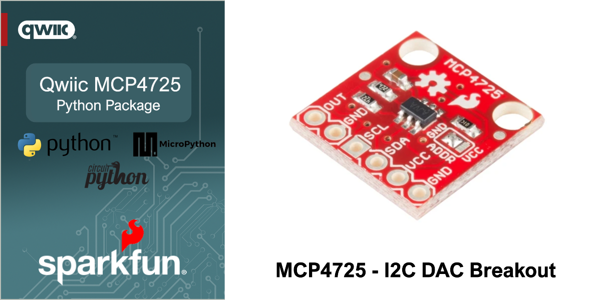

# SparkFun Qwiic MCP4725 - Python Package


[](https://docs.sparkfun.com/Qwiic_Py/qwiic_mcp4725/)

The SparkFun Qwiic Digital to Analog Converter MCP4725 Module provides a simple and cost effective solution for adding Digital to Analog Converter capabilities to your project. Implementing a SparkFun Qwiic I2C interface, these sensors can be rapidly added to any project with boards that are part of the SparkFun Qwiic ecosystem.

This package is the Python driver for the MCP4725. It works on CPython (Linux), MicroPython and CircuitPython, and is part of the [SparkFun Qwiic Python package](https://github.com/sparkfun/Qwiic_Py).

## Contents

* [About the Package](#about-the-package)
* [Supported Platforms](#supported-platforms)
* [Installation](#installation)
* [Example Use](#example-use)
* [Documentation](#documentation)
* [Migrating from 2.x](#migrating-from-2x)

## About the Package

This package writes output voltages to the MCP4725 over a single Qwiic cable, including fast-mode writes, waveforms, the EEPROM power-on value and the power-down modes. Each feature is demonstrated in the [examples](examples/README.md).

New to Qwiic? Take a look at the entire [SparkFun Qwiic ecosystem](https://www.sparkfun.com/qwiic).

### Supported SparkFun Products

* [SparkFun Digital to Analog Converter Sensor - MCP4725](https://www.sparkfun.com/products/12918)

## Supported Platforms

| Python | Platform | Boards |
| --- | --- | --- |
| CPython | Linux | [Raspberry Pi](https://www.sparkfun.com/raspberry-pi-5-8gb.html), [NVIDIA Jetson Orin Nano](https://www.sparkfun.com/nvidia-jetson-orin-nano-developer-kit.html) via the [SparkFun Qwiic SHIM](https://www.sparkfun.com/sparkfun-qwiic-shim-for-raspberry-pi.html) |
| MicroPython | Raspberry Pi RP2, ESP32 | [SparkFun Pro Micro RP2350](https://www.sparkfun.com/sparkfun-pro-micro-rp2350.html), [SparkFun IoT RedBoard ESP32](https://www.sparkfun.com/sparkfun-iot-redboard-esp32-development-board.html), [SparkFun IoT RedBoard RP2350](https://www.sparkfun.com/sparkfun-iot-redboard-rp2350.html) |
| CircuitPython | Raspberry Pi RP2, ESP32 | [SparkFun Pro Micro RP2350](https://www.sparkfun.com/sparkfun-pro-micro-rp2350.html), [SparkFun IoT RedBoard ESP32](https://www.sparkfun.com/sparkfun-iot-redboard-esp32-development-board.html), [SparkFun IoT RedBoard RP2350](https://www.sparkfun.com/sparkfun-iot-redboard-rp2350.html) |

> [!NOTE]
> These are the primary platforms tested. The package is expected to work on most Python-enabled systems.

## Installation

### CPython (pip)

```sh
python3 -m venv ~/sparkfun_venv
~/sparkfun_venv/bin/pip install sparkfun-qwiic-mcp4725
```

Run any example or script that does `import qwiic_mcp4725` with `~/sparkfun_venv/bin/python3 example_script.py`.

### MicroPython (mip)

Install [mpremote](https://docs.micropython.org/en/latest/reference/mpremote.html), connect your board, then install the driver (this also installs `qwiic_i2c`):

```sh
mpremote mip install github:sparkfun/Qwiic_Py/drivers/qwiic_mcp4725
```

To install the examples too:

```sh
mpremote mip install --target "" github:sparkfun/Qwiic_Py/drivers/qwiic_mcp4725/examples
```

Add `@qwiic_mcp4725-<version>` to either command to install a specific release.

### CircuitPython (circup)

Install [CircUp](https://docs.circuitpython.org/projects/circup/en/latest/#installation), add the SparkFun Qwiic bundle once, then install the driver:

```sh
circup bundle-add sparkfun/Qwiic_Py
circup install qwiic_mcp4725
```

To copy an example to the board:

```sh
circup example qwiic_mcp4725/qwiic_mcp4725_ex1_basic
```

> [!NOTE]
> Example 2 needs a larger stack than the CircuitPython default. Add `CIRCUITPY_PYSTACK_SIZE=12288` (increase as needed) to `settings.toml` in the base directory of your CircuitPython board, or you will likely get "pystack exhausted" errors.

## Example Use

Below is a quickstart program that writes three voltages to the DAC. See the [examples directory](examples) for more, and [examples/README.md](examples/README.md) for a summary of each.

```python
import sys
import qwiic_mcp4725
import qwiic_i2c


print("\nSparkFun MCP4725 Example 1 - Basic\n")
my_dac = qwiic_mcp4725.QwiicMCP4725()

if not my_dac.is_connected():
    print("The device isn't connected to the system. Please check your connection", file=sys.stderr)
    sys.exit(1)

my_dac.begin()

while True:
    print("Writing 0V to DAC")
    my_dac.write_dac(0)  # ~0V if VDD = 3.3V
    qwiic_i2c.delay_ms(2000)

    print("Writing 1.65V to DAC")
    my_dac.write_dac(2048)  # ~1.65 V if VDD = 3.3V
    qwiic_i2c.delay_ms(2000)

    print("Writing 3.3V to DAC")
    my_dac.write_dac(4095)  # ~3.3 V if VDD = 3.3V
    qwiic_i2c.delay_ms(2000)
```

## Documentation

The API reference is at [docs.sparkfun.com/Qwiic_Py/qwiic_mcp4725](https://docs.sparkfun.com/Qwiic_Py/qwiic_mcp4725/).

## Migrating from 2.x

Version 3 has one name per method and no properties, so it also runs on MicroPython builds without `property()`.

| 2.x | 3.0 |
| --- | --- |
| `dac.connected` | `dac.is_connected()` |
| `kPowerDownModeNormal`, `kPowerDownMode1K` | `POWER_DOWN_MODE_NORMAL`, `POWER_DOWN_MODE_1K` |
| `kPowerDownMode100K`, `kPowerDownMode500K` | `POWER_DOWN_MODE_100K`, `POWER_DOWN_MODE_500K` |
| `write_dac(value, powerDownMode=...)` (also `write_dac_eeprom`, `write_fast_mode`) | `write_dac(value, power_down_mode=...)` |
| `read_dac_eeprom()` sent a register byte before reading | reads without a register byte, as in the datasheet |
| `read_dac_eeprom()["eeprom_power_down_mode"]` was shifted wrongly (0, 16, 32 or 48) | returns the mode bits (0 to 3) |

<p align="center">

</p>
