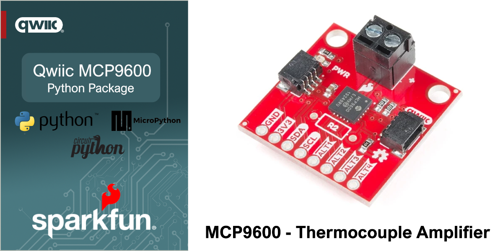

# SparkFun Qwiic MCP9600 - Python Package


[](https://docs.sparkfun.com/Qwiic_Py/qwiic_mcp9600/)

The SparkFun Qwiic Thermocouple Amplifier (MCP9600) provides a simple and cost effective solution for measuring temperature with a thermocouple. Implementing a SparkFun Qwiic I2C interface, it can be rapidly added to any project with boards that are part of the SparkFun Qwiic ecosystem.

This package is the Python driver for the MCP9600 thermocouple amplifier. It works on CPython (Linux), MicroPython and CircuitPython, and is part of the [SparkFun Qwiic Python package](https://github.com/sparkfun/Qwiic_Py).

## Contents

* [About the Package](#about-the-package)
* [Supported Platforms](#supported-platforms)
* [Installation](#installation)
* [Example Use](#example-use)
* [Documentation](#documentation)
* [Migrating from 2.x](#migrating-from-2x)

## About the Package

This package reads the thermocouple (hot junction), ambient (cold junction) and delta temperatures from the MCP9600 over a single Qwiic cable, and configures the thermocouple type, filtering, resolution, burst mode and temperature alerts. Each feature is demonstrated in the [examples](examples/README.md).

New to Qwiic? Take a look at the entire [SparkFun Qwiic ecosystem](https://www.sparkfun.com/qwiic).

### Supported SparkFun Products

* [SparkFun Qwiic Thermocouple Amplifier - MCP9600](https://www.sparkfun.com/products/16295)

## Supported Platforms

| Python | Platform | Boards |
| --- | --- | --- |
| CPython | Linux | [Raspberry Pi](https://www.sparkfun.com/raspberry-pi-5-8gb.html), [NVIDIA Jetson Orin Nano](https://www.sparkfun.com/nvidia-jetson-orin-nano-developer-kit.html) via the [SparkFun Qwiic SHIM](https://www.sparkfun.com/sparkfun-qwiic-shim-for-raspberry-pi.html) |
| MicroPython | Raspberry Pi RP2, ESP32 | [SparkFun Pro Micro RP2350](https://www.sparkfun.com/sparkfun-pro-micro-rp2350.html), [SparkFun IoT RedBoard ESP32](https://www.sparkfun.com/sparkfun-iot-redboard-esp32-development-board.html), [SparkFun IoT RedBoard RP2350](https://www.sparkfun.com/sparkfun-iot-redboard-rp2350.html) |
| CircuitPython | Raspberry Pi RP2, ESP32 | [SparkFun Pro Micro RP2350](https://www.sparkfun.com/sparkfun-pro-micro-rp2350.html), [SparkFun IoT RedBoard ESP32](https://www.sparkfun.com/sparkfun-iot-redboard-esp32-development-board.html), [SparkFun IoT RedBoard RP2350](https://www.sparkfun.com/sparkfun-iot-redboard-rp2350.html) |

> [!NOTE]
> These are the primary platforms tested. The package is expected to work on most Python-enabled systems.

## Installation

### CPython (pip)

```sh
python3 -m venv ~/sparkfun_venv
~/sparkfun_venv/bin/pip install sparkfun-qwiic-mcp9600
```

Run any example or script that does `import qwiic_mcp9600` with `~/sparkfun_venv/bin/python3 example_script.py`.

### MicroPython (mip)

Install [mpremote](https://docs.micropython.org/en/latest/reference/mpremote.html), connect your board, then install the driver (this also installs `qwiic_i2c`):

```sh
mpremote mip install github:sparkfun/Qwiic_Py/drivers/qwiic_mcp9600
```

To install the examples too:

```sh
mpremote mip install --target "" github:sparkfun/Qwiic_Py/drivers/qwiic_mcp9600/examples
```

Add `@qwiic_mcp9600-<version>` to either command to install a specific release.

### CircuitPython (circup)

Install [CircUp](https://docs.circuitpython.org/projects/circup/en/latest/#installation), add the SparkFun Qwiic bundle once, then install the driver:

```sh
circup bundle-add sparkfun/Qwiic_Py
circup install qwiic_mcp9600
```

To copy an example to the board:

```sh
circup example qwiic_mcp9600/qwiic_mcp9600_ex1_basic
```

## Example Use

Below is a quickstart program that prints the thermocouple, ambient and delta temperatures. See the [examples directory](examples) for more, and [examples/README.md](examples/README.md) for a summary of each.

```python
import sys
import qwiic_i2c
import qwiic_mcp9600


print("\nQwiic MCP9600 Example 1 - Basic Readings\n")
my_thermo = qwiic_mcp9600.QwiicMCP9600()

if not my_thermo.is_connected():
    print("The device isn't connected to the system. Please check your connection", file=sys.stderr)
    sys.exit(1)

my_thermo.begin()

while True:
    if my_thermo.available():
        print("Thermocouple: %sC   Ambient: %sC   Temperature Delta: %sC" % (
            my_thermo.get_thermocouple_temp(), my_thermo.get_ambient_temp(), my_thermo.get_temp_delta()))
    qwiic_i2c.delay_ms(20)
```

## Documentation

The API reference is at [docs.sparkfun.com/Qwiic_Py/qwiic_mcp9600](https://docs.sparkfun.com/Qwiic_Py/qwiic_mcp9600/).

## Migrating from 2.x

Version 3 has one name per method, no properties, and `UPPER_CASE` constants.

| 2.x | 3.0 |
| --- | --- |
| `thermo.connected` | `thermo.is_connected()` |
| `get_shutdown_mode(mode)` (the argument was ignored) | `get_shutdown_mode()` |
| `QwiicMCP9600(address)` silently used 0x60 for an address not in `available_addresses` | uses the address given (the MCP9600 can be strapped to 0x60 to 0x67) |
| `read_block_retry()` retried on any exception | retries only on `OSError` (bus errors); other errors are raised |
| `kDeviceIdUpper`, `kDeviceResolution`, `kRetryAttempts` | `DEVICE_ID_UPPER`, `DEVICE_RESOLUTION`, `RETRY_ATTEMPTS` |
| `kRegisterHotJuncTemp`, `kRegisterDeltaJuncTemp`, `kRegisterColdJuncTemp`, `kRegisterRawAdc`, `kRegisterSensorStatus`, `kRegisterThermoSensorConfig`, `kRegisterDeviceConfig`, `kRegisterDeviceId` | `REGISTER_HOT_JUNC_TEMP`, `REGISTER_DELTA_JUNC_TEMP`, `REGISTER_COLD_JUNC_TEMP`, `REGISTER_RAW_ADC`, `REGISTER_SENSOR_STATUS`, `REGISTER_THERMO_SENSOR_CONFIG`, `REGISTER_DEVICE_CONFIG`, `REGISTER_DEVICE_ID` |
| `kRegisterAlert1Config`, `kRegisterAlert2Config`, `kRegisterAlert3Config`, `kRegisterAlert4Config`, `kRegisterAlert1Hysteresis`, `kRegisterAlert2Hysteresis`, `kRegisterAlert3Hysteresis`, `kRegisterAlert4Hysteresis`, `kRegisterAlert1Limit`, `kRegisterAlert2Limit`, `kRegisterAlert3Limit`, `kRegisterAlert4Limit` | `REGISTER_ALERT_1_CONFIG`, `REGISTER_ALERT_2_CONFIG`, `REGISTER_ALERT_3_CONFIG`, `REGISTER_ALERT_4_CONFIG`, `REGISTER_ALERT_1_HYSTERESIS`, `REGISTER_ALERT_2_HYSTERESIS`, `REGISTER_ALERT_3_HYSTERESIS`, `REGISTER_ALERT_4_HYSTERESIS`, `REGISTER_ALERT_1_LIMIT`, `REGISTER_ALERT_2_LIMIT`, `REGISTER_ALERT_3_LIMIT`, `REGISTER_ALERT_4_LIMIT` |
| `kTypeK`, `kTypeJ`, `kTypeT`, `kTypeN`, `kTypeS`, `kTypeE`, `kTypeB`, `kTypeR` | `TYPE_K`, `TYPE_J`, `TYPE_T`, `TYPE_N`, `TYPE_S`, `TYPE_E`, `TYPE_B`, `TYPE_R` |
| `kAmbientResolutionZeroPoint0625`, `kAmbientResolutionZeroPoint25` | `AMBIENT_RESOLUTION_ZERO_POINT_0625`, `AMBIENT_RESOLUTION_ZERO_POINT_25` |
| `kThermocoupleResolution18Bit`, `kThermocoupleResolution16Bit`, `kThermocoupleResolution14Bit`, `kThermocoupleResolution12Bit` | `THERMOCOUPLE_RESOLUTION_18_BIT`, `THERMOCOUPLE_RESOLUTION_16_BIT`, `THERMOCOUPLE_RESOLUTION_14_BIT`, `THERMOCOUPLE_RESOLUTION_12_BIT` |
| `kBurstSample1`, `kBurstSample2`, `kBurstSample4`, `kBurstSample8`, `kBurstSample16`, `kBurstSample32`, `kBurstSample64`, `kBurstSample128` | `BURST_SAMPLE_1`, `BURST_SAMPLE_2`, `BURST_SAMPLE_4`, `BURST_SAMPLE_8`, `BURST_SAMPLE_16`, `BURST_SAMPLE_32`, `BURST_SAMPLE_64`, `BURST_SAMPLE_128` |
| `kShutdownModeNormal`, `kShutdownModeShutdown`, `kShutdownModeBurst` | `SHUTDOWN_MODE_NORMAL`, `SHUTDOWN_MODE_SHUTDOWN`, `SHUTDOWN_MODE_BURST` |
| `kStatusShiftAlert1`, `kStatusShiftAlert2`, `kStatusShiftAlert3`, `kStatusShiftAlert4` | `STATUS_SHIFT_ALERT_1`, `STATUS_SHIFT_ALERT_2`, `STATUS_SHIFT_ALERT_3`, `STATUS_SHIFT_ALERT_4` |
| `kShiftInputRange`, `kShiftDataReady`, `kShiftBurstComplete` | `SHIFT_INPUT_RANGE`, `SHIFT_DATA_READY`, `SHIFT_BURST_COMPLETE` |
| `kStatusMaskAlert1`, `kStatusMaskAlert2`, `kStatusMaskAlert3`, `kStatusMaskAlert4` | `STATUS_MASK_ALERT_1`, `STATUS_MASK_ALERT_2`, `STATUS_MASK_ALERT_3`, `STATUS_MASK_ALERT_4` |
| `kMaskInputRange`, `kMaskDataReady`, `kMaskBurstComplete` | `MASK_INPUT_RANGE`, `MASK_DATA_READY`, `MASK_BURST_COMPLETE` |
| `kConfigShiftShutdownMode`, `kConfigShiftBurstModeSample`, `kConfigShiftADCResolution`, `kConfigShiftColdJuncRes` | `CONFIG_SHIFT_SHUTDOWN_MODE`, `CONFIG_SHIFT_BURST_MODE_SAMPLE`, `CONFIG_SHIFT_ADC_RESOLUTION`, `CONFIG_SHIFT_COLD_JUNC_RES` |
| `kConfigMaskShutdownMode`, `kConfigMaskBurstModeSample`, `kConfigMaskADCResolution`, `kConfigMaskColdJuncRes` | `CONFIG_MASK_SHUTDOWN_MODE`, `CONFIG_MASK_BURST_MODE_SAMPLE`, `CONFIG_MASK_ADC_RESOLUTION`, `CONFIG_MASK_COLD_JUNC_RES` |
| `kThermoSensorConfigShiftFilter`, `kThermoSensorConfigShiftType`, `kThermoSensorConfigMaskFilter`, `kThermoSensorConfigMaskType` | `THERMO_SENSOR_CONFIG_SHIFT_FILTER`, `THERMO_SENSOR_CONFIG_SHIFT_TYPE`, `THERMO_SENSOR_CONFIG_MASK_FILTER`, `THERMO_SENSOR_CONFIG_MASK_TYPE` |
| `kAlertLimitShiftSignBit`, `kAlertLimitMaskSignBit` | `ALERT_LIMIT_SHIFT_SIGN_BIT`, `ALERT_LIMIT_MASK_SIGN_BIT` |
| `kAlertConfigShiftEnable`, `kAlertConfigShiftCompIntMode`, `kAlertConfigShiftActiveHigh`, `kAlertConfigShiftRising`, `kAlertConfigShiftJuncHot`, `kAlertConfigShiftIntClear` | `ALERT_CONFIG_SHIFT_ENABLE`, `ALERT_CONFIG_SHIFT_COMP_INT_MODE`, `ALERT_CONFIG_SHIFT_ACTIVE_HIGH`, `ALERT_CONFIG_SHIFT_RISING`, `ALERT_CONFIG_SHIFT_JUNC_HOT`, `ALERT_CONFIG_SHIFT_INT_CLEAR` |
| `kAlertConfigMaskEnable`, `kAlertConfigMaskCompIntMode`, `kAlertConfigMaskActiveHigh`, `kAlertConfigMaskRising`, `kAlertConfigMaskJuncHot`, `kAlertConfigMaskIntClear` | `ALERT_CONFIG_MASK_ENABLE`, `ALERT_CONFIG_MASK_COMP_INT_MODE`, `ALERT_CONFIG_MASK_ACTIVE_HIGH`, `ALERT_CONFIG_MASK_RISING`, `ALERT_CONFIG_MASK_JUNC_HOT`, `ALERT_CONFIG_MASK_INT_CLEAR` |

<p align="center">

</p>
