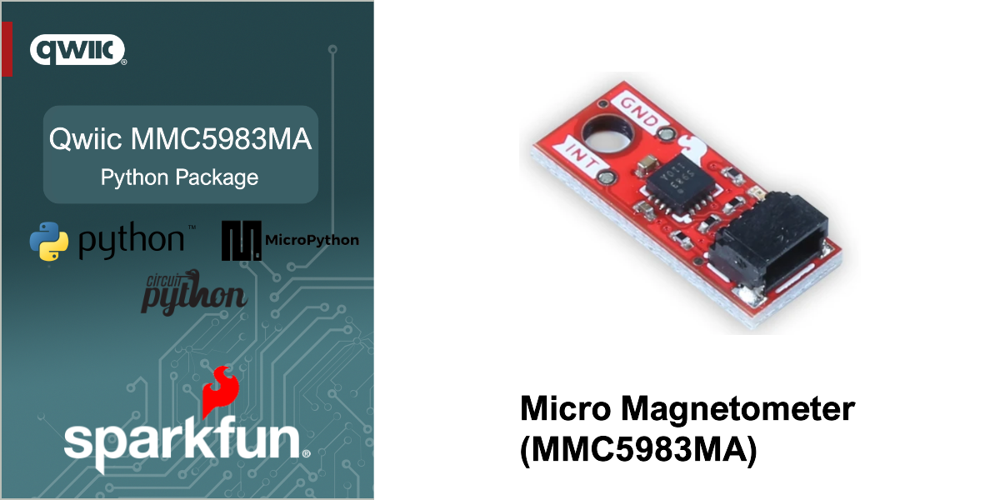

# SparkFun Qwiic MMC5983MA - Python Package


[](https://docs.sparkfun.com/Qwiic_Py/qwiic_mmc5983ma/)

The SparkFun Qwiic Magnetometer MMC5983MA Module provides a simple and cost effective solution for adding magnetometer capabilities to your project. Implementing a SparkFun Qwiic I2C interface, these sensors can be rapidly added to any project with boards that are part of the SparkFun Qwiic ecosystem.

This package is the Python driver for the MMC5983MA. It works on CPython (Linux), MicroPython and CircuitPython, and is part of the [SparkFun Qwiic Python package](https://github.com/sparkfun/Qwiic_Py).

## Contents

* [About the Package](#about-the-package)
* [Supported Platforms](#supported-platforms)
* [Installation](#installation)
* [Example Use](#example-use)
* [Documentation](#documentation)
* [Migrating from 2.x](#migrating-from-2x)

## About the Package

This package reads the magnetic field in gauss and the temperature from the MMC5983MA over a single Qwiic cable, calibrates the axis offsets with the SET and RESET coils, and configures filtering and continuous measurement. Each feature is demonstrated in the [examples](examples/README.md).

New to Qwiic? Take a look at the entire [SparkFun Qwiic ecosystem](https://www.sparkfun.com/qwiic).

### Supported SparkFun Products

* [SparkFun Magnetometer Sensor - MMC5983MA](https://www.sparkfun.com/products/19921)

## Supported Platforms

| Python | Platform | Boards |
| --- | --- | --- |
| CPython | Linux | [Raspberry Pi](https://www.sparkfun.com/raspberry-pi-5-8gb.html), [NVIDIA Jetson Orin Nano](https://www.sparkfun.com/nvidia-jetson-orin-nano-developer-kit.html) via the [SparkFun Qwiic SHIM](https://www.sparkfun.com/sparkfun-qwiic-shim-for-raspberry-pi.html) |
| MicroPython | Raspberry Pi RP2, ESP32 | [SparkFun Pro Micro RP2350](https://www.sparkfun.com/sparkfun-pro-micro-rp2350.html), [SparkFun IoT RedBoard ESP32](https://www.sparkfun.com/sparkfun-iot-redboard-esp32-development-board.html), [SparkFun IoT RedBoard RP2350](https://www.sparkfun.com/sparkfun-iot-redboard-rp2350.html) |
| CircuitPython | Raspberry Pi RP2, ESP32 | [SparkFun Pro Micro RP2350](https://www.sparkfun.com/sparkfun-pro-micro-rp2350.html), [SparkFun IoT RedBoard ESP32](https://www.sparkfun.com/sparkfun-iot-redboard-esp32-development-board.html), [SparkFun IoT RedBoard RP2350](https://www.sparkfun.com/sparkfun-iot-redboard-rp2350.html) |

> [!NOTE]
> These are the primary platforms tested. The package is expected to work on most Python-enabled systems.

## Installation

### CPython (pip)

```sh
python3 -m venv ~/sparkfun_venv
~/sparkfun_venv/bin/pip install sparkfun-qwiic-mmc5983ma
```

Run any example or script that does `import qwiic_mmc5983ma` with `~/sparkfun_venv/bin/python3 example_script.py`.

### MicroPython (mip)

Install [mpremote](https://docs.micropython.org/en/latest/reference/mpremote.html), connect your board, then install the driver (this also installs `qwiic_i2c`):

```sh
mpremote mip install github:sparkfun/Qwiic_Py/drivers/qwiic_mmc5983ma
```

To install the examples too:

```sh
mpremote mip install --target "" github:sparkfun/Qwiic_Py/drivers/qwiic_mmc5983ma/examples
```

Add `@qwiic_mmc5983ma-<version>` to either command to install a specific release.

### CircuitPython (circup)

Install [CircUp](https://docs.circuitpython.org/projects/circup/en/latest/#installation), add the SparkFun Qwiic bundle once, then install the driver:

```sh
circup bundle-add sparkfun/Qwiic_Py
circup install qwiic_mmc5983ma
```

To copy an example to the board:

```sh
circup example qwiic_mmc5983ma/qwiic_mmc5983ma_ex1_basic_readings
```

## Example Use

Below is a quickstart program that prints the magnetic field on each axis. See the [examples directory](examples) for more, and [examples/README.md](examples/README.md) for a summary of each.

```python
import sys
import qwiic_i2c
import qwiic_mmc5983ma


def run_example():
    print("\nQwiic MMC5983MA Example 1 - Basic Readings\n")
    my_mag = qwiic_mmc5983ma.QwiicMMC5983MA()

    if not my_mag.is_connected():
        print("The device isn't connected to the system. Please check your connection", file=sys.stderr)
        return

    my_mag.begin()

    while True:
        x, y, z = my_mag.get_measurement_xyz_gauss()
        print("X: %f" % x)
        print("Y: %f" % y)
        print("Z: %f\n" % z)
        qwiic_i2c.delay_ms(100)


if __name__ == "__main__":
    try:
        run_example()
    except (KeyboardInterrupt, SystemExit):
        print("\nEnding Example")
        sys.exit(0)
```

## Documentation

The API reference is at [docs.sparkfun.com/Qwiic_Py/qwiic_mmc5983ma](https://docs.sparkfun.com/Qwiic_Py/qwiic_mmc5983ma/).

## Migrating from 2.x

Version 3 has no properties, so it also runs on MicroPython builds without `property()`. The method names were already snake_case and are unchanged. The constructor no longer talks to the sensor, and several read-back methods now match the datasheet.

| 2.x | 3.0 |
| --- | --- |
| `mag.connected` | `mag.is_connected()` |
| The constructor ran `calibrate_offsets()` (and raised if no sensor answered) | `begin()` runs `calibrate_offsets()` after the soft reset; the constructor does no I/O |
| `begin()` returned `True` after the reset | `begin()` returns the result of `calibrate_offsets()` |
| `calibrate_offsets()` raised `TypeError` if a measurement timed out | returns `False` and keeps the previous offsets; `True` on success |
| Shadow copies of the write-only control registers were never updated, so each write cleared the other bits and `is_*_enabled()` / `get_*()` returned defaults | The shadow registers keep their values, as in the Arduino library |
| `set_filter_bandwidth(800)` / `(400)` wrote each other's bits; `get_filter_bandwidth()` swapped 200 and 400 Hz | Bandwidth bits follow the datasheet (`BW[1:0]` = 00/01/10/11 for 100/200/400/800 Hz) |
| `get_continuous_mode_frequency()` read the `CM_FREQ` bits in the wrong order | Returns the frequency set with `set_continuous_mode_frequency()` |
| `is_x_channel_enabled()`, `are_yz_channels_enabled()` returned `True` when the channel was inhibited | Return `True` when the channel is enabled |
| `get_measurement_xyz_gauss()` raised `TypeError` when the measurement timed out | returns `False` |

<p align="center">

</p>
