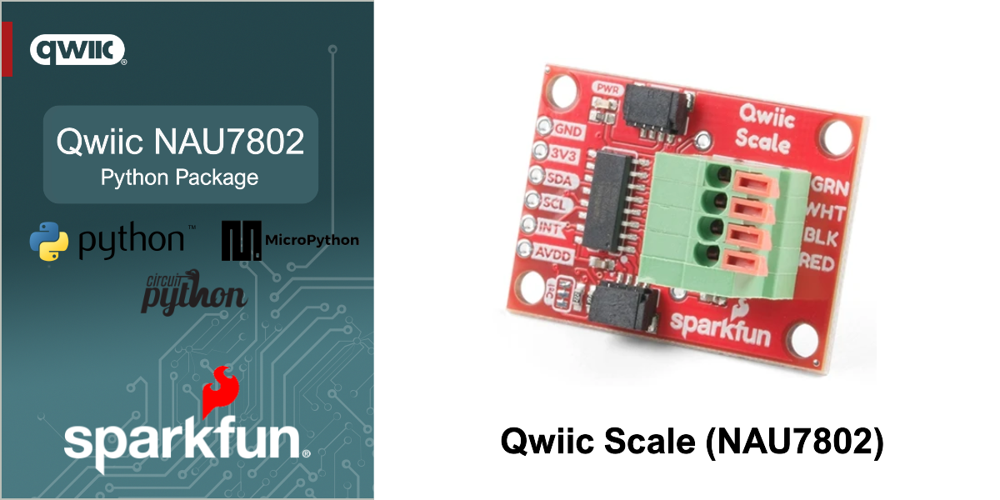

# SparkFun Qwiic NAU7802 - Python Package


[](https://docs.sparkfun.com/Qwiic_Py/qwiic_nau7802/)

The SparkFun Qwiic Scale NAU7802 Module provides a simple and cost effective solution for adding Scale capabilities to your project. Implementing a SparkFun Qwiic I2C interface, these sensors can be rapidly added to any project with boards that are part of the SparkFun Qwiic ecosystem.

This package is the Python driver for the NAU7802. It works on CPython (Linux), MicroPython and CircuitPython, and is part of the [SparkFun Qwiic Python package](https://github.com/sparkfun/Qwiic_Py).

## Contents

* [About the Package](#about-the-package)
* [Supported Platforms](#supported-platforms)
* [Installation](#installation)
* [Example Use](#example-use)
* [Documentation](#documentation)
* [Migrating from 2.x](#migrating-from-2x)

## About the Package

This package reads a load cell through the NAU7802 over a single Qwiic cable, calibrates it into a scale, and sets the gain, sample rate and power mode. Each feature is demonstrated in the [examples](examples/README.md).

New to Qwiic? Take a look at the entire [SparkFun Qwiic ecosystem](https://www.sparkfun.com/qwiic).

### Supported SparkFun Products

* [SparkFun Qwiic Scale - NAU7802](https://www.sparkfun.com/products/15242)

## Supported Platforms

| Python | Platform | Boards |
| --- | --- | --- |
| CPython | Linux | [Raspberry Pi](https://www.sparkfun.com/raspberry-pi-5-8gb.html), [NVIDIA Jetson Orin Nano](https://www.sparkfun.com/nvidia-jetson-orin-nano-developer-kit.html) via the [SparkFun Qwiic SHIM](https://www.sparkfun.com/sparkfun-qwiic-shim-for-raspberry-pi.html) |
| MicroPython | Raspberry Pi RP2, ESP32 | [SparkFun Pro Micro RP2350](https://www.sparkfun.com/sparkfun-pro-micro-rp2350.html), [SparkFun IoT RedBoard ESP32](https://www.sparkfun.com/sparkfun-iot-redboard-esp32-development-board.html), [SparkFun IoT RedBoard RP2350](https://www.sparkfun.com/sparkfun-iot-redboard-rp2350.html) |
| CircuitPython | Raspberry Pi RP2, ESP32 | [SparkFun Pro Micro RP2350](https://www.sparkfun.com/sparkfun-pro-micro-rp2350.html), [SparkFun IoT RedBoard ESP32](https://www.sparkfun.com/sparkfun-iot-redboard-esp32-development-board.html), [SparkFun IoT RedBoard RP2350](https://www.sparkfun.com/sparkfun-iot-redboard-rp2350.html) |

> [!NOTE]
> These are the primary platforms tested. The package is expected to work on most Python-enabled systems.

## Installation

### CPython (pip)

```sh
python3 -m venv ~/sparkfun_venv
~/sparkfun_venv/bin/pip install sparkfun-qwiic-nau7802
```

Run any example or script that does `import qwiic_nau7802` with `~/sparkfun_venv/bin/python3 example_script.py`.

### MicroPython (mip)

Install [mpremote](https://docs.micropython.org/en/latest/reference/mpremote.html), connect your board, then install the driver (this also installs `qwiic_i2c`):

```sh
mpremote mip install github:sparkfun/Qwiic_Py/drivers/qwiic_nau7802
```

To install the examples too:

```sh
mpremote mip install --target "" github:sparkfun/Qwiic_Py/drivers/qwiic_nau7802/examples
```

Add `@qwiic_nau7802-<version>` to either command to install a specific release.

### CircuitPython (circup)

Install [CircUp](https://docs.circuitpython.org/projects/circup/en/latest/#installation), add the SparkFun Qwiic bundle once, then install the driver:

```sh
circup bundle-add sparkfun/Qwiic_Py
circup install qwiic_nau7802
```

To copy an example to the board:

```sh
circup example qwiic_nau7802/qwiic_nau7802_ex1_basic_readings
```

## Example Use

Below is a quickstart program that prints raw readings from the NAU7802. See the [examples directory](examples) for more, and [examples/README.md](examples/README.md) for a summary of each.

```python
import sys
import qwiic_nau7802


print("\nQwiic NAU7802 Example 1 - Basic Readings\n")
my_scale = qwiic_nau7802.QwiicNAU7802()

if not my_scale.is_connected():
    print("The device isn't connected to the system. Please check your connection", file=sys.stderr)
    sys.exit(1)

my_scale.begin()

while True:
    if my_scale.available():
        print("Reading:", my_scale.get_reading())
```

## Documentation

The API reference is at [docs.sparkfun.com/Qwiic_Py/qwiic_nau7802](https://docs.sparkfun.com/Qwiic_Py/qwiic_nau7802/).

## Migrating from 2.x

Version 3 has one name per method and no properties, so it also runs on MicroPython builds without `property()`.

| 2.x | 3.0 |
| --- | --- |
| `scale.connected` | `scale.is_connected()` |
| `scale.millis()` | removed: use `qwiic_i2c.ticks_ms()` and `qwiic_i2c.ticks_diff()` |
| `wait_for_calibrate_afe()` and `get_average()` timeouts subtracted raw ticks (wrong when the counter wrapped, 1 s resolution on CircuitPython) | measured with `ticks_ms()` / `ticks_diff()` |

<p align="center">

</p>
