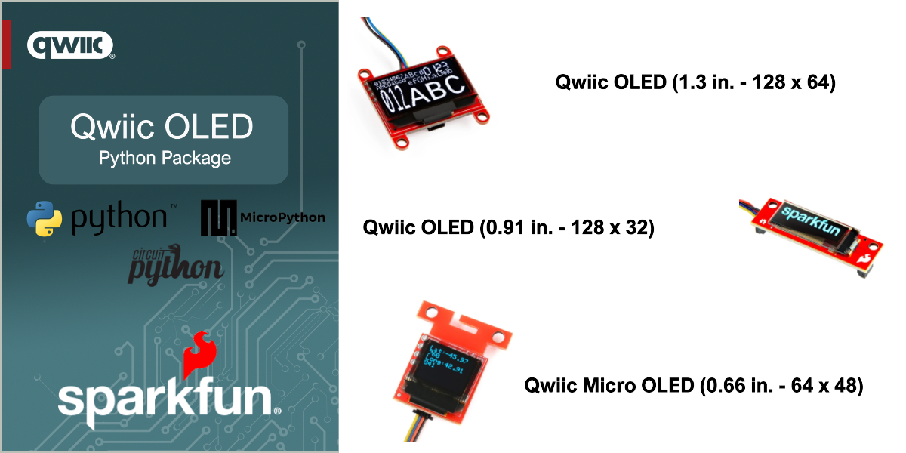

# SparkFun Qwiic OLED - Python Package


[](https://docs.sparkfun.com/Qwiic_Py/qwiic_oled/)

The SparkFun Qwiic OLED displays provide a simple and cost effective solution for adding a small graphic display to your project. Implementing a SparkFun Qwiic I2C interface, they can be rapidly added to any project with boards that are part of the SparkFun Qwiic ecosystem.

This package is the Python driver for the SparkFun Qwiic OLED displays (SSD1306). It works on CPython (Linux), MicroPython and CircuitPython, and is part of the [SparkFun Qwiic Python package](https://github.com/sparkfun/Qwiic_Py).

## Contents

* [About the Package](#about-the-package)
* [Supported Platforms](#supported-platforms)
* [Installation](#installation)
* [Example Use](#example-use)
* [Documentation](#documentation)
* [Migrating from 2.x](#migrating-from-2x)

## About the Package

This package displays a splash screen, draws pixels, lines and shapes, writes text in several fonts, moves the cursor and scrolls, over a single Qwiic cable. The fonts ship with the package, in `qwiic_oled/fonts`. Each feature is demonstrated in the [examples](examples/README.md).

New to Qwiic? Take a look at the entire [SparkFun Qwiic ecosystem](https://www.sparkfun.com/qwiic).

### Supported SparkFun Products

* [SparkFun Qwiic OLED (0.91 in., 128x32)](https://www.sparkfun.com/sparkfun-qwiic-oled-display-0-91-in-128x32-lcd-24606.html)
* [SparkFun Qwiic OLED (1.3 in., 128x64)](https://www.sparkfun.com/sparkfun-qwiic-oled-1-3in-128x64.html)
* [SparkFun Qwiic Micro OLED Breakout](https://www.sparkfun.com/sparkfun-micro-oled-breakout-qwiic-lcd-22495.html)

## Supported Platforms

| Python | Platform | Boards |
| --- | --- | --- |
| CPython | Linux | [Raspberry Pi](https://www.sparkfun.com/raspberry-pi-5-8gb.html), [NVIDIA Jetson Orin Nano](https://www.sparkfun.com/nvidia-jetson-orin-nano-developer-kit.html) via the [SparkFun Qwiic SHIM](https://www.sparkfun.com/sparkfun-qwiic-shim-for-raspberry-pi.html) |
| MicroPython | Raspberry Pi RP2, ESP32 | [SparkFun Pro Micro RP2350](https://www.sparkfun.com/sparkfun-pro-micro-rp2350.html), [SparkFun IoT RedBoard ESP32](https://www.sparkfun.com/sparkfun-iot-redboard-esp32-development-board.html), [SparkFun IoT RedBoard RP2350](https://www.sparkfun.com/sparkfun-iot-redboard-rp2350.html) |
| CircuitPython | Raspberry Pi RP2, ESP32 | [SparkFun Pro Micro RP2350](https://www.sparkfun.com/sparkfun-pro-micro-rp2350.html), [SparkFun IoT RedBoard ESP32](https://www.sparkfun.com/sparkfun-iot-redboard-esp32-development-board.html), [SparkFun IoT RedBoard RP2350](https://www.sparkfun.com/sparkfun-iot-redboard-rp2350.html) |

> [!NOTE]
> These are the primary platforms tested. The package is expected to work on most Python-enabled systems.

## Installation

### CPython (pip)

```sh
python3 -m venv ~/sparkfun_venv
~/sparkfun_venv/bin/pip install sparkfun-qwiic-oled-base
```

Run any example or script that does `import qwiic_oled` with `~/sparkfun_venv/bin/python3 example_script.py`.

### MicroPython (mip)

Install [mpremote](https://docs.micropython.org/en/latest/reference/mpremote.html), connect your board, then install the driver (this also installs `qwiic_i2c`):

```sh
mpremote mip install github:sparkfun/Qwiic_Py/drivers/qwiic_oled
```

To install the examples too:

```sh
mpremote mip install --target "" github:sparkfun/Qwiic_Py/drivers/qwiic_oled/examples
```

Add `@qwiic_oled-<version>` to either command to install a specific release.

### CircuitPython (circup)

Install [CircUp](https://docs.circuitpython.org/projects/circup/en/latest/#installation), add the SparkFun Qwiic bundle once, then install the driver:

```sh
circup bundle-add sparkfun/Qwiic_Py
circup install qwiic_oled
```

To copy an example to the board:

```sh
circup example qwiic_oled/qwiic_oled_ex1_splash_screen
```

## Example Use

Below is a quickstart program that prints "Hello World". See the [examples directory](examples) for more, and [examples/README.md](examples/README.md) for a summary of each.

```python
import sys
import qwiic_oled
import qwiic_i2c


def run_example():
    print("\nOLED Display - Hello World Example\n")

    my_oled = qwiic_oled.QwiicMicroOLED()  # Micro OLED
    # my_oled = qwiic_oled.QwiicOLEDDisplay()  # 0.91in 128x32 OLED
    # my_oled = qwiic_oled.QwiicLargeOLED()  # 1.3in 128x64 OLED

    if not my_oled.is_connected():
        print("The OLED Display isn't connected to the system. Please check your connection", file=sys.stderr)
        return

    my_oled.begin()

    my_oled.clear(my_oled.ALL)  # Clear the display's memory (gets rid of artifacts)
    my_oled.display()  # Display buffer contents
    qwiic_i2c.delay_ms(3000)

    my_oled.clear(my_oled.PAGE)  # Clear the display's buffer
    my_oled.print("Hello World")
    my_oled.display()


if __name__ == "__main__":
    try:
        run_example()
    except (KeyboardInterrupt, SystemExit):
        print("\nEnding OLED Hello Example")
        sys.exit(0)
```

## Documentation

The API reference is at [docs.sparkfun.com/Qwiic_Py/qwiic_oled](https://docs.sparkfun.com/Qwiic_Py/qwiic_oled/).

## Migrating from 2.x

Version 3 spells OLED in capitals in the class names, follows PEP 8 names throughout and has no properties, so it also runs on MicroPython builds without `property()`. The PyPI name stays `sparkfun-qwiic-oled-base`; the import name stays `qwiic_oled`.

| 2.x | 3.0 |
| --- | --- |
| `QwiicMicroOled` | `QwiicMicroOLED` |
| `QwiicOledDisplay` | `QwiicOLEDDisplay` |
| `QwiicLargeOled` | `QwiicLargeOLED` |
| `QwiicOledBase(address, pixel_width, pixel_height, i2c_driver)` | `QwiicOLEDBase(address, i2c_bus, pixel_width, pixel_height)` |
| `oled.connected` | `oled.is_connected()` |
| `oled.width`, `oled.height` | `oled.get_lcd_width()`, `oled.get_lcd_height()` |
| `oled.font_width`, `oled.font_height` | `oled.get_font_width()`, `oled.get_font_height()` |
| `oled.font_type` (get / set) | `oled.get_font_type()`, `oled.set_font_type(n)` |
| `set_draw_modee(mode)` | `set_draw_mode(mode)` |
| `oled.LCDWIDTH`, `oled.LCDHEIGHT` | `oled.lcd_width`, `oled.lcd_height` (or the `get_lcd_*()` methods) |
| `oled.cursorX`, `oled.cursorY`, `oled.foreColor`, `oled.drawMode`, `oled.fontType`, `oled.nFonts` | `oled.cursor_x`, `oled.cursor_y`, `oled.fore_color`, `oled.draw_mode`, `oled.font_type`, `oled.n_fonts` |
| `set_page_address(pageAddress)`, `set_column_address(colAddress)`, `scroll(..., scrollCommand, vertOffset)`, `scroll_vert_left/right(..., vertOffset)`, `draw_bitmap(bitArray)` | Same methods; the arguments are `page_address`, `col_address`, `scroll_command`, `vert_offset`, `bit_array` |
| `begin()` returned `None` | `begin()` returns `True` |
| `draw_bitmap()` printed an error for a bitmap of the wrong size | It raises `ValueError` |
| `oled_logos.add_logo(None)` printed an error | It raises `ValueError` |
| `print()` drew `\n` as a character | `print()` and `write()` start a new line on `\n` |
| Fonts were found by listing the `fonts` folder (needs `os`); a missing folder printed a warning | The five fonts are listed in `oled_fonts`; a missing font file raises `OSError` when it is loaded |
| 1.3in (128x64) OLED contrast 0x8F | 0xCF, as recommended for that panel |
| Examples `ex1_splash_screen.py` ... `ex5_micro_bitmap.py` | `qwiic_oled_ex1_splash_screen.py` ... `qwiic_oled_ex5_micro_bitmap.py` |
| `begin()` raised `OSError` when no device answered | `begin()` returns `False` |
| Creating a display on CircuitPython raised `RuntimeError: pystack exhausted` (the splash-screen logo was built as a 384- to 1024-element list) | It works: the logos are stored as `bytes` constants |

<p align="center">

</p>
