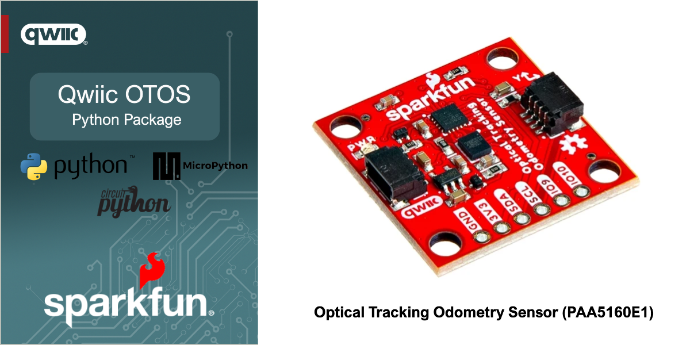

# SparkFun Qwiic OTOS - Python Package


[](https://docs.sparkfun.com/Qwiic_Py/qwiic_otos/)

The SparkFun Qwiic Optical Tracking Odometry Sensor (OTOS) provides a simple and cost effective solution for adding optical odometry to your robot. Implementing a SparkFun Qwiic I2C interface, these sensors can be rapidly added to any project with boards that are part of the SparkFun Qwiic ecosystem.

This package is the Python driver for the OTOS. It works on CPython (Linux), MicroPython and CircuitPython, and is part of the [SparkFun Qwiic Python package](https://github.com/sparkfun/Qwiic_Py).

## Contents

* [About the Package](#about-the-package)
* [Supported Platforms](#supported-platforms)
* [Installation](#installation)
* [Example Use](#example-use)
* [Documentation](#documentation)
* [Migrating from 2.x](#migrating-from-2x)

## About the Package

This package reads the tracked position, velocity and acceleration (and their standard deviations) from the OTOS over a single Qwiic cable, and handles IMU calibration, linear and angular scalars, sensor offsets and units. Each feature is demonstrated in the [examples](examples/README.md).

New to Qwiic? Take a look at the entire [SparkFun Qwiic ecosystem](https://www.sparkfun.com/qwiic).

### Supported SparkFun Products

* [SparkFun Optical Tracking Odometry Sensor - PAA5160E1 (Qwiic)](https://www.sparkfun.com/products/24904)

## Supported Platforms

| Python | Platform | Boards |
| --- | --- | --- |
| CPython | Linux | [Raspberry Pi](https://www.sparkfun.com/raspberry-pi-5-8gb.html), [NVIDIA Jetson Orin Nano](https://www.sparkfun.com/nvidia-jetson-orin-nano-developer-kit.html) via the [SparkFun Qwiic SHIM](https://www.sparkfun.com/sparkfun-qwiic-shim-for-raspberry-pi.html) |
| MicroPython | Raspberry Pi RP2, ESP32 | [SparkFun Pro Micro RP2350](https://www.sparkfun.com/sparkfun-pro-micro-rp2350.html), [SparkFun IoT RedBoard ESP32](https://www.sparkfun.com/sparkfun-iot-redboard-esp32-development-board.html), [SparkFun IoT RedBoard RP2350](https://www.sparkfun.com/sparkfun-iot-redboard-rp2350.html) |
| CircuitPython | Raspberry Pi RP2, ESP32 | [SparkFun Pro Micro RP2350](https://www.sparkfun.com/sparkfun-pro-micro-rp2350.html), [SparkFun IoT RedBoard ESP32](https://www.sparkfun.com/sparkfun-iot-redboard-esp32-development-board.html), [SparkFun IoT RedBoard RP2350](https://www.sparkfun.com/sparkfun-iot-redboard-rp2350.html) |

> [!NOTE]
> These are the primary platforms tested. The package is expected to work on most Python-enabled systems.

## Installation

### CPython (pip)

```sh
python3 -m venv ~/sparkfun_venv
~/sparkfun_venv/bin/pip install sparkfun-qwiic-otos
```

Run any example or script that does `import qwiic_otos` with `~/sparkfun_venv/bin/python3 example_script.py`.

### MicroPython (mip)

Install [mpremote](https://docs.micropython.org/en/latest/reference/mpremote.html), connect your board, then install the driver (this also installs `qwiic_i2c`):

```sh
mpremote mip install github:sparkfun/Qwiic_Py/drivers/qwiic_otos
```

To install the examples too:

```sh
mpremote mip install --target "" github:sparkfun/Qwiic_Py/drivers/qwiic_otos/examples
```

Add `@qwiic_otos-<version>` to either command to install a specific release.

### CircuitPython (circup)

Install [CircUp](https://docs.circuitpython.org/projects/circup/en/latest/#installation), add the SparkFun Qwiic bundle once, then install the driver:

```sh
circup bundle-add sparkfun/Qwiic_Py
circup install qwiic_otos
```

To copy an example to the board:

```sh
circup example qwiic_otos/qwiic_otos_ex1_basic_readings
```

## Example Use

Below is a quickstart program that calibrates the IMU and prints the tracked position. See the [examples directory](examples) for more, and [examples/README.md](examples/README.md) for a summary of each.

```python
import sys
import qwiic_i2c
import qwiic_otos


print("\nQwiic OTOS Example 1 - Basic Readings\n")
my_otos = qwiic_otos.QwiicOTOS()

if not my_otos.is_connected():
    print("The device isn't connected to the system. Please check your connection", file=sys.stderr)
    sys.exit(1)

my_otos.begin()

print("Ensure the OTOS is flat and stationary during calibration!")
qwiic_i2c.delay_ms(5000)
my_otos.calibrate_imu()
my_otos.reset_tracking()

while True:
    my_position = my_otos.get_position()
    print("X (Inches): {}".format(my_position.x))
    print("Y (Inches): {}".format(my_position.y))
    print("Heading (Degrees): {}\n".format(my_position.h))
    qwiic_i2c.delay_ms(500)
```

## Documentation

The API reference is at [docs.sparkfun.com/Qwiic_Py/qwiic_otos](https://docs.sparkfun.com/Qwiic_Py/qwiic_otos/).

## Migrating from 2.x

Version 3 uses snake_case method names and has no properties, so it also runs on MicroPython builds without `property()`. `Pose2D` is unchanged; the class constants are now UPPER_CASE.

| 2.x | 3.0 |
| --- | --- |
| `otos.connected` | `otos.is_connected()` |
| k-prefixed / mixed-case constants | UPPER_CASE (see [Renamed constants](#renamed-constants)) |
| `calibrateImu(numSamples, waitUntilDone)` | `calibrate_imu(num_samples, wait_until_done)` |
| `getAcceleration()` | `get_acceleration()` |
| `getAccelerationStdDev()` | `get_acceleration_std_dev()` |
| `getAngularScalar()` | `get_angular_scalar()` |
| `getAngularUnit()` | `get_angular_unit()` |
| `getImuCalibrationProgress()` | `get_imu_calibration_progress()` |
| `getLinearScalar()` | `get_linear_scalar()` |
| `getLinearUnit()` | `get_linear_unit()` |
| `getOffset()` | `get_offset()` |
| `getPosVelAcc()` | `get_pos_vel_acc()` |
| `getPosVelAccAndStdDev()` | `get_pos_vel_acc_and_std_dev()` |
| `getPosVelAccStdDev()` | `get_pos_vel_acc_std_dev()` |
| `getPosition()` | `get_position()` |
| `getPositionStdDev()` | `get_position_std_dev()` |
| `getSignalProcessConfig()` | `get_signal_process_config()` |
| `getStatus()` | `get_status()` |
| `getVelocity()` | `get_velocity()` |
| `getVelocityStdDev()` | `get_velocity_std_dev()` |
| `getVersionInfo()` | `get_version_info()` |
| `resetTracking()` | `reset_tracking()` |
| `selfTest()` | `self_test()` |
| `setAngularScalar(scalar)` | `set_angular_scalar(scalar)` |
| `setAngularUnit(unit)` | `set_angular_unit(unit)` |
| `setLinearScalar(scalar)` | `set_linear_scalar(scalar)` |
| `setLinearUnit(unit)` | `set_linear_unit(unit)` |
| `setOffset(pose)` | `set_offset(pose)` |
| `setPosition(pose)` | `set_position(pose)` |
| `setSignalProcessConfig(config)` | `set_signal_process_config(config)` |
| `setLinearScalar()`, `setAngularScalar()` returned `None` and passed a negative value to the I2C write for scalars below 1.0 | Return `True` (or `False` if out of range) and write the value as a two's complement byte, as the Arduino library does |

### Renamed constants

The leading `k` is dropped and the names are upper-cased with `_` between words; the values are unchanged.

| 2.x | 3.0 |
| --- | --- |
| `kProductId` | `PRODUCT_ID` |
| `kMinScalar` | `MIN_SCALAR` |
| `kMaxScalar` | `MAX_SCALAR` |
| `kLinearUnitMeters`, `kLinearUnitInches` | `LINEAR_UNIT_METERS`, `LINEAR_UNIT_INCHES` |
| `kAngularUnitRadians`, `kAngularUnitDegrees` | `ANGULAR_UNIT_RADIANS`, `ANGULAR_UNIT_DEGREES` |
| `kRegProductId`, `kRegHwVersion`, `kRegFwVersion`, `kRegScalarLinear`, `kRegScalarAngular` | `REG_PRODUCT_ID`, `REG_HW_VERSION`, `REG_FW_VERSION`, `REG_SCALAR_LINEAR`, `REG_SCALAR_ANGULAR` |
| `kRegImuCalib`, `kRegReset`, `kRegSignalProcess`, `kRegSelfTest`, `kRegStatus` | `REG_IMU_CALIB`, `REG_RESET`, `REG_SIGNAL_PROCESS`, `REG_SELF_TEST`, `REG_STATUS` |
| `kRegOffXL`, `kRegOffXH`, `kRegOffYL`, `kRegOffYH`, `kRegOffHL`, `kRegOffHH` | `REG_OFF_XL`, `REG_OFF_XH`, `REG_OFF_YL`, `REG_OFF_YH`, `REG_OFF_HL`, `REG_OFF_HH` |
| `kRegPosXL`, `kRegPosXH`, `kRegPosYL`, `kRegPosYH`, `kRegPosHL`, `kRegPosHH` | `REG_POS_XL`, `REG_POS_XH`, `REG_POS_YL`, `REG_POS_YH`, `REG_POS_HL`, `REG_POS_HH` |
| `kRegVelXL`, `kRegVelXH`, `kRegVelYL`, `kRegVelYH`, `kRegVelHL`, `kRegVelHH` | `REG_VEL_XL`, `REG_VEL_XH`, `REG_VEL_YL`, `REG_VEL_YH`, `REG_VEL_HL`, `REG_VEL_HH` |
| `kRegAccXL`, `kRegAccXH`, `kRegAccYL`, `kRegAccYH`, `kRegAccHL`, `kRegAccHH` | `REG_ACC_XL`, `REG_ACC_XH`, `REG_ACC_YL`, `REG_ACC_YH`, `REG_ACC_HL`, `REG_ACC_HH` |
| `kRegPosStdXL`, `kRegPosStdXH`, `kRegPosStdYL`, `kRegPosStdYH`, `kRegPosStdHL`, `kRegPosStdHH` | `REG_POS_STD_XL`, `REG_POS_STD_XH`, `REG_POS_STD_YL`, `REG_POS_STD_YH`, `REG_POS_STD_HL`, `REG_POS_STD_HH` |
| `kRegVelStdXL`, `kRegVelStdXH`, `kRegVelStdYL`, `kRegVelStdYH`, `kRegVelStdHL`, `kRegVelStdHH` | `REG_VEL_STD_XL`, `REG_VEL_STD_XH`, `REG_VEL_STD_YL`, `REG_VEL_STD_YH`, `REG_VEL_STD_HL`, `REG_VEL_STD_HH` |
| `kRegAccStdXL`, `kRegAccStdXH`, `kRegAccStdYL`, `kRegAccStdYH`, `kRegAccStdHL`, `kRegAccStdHH` | `REG_ACC_STD_XL`, `REG_ACC_STD_XH`, `REG_ACC_STD_YL`, `REG_ACC_STD_YH`, `REG_ACC_STD_HL`, `REG_ACC_STD_HH` |
| `kMeterToInch`, `kInchToMeter`, `kRadianToDegree`, `kDegreeToRadian` | `METER_TO_INCH`, `INCH_TO_METER`, `RADIAN_TO_DEGREE`, `DEGREE_TO_RADIAN` |
| `kMeterToInt16`, `kInt16ToMeter`, `kMpsToInt16`, `kInt16ToMps` | `METER_TO_INT16`, `INT16_TO_METER`, `MPS_TO_INT16`, `INT16_TO_MPS` |
| `kMpssToInt16`, `kInt16ToMpss`, `kRadToInt16`, `kInt16ToRad` | `MPSS_TO_INT16`, `INT16_TO_MPSS`, `RAD_TO_INT16`, `INT16_TO_RAD` |
| `kRpsToInt16`, `kInt16ToRps`, `kRpssToInt16`, `kInt16ToRpss` | `RPS_TO_INT16`, `INT16_TO_RPS`, `RPSS_TO_INT16`, `INT16_TO_RPSS` |

<p align="center">

</p>
