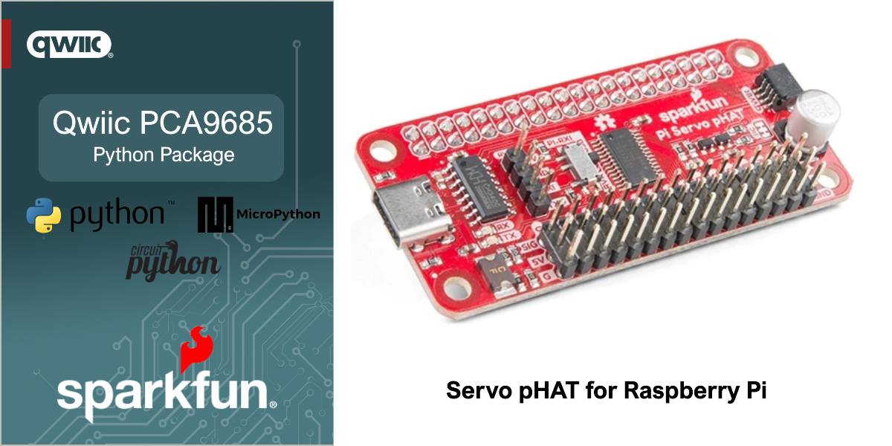

# SparkFun Qwiic PCA9685 - Python Package


[](https://docs.sparkfun.com/Qwiic_Py/qwiic_pca9685/)

The PCA9685 is a 16-channel, 12-bit PWM controller, used on SparkFun boards to drive servos and LEDs. Implementing a SparkFun Qwiic I2C interface, it can be rapidly added to any project with boards that are part of the SparkFun Qwiic ecosystem.

This package is the Python driver for the PCA9685 16-channel PWM controller. It works on CPython (Linux), MicroPython and CircuitPython, and is part of the [SparkFun Qwiic Python package](https://github.com/sparkfun/Qwiic_Py).

## Contents

* [About the Package](#about-the-package)
* [Supported Platforms](#supported-platforms)
* [Installation](#installation)
* [Example Use](#example-use)
* [Documentation](#documentation)
* [Migrating from 2.x](#migrating-from-2x)

## About the Package

This package sets the PWM frequency and the on and off timing of each channel of the PCA9685 over a single Qwiic cable, and gives access to its MODE1 and MODE2 configuration bits. For servo control in degrees, use the [pi_servo_hat](../pi_servo_hat) driver, which is built on this one. Each feature is demonstrated in the [examples](examples/README.md).

New to Qwiic? Take a look at the entire [SparkFun Qwiic ecosystem](https://www.sparkfun.com/qwiic).

### Supported SparkFun Products

* [SparkFun Servo pHAT for Raspberry Pi](https://www.sparkfun.com/products/15316)
* [SparkFun Pi Servo HAT](https://www.sparkfun.com/products/14328)

## Supported Platforms

| Python | Platform | Boards |
| --- | --- | --- |
| CPython | Linux | [Raspberry Pi](https://www.sparkfun.com/raspberry-pi-5-8gb.html), [NVIDIA Jetson Orin Nano](https://www.sparkfun.com/nvidia-jetson-orin-nano-developer-kit.html) via the [SparkFun Qwiic SHIM](https://www.sparkfun.com/sparkfun-qwiic-shim-for-raspberry-pi.html) |
| MicroPython | Raspberry Pi RP2, ESP32 | [SparkFun Pro Micro RP2350](https://www.sparkfun.com/sparkfun-pro-micro-rp2350.html), [SparkFun IoT RedBoard ESP32](https://www.sparkfun.com/sparkfun-iot-redboard-esp32-development-board.html), [SparkFun IoT RedBoard RP2350](https://www.sparkfun.com/sparkfun-iot-redboard-rp2350.html) |
| CircuitPython | Raspberry Pi RP2, ESP32 | [SparkFun Pro Micro RP2350](https://www.sparkfun.com/sparkfun-pro-micro-rp2350.html), [SparkFun IoT RedBoard ESP32](https://www.sparkfun.com/sparkfun-iot-redboard-esp32-development-board.html), [SparkFun IoT RedBoard RP2350](https://www.sparkfun.com/sparkfun-iot-redboard-rp2350.html) |

> [!NOTE]
> These are the primary platforms tested. The package is expected to work on most Python-enabled systems.

## Installation

### CPython (pip)

```sh
python3 -m venv ~/sparkfun_venv
~/sparkfun_venv/bin/pip install sparkfun-qwiic-pca9685
```

Run any example or script that does `import qwiic_pca9685` with `~/sparkfun_venv/bin/python3 example_script.py`.

### MicroPython (mip)

Install [mpremote](https://docs.micropython.org/en/latest/reference/mpremote.html), connect your board, then install the driver (this also installs `qwiic_i2c`):

```sh
mpremote mip install github:sparkfun/Qwiic_Py/drivers/qwiic_pca9685
```

To install the examples too:

```sh
mpremote mip install --target "" github:sparkfun/Qwiic_Py/drivers/qwiic_pca9685/examples
```

Add `@qwiic_pca9685-<version>` to either command to install a specific release.

### CircuitPython (circup)

Install [CircUp](https://docs.circuitpython.org/projects/circup/en/latest/#installation), add the SparkFun Qwiic bundle once, then install the driver:

```sh
circup bundle-add sparkfun/Qwiic_Py
circup install qwiic_pca9685
```

To copy an example to the board:

```sh
circup example qwiic_pca9685/qwiic_pca9685_ex1_servo_sweep
```

## Example Use

Below is a quickstart program that sweeps a servo on channel 0 between 1 ms and 2 ms pulses. See the [examples directory](examples) for more, and [examples/README.md](examples/README.md) for a summary of each.

```python
import sys
import qwiic_i2c
import qwiic_pca9685


def run_example():
    print("\nSparkFun PCA9685 Example 1\n")
    my_pwm = qwiic_pca9685.QwiicPCA9685()

    if not my_pwm.is_connected():
        print("The Qwiic PCA9685 device isn't connected to the system. Please check your connection", file=sys.stderr)
        return

    my_pwm.begin()
    my_pwm.set_pre_scale(50)            # 50 Hz PWM
    my_pwm.set_channel_word(0, 1, 0)    # channel 0 pulse starts at count 0

    while True:
        for i in range(205, 410):       # 1 ms to 2 ms
            my_pwm.set_channel_word(0, 0, i)
            qwiic_i2c.delay_ms(50)
        for i in range(410, 205, -1):
            my_pwm.set_channel_word(0, 0, i)
            qwiic_i2c.delay_ms(50)


if __name__ == "__main__":
    try:
        run_example()
    except (KeyboardInterrupt, SystemExit):
        print("\nEnding Example")
        sys.exit(0)
```

## Documentation

The API reference is at [docs.sparkfun.com/Qwiic_Py/qwiic_pca9685](https://docs.sparkfun.com/Qwiic_Py/qwiic_pca9685/).

## Migrating from 2.x

Version 3 has no `debug` option and never prints: invalid arguments make a method return `False` (or `0`, or leave the register unchanged) as they did in 2.x, just silently.

| 2.x | 3.0 |
| --- | --- |
| `QwiicPCA9685(address, debug, i2c_driver)` | `QwiicPCA9685(address, i2c_bus)`: the `debug` argument and attribute are gone |
| module variable `qwiic_pca9685.pwm_channels` | `qwiic_pca9685.PWM_CHANNELS` |
| `__readBit__()`, `__writeBit__()` | private `_read_bit()`, `_write_bit()` |
| `is_connected()` checked the platform default bus, not the driver's bus | `is_connected()` checks the bus the driver was given |
| `set_pre_scale()` prompted with `input()` when the EXTCLK pin was enabled | returns `False` unless the clock frequency is passed as `ext` |
| `set_pre_scale()` with no frequency raised `NameError` | sets the default prescale `0x1E` (200 Hz) |
| `set_pre_scale()` wrote an out-of-range prescale for some `ext` clocks | returns `False` unless the prescale is 3 to 255 |
| `get_channel_word()`, `set_channel_word()` with `channel=None` raised `TypeError` | use channel 0 |
| `get_channel_word()`, `set_channel_word()` with `on_off` other than 0 or 1 raised `UnboundLocalError` | return `False` |
| `clear_restart_bit()`, `restart_pwm_channels()` printed when there was nothing to do | return the RESTART bit without printing |

<p align="center">

</p>
