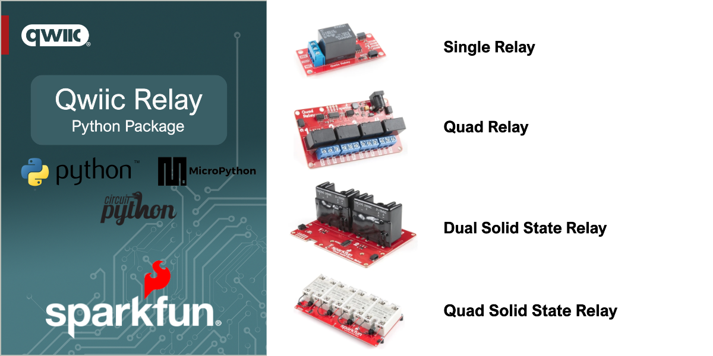

# SparkFun Qwiic Relay - Python Package


[](https://docs.sparkfun.com/Qwiic_Py/qwiic_relay/)

The SparkFun Qwiic Relays provide a simple and cost effective solution for switching loads from your project. Implementing a SparkFun Qwiic I2C interface, they can be rapidly added to any project with boards that are part of the SparkFun Qwiic ecosystem.

This package is the Python driver for the SparkFun Qwiic relays (single, quad, dual and quad solid state). It works on CPython (Linux), MicroPython and CircuitPython, and is part of the [SparkFun Qwiic Python package](https://github.com/sparkfun/Qwiic_Py).

## Contents

* [About the Package](#about-the-package)
* [Supported Platforms](#supported-platforms)
* [Installation](#installation)
* [Example Use](#example-use)
* [Documentation](#documentation)
* [Migrating from 2.x](#migrating-from-2x)

## About the Package

This package switches each relay on and off, reads its state, runs the slow PWM of the solid state relays, and changes the board's I2C address, over a single Qwiic cable. Each feature is demonstrated in the [examples](examples/README.md).

New to Qwiic? Take a look at the entire [SparkFun Qwiic ecosystem](https://www.sparkfun.com/qwiic).

### Supported SparkFun Products

* [SparkFun Qwiic Single Relay](https://www.sparkfun.com/sparkfun-qwiic-single-relay.html)
* [SparkFun Qwiic Quad Relay](https://www.sparkfun.com/sparkfun-qwiic-quad-relay.html)
* [SparkFun Qwiic Dual Solid State Relay](https://www.sparkfun.com/sparkfun-qwiic-dual-solid-state-relay.html)
* [SparkFun Qwiic Quad Solid State Relay](https://www.sparkfun.com/sparkfun-qwiic-quad-solid-state-relay-kit.html)

## Supported Platforms

| Python | Platform | Boards |
| --- | --- | --- |
| CPython | Linux | [Raspberry Pi](https://www.sparkfun.com/raspberry-pi-5-8gb.html), [NVIDIA Jetson Orin Nano](https://www.sparkfun.com/nvidia-jetson-orin-nano-developer-kit.html) via the [SparkFun Qwiic SHIM](https://www.sparkfun.com/sparkfun-qwiic-shim-for-raspberry-pi.html) |
| MicroPython | Raspberry Pi RP2, ESP32 | [SparkFun Pro Micro RP2350](https://www.sparkfun.com/sparkfun-pro-micro-rp2350.html), [SparkFun IoT RedBoard ESP32](https://www.sparkfun.com/sparkfun-iot-redboard-esp32-development-board.html), [SparkFun IoT RedBoard RP2350](https://www.sparkfun.com/sparkfun-iot-redboard-rp2350.html) |
| CircuitPython | Raspberry Pi RP2, ESP32 | [SparkFun Pro Micro RP2350](https://www.sparkfun.com/sparkfun-pro-micro-rp2350.html), [SparkFun IoT RedBoard ESP32](https://www.sparkfun.com/sparkfun-iot-redboard-esp32-development-board.html), [SparkFun IoT RedBoard RP2350](https://www.sparkfun.com/sparkfun-iot-redboard-rp2350.html) |

> [!NOTE]
> These are the primary platforms tested. The package is expected to work on most Python-enabled systems.

## Installation

### CPython (pip)

```sh
python3 -m venv ~/sparkfun_venv
~/sparkfun_venv/bin/pip install sparkfun-qwiic-relay
```

Run any example or script that does `import qwiic_relay` with `~/sparkfun_venv/bin/python3 example_script.py`.

### MicroPython (mip)

Install [mpremote](https://docs.micropython.org/en/latest/reference/mpremote.html), connect your board, then install the driver (this also installs `qwiic_i2c`):

```sh
mpremote mip install github:sparkfun/Qwiic_Py/drivers/qwiic_relay
```

To install the examples too:

```sh
mpremote mip install --target "" github:sparkfun/Qwiic_Py/drivers/qwiic_relay/examples
```

Add `@qwiic_relay-<version>` to either command to install a specific release.

### CircuitPython (circup)

Install [CircUp](https://docs.circuitpython.org/projects/circup/en/latest/#installation), add the SparkFun Qwiic bundle once, then install the driver:

```sh
circup bundle-add sparkfun/Qwiic_Py
circup install qwiic_relay
```

To copy an example to the board:

```sh
circup example qwiic_relay/qwiic_relay_ex1_single
```

## Example Use

Below is a quickstart program that switches a single relay on and off. See the [examples directory](examples) for more, and [examples/README.md](examples/README.md) for a summary of each.

```python
import sys
import qwiic_i2c
import qwiic_relay


print("\nSparkFun Qwiic Relay Example 1 - Single\n")

# Be sure to initialize your relay with the proper address.
my_relay = qwiic_relay.QwiicRelay(qwiic_relay.SINGLE_RELAY_DEFAULT_ADDR)

if not my_relay.begin():
    print("The Qwiic Relay isn't connected to the system. Please check your connection", file=sys.stderr)
    sys.exit(1)

for i in range(2):
    my_relay.set_relay_on()
    print("Relay state: " + str(my_relay.get_relay_state()))
    qwiic_i2c.delay_ms(1000)

    my_relay.set_relay_off()
    print("Relay state: " + str(my_relay.get_relay_state()))
    qwiic_i2c.delay_ms(1000)
```

## Documentation

The API reference is at [docs.sparkfun.com/Qwiic_Py/qwiic_relay](https://docs.sparkfun.com/Qwiic_Py/qwiic_relay/).

## Migrating from 2.x

Version 3 has one name per method and no properties, so it also runs on MicroPython builds without `property()`.

| 2.x | 3.0 |
| --- | --- |
| `relay.connected` | `relay.is_connected()` |
| `relay.version` | `relay.get_version()` |
| `SINGLE_RELAY_DEFUALT_ADDR`, `QUAD_RELAY_DEFUALT_ADDR` | `SINGLE_RELAY_DEFAULT_ADDR`, `QUAD_RELAY_DEFAULT_ADDR` |
| `DUAL_SOLID_STATE_RELAY_DEFUALT_ADDR`, `QUAD_SOLID_STATE_RELAY_DEFUALT_ADDR` | `DUAL_SOLID_STATE_RELAY_DEFAULT_ADDR`, `QUAD_SOLID_STATE_RELAY_DEFAULT_ADDR` |
| `set_relay_on(relayNum)`, `set_relay_off(relayNum)`, `get_relay_state(relayNum)` | `set_relay_on(relay_num)`, `set_relay_off(relay_num)`, `get_relay_state(relay_num)` |
| `set_slow_pwm(relayNum, pwmValue)`, `get_slow_pwm(relayNum)` | `set_slow_pwm(relay_num, pwm_value)`, `get_slow_pwm(relay_num)` |
| `change_address(newAddress, singleRelay)` | `change_address(new_address, single_relay)` |
| `change_address()` kept talking to the old address | switches the driver to the new address and returns `True` (`False` if out of range) |
| `QwiicRelay(address)` silently used 0x18 for an address not in `available_addresses` | uses the address given, so a board moved with `change_address()` can be opened |
| `set_slow_pwm()`, `get_slow_pwm()` printed on a mechanical relay | return `False` without printing |

<p align="center">

</p>
