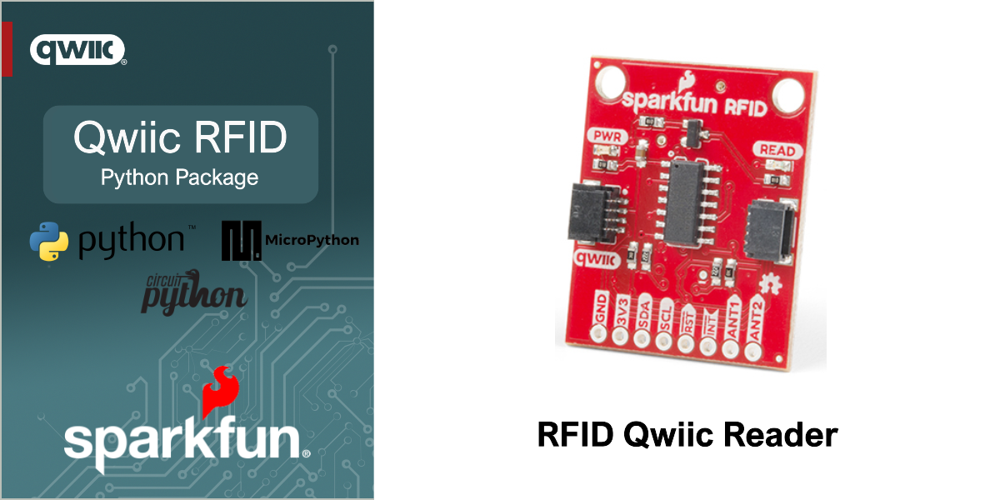

# SparkFun Qwiic RFID - Python Package


[](https://docs.sparkfun.com/Qwiic_Py/qwiic_rfid/)

The SparkFun Qwiic RFID Reader provides a simple and cost effective solution for adding 125 kHz RFID tag reading to your project. Implementing a SparkFun Qwiic I2C interface, it can be rapidly added to any project with boards that are part of the SparkFun Qwiic ecosystem.

This package is the Python driver for the Qwiic RFID Reader. It works on CPython (Linux), MicroPython and CircuitPython, and is part of the [SparkFun Qwiic Python package](https://github.com/sparkfun/Qwiic_Py).

## Contents

* [About the Package](#about-the-package)
* [Supported Platforms](#supported-platforms)
* [Installation](#installation)
* [Example Use](#example-use)
* [Documentation](#documentation)
* [Migrating from 2.x](#migrating-from-2x)

## About the Package

This package reads the latest RFID tag and its scan time, drains the reader's buffer of up to 20 tags and times, and changes the reader's I2C address over a single Qwiic cable. Each feature is demonstrated in the [examples](examples/README.md).

New to Qwiic? Take a look at the entire [SparkFun Qwiic ecosystem](https://www.sparkfun.com/qwiic).

### Supported SparkFun Products

* [SparkFun RFID Qwiic Reader](https://www.sparkfun.com/products/15191)

## Supported Platforms

| Python | Platform | Boards |
| --- | --- | --- |
| CPython | Linux | [Raspberry Pi](https://www.sparkfun.com/raspberry-pi-5-8gb.html), [NVIDIA Jetson Orin Nano](https://www.sparkfun.com/nvidia-jetson-orin-nano-developer-kit.html) via the [SparkFun Qwiic SHIM](https://www.sparkfun.com/sparkfun-qwiic-shim-for-raspberry-pi.html) |
| MicroPython | Raspberry Pi RP2, ESP32 | [SparkFun Pro Micro RP2350](https://www.sparkfun.com/sparkfun-pro-micro-rp2350.html), [SparkFun IoT RedBoard ESP32](https://www.sparkfun.com/sparkfun-iot-redboard-esp32-development-board.html), [SparkFun IoT RedBoard RP2350](https://www.sparkfun.com/sparkfun-iot-redboard-rp2350.html) |
| CircuitPython | Raspberry Pi RP2, ESP32 | [SparkFun Pro Micro RP2350](https://www.sparkfun.com/sparkfun-pro-micro-rp2350.html), [SparkFun IoT RedBoard ESP32](https://www.sparkfun.com/sparkfun-iot-redboard-esp32-development-board.html), [SparkFun IoT RedBoard RP2350](https://www.sparkfun.com/sparkfun-iot-redboard-rp2350.html) |

> [!NOTE]
> These are the primary platforms tested. The package is expected to work on most Python-enabled systems.

## Installation

### CPython (pip)

```sh
python3 -m venv ~/sparkfun_venv
~/sparkfun_venv/bin/pip install sparkfun-qwiic-rfid
```

Run any example or script that does `import qwiic_rfid` with `~/sparkfun_venv/bin/python3 example_script.py`.

### MicroPython (mip)

Install [mpremote](https://docs.micropython.org/en/latest/reference/mpremote.html), connect your board, then install the driver (this also installs `qwiic_i2c`):

```sh
mpremote mip install github:sparkfun/Qwiic_Py/drivers/qwiic_rfid
```

To install the examples too:

```sh
mpremote mip install --target "" github:sparkfun/Qwiic_Py/drivers/qwiic_rfid/examples
```

Add `@qwiic_rfid-<version>` to either command to install a specific release.

### CircuitPython (circup)

Install [CircUp](https://docs.circuitpython.org/projects/circup/en/latest/#installation), add the SparkFun Qwiic bundle once, then install the driver:

```sh
circup bundle-add sparkfun/Qwiic_Py
circup install qwiic_rfid
```

To copy an example to the board:

```sh
circup example qwiic_rfid/qwiic_rfid_ex1_get_tag
```

## Example Use

Below is a quickstart program that prints each RFID tag as it is scanned. See the [examples directory](examples) for more, and [examples/README.md](examples/README.md) for a summary of each.

```python
import sys
import qwiic_rfid
import qwiic_i2c


print("\nSparkFun Qwiic RFID Reader Example 1")
my_rfid = qwiic_rfid.QwiicRFID()

if not my_rfid.begin():
    print("The Qwiic RFID Reader isn't connected to the system. Please check your connection", file=sys.stderr)
    sys.exit(1)

print("Ready to scan some tags!")

while True:
    tag_id = my_rfid.get_tag()
    if tag_id != "000000":
        print("Tag ID: " + tag_id)
        print("Scanned %s seconds ago" % my_rfid.get_prec_req_time())
    qwiic_i2c.delay_ms(1000)
```

## Documentation

The API reference is at [docs.sparkfun.com/Qwiic_Py/qwiic_rfid](https://docs.sparkfun.com/Qwiic_Py/qwiic_rfid/).

## Migrating from 2.x

Version 3 uses the qwiic_i2c 3.0 API. The method names are unchanged.

| 2.x | 3.0 |
| --- | --- |
| `change_address(address)` returned `None` on success | `change_address(address)` returns `True` on success |
| `QwiicRFID.TAG_ARRAY`, `QwiicRFID.TIME_ARRAY` were shared by every reader | `TAG_ARRAY` and `TIME_ARRAY` are per-reader attributes |

<p align="center">

</p>
