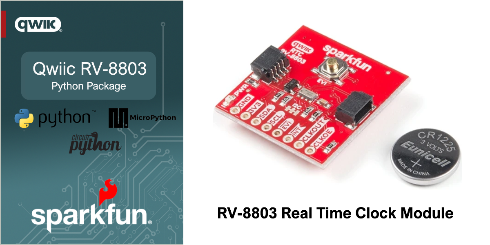

# SparkFun Qwiic RV8803 - Python Package


[](https://docs.sparkfun.com/Qwiic_Py/qwiic_rv8803/)

The SparkFun Qwiic Real Time Clock RV8803 Module provides a simple and cost effective solution for adding a real time clock to your project. Implementing a SparkFun Qwiic I2C interface, these sensors can be rapidly added to any project with boards that are part of the SparkFun Qwiic ecosystem.

This package is the Python driver for the RV8803. It works on CPython (Linux), MicroPython and CircuitPython, and is part of the [SparkFun Qwiic Python package](https://github.com/sparkfun/Qwiic_Py).

## Contents

* [About the Package](#about-the-package)
* [Supported Platforms](#supported-platforms)
* [Installation](#installation)
* [Example Use](#example-use)
* [Documentation](#documentation)
* [Migrating from 2.x](#migrating-from-2x)

## About the Package

This package sets and reads the time and date of the RV8803 over a single Qwiic cable, as date and time fields or as a Unix epoch, and configures its alarm, countdown, periodic and event (EVI) interrupts and calibration offset. Each feature is demonstrated in the [examples](examples/README.md).

New to Qwiic? Take a look at the entire [SparkFun Qwiic ecosystem](https://www.sparkfun.com/qwiic).

### Supported SparkFun Products

* [SparkFun Real Time Clock Module - RV-8803 (Qwiic)](https://www.sparkfun.com/products/16281)

## Supported Platforms

| Python | Platform | Boards |
| --- | --- | --- |
| CPython | Linux | [Raspberry Pi](https://www.sparkfun.com/raspberry-pi-5-8gb.html), [NVIDIA Jetson Orin Nano](https://www.sparkfun.com/nvidia-jetson-orin-nano-developer-kit.html) via the [SparkFun Qwiic SHIM](https://www.sparkfun.com/sparkfun-qwiic-shim-for-raspberry-pi.html) |
| MicroPython | Raspberry Pi RP2, ESP32 | [SparkFun Pro Micro RP2350](https://www.sparkfun.com/sparkfun-pro-micro-rp2350.html), [SparkFun IoT RedBoard ESP32](https://www.sparkfun.com/sparkfun-iot-redboard-esp32-development-board.html), [SparkFun IoT RedBoard RP2350](https://www.sparkfun.com/sparkfun-iot-redboard-rp2350.html) |
| CircuitPython | Raspberry Pi RP2, ESP32 | [SparkFun Pro Micro RP2350](https://www.sparkfun.com/sparkfun-pro-micro-rp2350.html), [SparkFun IoT RedBoard ESP32](https://www.sparkfun.com/sparkfun-iot-redboard-esp32-development-board.html), [SparkFun IoT RedBoard RP2350](https://www.sparkfun.com/sparkfun-iot-redboard-rp2350.html) |

> [!NOTE]
> These are the primary platforms tested. The package is expected to work on most Python-enabled systems.

## Installation

### CPython (pip)

```sh
python3 -m venv ~/sparkfun_venv
~/sparkfun_venv/bin/pip install sparkfun-qwiic-rv8803
```

Run any example or script that does `import qwiic_rv8803` with `~/sparkfun_venv/bin/python3 example_script.py`.

### MicroPython (mip)

Install [mpremote](https://docs.micropython.org/en/latest/reference/mpremote.html), connect your board, then install the driver (this also installs `qwiic_i2c`):

```sh
mpremote mip install github:sparkfun/Qwiic_Py/drivers/qwiic_rv8803
```

To install the examples too:

```sh
mpremote mip install --target "" github:sparkfun/Qwiic_Py/drivers/qwiic_rv8803/examples
```

Add `@qwiic_rv8803-<version>` to either command to install a specific release.

### CircuitPython (circup)

Install [CircUp](https://docs.circuitpython.org/projects/circup/en/latest/#installation), add the SparkFun Qwiic bundle once, then install the driver:

```sh
circup bundle-add sparkfun/Qwiic_Py
circup install qwiic_rv8803
```

To copy an example to the board:

```sh
circup example qwiic_rv8803/qwiic_rv8803_ex1_set_time
```

## Example Use

Below is a quickstart program that sets the time and prints it every second. See the [examples directory](examples) for more, and [examples/README.md](examples/README.md) for a summary of each.

```python
import sys
import qwiic_rv8803
import qwiic_i2c


print("\nQwiic RV8803 Example 1 - Set Time\n")
my_rtc = qwiic_rv8803.QwiicRV8803()

if not my_rtc.is_connected():
    print("The device isn't connected to the system. Please check your connection", file=sys.stderr)
    sys.exit(1)

my_rtc.begin()

# seconds, minutes, hours, weekday, date, month, year
my_rtc.set_time(2, 47, 14, my_rtc.TUESDAY, 2, 3, 2020)

while True:
    my_rtc.update_time()
    print("Current Time:", my_rtc.string_date_usa(), my_rtc.string_time())
    qwiic_i2c.delay_ms(1000)
```

## Documentation

The API reference is at [docs.sparkfun.com/Qwiic_Py/qwiic_rv8803](https://docs.sparkfun.com/Qwiic_Py/qwiic_rv8803/).

## Migrating from 2.x

Version 3 has one name per method and no properties, so it also runs on MicroPython builds without `property()`. The driver no longer uses the `time` module: epoch conversions are done in the driver, the same way on every platform.

| 2.x | 3.0 |
| --- | --- |
| `rtc.connected` | `rtc.is_connected()` |
| `is_PM()` | `is_pm()` |
| `string_time_8601_TZ()` | `string_time_8601_tz()` |
| `set_epoch(value, use1970sEpoch, timeZoneQuarterHours)` | `set_epoch(value, use_1970s_epoch, time_zone_quarter_hours)` |
| `set_local_epoch(value, use1970sEpoch)`, `get_epoch(use1970sEpoch)`, `get_local_epoch(use1970sEpoch)` | `use_1970s_epoch` argument |
| `set_items_to_match_for_alarm(minuteAlarm, hourAlarm, weekdayAlarm, dateAlarm)` | `set_items_to_match_for_alarm(minute_alarm, hour_alarm, weekday_alarm, date_alarm)` |
| The alarm getters included the alarm enable bit (values of 80 or more), and `get_alarm_weekday()` decoded the weekday mask as BCD | they return the value alone, and the weekday as the mask `set_alarm_weekday()` takes |
| `kTmYear`, `kTmMonth`, ... `kTmIsDST` (indices into `time.localtime()`) | removed |
| Epoch methods used `time.localtime()` / `time.mktime()`, so the result depended on the platform's epoch and, on Linux, the system time zone | the epoch is always UTC-style seconds since 1970-01-01 (or 2000-01-01); use the time zone methods for local offsets |
| `get_local_epoch()` returned a float on CPython | returns an `int` |
| `set_time()`, `set_weekday()` and `set_local_epoch()` wrote the weekday as BCD (Thursday to Saturday were stored wrong), `set_local_epoch()` was one day off, and `get_weekday()` decoded it as BCD | the weekday register holds one bit per day: pass and compare `SUNDAY` ... `SATURDAY` |
| `string_month()` returned "Invalid Month" for October to December | returns the month name |
| `k`-prefixed constants (`kSunday`, `kMonday`, ...) | UPPER_CASE without the `k` (`SUNDAY`, `MONDAY`, ...); every rename is listed below |

<details>
<summary>Every renamed constant</summary>

| 2.x | 3.0 |
| --- | --- |
| `kSunday` | `SUNDAY` |
| `kMonday` | `MONDAY` |
| `kTuesday` | `TUESDAY` |
| `kWednesday` | `WEDNESDAY` |
| `kThursday` | `THURSDAY` |
| `kFriday` | `FRIDAY` |
| `kSaturday` | `SATURDAY` |
| `kRegRAM` | `REG_RAM` |
| `kRegHundredths` | `REG_HUNDREDTHS` |
| `kRegSeconds` | `REG_SECONDS` |
| `kRegMinutes` | `REG_MINUTES` |
| `kRegHours` | `REG_HOURS` |
| `kRegWeekdays` | `REG_WEEKDAYS` |
| `kRegDate` | `REG_DATE` |
| `kRegMonths` | `REG_MONTHS` |
| `kRegYears` | `REG_YEARS` |
| `kRegMinutesAlarm` | `REG_MINUTES_ALARM` |
| `kRegHoursAlarm` | `REG_HOURS_ALARM` |
| `kRegWeekdaysDateAlarm` | `REG_WEEKDAYS_DATE_ALARM` |
| `kRegTimer0` | `REG_TIMER0` |
| `kRegTimer1` | `REG_TIMER1` |
| `kRegExtension` | `REG_EXTENSION` |
| `kRegFlag` | `REG_FLAG` |
| `kRegControl` | `REG_CONTROL` |
| `kRegHundredthsCapture` | `REG_HUNDREDTHS_CAPTURE` |
| `kRegSecondsCapture` | `REG_SECONDS_CAPTURE` |
| `kRegOffset` | `REG_OFFSET` |
| `kRegEventControl` | `REG_EVENT_CONTROL` |
| `kAlarmEnable` | `ALARM_ENABLE` |
| `kExtensionTest` | `EXTENSION_TEST` |
| `kExtensionWada` | `EXTENSION_WADA` |
| `kExtensionUsel` | `EXTENSION_USEL` |
| `kExtensionTe` | `EXTENSION_TE` |
| `kExtensionFd` | `EXTENSION_FD` |
| `kExtensionTd` | `EXTENSION_TD` |
| `kFlagUpdate` | `FLAG_UPDATE` |
| `kFlagTimer` | `FLAG_TIMER` |
| `kFlagAlarm` | `FLAG_ALARM` |
| `kFlagEvi` | `FLAG_EVI` |
| `kFlagV2f` | `FLAG_V2F` |
| `kFlagV1f` | `FLAG_V1F` |
| `kUpdateInterrupt` | `UPDATE_INTERRUPT` |
| `kTimerInterrupt` | `TIMER_INTERRUPT` |
| `kAlarmInterrupt` | `ALARM_INTERRUPT` |
| `kEviInterrupt` | `EVI_INTERRUPT` |
| `kControlReset` | `CONTROL_RESET` |
| `kEventEcp` | `EVENT_ECP` |
| `kEventEhl` | `EVENT_EHL` |
| `kEventEt` | `EVENT_ET` |
| `kEventErst` | `EVENT_ERST` |
| `kCountdownTimerFrequency4096Hz` | `COUNTDOWN_TIMER_FREQUENCY_4096HZ` |
| `kCountdownTimerFrequency64Hz` | `COUNTDOWN_TIMER_FREQUENCY_64HZ` |
| `kCountdownTimerFrequency1Hz` | `COUNTDOWN_TIMER_FREQUENCY_1HZ` |
| `kCountdownTimerFrequency1_60thHz` | `COUNTDOWN_TIMER_FREQUENCY_1_60TH_HZ` |
| `kClockOutFrequency32768Hz` | `CLOCK_OUT_FREQUENCY_32768HZ` |
| `kClockOutFrequency1024Hz` | `CLOCK_OUT_FREQUENCY_1024HZ` |
| `kClockOutFrequency1Hz` | `CLOCK_OUT_FREQUENCY_1HZ` |
| `kCountdownTimerOn` | `COUNTDOWN_TIMER_ON` |
| `kCountdownTimerOff` | `COUNTDOWN_TIMER_OFF` |
| `kTimeUpdate1Second` | `TIME_UPDATE_1_SECOND` |
| `kTimeUpdate1Minute` | `TIME_UPDATE_1_MINUTE` |
| `kEnableEviCalibration` | `ENABLE_EVI_CALIBRATION` |
| `kDisableEviCalibration` | `DISABLE_EVI_CALIBRATION` |
| `kEviDebounceNone` | `EVI_DEBOUNCE_NONE` |
| `kEviDebounce256Hz` | `EVI_DEBOUNCE_256HZ` |
| `kEviDebounce64Hz` | `EVI_DEBOUNCE_64HZ` |
| `kEviDebounce8Hz` | `EVI_DEBOUNCE_8HZ` |
| `kRisingEdge` | `RISING_EDGE` |
| `kFallingEdge` | `FALLING_EDGE` |
| `kEviCaptureEnable` | `EVI_CAPTURE_ENABLE` |
| `kEviCaptureDisable` | `EVI_CAPTURE_DISABLE` |
| `kTimeListLength` | `TIME_LIST_LENGTH` |
| `kIdxHundredths` | `IDX_HUNDREDTHS` |
| `kIdxSeconds` | `IDX_SECONDS` |
| `kIdxMinutes` | `IDX_MINUTES` |
| `kIdxHours` | `IDX_HOURS` |
| `kIdxWeekday` | `IDX_WEEKDAY` |
| `kIdxDate` | `IDX_DATE` |
| `kIdxMonth` | `IDX_MONTH` |
| `kIdxYear` | `IDX_YEAR` |

</details>

<p align="center">

</p>
