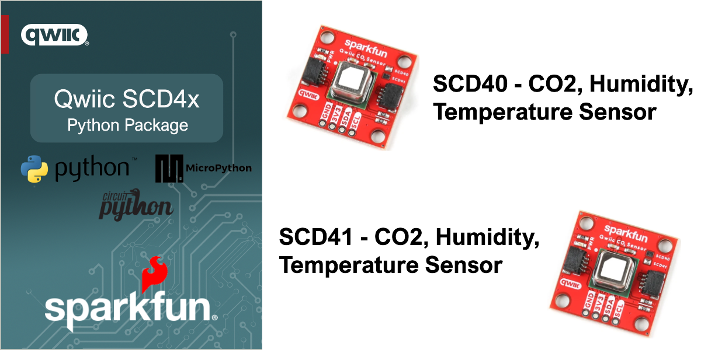

# SparkFun Qwiic SCD4x - Python Package


[](https://docs.sparkfun.com/Qwiic_Py/qwiic_scd4x/)

The SparkFun Qwiic CO2, Temperature, and Humidity SCD4x Module provides a simple and cost effective solution for adding CO2, temperature, and humidity sensing to your project. Implementing a SparkFun Qwiic I2C interface, these sensors can be rapidly added to any project with boards that are part of the SparkFun Qwiic ecosystem.

This package is the Python driver for the SCD40 and SCD41. It works on CPython (Linux), MicroPython and CircuitPython, and is part of the [SparkFun Qwiic Python package](https://github.com/sparkfun/Qwiic_Py).

## Contents

* [About the Package](#about-the-package)
* [Supported Platforms](#supported-platforms)
* [Installation](#installation)
* [Example Use](#example-use)
* [Documentation](#documentation)
* [Migrating from 2.x](#migrating-from-2x)

## About the Package

This package reads CO2, temperature and humidity from the SCD4x over a single Qwiic cable, and sets its signal compensation, calibration, low power and single shot modes. Each feature is demonstrated in the [examples](examples/README.md).

New to Qwiic? Take a look at the entire [SparkFun Qwiic ecosystem](https://www.sparkfun.com/qwiic).

### Supported SparkFun Products

* [SparkFun CO2, Temperature, and Humidity Sensor - SCD4x](https://www.sparkfun.com/products/22396)

## Supported Platforms

| Python | Platform | Boards |
| --- | --- | --- |
| CPython | Linux | [Raspberry Pi](https://www.sparkfun.com/raspberry-pi-5-8gb.html), [NVIDIA Jetson Orin Nano](https://www.sparkfun.com/nvidia-jetson-orin-nano-developer-kit.html) via the [SparkFun Qwiic SHIM](https://www.sparkfun.com/sparkfun-qwiic-shim-for-raspberry-pi.html) |
| MicroPython | Raspberry Pi RP2, ESP32 | [SparkFun Pro Micro RP2350](https://www.sparkfun.com/sparkfun-pro-micro-rp2350.html), [SparkFun IoT RedBoard ESP32](https://www.sparkfun.com/sparkfun-iot-redboard-esp32-development-board.html), [SparkFun IoT RedBoard RP2350](https://www.sparkfun.com/sparkfun-iot-redboard-rp2350.html) |
| CircuitPython | Raspberry Pi RP2, ESP32 | [SparkFun Pro Micro RP2350](https://www.sparkfun.com/sparkfun-pro-micro-rp2350.html), [SparkFun IoT RedBoard ESP32](https://www.sparkfun.com/sparkfun-iot-redboard-esp32-development-board.html), [SparkFun IoT RedBoard RP2350](https://www.sparkfun.com/sparkfun-iot-redboard-rp2350.html) |

> [!NOTE]
> These are the primary platforms tested. The package is expected to work on most Python-enabled systems.

## Installation

### CPython (pip)

```sh
python3 -m venv ~/sparkfun_venv
~/sparkfun_venv/bin/pip install sparkfun-qwiic-scd4x
```

Run any example or script that does `import qwiic_scd4x` with `~/sparkfun_venv/bin/python3 example_script.py`.

### MicroPython (mip)

Install [mpremote](https://docs.micropython.org/en/latest/reference/mpremote.html), connect your board, then install the driver (this also installs `qwiic_i2c`):

```sh
mpremote mip install github:sparkfun/Qwiic_Py/drivers/qwiic_scd4x
```

To install the examples too:

```sh
mpremote mip install --target "" github:sparkfun/Qwiic_Py/drivers/qwiic_scd4x/examples
```

Add `@qwiic_scd4x-<version>` to either command to install a specific release.

### CircuitPython (circup)

Install [CircUp](https://docs.circuitpython.org/projects/circup/en/latest/#installation), add the SparkFun Qwiic bundle once, then install the driver:

```sh
circup bundle-add sparkfun/Qwiic_Py
circup install qwiic_scd4x
```

To copy an example to the board:

```sh
circup example qwiic_scd4x/qwiic_scd4x_ex1_basic
```

## Example Use

Below is a quickstart program that prints CO2, temperature and humidity readings. See the [examples directory](examples) for more, and [examples/README.md](examples/README.md) for a summary of each.

```python
import sys
import qwiic_i2c
import qwiic_scd4x


print("\nQwiic SCD4x Example 1 - Basic Readings\n")
my_scd4x = qwiic_scd4x.QwiicSCD4x()

if not my_scd4x.is_connected():
    print("The device isn't connected to the system. Please check your connection", file=sys.stderr)
    sys.exit(1)

if not my_scd4x.begin():
    print("Error while initializing device", file=sys.stderr)
    sys.exit(1)

while True:
    # read_measurement() returns False until new data is available
    if my_scd4x.read_measurement():
        print("\nCO2(ppm):", my_scd4x.get_co2())
        print("Temperature(C):", my_scd4x.get_temperature())
        print("Humidity(%RH):", my_scd4x.get_humidity())
    else:
        print(".", end="")

    qwiic_i2c.delay_ms(500)
```

## Documentation

The API reference is at [docs.sparkfun.com/Qwiic_Py/qwiic_scd4x](https://docs.sparkfun.com/Qwiic_Py/qwiic_scd4x/).

## Migrating from 2.x

Version 3 has no properties, so it also runs on MicroPython builds without `property()`. The method names are unchanged; the camelCase arguments are now snake_case, and the constants are UPPER_CASE without the `k` prefix.

| 2.x | 3.0 |
| --- | --- |
| `sensor.connected` | `sensor.is_connected()` |
| `begin(measBegin, autoCalibrate, skipStopPeriodicMeasurement, pollAndSetDeviceType)` | `begin(meas_begin, auto_calibrate, skip_stop_periodic_measurement, poll_and_set_device_type)` |
| `begin()` returned `True` even when its checks failed | `begin()` returns `False` if the serial number, feature set or self-calibration checks fail |
| `delayMillis=` argument of `stop_periodic_measurement()`, `set_temperature_offset()`, `set_sensor_altitude()`, `set_ambient_pressure()`, `persist_settings()`, `perform_factory_reset()`, `reinit()`, `set_automatic_self_calibration_enabled()`, `read_register()` | `delay_millis=` |
| `set_sensor_type(sensorType)`, `read_register(registerAddress)` | `set_sensor_type(sensor_type)`, `read_register(register_address)` |
| `set_sensor_altitude()` returned `None` on success | returns `True` on success |
| `perform_forced_recalibration()` returned `True` even when the sensor reported failure | returns `False` |
| `kComGetAutomaticSelfCalibrationEnabled`, `kComGetDataReadyStatus`, `kComGetFeatureSetVersion`, `kComGetSensorAltitude` | `COM_GET_AUTOMATIC_SELF_CALIBRATION_ENABLED`, `COM_GET_DATA_READY_STATUS`, `COM_GET_FEATURE_SET_VERSION`, `COM_GET_SENSOR_ALTITUDE` |
| `kComGetSerialNumber`, `kComGetTemperatureOffset`, `kComMeasureSingleShot`, `kComMeasureSingleShotRhtOnly` | `COM_GET_SERIAL_NUMBER`, `COM_GET_TEMPERATURE_OFFSET`, `COM_MEASURE_SINGLE_SHOT`, `COM_MEASURE_SINGLE_SHOT_RHT_ONLY` |
| `kComPerformFactoryReset`, `kComPerformForcedCalibration`, `kComPerformSelfTest`, `kComPersistSettings` | `COM_PERFORM_FACTORY_RESET`, `COM_PERFORM_FORCED_CALIBRATION`, `COM_PERFORM_SELF_TEST`, `COM_PERSIST_SETTINGS` |
| `kComReadMeasurement`, `kComReinit`, `kComSetAmbientPressure`, `kComSetAutomaticSelfCalibrationEnabled` | `COM_READ_MEASUREMENT`, `COM_REINIT`, `COM_SET_AMBIENT_PRESSURE`, `COM_SET_AUTOMATIC_SELF_CALIBRATION_ENABLED` |
| `kComSetSensorAltitude`, `kComSetTemperatureOffset`, `kComStartLowPowerPeriodicMeasurement`, `kComStartPeriodicMeasurement` | `COM_SET_SENSOR_ALTITUDE`, `COM_SET_TEMPERATURE_OFFSET`, `COM_START_LOW_POWER_PERIODIC_MEASUREMENT`, `COM_START_PERIODIC_MEASUREMENT` |
| `kComStopPeriodicMeasurement`, `kTypeSCD40`, `kTypeSCD41`, `kTypeSDC4xInvalid` | `COM_STOP_PERIODIC_MEASUREMENT`, `TYPE_SCD40`, `TYPE_SCD41`, `TYPE_SCD4X_INVALID` |

<p align="center">

</p>
