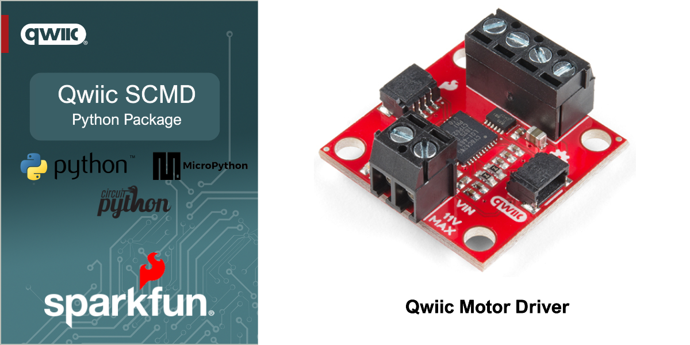

# SparkFun Qwiic SCMD - Python Package


[](https://docs.sparkfun.com/Qwiic_Py/qwiic_scmd/)

The SparkFun Qwiic Motor Driver provides a simple and cost effective solution for driving two DC motors from your project. Implementing a SparkFun Qwiic I2C interface, it can be rapidly added to any project with boards that are part of the SparkFun Qwiic ecosystem.

This package is the Python driver for the Serial Controlled Motor Driver (SCMD). It works on CPython (Linux), MicroPython and CircuitPython, and is part of the [SparkFun Qwiic Python package](https://github.com/sparkfun/Qwiic_Py).

## Contents

* [About the Package](#about-the-package)
* [Supported Platforms](#supported-platforms)
* [Installation](#installation)
* [Example Use](#example-use)
* [Documentation](#documentation)
* [Migrating from 2.x](#migrating-from-2x)

## About the Package

This package drives the motors of the Serial Controlled Motor Driver over a single Qwiic cable: speed and direction, inversion, bridging, and diagnostics of the driver and of any expansion drivers chained to it. Each feature is demonstrated in the [examples](examples/README.md).

New to Qwiic? Take a look at the entire [SparkFun Qwiic ecosystem](https://www.sparkfun.com/qwiic).

### Supported SparkFun Products

* [SparkFun Qwiic Motor Driver](https://www.sparkfun.com/sparkfun-qwiic-motor-driver.html)

## Supported Platforms

| Python | Platform | Boards |
| --- | --- | --- |
| CPython | Linux | [Raspberry Pi](https://www.sparkfun.com/raspberry-pi-5-8gb.html), [NVIDIA Jetson Orin Nano](https://www.sparkfun.com/nvidia-jetson-orin-nano-developer-kit.html) via the [SparkFun Qwiic SHIM](https://www.sparkfun.com/sparkfun-qwiic-shim-for-raspberry-pi.html) |
| MicroPython | Raspberry Pi RP2, ESP32 | [SparkFun Pro Micro RP2350](https://www.sparkfun.com/sparkfun-pro-micro-rp2350.html), [SparkFun IoT RedBoard ESP32](https://www.sparkfun.com/sparkfun-iot-redboard-esp32-development-board.html), [SparkFun IoT RedBoard RP2350](https://www.sparkfun.com/sparkfun-iot-redboard-rp2350.html) |
| CircuitPython | Raspberry Pi RP2, ESP32 | [SparkFun Pro Micro RP2350](https://www.sparkfun.com/sparkfun-pro-micro-rp2350.html), [SparkFun IoT RedBoard ESP32](https://www.sparkfun.com/sparkfun-iot-redboard-esp32-development-board.html), [SparkFun IoT RedBoard RP2350](https://www.sparkfun.com/sparkfun-iot-redboard-rp2350.html) |

> [!NOTE]
> These are the primary platforms tested. The package is expected to work on most Python-enabled systems.

## Installation

### CPython (pip)

```sh
python3 -m venv ~/sparkfun_venv
~/sparkfun_venv/bin/pip install sparkfun-qwiic-scmd
```

Run any example or script that does `import qwiic_scmd` with `~/sparkfun_venv/bin/python3 example_script.py`.

### MicroPython (mip)

Install [mpremote](https://docs.micropython.org/en/latest/reference/mpremote.html), connect your board, then install the driver (this also installs `qwiic_i2c`):

```sh
mpremote mip install github:sparkfun/Qwiic_Py/drivers/qwiic_scmd
```

To install the examples too:

```sh
mpremote mip install --target "" github:sparkfun/Qwiic_Py/drivers/qwiic_scmd/examples
```

Add `@qwiic_scmd-<version>` to either command to install a specific release.

### CircuitPython (circup)

Install [CircUp](https://docs.circuitpython.org/projects/circup/en/latest/#installation), add the SparkFun Qwiic bundle once, then install the driver:

```sh
circup bundle-add sparkfun/Qwiic_Py
circup install qwiic_scmd
```

To copy an example to the board:

```sh
circup example qwiic_scmd/qwiic_scmd_ex1_basic
```

## Example Use

Below is a quickstart program that speeds one motor up and down. See the [examples directory](examples) for more, and [examples/README.md](examples/README.md) for a summary of each.

```python
import sys
import qwiic_i2c
import qwiic_scmd

R_MTR = 0
FWD = 0


def run_example():
    print("Motor Test.")
    my_motor = qwiic_scmd.QwiicSCMD()

    if not my_motor.is_connected():
        print("Motor Driver not connected. Check connections.", file=sys.stderr)
        return

    my_motor.begin()
    my_motor.set_drive(R_MTR, FWD, 0)
    my_motor.enable()

    try:
        while True:
            for speed in range(20, 255):
                my_motor.set_drive(R_MTR, FWD, speed)
                qwiic_i2c.delay_ms(50)
            for speed in range(254, 20, -1):
                my_motor.set_drive(R_MTR, FWD, speed)
                qwiic_i2c.delay_ms(50)
    finally:
        my_motor.disable()


if __name__ == "__main__":
    try:
        run_example()
    except (KeyboardInterrupt, SystemExit):
        print("Ending example.")
        sys.exit(0)
```

## Documentation

The API reference is at [docs.sparkfun.com/Qwiic_Py/qwiic_scmd](https://docs.sparkfun.com/Qwiic_Py/qwiic_scmd/).

## Migrating from 2.x

Version 3 has one name per method and no properties, so it also runs on MicroPython builds without `property()`.

| 2.x | 3.0 |
| --- | --- |
| `QwiicScmd` | `QwiicSCMD` |
| `motor.connected` | `motor.is_connected()` |
| `begin()` returned the ID register (`0xA9`) | `begin()` returns `True` if the ID register reads `0xA9`, otherwise `False` |
| `set_drive(motorNum, ...)`, `inversion_mode(motorNum, ...)` | `set_drive(motor_num, ...)`, `inversion_mode(motor_num, ...)` |
| `bridging_mode(driverNum, ...)` | `bridging_mode(driver_num, ...)` |
| `write_remote_register(address, offset, dataToWrite)` | `write_remote_register(address, offset, data_to_write)` |
| `SCMDDiagnostics.numberOfSlaves` | `SCMDDiagnostics.number_of_slaves` |
| `set_drive(m, 0, 255)` and `set_drive(m, 1, 255)` sent drive value 0, which leaves the motor stopped ([Qwiic_SCMD_Py#3](https://github.com/sparkfun/Qwiic_SCMD_Py/issues/3)) | both drive at full speed |
| `available_addresses` listed 5 addresses ([Qwiic_SCMD_Py#4](https://github.com/sparkfun/Qwiic_SCMD_Py/issues/4)) | lists all 10 (0x58 to 0x61, default 0x5D first) |
| `bridging_mode()` on an expansion driver failed (missing address argument) | works |
| `begin()` raised `OSError` when no device answered | `begin()` returns `False` |

<p align="center">

</p>
