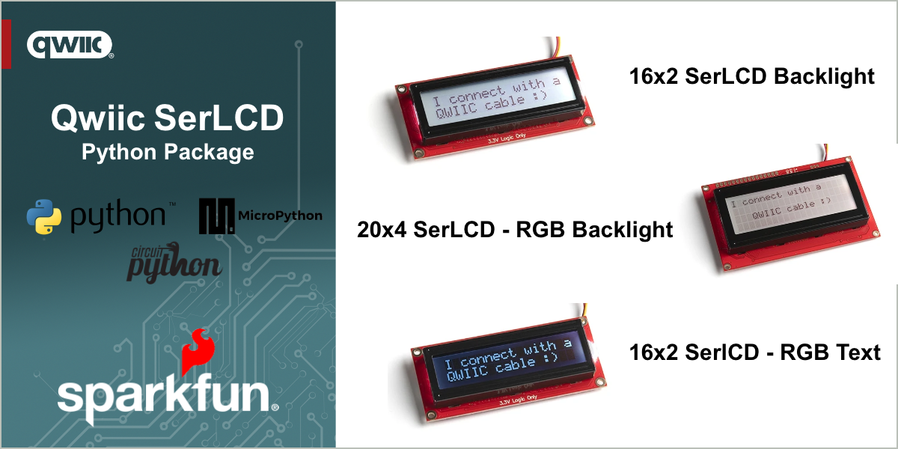

# SparkFun Qwiic SerLCD - Python Package


[](https://docs.sparkfun.com/Qwiic_Py/qwiic_serlcd/)

The line of SparkFun Qwiic SerLCD products provide a simple and cost effective solution for adding a "text based" LCD display to your project. Implementing a SparkFun Qwiic interface, a SerLCD is rapidly added to any board that is part of the SparkFun Qwiic ecosystem.

This package is the Python driver for the SparkFun SerLCD displays. It works on CPython (Linux), MicroPython and CircuitPython, and is part of the [SparkFun Qwiic Python package](https://github.com/sparkfun/Qwiic_Py).

## Contents

* [About the Package](#about-the-package)
* [Supported Platforms](#supported-platforms)
* [Installation](#installation)
* [Example Use](#example-use)
* [Documentation](#documentation)
* [Migrating from 2.x](#migrating-from-2x)

## About the Package

This package writes text to the screen, adjusts the backlight color, sets the contrast, makes custom characters, customizes the splash screen and more, over a single Qwiic cable. The displays come pre-programmed with the open-source [OpenLCD firmware](https://github.com/sparkfun/OpenLCD). Each feature is demonstrated in the [examples](examples/README.md).

New to Qwiic? Take a look at the entire [SparkFun Qwiic ecosystem](https://www.sparkfun.com/qwiic).

### Supported SparkFun Products

* [SparkFun 16x2 SerLCD - RGB Backlight (Qwiic)](https://www.sparkfun.com/products/16396)
* [SparkFun 16x2 SerLCD - RGB Text (Qwiic)](https://www.sparkfun.com/products/16397)
* [SparkFun 20x4 SerLCD - RGB Backlight (Qwiic)](https://www.sparkfun.com/products/16398)

## Supported Platforms

| Python | Platform | Boards |
| --- | --- | --- |
| CPython | Linux | [Raspberry Pi](https://www.sparkfun.com/raspberry-pi-5-8gb.html), [NVIDIA Jetson Orin Nano](https://www.sparkfun.com/nvidia-jetson-orin-nano-developer-kit.html) via the [SparkFun Qwiic SHIM](https://www.sparkfun.com/sparkfun-qwiic-shim-for-raspberry-pi.html) |
| MicroPython | Raspberry Pi RP2, ESP32 | [SparkFun Pro Micro RP2350](https://www.sparkfun.com/sparkfun-pro-micro-rp2350.html), [SparkFun IoT RedBoard ESP32](https://www.sparkfun.com/sparkfun-iot-redboard-esp32-development-board.html), [SparkFun IoT RedBoard RP2350](https://www.sparkfun.com/sparkfun-iot-redboard-rp2350.html) |
| CircuitPython | Raspberry Pi RP2, ESP32 | [SparkFun Pro Micro RP2350](https://www.sparkfun.com/sparkfun-pro-micro-rp2350.html), [SparkFun IoT RedBoard ESP32](https://www.sparkfun.com/sparkfun-iot-redboard-esp32-development-board.html), [SparkFun IoT RedBoard RP2350](https://www.sparkfun.com/sparkfun-iot-redboard-rp2350.html) |

> [!NOTE]
> These are the primary platforms tested. The package is expected to work on most Python-enabled systems.

## Installation

### CPython (pip)

```sh
python3 -m venv ~/sparkfun_venv
~/sparkfun_venv/bin/pip install sparkfun-qwiic-serlcd
```

Run any example or script that does `import qwiic_serlcd` with `~/sparkfun_venv/bin/python3 example_script.py`.

### MicroPython (mip)

Install [mpremote](https://docs.micropython.org/en/latest/reference/mpremote.html), connect your board, then install the driver (this also installs `qwiic_i2c`):

```sh
mpremote mip install github:sparkfun/Qwiic_Py/drivers/qwiic_serlcd
```

To install the examples too:

```sh
mpremote mip install --target "" github:sparkfun/Qwiic_Py/drivers/qwiic_serlcd/examples
```

Add `@qwiic_serlcd-<version>` to either command to install a specific release.

### CircuitPython (circup)

Install [CircUp](https://docs.circuitpython.org/projects/circup/en/latest/#installation), add the SparkFun Qwiic bundle once, then install the driver:

```sh
circup bundle-add sparkfun/Qwiic_Py
circup install qwiic_serlcd
```

To copy an example to the board:

```sh
circup example qwiic_serlcd/qwiic_serlcd_ex1_hello_world
```

## Example Use

Below is a quickstart program that prints "Hello World!" and a counter. See the [examples directory](examples) for more, and [examples/README.md](examples/README.md) for a summary of each.

```python
import sys
import qwiic_serlcd
import qwiic_i2c


def run_example():
    print("\nSparkFun Qwiic SerLCD Example 1\n")
    my_lcd = qwiic_serlcd.QwiicSerLCD()

    if not my_lcd.is_connected():
        print("The Qwiic SerLCD device isn't connected to the system. Please check your connection", file=sys.stderr)
        return

    my_lcd.set_backlight(255, 255, 255)  # Set backlight to bright white
    my_lcd.set_contrast(5)  # Set contrast. Lower to 0 for higher contrast.
    my_lcd.clear_screen()  # Clear the screen; this also moves the cursor home

    qwiic_i2c.delay_ms(1000)  # Give a second for system messages to complete

    my_lcd.print("Hello World!")
    counter = 0
    while True:
        print("counter: %d" % counter)
        my_lcd.set_cursor(0, 1)
        my_lcd.print(str(counter))
        counter = counter + 1
        qwiic_i2c.delay_ms(1000)


if __name__ == "__main__":
    try:
        run_example()
    except (KeyboardInterrupt, SystemExit):
        print("\nEnding Example 1")
        sys.exit(0)
```

## Documentation

The API reference is at [docs.sparkfun.com/Qwiic_Py/qwiic_serlcd](https://docs.sparkfun.com/Qwiic_Py/qwiic_serlcd/).

## Migrating from 2.x

Version 3 follows PEP 8 names throughout (the 2.x methods were camelCase) and has no properties, so it also runs on MicroPython builds without `property()`. Methods that were already lowercase (`begin()`, `print()`, `home()`, `command()`, `cursor()`, `blink()`, `autoscroll()`, `display()`) keep their names.

| 2.x | 3.0 |
| --- | --- |
| `QwiicSerlcd` | `QwiicSerLCD` |
| `lcd.connected` | `lcd.is_connected()` |
| `clearScreen()` | `clear_screen()` |
| `setCursor()` | `set_cursor()` |
| `setContrast()` | `set_contrast()` |
| `setBacklight()` | `set_backlight()` |
| `specialCommand()` | `special_command()` |
| `moveCursorLeft()` | `move_cursor_left()` |
| `moveCursorRight()` | `move_cursor_right()` |
| `noCursor()` | `no_cursor()` |
| `noBlink()` | `no_blink()` |
| `scrollDisplayLeft()` | `scroll_display_left()` |
| `scrollDisplayRight()` | `scroll_display_right()` |
| `noAutoscroll()` | `no_autoscroll()` |
| `leftToRight()` | `left_to_right()` |
| `rightToLeft()` | `right_to_left()` |
| `createChar()` | `create_char()` |
| `writeChar()` | `write_char()` |
| `noDisplay()` | `no_display()` |
| `setFastBacklight()` | `set_fast_backlight()` |
| `enableSystemMessages()` | `enable_system_messages()` |
| `disableSystemMessages()` | `disable_system_messages()` |
| `enableSplash()` | `enable_splash()` |
| `disableSplash()` | `disable_splash()` |
| `saveSplash()` | `save_splash()` |
| `setAddress()` | `set_address()` |
| `begin()` returned the combined result of writes that always returned `None` | `begin()` returns `False` if the display doesn't answer, otherwise `True` |
| `print()`, `set_cursor()`, `set_backlight()` and the other commands were documented to return a `bool` but returned `None` or `True` | They return nothing; a bus error raises `OSError` |
| `is_connected()` checked the default bus, not the one passed to the constructor | It checks the object's own bus |
| `set_backlight()` sent an extra command byte, which could delete a character on the display | Fixed |
| `autoscroll()`, `no_autoscroll()`, `left_to_right()`, `right_to_left()` changed the cursor and blink settings | They change only the entry mode, as in the Arduino library |
| Commands could be sent back to back | The driver keeps at least 10 ms between transmissions to the display |

<p align="center">

</p>
