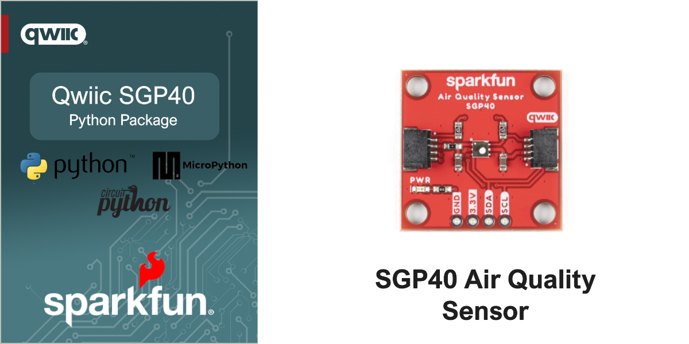

# SparkFun Qwiic SGP40 - Python Package


[](https://docs.sparkfun.com/Qwiic_Py/qwiic_sgp40/)

The SparkFun Qwiic SGP40 Air Quality Sensor Breakout Boards provide a simple and cost effective solution for adding air quality sensing to your project. Implementing a SparkFun Qwiic I2C interface, these sensors can be rapidly added to any project with boards that are part of the SparkFun Qwiic ecosystem.

This package is the Python driver for the SGP40. It works on CPython (Linux), MicroPython and CircuitPython, and is part of the [SparkFun Qwiic Python package](https://github.com/sparkfun/Qwiic_Py). Its VOC Index algorithm is ported from the [DFRobot SGP40 driver](https://github.com/DFRobot/DFRobot_SGP40).

## Contents

* [About the Package](#about-the-package)
* [Supported Platforms](#supported-platforms)
* [Installation](#installation)
* [Example Use](#example-use)
* [Documentation](#documentation)
* [Migrating from 2.x](#migrating-from-2x)

## About the Package

This package reads the raw signal and the VOC (volatile organic compound) Index from the SGP40 over a single Qwiic cable, runs its self test, and turns its heater off. Each feature is demonstrated in the [examples](examples/README.md).

New to Qwiic? Take a look at the entire [SparkFun Qwiic ecosystem](https://www.sparkfun.com/qwiic).

### Supported SparkFun Products

* [SparkFun Air Quality Sensor - SGP40](https://www.sparkfun.com/sparkfun-air-quality-sensor-sgp40-qwiic.html)

## Supported Platforms

| Python | Platform | Boards |
| --- | --- | --- |
| CPython | Linux | [Raspberry Pi](https://www.sparkfun.com/raspberry-pi-5-8gb.html), [NVIDIA Jetson Orin Nano](https://www.sparkfun.com/nvidia-jetson-orin-nano-developer-kit.html) via the [SparkFun Qwiic SHIM](https://www.sparkfun.com/sparkfun-qwiic-shim-for-raspberry-pi.html) |
| MicroPython | Raspberry Pi RP2, ESP32 | [SparkFun Pro Micro RP2350](https://www.sparkfun.com/sparkfun-pro-micro-rp2350.html), [SparkFun IoT RedBoard ESP32](https://www.sparkfun.com/sparkfun-iot-redboard-esp32-development-board.html), [SparkFun IoT RedBoard RP2350](https://www.sparkfun.com/sparkfun-iot-redboard-rp2350.html) |
| CircuitPython | Raspberry Pi RP2, ESP32 | [SparkFun Pro Micro RP2350](https://www.sparkfun.com/sparkfun-pro-micro-rp2350.html), [SparkFun IoT RedBoard ESP32](https://www.sparkfun.com/sparkfun-iot-redboard-esp32-development-board.html), [SparkFun IoT RedBoard RP2350](https://www.sparkfun.com/sparkfun-iot-redboard-rp2350.html) |

> [!NOTE]
> These are the primary platforms tested. The package is expected to work on most Python-enabled systems.

## Installation

### CPython (pip)

```sh
python3 -m venv ~/sparkfun_venv
~/sparkfun_venv/bin/pip install sparkfun-qwiic-sgp40
```

Run any example or script that does `import qwiic_sgp40` with `~/sparkfun_venv/bin/python3 example_script.py`.

### MicroPython (mip)

Install [mpremote](https://docs.micropython.org/en/latest/reference/mpremote.html), connect your board, then install the driver (this also installs `qwiic_i2c`):

```sh
mpremote mip install github:sparkfun/Qwiic_Py/drivers/qwiic_sgp40
```

To install the examples too:

```sh
mpremote mip install --target "" github:sparkfun/Qwiic_Py/drivers/qwiic_sgp40/examples
```

Add `@qwiic_sgp40-<version>` to either command to install a specific release.

### CircuitPython (circup)

Install [CircUp](https://docs.circuitpython.org/projects/circup/en/latest/#installation), add the SparkFun Qwiic bundle once, then install the driver:

```sh
circup bundle-add sparkfun/Qwiic_Py
circup install qwiic_sgp40
```

To copy an example to the board:

```sh
circup example qwiic_sgp40/qwiic_sgp40_ex1_basic_readings
```

## Example Use

Below is a quickstart program that prints the VOC Index once a second. See the [examples directory](examples) for more, and [examples/README.md](examples/README.md) for a summary of each.

```python
import sys
import qwiic_i2c
import qwiic_sgp40


print("\nSparkFun Qwiic Air Quality Sensor - SGP40, Example 1\n")
my_sgp40 = qwiic_sgp40.QwiicSGP40()

print("Waiting 10 seconds for the SGP40 to warm-up.")
if not my_sgp40.begin():
    print("The Qwiic SGP40 isn't connected to the system or failed its self test. Please check your connection", file=sys.stderr)
    sys.exit(1)

while True:
    print("VOC Index is: " + str(my_sgp40.get_voc_index()))
    qwiic_i2c.delay_ms(1000)
```

## Documentation

The API reference is at [docs.sparkfun.com/Qwiic_Py/qwiic_sgp40](https://docs.sparkfun.com/Qwiic_Py/qwiic_sgp40/).

## Migrating from 2.x

Version 3 has one name per method and is a single module, so it also installs as one file on MicroPython and CircuitPython.

| 2.x | 3.0 |
| --- | --- |
| `get_VOC_index()` | `get_voc_index()` |
| `begin()` returned the `measure_test()` result (0 on success, 1 on failure) or `False` if not connected, and printed a warm-up message | `begin()` returns `True` if connected and the self test passed, otherwise `False`, without printing |
| `measure_raw(__relative_humidity, __temperature_c)`, `get_VOC_index(__relative_humidity, __temperature_c)` | `measure_raw(relative_humidity, temperature_c)`, `get_voc_index(relative_humidity, temperature_c)` |
| `qwiic_sgp40` package with `DFRobot_SGP40_VOCAlgorithm.DFRobot_VOCAlgorithm` | single `qwiic_sgp40.py` module; the VOC algorithm is private |
| The self-test result was read after 250 ms, before the sensor can be done (up to 320 ms) | waits 320 ms |

<p align="center">

</p>
