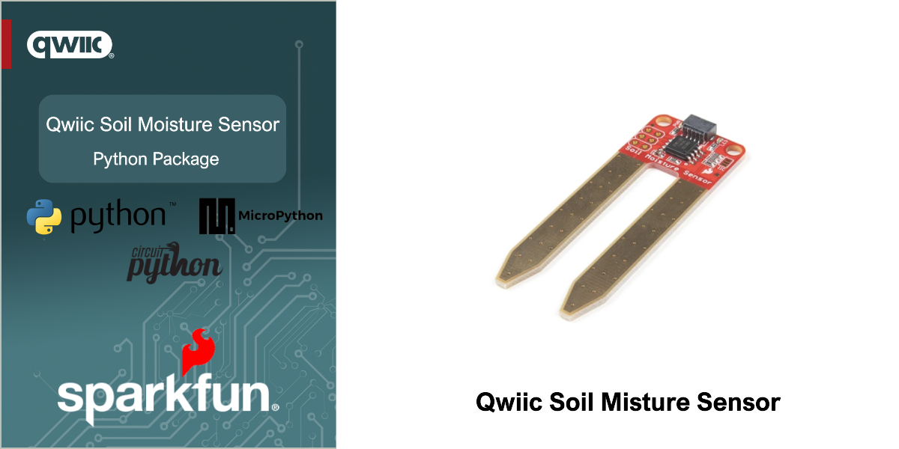

# SparkFun Qwiic Soil Moisture Sensor - Python Package


[](https://docs.sparkfun.com/Qwiic_Py/qwiic_soil_moisture_sensor/)

The SparkFun Qwiic Soil Moisture Sensor provides a simple and cost effective solution for adding soil moisture sensing to your project. Implementing a SparkFun Qwiic I2C interface, these sensors can be rapidly added to any project with boards that are part of the SparkFun Qwiic ecosystem.

This package is the Python driver for the Qwiic Soil Moisture Sensor. It works on CPython (Linux), MicroPython and CircuitPython, and is part of the [SparkFun Qwiic Python package](https://github.com/sparkfun/Qwiic_Py).

## Contents

* [About the Package](#about-the-package)
* [Supported Platforms](#supported-platforms)
* [Installation](#installation)
* [Example Use](#example-use)
* [Documentation](#documentation)
* [Migrating from 2.x](#migrating-from-2x)

## About the Package

This package reads the moisture level from the Qwiic Soil Moisture Sensor over a single Qwiic cable, turns its LED on and off, and changes its I2C address. Each feature is demonstrated in the [examples](examples/README.md).

New to Qwiic? Take a look at the entire [SparkFun Qwiic ecosystem](https://www.sparkfun.com/qwiic).

### Supported SparkFun Products

* [SparkFun Qwiic Soil Moisture Sensor](https://www.sparkfun.com/sparkfun-qwiic-soil-moisture-sensor.html)

## Supported Platforms

| Python | Platform | Boards |
| --- | --- | --- |
| CPython | Linux | [Raspberry Pi](https://www.sparkfun.com/raspberry-pi-5-8gb.html), [NVIDIA Jetson Orin Nano](https://www.sparkfun.com/nvidia-jetson-orin-nano-developer-kit.html) via the [SparkFun Qwiic SHIM](https://www.sparkfun.com/sparkfun-qwiic-shim-for-raspberry-pi.html) |
| MicroPython | Raspberry Pi RP2, ESP32 | [SparkFun Pro Micro RP2350](https://www.sparkfun.com/sparkfun-pro-micro-rp2350.html), [SparkFun IoT RedBoard ESP32](https://www.sparkfun.com/sparkfun-iot-redboard-esp32-development-board.html), [SparkFun IoT RedBoard RP2350](https://www.sparkfun.com/sparkfun-iot-redboard-rp2350.html) |
| CircuitPython | Raspberry Pi RP2, ESP32 | [SparkFun Pro Micro RP2350](https://www.sparkfun.com/sparkfun-pro-micro-rp2350.html), [SparkFun IoT RedBoard ESP32](https://www.sparkfun.com/sparkfun-iot-redboard-esp32-development-board.html), [SparkFun IoT RedBoard RP2350](https://www.sparkfun.com/sparkfun-iot-redboard-rp2350.html) |

> [!NOTE]
> These are the primary platforms tested. The package is expected to work on most Python-enabled systems.

## Installation

### CPython (pip)

```sh
python3 -m venv ~/sparkfun_venv
~/sparkfun_venv/bin/pip install sparkfun-qwiic-soil-moisture-sensor
```

Run any example or script that does `import qwiic_soil_moisture_sensor` with `~/sparkfun_venv/bin/python3 example_script.py`.

### MicroPython (mip)

Install [mpremote](https://docs.micropython.org/en/latest/reference/mpremote.html), connect your board, then install the driver (this also installs `qwiic_i2c`):

```sh
mpremote mip install github:sparkfun/Qwiic_Py/drivers/qwiic_soil_moisture_sensor
```

To install the examples too:

```sh
mpremote mip install --target "" github:sparkfun/Qwiic_Py/drivers/qwiic_soil_moisture_sensor/examples
```

Add `@qwiic_soil_moisture_sensor-<version>` to either command to install a specific release.

### CircuitPython (circup)

Install [CircUp](https://docs.circuitpython.org/projects/circup/en/latest/#installation), add the SparkFun Qwiic bundle once, then install the driver:

```sh
circup bundle-add sparkfun/Qwiic_Py
circup install qwiic_soil_moisture_sensor
```

To copy an example to the board:

```sh
circup example qwiic_soil_moisture_sensor/qwiic_soil_moisture_sensor_ex1_get_readings
```

## Example Use

Below is a quickstart program that prints the moisture level and toggles the LED. See the [examples directory](examples) for more, and [examples/README.md](examples/README.md) for a summary of each.

```python
import sys
import qwiic_i2c
import qwiic_soil_moisture_sensor


print("\nSparkFun Qwiic Soil Moisture Sensor Example 1\n")
my_soil_sensor = qwiic_soil_moisture_sensor.QwiicSoilMoistureSensor()

if not my_soil_sensor.is_connected():
    print("The Qwiic Soil Moisture Sensor device isn't connected to the system. Please check your connection", file=sys.stderr)
    sys.exit(1)

my_soil_sensor.begin()

while True:
    print(my_soil_sensor.read_moisture_level())
    my_soil_sensor.led_on()
    qwiic_i2c.delay_ms(1000)
    my_soil_sensor.led_off()
    qwiic_i2c.delay_ms(1000)
```

### Bus scans

A full bus scan, such as `qwiic.list_devices()` or `bus.scan()`, can make the sensor hold SDA low until it's power-cycled, which also blocks every other device on that bus. Checking one address at a time with `is_connected()` is fine. This comes from the sensor's firmware, so it happens with any driver.

## Documentation

The API reference is at [docs.sparkfun.com/Qwiic_Py/qwiic_soil_moisture_sensor](https://docs.sparkfun.com/Qwiic_Py/qwiic_soil_moisture_sensor/).

## Migrating from 2.x

Version 3 has no properties, so it also runs on MicroPython builds without `property()`. The method names are unchanged.

| 2.x | 3.0 |
| --- | --- |
| `sensor.connected` | `sensor.is_connected()` |
| `is_connected()` and `begin()` sent an empty write, which the sensor doesn't acknowledge, so they could report it missing | They read the moisture level instead |
| `read_moisture_level()` returned `None` | `read_moisture_level()` returns the level (it is still stored in `sensor.level` too) |
| `change_address(newAddress)` returned `None` on success | `change_address(new_address)` returns `True` on success, `False` if the address is out of range |

<p align="center">

</p>
