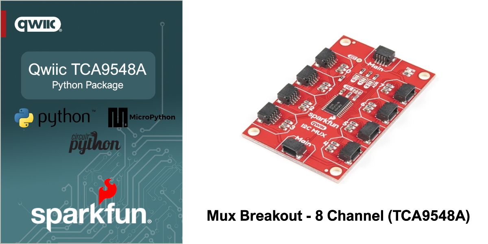

# SparkFun Qwiic TCA9548A - Python Package


[](https://docs.sparkfun.com/Qwiic_Py/qwiic_tca9548a/)

The SparkFun Qwiic Mux Breakout provides a simple and cost effective solution for connecting up to eight devices with the same I2C address to one bus. Implementing a SparkFun Qwiic I2C interface, it can be rapidly added to any project with boards that are part of the SparkFun Qwiic ecosystem.

This package is the Python driver for the TCA9548A 8-channel I2C multiplexer. It works on CPython (Linux), MicroPython and CircuitPython, and is part of the [SparkFun Qwiic Python package](https://github.com/sparkfun/Qwiic_Py).

## Contents

* [About the Package](#about-the-package)
* [Supported Platforms](#supported-platforms)
* [Installation](#installation)
* [Example Use](#example-use)
* [Documentation](#documentation)
* [Migrating from 2.x](#migrating-from-2x)

## About the Package

This package enables and disables the eight downstream channels of the TCA9548A over a single Qwiic cable, and lists which are enabled. Each feature is demonstrated in the [examples](examples/README.md).

New to Qwiic? Take a look at the entire [SparkFun Qwiic ecosystem](https://www.sparkfun.com/qwiic).

### Supported SparkFun Products

* [SparkFun Qwiic Mux Breakout - 8 Channel (TCA9548A)](https://www.sparkfun.com/products/16784)
* [SparkFun Qwiic Mux Breakout - 8 Channel (TCA9548A), original](https://www.sparkfun.com/products/14685)

## Supported Platforms

| Python | Platform | Boards |
| --- | --- | --- |
| CPython | Linux | [Raspberry Pi](https://www.sparkfun.com/raspberry-pi-5-8gb.html), [NVIDIA Jetson Orin Nano](https://www.sparkfun.com/nvidia-jetson-orin-nano-developer-kit.html) via the [SparkFun Qwiic SHIM](https://www.sparkfun.com/sparkfun-qwiic-shim-for-raspberry-pi.html) |
| MicroPython | Raspberry Pi RP2, ESP32 | [SparkFun Pro Micro RP2350](https://www.sparkfun.com/sparkfun-pro-micro-rp2350.html), [SparkFun IoT RedBoard ESP32](https://www.sparkfun.com/sparkfun-iot-redboard-esp32-development-board.html), [SparkFun IoT RedBoard RP2350](https://www.sparkfun.com/sparkfun-iot-redboard-rp2350.html) |
| CircuitPython | Raspberry Pi RP2, ESP32 | [SparkFun Pro Micro RP2350](https://www.sparkfun.com/sparkfun-pro-micro-rp2350.html), [SparkFun IoT RedBoard ESP32](https://www.sparkfun.com/sparkfun-iot-redboard-esp32-development-board.html), [SparkFun IoT RedBoard RP2350](https://www.sparkfun.com/sparkfun-iot-redboard-rp2350.html) |

> [!NOTE]
> These are the primary platforms tested. The package is expected to work on most Python-enabled systems.

## Installation

### CPython (pip)

```sh
python3 -m venv ~/sparkfun_venv
~/sparkfun_venv/bin/pip install sparkfun-qwiic-tca9548a
```

Run any example or script that does `import qwiic_tca9548a` with `~/sparkfun_venv/bin/python3 example_script.py`.

### MicroPython (mip)

Install [mpremote](https://docs.micropython.org/en/latest/reference/mpremote.html), connect your board, then install the driver (this also installs `qwiic_i2c`):

```sh
mpremote mip install github:sparkfun/Qwiic_Py/drivers/qwiic_tca9548a
```

To install the examples too:

```sh
mpremote mip install --target "" github:sparkfun/Qwiic_Py/drivers/qwiic_tca9548a/examples
```

Add `@qwiic_tca9548a-<version>` to either command to install a specific release.

### CircuitPython (circup)

Install [CircUp](https://docs.circuitpython.org/projects/circup/en/latest/#installation), add the SparkFun Qwiic bundle once, then install the driver:

```sh
circup bundle-add sparkfun/Qwiic_Py
circup install qwiic_tca9548a
```

To copy an example to the board:

```sh
circup example qwiic_tca9548a/qwiic_tca9548a_ex1_scan_channels
```

## Example Use

Below is a quickstart program that enables channels 0 and 1, then 2 and 3, and scans for the devices on each pair. See the [examples directory](examples) for more, and [examples/README.md](examples/README.md) for a summary of each.

```python
import sys
import qwiic_i2c
import qwiic_tca9548a


print("\nSparkFun TCA9548A 8-Channel Mux Example 1\n")
my_tca = qwiic_tca9548a.QwiicTCA9548A()

if not my_tca.is_connected():
    print("The Qwiic TCA9548A 8-Channel Mux device isn't connected to the system. Please check your connection", file=sys.stderr)
    sys.exit(1)

i2c = qwiic_i2c.get_i2c_bus()

while True:
    for channels in ([0, 1], [2, 3]):
        my_tca.disable_all()
        my_tca.enable_channels(channels)
        print("Enabled channels:", my_tca.list_channels())
        print("Devices found:", i2c.scan())
        qwiic_i2c.delay_ms(2000)
```

## Documentation

The API reference is at [docs.sparkfun.com/Qwiic_Py/qwiic_tca9548a](https://docs.sparkfun.com/Qwiic_Py/qwiic_tca9548a/).

## Migrating from 2.x

Version 3 has no `debug` option and never prints.

| 2.x | 3.0 |
| --- | --- |
| `mux.connected` | `mux.is_connected()` |
| `QwiicTCA9548A(address, debug, i2c_driver)` | `QwiicTCA9548A(address, i2c_bus)`: the `debug` argument and attribute are gone |
| no `begin()` | `begin()` returns `is_connected()` |
| `list_channels()` printed each channel's state and returned `None` ([Qwiic_TCA9548A_Py#5](https://github.com/sparkfun/Qwiic_TCA9548A_Py/issues/5)) | returns the list of enabled channel numbers, for example `[0, 4]` |
| `enable_channels()`, `disable_channels()` printed and skipped invalid entries | raise `ValueError` and change nothing |
| `available_addresses`, `available_channels` were `range` objects | lists |
| `is_connected()` checked the platform default bus, not the driver's bus | `is_connected()` checks the bus the driver was given |

<p align="center">

</p>
