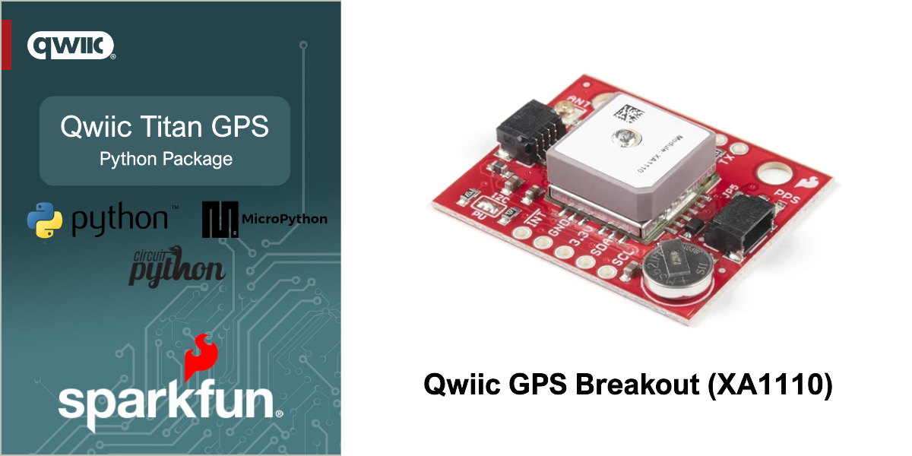

# SparkFun Qwiic Titan GPS - Python Package


[](https://docs.sparkfun.com/Qwiic_Py/qwiic_titan_gps/)

The SparkFun GPS Breakout - XA1110 (Qwiic) provides a simple and cost effective solution for adding GPS receiver capabilities to your project. Implementing a SparkFun Qwiic I2C interface, these sensors can be rapidly added to any project with boards that are part of the SparkFun Qwiic ecosystem.

This package is the Python driver for the Titan X1 GPS (XA1110). It works on CPython (Linux), MicroPython and CircuitPython, and is part of the [SparkFun Qwiic Python package](https://github.com/sparkfun/Qwiic_Py).

## Contents

* [About the Package](#about-the-package)
* [Supported Platforms](#supported-platforms)
* [Installation](#installation)
* [Example Use](#example-use)
* [Documentation](#documentation)
* [Migrating from 2.x](#migrating-from-2x)

## About the Package

This package reads NMEA data from the XA1110 over a single Qwiic cable and parses it, with the bundled [MicropyGPS](https://github.com/inmcm/micropyGPS) parser, into latitude, longitude, altitude, time and satellite count. Each feature is demonstrated in the [examples](examples/README.md).

New to Qwiic? Take a look at the entire [SparkFun Qwiic ecosystem](https://www.sparkfun.com/qwiic).

### Supported SparkFun Products

* [SparkFun GPS Breakout - XA1110 (Qwiic)](https://www.sparkfun.com/products/14414)

## Supported Platforms

| Python | Platform | Boards |
| --- | --- | --- |
| CPython | Linux | [Raspberry Pi](https://www.sparkfun.com/raspberry-pi-5-8gb.html), [NVIDIA Jetson Orin Nano](https://www.sparkfun.com/nvidia-jetson-orin-nano-developer-kit.html) via the [SparkFun Qwiic SHIM](https://www.sparkfun.com/sparkfun-qwiic-shim-for-raspberry-pi.html) |
| MicroPython | Raspberry Pi RP2, ESP32 | [SparkFun Pro Micro RP2350](https://www.sparkfun.com/sparkfun-pro-micro-rp2350.html), [SparkFun IoT RedBoard ESP32](https://www.sparkfun.com/sparkfun-iot-redboard-esp32-development-board.html), [SparkFun IoT RedBoard RP2350](https://www.sparkfun.com/sparkfun-iot-redboard-rp2350.html) |
| CircuitPython | Raspberry Pi RP2, ESP32 | [SparkFun Pro Micro RP2350](https://www.sparkfun.com/sparkfun-pro-micro-rp2350.html), [SparkFun IoT RedBoard ESP32](https://www.sparkfun.com/sparkfun-iot-redboard-esp32-development-board.html), [SparkFun IoT RedBoard RP2350](https://www.sparkfun.com/sparkfun-iot-redboard-rp2350.html) |

> [!NOTE]
> These are the primary platforms tested. The package is expected to work on most Python-enabled systems.

## Installation

### CPython (pip)

```sh
python3 -m venv ~/sparkfun_venv
~/sparkfun_venv/bin/pip install sparkfun-qwiic-titan-gps
```

Run any example or script that does `import qwiic_titan_gps` with `~/sparkfun_venv/bin/python3 example_script.py`.

### MicroPython (mip)

Install [mpremote](https://docs.micropython.org/en/latest/reference/mpremote.html), connect your board, then install the driver (this also installs `qwiic_i2c`):

```sh
mpremote mip install github:sparkfun/Qwiic_Py/drivers/qwiic_titan_gps
```

To install the examples too:

```sh
mpremote mip install --target "" github:sparkfun/Qwiic_Py/drivers/qwiic_titan_gps/examples
```

Add `@qwiic_titan_gps-<version>` to either command to install a specific release.

### CircuitPython (circup)

Install [CircUp](https://docs.circuitpython.org/projects/circup/en/latest/#installation), add the SparkFun Qwiic bundle once, then install the driver:

```sh
circup bundle-add sparkfun/Qwiic_Py
circup install qwiic_titan_gps
```

To copy an example to the board:

```sh
circup example qwiic_titan_gps/qwiic_titan_gps_ex1_basic
```

> [!NOTE]
> On a Raspberry Pi the XA1110 needs I2C clock stretching. Add `dtparam=i2c_arm_baudrate=10000` to `/boot/config.txt` (or `/boot/firmware/config.txt`) and reboot.

## Example Use

Below is a quickstart program that prints latitude, longitude and time. See the [examples directory](examples) for more, and [examples/README.md](examples/README.md) for a summary of each.

```python
import sys
import qwiic_titan_gps
import qwiic_i2c


print("SparkFun GPS Breakout - XA1110!")
qwiic_gps = qwiic_titan_gps.QwiicTitanGPS()

if not qwiic_gps.is_connected():
    print("Could not connect to the SparkFun GPS Unit. Double check that it's wired correctly.", file=sys.stderr)
    sys.exit(1)

qwiic_gps.begin()

while True:
    if qwiic_gps.get_nmea_data():
        print("Latitude: {}, Longitude: {}, Time: {}".format(
            qwiic_gps.gnss_messages["Latitude"],
            qwiic_gps.gnss_messages["Longitude"],
            qwiic_gps.gnss_messages["Time"]))  # UTC time as a list [hh, mm, ss]
    qwiic_i2c.delay_ms(1000)
```

## Documentation

The API reference is at [docs.sparkfun.com/Qwiic_Py/qwiic_titan_gps](https://docs.sparkfun.com/Qwiic_Py/qwiic_titan_gps/).

## Migrating from 2.x

Version 3 has one name per method and no properties, so it also runs on MicroPython builds without `property()`.

| 2.x | 3.0 |
| --- | --- |
| `QwiicTitanGps` | `QwiicTitanGPS` |
| `gps.connected` | `gps.is_connected()` |
| `qwiic_titan_gps` package (`qwiic_titan_gps/__init__.py`, `micropyGPS.py`) | one module `qwiic_titan_gps.py`; the parser is `qwiic_titan_gps.MicropyGPS` |
| `from qwiic_titan_gps.micropyGPS import MicropyGPS` | `from qwiic_titan_gps import MicropyGPS` |
| `gps.gps.latitude`, `gps.gps.longitude` (MicropyGPS properties) | `gps.gps.get_latitude()`, `gps.gps.get_longitude()` |
| `MicropyGPS.time_since_fix()` used `time.time()` on CPython | uses `qwiic_i2c.ticks_ms()` on every platform (still milliseconds) |
| `MicropyGPS.start_logging()` / `stop_logging()` printed errors | return `False` without printing (also when there is no file system) |
| Creating a `QwiicTitanGps` on a Raspberry Pi read `/proc/device-tree` and `/boot/config.txt` and printed a clock-stretching warning | no check; see the note under [Installation](#installation) |
| `get_raw_data()` repeated earlier 32-byte chunks in its result | returns each byte once |

<p align="center">

</p>
