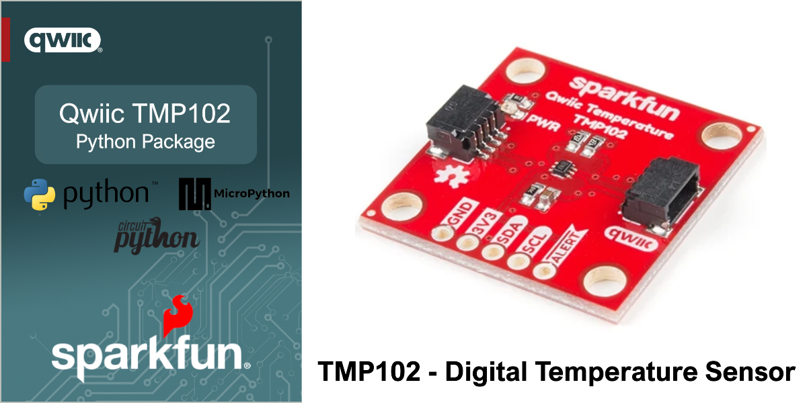

# SparkFun Qwiic TMP102 - Python Package


[](https://docs.sparkfun.com/Qwiic_Py/qwiic_tmp102/)

The SparkFun Qwiic Digital Temperature Sensing TMP102 Module provides a simple and cost effective solution for adding Digital Temperature Sensing capabilities to your project. Implementing a SparkFun Qwiic I2C interface, these sensors can be rapidly added to any project with boards that are part of the SparkFun Qwiic ecosystem.

This package is the Python driver for the TMP102. It works on CPython (Linux), MicroPython and CircuitPython, and is part of the [SparkFun Qwiic Python package](https://github.com/sparkfun/Qwiic_Py).

## Contents

* [About the Package](#about-the-package)
* [Supported Platforms](#supported-platforms)
* [Installation](#installation)
* [Example Use](#example-use)
* [Documentation](#documentation)
* [Migrating from 2.x](#migrating-from-2x)

## About the Package

This package reads temperature from the TMP102 over a single Qwiic cable, and configures its alert thresholds, conversion rate, extended mode, one-shot conversions and sleep mode. Each feature is demonstrated in the [examples](examples/README.md).

New to Qwiic? Take a look at the entire [SparkFun Qwiic ecosystem](https://www.sparkfun.com/qwiic).

### Supported SparkFun Products

* [SparkFun Digital Temperature Sensor - TMP102](https://www.sparkfun.com/products/16304)

## Supported Platforms

| Python | Platform | Boards |
| --- | --- | --- |
| CPython | Linux | [Raspberry Pi](https://www.sparkfun.com/raspberry-pi-5-8gb.html), [NVIDIA Jetson Orin Nano](https://www.sparkfun.com/nvidia-jetson-orin-nano-developer-kit.html) via the [SparkFun Qwiic SHIM](https://www.sparkfun.com/sparkfun-qwiic-shim-for-raspberry-pi.html) |
| MicroPython | Raspberry Pi RP2, ESP32 | [SparkFun Pro Micro RP2350](https://www.sparkfun.com/sparkfun-pro-micro-rp2350.html), [SparkFun IoT RedBoard ESP32](https://www.sparkfun.com/sparkfun-iot-redboard-esp32-development-board.html), [SparkFun IoT RedBoard RP2350](https://www.sparkfun.com/sparkfun-iot-redboard-rp2350.html) |
| CircuitPython | Raspberry Pi RP2, ESP32 | [SparkFun Pro Micro RP2350](https://www.sparkfun.com/sparkfun-pro-micro-rp2350.html), [SparkFun IoT RedBoard ESP32](https://www.sparkfun.com/sparkfun-iot-redboard-esp32-development-board.html), [SparkFun IoT RedBoard RP2350](https://www.sparkfun.com/sparkfun-iot-redboard-rp2350.html) |

> [!NOTE]
> These are the primary platforms tested. The package is expected to work on most Python-enabled systems.

## Installation

### CPython (pip)

```sh
python3 -m venv ~/sparkfun_venv
~/sparkfun_venv/bin/pip install sparkfun-qwiic-tmp102
```

Run any example or script that does `import qwiic_tmp102` with `~/sparkfun_venv/bin/python3 example_script.py`.

### MicroPython (mip)

Install [mpremote](https://docs.micropython.org/en/latest/reference/mpremote.html), connect your board, then install the driver (this also installs `qwiic_i2c`):

```sh
mpremote mip install github:sparkfun/Qwiic_Py/drivers/qwiic_tmp102
```

To install the examples too:

```sh
mpremote mip install --target "" github:sparkfun/Qwiic_Py/drivers/qwiic_tmp102/examples
```

Add `@qwiic_tmp102-<version>` to either command to install a specific release.

### CircuitPython (circup)

Install [CircUp](https://docs.circuitpython.org/projects/circup/en/latest/#installation), add the SparkFun Qwiic bundle once, then install the driver:

```sh
circup bundle-add sparkfun/Qwiic_Py
circup install qwiic_tmp102
```

To copy an example to the board:

```sh
circup example qwiic_tmp102/qwiic_tmp102_ex1_get_temperature
```

## Example Use

Below is a quickstart program that prints the temperature and alert state. See the [examples directory](examples) for more, and [examples/README.md](examples/README.md) for a summary of each.

```python
import sys
import qwiic_tmp102
import qwiic_i2c


print("\nSparkFun Qwiic TMP102 Sensor Example 1\n")
my_sensor = qwiic_tmp102.QwiicTMP102()

if not my_sensor.is_connected():
    print("The Qwiic TMP102 Sensor device isn't connected to the system. Please check your connection", file=sys.stderr)
    sys.exit(1)

my_sensor.begin()

my_sensor.set_fault(0)              # 1 fault before an alert
my_sensor.set_alert_polarity(1)     # Active HIGH
my_sensor.set_alert_mode(0)         # Comparator mode
my_sensor.set_conversion_rate(2)    # 4 Hz
my_sensor.set_extended_mode(0)      # 12-bit, -55C to +128C
my_sensor.set_high_temp_f(85.0)     # T_HIGH
my_sensor.set_low_temp_f(84.0)      # T_LOW

while True:
    my_sensor.wakeup()
    temperature = my_sensor.read_temp_f()
    alert = my_sensor.alert()
    my_sensor.sleep()

    print("Temperature: ", temperature)
    print("Alert Register: ", alert)
    qwiic_i2c.delay_ms(2000)
```

## Documentation

The API reference is at [docs.sparkfun.com/Qwiic_Py/qwiic_tmp102](https://docs.sparkfun.com/Qwiic_Py/qwiic_tmp102/).

## Migrating from 2.x

Version 3 has one name per method and no properties, so it also runs on MicroPython builds without `property()`.

| 2.x | 3.0 |
| --- | --- |
| `QwiicTmp102Sensor` | `QwiicTMP102` |
| `sensor.connected` | `sensor.is_connected()` |
| `sensor.tempC`, `sensor.tempF` (last reading) | `sensor.temp_c`, `sensor.temp_f` |
| `one_shot(setOneShot=...)` | `one_shot(set_one_shot=...)` |
| `set_fault(faultSetting=...)` | `set_fault(fault_setting=...)` |
| `read_block_pointer_reg(reg, numBytes=...)` | `read_block_pointer_reg(reg, num_bytes=...)` |
| `is_connected()` used the default bus even when an `i2c_driver` was given | `is_connected()` uses the driver's own bus |
| Temperatures below 0 °C read as about +4096 °C, and negative alert thresholds couldn't be set | read and written correctly |

<p align="center">

</p>
