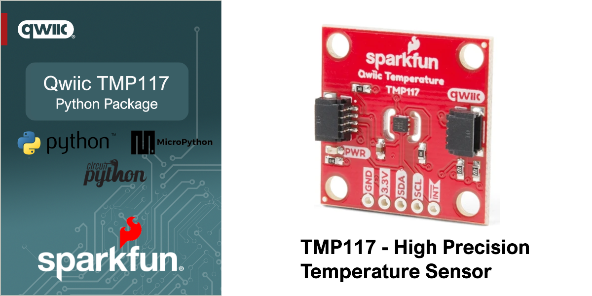

# SparkFun Qwiic TMP117 - Python Package


[](https://docs.sparkfun.com/Qwiic_Py/qwiic_tmp117/)

The SparkFun Qwiic High-Precision Temperature Sensing TMP117 Module provides a simple and cost effective solution for adding High-Precision Temperature Sensing capabilities to your project. Implementing a SparkFun Qwiic I2C interface, these sensors can be rapidly added to any project with boards that are part of the SparkFun Qwiic ecosystem.

This package is the Python driver for the TMP117. It works on CPython (Linux), MicroPython and CircuitPython, and is part of the [SparkFun Qwiic Python package](https://github.com/sparkfun/Qwiic_Py).

## Contents

* [About the Package](#about-the-package)
* [Supported Platforms](#supported-platforms)
* [Installation](#installation)
* [Example Use](#example-use)
* [Documentation](#documentation)
* [Migrating from 2.x](#migrating-from-2x)

## About the Package

This package reads temperature from the TMP117 over a single Qwiic cable, and configures its temperature offset, alert limits and modes, conversion mode, averaging and cycle time. Each feature is demonstrated in the [examples](examples/README.md).

New to Qwiic? Take a look at the entire [SparkFun Qwiic ecosystem](https://www.sparkfun.com/qwiic).

### Supported SparkFun Products

* [SparkFun High-Precision Temperature Sensor - TMP117](https://www.sparkfun.com/products/15805)

## Supported Platforms

| Python | Platform | Boards |
| --- | --- | --- |
| CPython | Linux | [Raspberry Pi](https://www.sparkfun.com/raspberry-pi-5-8gb.html), [NVIDIA Jetson Orin Nano](https://www.sparkfun.com/nvidia-jetson-orin-nano-developer-kit.html) via the [SparkFun Qwiic SHIM](https://www.sparkfun.com/sparkfun-qwiic-shim-for-raspberry-pi.html) |
| MicroPython | Raspberry Pi RP2, ESP32 | [SparkFun Pro Micro RP2350](https://www.sparkfun.com/sparkfun-pro-micro-rp2350.html), [SparkFun IoT RedBoard ESP32](https://www.sparkfun.com/sparkfun-iot-redboard-esp32-development-board.html), [SparkFun IoT RedBoard RP2350](https://www.sparkfun.com/sparkfun-iot-redboard-rp2350.html) |
| CircuitPython | Raspberry Pi RP2, ESP32 | [SparkFun Pro Micro RP2350](https://www.sparkfun.com/sparkfun-pro-micro-rp2350.html), [SparkFun IoT RedBoard ESP32](https://www.sparkfun.com/sparkfun-iot-redboard-esp32-development-board.html), [SparkFun IoT RedBoard RP2350](https://www.sparkfun.com/sparkfun-iot-redboard-rp2350.html) |

> [!NOTE]
> These are the primary platforms tested. The package is expected to work on most Python-enabled systems.

## Installation

### CPython (pip)

```sh
python3 -m venv ~/sparkfun_venv
~/sparkfun_venv/bin/pip install sparkfun-qwiic-tmp117
```

Run any example or script that does `import qwiic_tmp117` with `~/sparkfun_venv/bin/python3 example_script.py`.

### MicroPython (mip)

Install [mpremote](https://docs.micropython.org/en/latest/reference/mpremote.html), connect your board, then install the driver (this also installs `qwiic_i2c`):

```sh
mpremote mip install github:sparkfun/Qwiic_Py/drivers/qwiic_tmp117
```

To install the examples too:

```sh
mpremote mip install --target "" github:sparkfun/Qwiic_Py/drivers/qwiic_tmp117/examples
```

Add `@qwiic_tmp117-<version>` to either command to install a specific release.

### CircuitPython (circup)

Install [CircUp](https://docs.circuitpython.org/projects/circup/en/latest/#installation), add the SparkFun Qwiic bundle once, then install the driver:

```sh
circup bundle-add sparkfun/Qwiic_Py
circup install qwiic_tmp117
```

To copy an example to the board:

```sh
circup example qwiic_tmp117/qwiic_tmp117_ex1_basic
```

## Example Use

Below is a quickstart program that prints the temperature in Celsius and Fahrenheit. See the [examples directory](examples) for more, and [examples/README.md](examples/README.md) for a summary of each.

```python
import sys
import qwiic_tmp117
import qwiic_i2c


def run_example():
    print("\nQwiic TMP117 Example 1 - Basic Readings\n")
    my_tmp117 = qwiic_tmp117.QwiicTMP117()

    if not my_tmp117.is_connected():
        print("The device isn't connected to the system. Please check your connection", file=sys.stderr)
        return

    my_tmp117.begin()

    while True:
        if my_tmp117.data_ready():
            print("Temperature in Celsius:", my_tmp117.read_temp_c())
            print("Temperature in Fahrenheit:", my_tmp117.read_temp_f())

        qwiic_i2c.delay_ms(500)


if __name__ == "__main__":
    try:
        run_example()
    except (KeyboardInterrupt, SystemExit):
        print("\nEnding Example")
        sys.exit(0)
```

## Documentation

The API reference is at [docs.sparkfun.com/Qwiic_Py/qwiic_tmp117](https://docs.sparkfun.com/Qwiic_Py/qwiic_tmp117/).

## Migrating from 2.x

Version 3 has one name per method and no properties, so it also runs on MicroPython builds without `property()`.

| 2.x | 3.0 |
| --- | --- |
| `k`-prefixed class constants (`QwiicTMP117.kThermMode`, ...) | UPPER_CASE without the `k` (`QwiicTMP117.THERM_MODE`, ...), listed below |
| `sensor.connected` | `sensor.is_connected()` |
| `set_low_limit(lowLimit=...)`, `set_high_limit(highLimit=...)` | `set_low_limit(low_limit=...)`, `set_high_limit(high_limit=...)` |
| `set_alert_function_mode(setAlertMode=...)` | `set_alert_function_mode(set_alert_mode=...)` |
| `set_conversion_average_mode(convMode=...)` | `set_conversion_average_mode(conv_mode=...)` |
| `set_conversion_cycle_bit()` returned `None` on success | returns `True` on success, `False` for an invalid value |

### Renamed constants

Every class constant is now UPPER_CASE (PEP 8):

| 2.x | 3.0 |
| --- | --- |
| `kAlertMode` | `ALERT_MODE` |
| `kConfigAvgMask` | `CONFIG_AVG_MASK` |
| `kConfigAvgShift` | `CONFIG_AVG_SHIFT` |
| `kConfigConvMask` | `CONFIG_CONV_MASK` |
| `kConfigConvShift` | `CONFIG_CONV_SHIFT` |
| `kConfigDataReadyMask` | `CONFIG_DATA_READY_MASK` |
| `kConfigDataReadyShift` | `CONFIG_DATA_READY_SHIFT` |
| `kConfigDeviceIdMask` | `CONFIG_DEVICE_ID_MASK` |
| `kConfigDeviceIdShift` | `CONFIG_DEVICE_ID_SHIFT` |
| `kConfigDrAlertMask` | `CONFIG_DR_ALERT_MASK` |
| `kConfigDrAlertShift` | `CONFIG_DR_ALERT_SHIFT` |
| `kConfigEepromBusyMask` | `CONFIG_EEPROM_BUSY_MASK` |
| `kConfigEepromBusyShift` | `CONFIG_EEPROM_BUSY_SHIFT` |
| `kConfigHighAlertMask` | `CONFIG_HIGH_ALERT_MASK` |
| `kConfigHighAlertShift` | `CONFIG_HIGH_ALERT_SHIFT` |
| `kConfigLowAlertMask` | `CONFIG_LOW_ALERT_MASK` |
| `kConfigLowAlertShift` | `CONFIG_LOW_ALERT_SHIFT` |
| `kConfigModMask` | `CONFIG_MOD_MASK` |
| `kConfigModShift` | `CONFIG_MOD_SHIFT` |
| `kConfigPolMask` | `CONFIG_POL_MASK` |
| `kConfigPolShift` | `CONFIG_POL_SHIFT` |
| `kConfigRevMask` | `CONFIG_REV_MASK` |
| `kConfigRevShift` | `CONFIG_REV_SHIFT` |
| `kConfigSoftResetMask` | `CONFIG_SOFT_RESET_MASK` |
| `kConfigSoftResetShift` | `CONFIG_SOFT_RESET_SHIFT` |
| `kConfigTNaMask` | `CONFIG_T_NA_MASK` |
| `kConfigTNaShift` | `CONFIG_T_NA_SHIFT` |
| `kContinuousConversionMode` | `CONTINUOUS_CONVERSION_MODE` |
| `kConvAvg32` | `CONV_AVG_32` |
| `kConvAvg64` | `CONV_AVG_64` |
| `kConvAvg8` | `CONV_AVG_8` |
| `kConvAvgNone` | `CONV_AVG_NONE` |
| `kDeviceIdValue` | `DEVICE_ID_VALUE` |
| `kHighAlertIdx` | `HIGH_ALERT_IDX` |
| `kLowAlertIdx` | `LOW_ALERT_IDX` |
| `kOneShotMode` | `ONE_SHOT_MODE` |
| `kRegConfiguration` | `REG_CONFIGURATION` |
| `kRegDeviceId` | `REG_DEVICE_ID` |
| `kRegEeprom1` | `REG_EEPROM_1` |
| `kRegEeprom2` | `REG_EEPROM_2` |
| `kRegEeprom3` | `REG_EEPROM_3` |
| `kRegEepromUl` | `REG_EEPROM_UL` |
| `kRegTHighLimit` | `REG_T_HIGH_LIMIT` |
| `kRegTLowLimit` | `REG_T_LOW_LIMIT` |
| `kRegTempOffset` | `REG_TEMP_OFFSET` |
| `kRegTempResult` | `REG_TEMP_RESULT` |
| `kShutdownMode` | `SHUTDOWN_MODE` |
| `kThermMode` | `THERM_MODE` |
| `kTmp117Resolution` | `TMP117_RESOLUTION` |

<p align="center">

</p>
