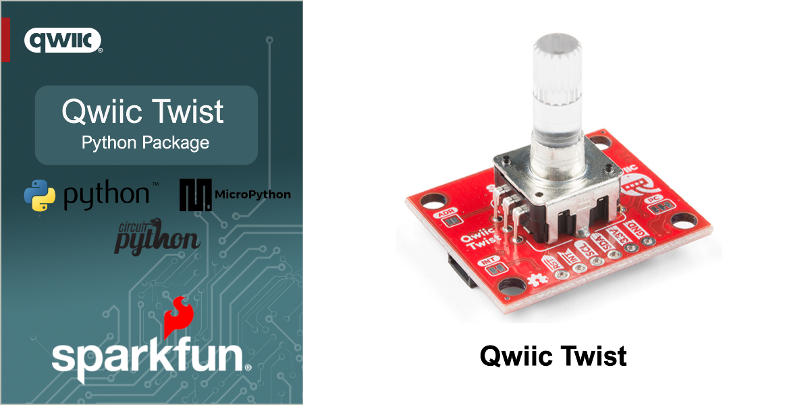

# SparkFun Qwiic Twist - Python Package


[](https://docs.sparkfun.com/Qwiic_Py/qwiic_twist/)

The SparkFun Qwiic Twist RGB Rotary Encoder provides a simple and cost effective solution for adding a rotary encoder with an RGB-lit knob and a push button to your project. Implementing a SparkFun Qwiic I2C interface, it can be rapidly added to any project with boards that are part of the SparkFun Qwiic ecosystem.

This package is the Python driver for the Qwiic Twist RGB rotary encoder. It works on CPython (Linux), MicroPython and CircuitPython, and is part of the [SparkFun Qwiic Python package](https://github.com/sparkfun/Qwiic_Py).

## Contents

* [About the Package](#about-the-package)
* [Supported Platforms](#supported-platforms)
* [Installation](#installation)
* [Example Use](#example-use)
* [Documentation](#documentation)
* [Migrating from 2.x](#migrating-from-2x)

## About the Package

This package reads the knob's count and button state, and sets the knob color, over a single Qwiic cable. Each feature is demonstrated in the [examples](examples/README.md).

New to Qwiic? Take a look at the entire [SparkFun Qwiic ecosystem](https://www.sparkfun.com/qwiic).

### Supported SparkFun Products

* [SparkFun Qwiic Twist - RGB Rotary Encoder Breakout](https://www.sparkfun.com/products/15083)

## Supported Platforms

| Python | Platform | Boards |
| --- | --- | --- |
| CPython | Linux | [Raspberry Pi](https://www.sparkfun.com/raspberry-pi-5-8gb.html), [NVIDIA Jetson Orin Nano](https://www.sparkfun.com/nvidia-jetson-orin-nano-developer-kit.html) via the [SparkFun Qwiic SHIM](https://www.sparkfun.com/sparkfun-qwiic-shim-for-raspberry-pi.html) |
| MicroPython | Raspberry Pi RP2, ESP32 | [SparkFun Pro Micro RP2350](https://www.sparkfun.com/sparkfun-pro-micro-rp2350.html), [SparkFun IoT RedBoard ESP32](https://www.sparkfun.com/sparkfun-iot-redboard-esp32-development-board.html), [SparkFun IoT RedBoard RP2350](https://www.sparkfun.com/sparkfun-iot-redboard-rp2350.html) |
| CircuitPython | Raspberry Pi RP2, ESP32 | [SparkFun Pro Micro RP2350](https://www.sparkfun.com/sparkfun-pro-micro-rp2350.html), [SparkFun IoT RedBoard ESP32](https://www.sparkfun.com/sparkfun-iot-redboard-esp32-development-board.html), [SparkFun IoT RedBoard RP2350](https://www.sparkfun.com/sparkfun-iot-redboard-rp2350.html) |

> [!NOTE]
> These are the primary platforms tested. The package is expected to work on most Python-enabled systems.

## Installation

### CPython (pip)

```sh
python3 -m venv ~/sparkfun_venv
~/sparkfun_venv/bin/pip install sparkfun-qwiic-twist
```

Run any example or script that does `import qwiic_twist` with `~/sparkfun_venv/bin/python3 example_script.py`.

### MicroPython (mip)

Install [mpremote](https://docs.micropython.org/en/latest/reference/mpremote.html), connect your board, then install the driver (this also installs `qwiic_i2c`):

```sh
mpremote mip install github:sparkfun/Qwiic_Py/drivers/qwiic_twist
```

To install the examples too:

```sh
mpremote mip install --target "" github:sparkfun/Qwiic_Py/drivers/qwiic_twist/examples
```

Add `@qwiic_twist-<version>` to either command to install a specific release.

### CircuitPython (circup)

Install [CircUp](https://docs.circuitpython.org/projects/circup/en/latest/#installation), add the SparkFun Qwiic bundle once, then install the driver:

```sh
circup bundle-add sparkfun/Qwiic_Py
circup install qwiic_twist
```

To copy an example to the board:

```sh
circup example qwiic_twist/qwiic_twist_ex1_basic_readings
```

## Example Use

Below is a quickstart program that prints the knob count and whether the button is pressed. See the [examples directory](examples) for more, and [examples/README.md](examples/README.md) for a summary of each.

```python
import sys
import qwiic_twist
import qwiic_i2c


print("\nSparkFun Qwiic Twist Example 1\n")
my_twist = qwiic_twist.QwiicTwist()

if not my_twist.is_connected():
    print("The Qwiic Twist device isn't connected to the system. Please check your connection", file=sys.stderr)
    sys.exit(1)

my_twist.begin()

# Set the knob color to pink
my_twist.set_color(100, 10, 50)

while True:
    print("Count: %d, Pressed: %s" % (my_twist.get_count(), "YES" if my_twist.is_pressed() else "NO"))
    qwiic_i2c.delay_ms(300)
```

## Documentation

The API reference is at [docs.sparkfun.com/Qwiic_Py/qwiic_twist](https://docs.sparkfun.com/Qwiic_Py/qwiic_twist/).

## Migrating from 2.x

Version 3 has one name per method and no properties, so it also runs on MicroPython builds without `property()`.

| 2.x | 3.0 |
| --- | --- |
| `twist.connected` | `twist.is_connected()` |
| `twist.count` (get / set) | `twist.get_count()`, `twist.set_count(n)` |
| `twist.limit` (get / set) | `twist.get_limit()`, `twist.set_limit(n)` |
| `twist.pressed`, `twist.clicked`, `twist.moved` | `twist.is_pressed()`, `twist.was_clicked()`, `twist.has_moved()` |
| `twist.red`, `twist.green`, `twist.blue` (get / set) | `twist.get_red()`, `twist.set_red(r)`, `twist.get_green()`, `twist.set_green(g)`, `twist.get_blue()`, `twist.set_blue(b)` |
| `twist.connect_red`, `twist.connect_green`, `twist.connect_blue` (get / set) | `twist.get_connect_red()`, `twist.set_connect_red(r)`, `twist.get_connect_green()`, `twist.set_connect_green(g)`, `twist.get_connect_blue()`, `twist.set_connect_blue(b)` |
| `twist.int_timeout` (get / set) | `twist.get_int_timeout()`, `twist.set_int_timeout(ms)` |
| `twist.version` | `twist.get_version()` |
| `get_count()`, `get_diff()` and `get_connect_*()` returned 0 to 65535 | They return signed values (-32768 to 32767), as the Twist stores them |
| `connect_color(r, g, b)` wrote one byte per color | `connect_color(r, g, b)` writes each color as a signed 16-bit value, like `set_connect_red()` and the others |
| `since_last_movement()`, `since_last_press()` crashed when clearing the value | Fixed |

<p align="center">

</p>
