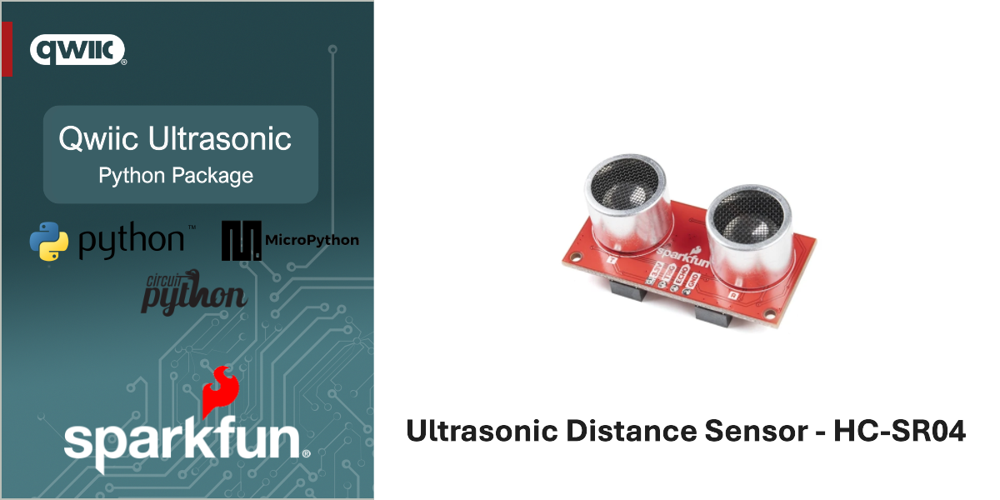

# SparkFun Qwiic Ultrasonic - Python Package


[](https://docs.sparkfun.com/Qwiic_Py/qwiic_ultrasonic/)

The SparkFun Qwiic HC-SR04 Ultrasonic Distance Sensor provides a simple and cost effective solution for adding distance measurements (from 2cm to 400cm) to your project. Implementing a SparkFun Qwiic I2C interface, these sensors can be rapidly added to any project with boards that are part of the SparkFun Qwiic ecosystem.

This package is the Python driver for the Qwiic Ultrasonic Distance Sensor (HC-SR04). It works on CPython (Linux), MicroPython and CircuitPython, and is part of the [SparkFun Qwiic Python package](https://github.com/sparkfun/Qwiic_Py).

## Contents

* [About the Package](#about-the-package)
* [Supported Platforms](#supported-platforms)
* [Installation](#installation)
* [Example Use](#example-use)
* [Documentation](#documentation)
* [Migrating from 2.x](#migrating-from-2x)

## About the Package

This package reads distance from the Qwiic Ultrasonic Distance Sensor over a single Qwiic cable, and changes its I2C address. Each feature is demonstrated in the [examples](examples/README.md).

New to Qwiic? Take a look at the entire [SparkFun Qwiic ecosystem](https://www.sparkfun.com/qwiic).

### Supported SparkFun Products

* [SparkFun Qwiic Ultrasonic Distance Sensor - HC-SR04](https://www.sparkfun.com/sparkfun-qwiic-ultrasonic-distance-sensor-hc-sr04.html)

## Supported Platforms

| Python | Platform | Boards |
| --- | --- | --- |
| CPython | Linux | [Raspberry Pi](https://www.sparkfun.com/raspberry-pi-5-8gb.html), [NVIDIA Jetson Orin Nano](https://www.sparkfun.com/nvidia-jetson-orin-nano-developer-kit.html) via the [SparkFun Qwiic SHIM](https://www.sparkfun.com/sparkfun-qwiic-shim-for-raspberry-pi.html) |
| MicroPython | Raspberry Pi RP2, ESP32 | [SparkFun Pro Micro RP2350](https://www.sparkfun.com/sparkfun-pro-micro-rp2350.html), [SparkFun IoT RedBoard ESP32](https://www.sparkfun.com/sparkfun-iot-redboard-esp32-development-board.html), [SparkFun IoT RedBoard RP2350](https://www.sparkfun.com/sparkfun-iot-redboard-rp2350.html) |
| CircuitPython | Raspberry Pi RP2, ESP32 | [SparkFun Pro Micro RP2350](https://www.sparkfun.com/sparkfun-pro-micro-rp2350.html), [SparkFun IoT RedBoard ESP32](https://www.sparkfun.com/sparkfun-iot-redboard-esp32-development-board.html), [SparkFun IoT RedBoard RP2350](https://www.sparkfun.com/sparkfun-iot-redboard-rp2350.html) |

> [!NOTE]
> These are the primary platforms tested. The package is expected to work on most Python-enabled systems.

## Installation

### CPython (pip)

```sh
python3 -m venv ~/sparkfun_venv
~/sparkfun_venv/bin/pip install sparkfun-qwiic-ultrasonic
```

Run any example or script that does `import qwiic_ultrasonic` with `~/sparkfun_venv/bin/python3 example_script.py`.

### MicroPython (mip)

Install [mpremote](https://docs.micropython.org/en/latest/reference/mpremote.html), connect your board, then install the driver (this also installs `qwiic_i2c`):

```sh
mpremote mip install github:sparkfun/Qwiic_Py/drivers/qwiic_ultrasonic
```

To install the examples too:

```sh
mpremote mip install --target "" github:sparkfun/Qwiic_Py/drivers/qwiic_ultrasonic/examples
```

Add `@qwiic_ultrasonic-<version>` to either command to install a specific release.

### CircuitPython (circup)

Install [CircUp](https://docs.circuitpython.org/projects/circup/en/latest/#installation), add the SparkFun Qwiic bundle once, then install the driver:

```sh
circup bundle-add sparkfun/Qwiic_Py
circup install qwiic_ultrasonic
```

To copy an example to the board:

```sh
circup example qwiic_ultrasonic/qwiic_ultrasonic_ex1_basic_readings
```

## Example Use

Below is a quickstart program that prints the measured distance. See the [examples directory](examples) for more, and [examples/README.md](examples/README.md) for a summary of each.

```python
import sys
import qwiic_ultrasonic
import qwiic_i2c


def run_example():
    print("\nQwiic Ultrasonic Example 1 - Basic Readings\n")
    # Older firmware used address 0x00: pass address=0x00 for those sensors
    my_ultrasonic = qwiic_ultrasonic.QwiicUltrasonic()

    if not my_ultrasonic.is_connected():
        print("The device isn't connected to the system. Please check your connection", file=sys.stderr)
        return

    my_ultrasonic.begin()

    while True:
        # The distance comes from the previous trigger
        print("Distance (mm):", my_ultrasonic.trigger_and_read())
        qwiic_i2c.delay_ms(100)


if __name__ == "__main__":
    try:
        run_example()
    except (KeyboardInterrupt, SystemExit):
        print("\nEnding Example")
        sys.exit(0)
```

## Documentation

The API reference is at [docs.sparkfun.com/Qwiic_Py/qwiic_ultrasonic](https://docs.sparkfun.com/Qwiic_Py/qwiic_ultrasonic/).

## Migrating from 2.x

Version 3 has one name per method and no properties, so it also runs on MicroPython builds without `property()`.

| 2.x | 3.0 |
| --- | --- |
| `sensor.connected` | `sensor.is_connected()` |
| `kMinAddress`, `kMaxAddress`, `kDefaultAddress` | `MIN_ADDRESS`, `MAX_ADDRESS`, `DEFAULT_ADDRESS` |
| `kRegisterTrigger` | `REGISTER_TRIGGER` |
| `change_address(a)` left `sensor.address` set to `a \| 0x80`, so later reads went to the wrong address | `change_address(a)` sets `sensor.address` to `a` |

<p align="center">

</p>
