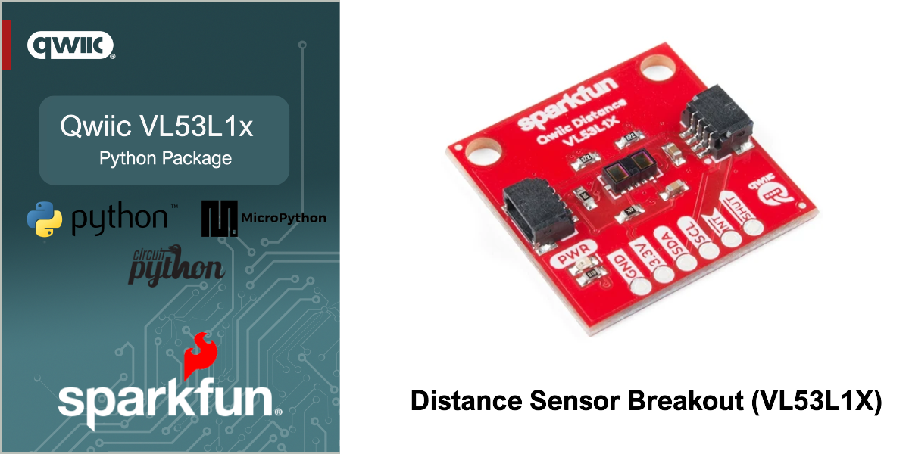

# SparkFun Qwiic VL53L1X - Python Package


[](https://docs.sparkfun.com/Qwiic_Py/qwiic_vl53l1x/)

The SparkFun Qwiic ToF Distance Sensor VL53L1X Module provides a simple and cost effective solution for adding ToF Distance Sensor capabilities to your project. Implementing a SparkFun Qwiic I2C interface, these sensors can be rapidly added to any project with boards that are part of the SparkFun Qwiic ecosystem.

This package is the Python driver for the VL53L1X. It works on CPython (Linux), MicroPython and CircuitPython, and is part of the [SparkFun Qwiic Python package](https://github.com/sparkfun/Qwiic_Py).

## Contents

* [About the Package](#about-the-package)
* [Supported Platforms](#supported-platforms)
* [Installation](#installation)
* [Example Use](#example-use)
* [Documentation](#documentation)
* [Migrating from 2.x](#migrating-from-2x)

## About the Package

This package reads distance from the VL53L1X over a single Qwiic cable, and configures its distance mode, timing budget, inter-measurement period, region of interest, thresholds and calibration. Each feature is demonstrated in the [examples](examples/README.md).

New to Qwiic? Take a look at the entire [SparkFun Qwiic ecosystem](https://www.sparkfun.com/qwiic).

### Supported SparkFun Products

* [SparkFun Distance Sensor - VL53L1X (Qwiic)](https://www.sparkfun.com/products/14722)

## Supported Platforms

| Python | Platform | Boards |
| --- | --- | --- |
| CPython | Linux | [Raspberry Pi](https://www.sparkfun.com/raspberry-pi-5-8gb.html), [NVIDIA Jetson Orin Nano](https://www.sparkfun.com/nvidia-jetson-orin-nano-developer-kit.html) via the [SparkFun Qwiic SHIM](https://www.sparkfun.com/sparkfun-qwiic-shim-for-raspberry-pi.html) |
| MicroPython | Raspberry Pi RP2, ESP32 | [SparkFun Pro Micro RP2350](https://www.sparkfun.com/sparkfun-pro-micro-rp2350.html), [SparkFun IoT RedBoard ESP32](https://www.sparkfun.com/sparkfun-iot-redboard-esp32-development-board.html), [SparkFun IoT RedBoard RP2350](https://www.sparkfun.com/sparkfun-iot-redboard-rp2350.html) |
| CircuitPython | Raspberry Pi RP2, ESP32 | [SparkFun Pro Micro RP2350](https://www.sparkfun.com/sparkfun-pro-micro-rp2350.html), [SparkFun IoT RedBoard ESP32](https://www.sparkfun.com/sparkfun-iot-redboard-esp32-development-board.html), [SparkFun IoT RedBoard RP2350](https://www.sparkfun.com/sparkfun-iot-redboard-rp2350.html) |

> [!NOTE]
> These are the primary platforms tested. The package is expected to work on most Python-enabled systems.

## Installation

### CPython (pip)

```sh
python3 -m venv ~/sparkfun_venv
~/sparkfun_venv/bin/pip install sparkfun-qwiic-vl53l1x
```

Run any example or script that does `import qwiic_vl53l1x` with `~/sparkfun_venv/bin/python3 example_script.py`.

### MicroPython (mip)

Install [mpremote](https://docs.micropython.org/en/latest/reference/mpremote.html), connect your board, then install the driver (this also installs `qwiic_i2c`):

```sh
mpremote mip install github:sparkfun/Qwiic_Py/drivers/qwiic_vl53l1x
```

To install the examples too:

```sh
mpremote mip install --target "" github:sparkfun/Qwiic_Py/drivers/qwiic_vl53l1x/examples
```

Add `@qwiic_vl53l1x-<version>` to either command to install a specific release.

### CircuitPython (circup)

Install [CircUp](https://docs.circuitpython.org/projects/circup/en/latest/#installation), add the SparkFun Qwiic bundle once, then install the driver:

```sh
circup bundle-add sparkfun/Qwiic_Py
circup install qwiic_vl53l1x
```

To copy an example to the board:

```sh
circup example qwiic_vl53l1x/qwiic_vl53l1x_ex1_read_distance
```

## Example Use

Below is a quickstart program that prints the distance to an object. See the [examples directory](examples) for more, and [examples/README.md](examples/README.md) for a summary of each.

```python
import sys
import qwiic_vl53l1x
import qwiic_i2c


print("VL53L1X Qwiic Test\n")
tof = qwiic_vl53l1x.QwiicVL53L1X()

if not tof.begin():
    print("The Qwiic VL53L1X device isn't connected to the system. Please check your connection", file=sys.stderr)
    sys.exit(1)

while True:
    tof.start_ranging()
    while not tof.check_for_data_ready():
        qwiic_i2c.delay_ms(1)
    distance = tof.get_distance()
    tof.clear_interrupt()
    tof.stop_ranging()

    print("Distance(mm): %s" % distance)
```

## Documentation

The API reference is at [docs.sparkfun.com/Qwiic_Py/qwiic_vl53l1x](https://docs.sparkfun.com/Qwiic_Py/qwiic_vl53l1x/).

## Migrating from 2.x

Version 3 has one name per method and no properties, so it also runs on MicroPython builds without `property()`.

| 2.x | 3.0 |
| --- | --- |
| `QwiicVL53L1X(address, debug, i2c_driver)` | `QwiicVL53L1X(address, i2c_bus)`: the `debug` argument and its prints are gone |
| no `is_connected()` or `begin()` | `is_connected()` (address acknowledges and model ID is 0xEACC) and `begin()` (returns `True` or `False`) |
| `sensor_init()` returned `None` on success | returns `0` (`VL53L1_ERROR_NONE`) on success, `VL53L1_ERROR_TIME_OUT` (-7) on timeout |
| `_begin()` (returned `sensor_init()`'s status) | `begin()` |
| Status returned by the setters (`start_ranging()`, `clear_interrupt()`, ...) was `None` | `0`; I2C errors raise `OSError` |
| no soft reset | `soft_reset()` |
| `set_distance_mode(DM)` ignored an invalid mode | `set_distance_mode(distance_mode)` raises `ValueError` |
| `set_interrupt_polarity(NewPolarity)` | `set_interrupt_polarity(new_polarity)` |
| `set_timing_budget_in_ms(TimingBudgetInMs)` | `set_timing_budget_in_ms(timing_budget_in_ms)` |
| `set_inter_measurement_in_ms(InterMeasMs)` | `set_inter_measurement_in_ms(inter_meas_ms)` |
| `set_offset(OffsetValue)`, `set_xtalk(XtalkValue)` | `set_offset(offset_value)`, `set_xtalk(xtalk_value)` |
| `set_distance_threshold(ThreshLow, ThreshHigh, Window, IntOnNoTarget)` | `set_distance_threshold(thresh_low, thresh_high, window, int_on_no_target)` |
| `set_roi(X, Y, OpticalCenter)` | `set_roi(x, y, optical_center)` |
| `set_signal_threshold(Signal)`, `set_sigma_threshold(Sigma)` | `set_signal_threshold(signal)`, `set_sigma_threshold(sigma)` |
| `calibrate_offset(TargetDistInMm)`, `calibrate_xtalk(TargetDistInMm)` raised `TypeError` | `calibrate_offset(target_dist_in_mm)`, `calibrate_xtalk(target_dist_in_mm)` work |
| `set_xtalk()` raised `TypeError` | fixed |
| `get_offset()` returned a large positive number for a negative offset | returns the signed offset |

<p align="center">

</p>
