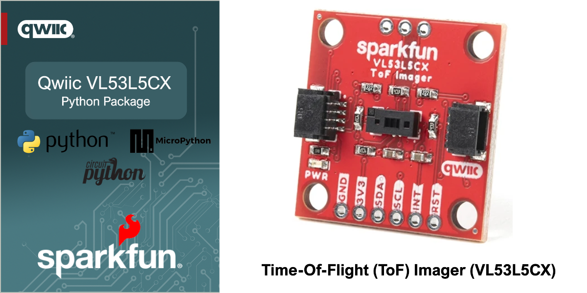

# SparkFun Qwiic VL53L5CX - Python Package


[](https://docs.sparkfun.com/Qwiic_Py/qwiic_vl53l5cx/)

The SparkFun Qwiic ToF Imager VL53L5CX provides a simple and cost effective solution for adding multizone (up to 8x8) ToF distance sensing to your project. Implementing a SparkFun Qwiic I2C interface, these sensors can be rapidly added to any project with boards that are part of the SparkFun Qwiic ecosystem.

This package is the Python driver for the VL53L5CX. It works on CPython (Linux), MicroPython and CircuitPython, and is part of the [SparkFun Qwiic Python package](https://github.com/sparkfun/Qwiic_Py).

## Contents

* [About the Package](#about-the-package)
* [Supported Platforms](#supported-platforms)
* [Installation](#installation)
* [Example Use](#example-use)
* [Documentation](#documentation)
* [Migrating from 2.x](#migrating-from-2x)

## About the Package

This package reads a 4x4 or 8x8 array of distances from the VL53L5CX over a single Qwiic cable, and configures its resolution, ranging frequency and mode, power mode, integration time, sharpener, target order and I2C address. The sensor firmware and default configuration ship with the package in `qwiic_vl53l5cx/vl53l5cx_bin/`; `begin()` uploads them, which takes a few seconds. Each feature is demonstrated in the [examples](examples/README.md).

New to Qwiic? Take a look at the entire [SparkFun Qwiic ecosystem](https://www.sparkfun.com/qwiic).

### Supported SparkFun Products

* [SparkFun Qwiic ToF Imager - VL53L5CX](https://www.sparkfun.com/products/18642)

## Supported Platforms

| Python | Platform | Boards |
| --- | --- | --- |
| CPython | Linux | [Raspberry Pi](https://www.sparkfun.com/raspberry-pi-5-8gb.html), [NVIDIA Jetson Orin Nano](https://www.sparkfun.com/nvidia-jetson-orin-nano-developer-kit.html) via the [SparkFun Qwiic SHIM](https://www.sparkfun.com/sparkfun-qwiic-shim-for-raspberry-pi.html) |
| MicroPython | Raspberry Pi RP2, ESP32 | [SparkFun Pro Micro RP2350](https://www.sparkfun.com/sparkfun-pro-micro-rp2350.html), [SparkFun IoT RedBoard ESP32](https://www.sparkfun.com/sparkfun-iot-redboard-esp32-development-board.html), [SparkFun IoT RedBoard RP2350](https://www.sparkfun.com/sparkfun-iot-redboard-rp2350.html) |
| CircuitPython | Raspberry Pi RP2, ESP32 | [SparkFun Pro Micro RP2350](https://www.sparkfun.com/sparkfun-pro-micro-rp2350.html), [SparkFun IoT RedBoard ESP32](https://www.sparkfun.com/sparkfun-iot-redboard-esp32-development-board.html), [SparkFun IoT RedBoard RP2350](https://www.sparkfun.com/sparkfun-iot-redboard-rp2350.html) |

> [!NOTE]
> These are the primary platforms tested. The package is expected to work on most Python-enabled systems.

## Installation

### CPython (pip)

```sh
python3 -m venv ~/sparkfun_venv
~/sparkfun_venv/bin/pip install sparkfun-qwiic-vl53l5cx
```

Run any example or script that does `import qwiic_vl53l5cx` with `~/sparkfun_venv/bin/python3 example_script.py`.

### MicroPython (mip)

Install [mpremote](https://docs.micropython.org/en/latest/reference/mpremote.html), connect your board, then install the driver (this also installs `qwiic_i2c`):

```sh
mpremote mip install github:sparkfun/Qwiic_Py/drivers/qwiic_vl53l5cx
```

To install the examples too:

```sh
mpremote mip install --target "" github:sparkfun/Qwiic_Py/drivers/qwiic_vl53l5cx/examples
```

Add `@qwiic_vl53l5cx-<version>` to either command to install a specific release.

The firmware files are installed with the driver. If you copy the package to a board by hand, keep `vl53l5cx_bin/` inside the `qwiic_vl53l5cx` folder, or pass its location with `QwiicVL53L5CX(data_path=...)`.

### CircuitPython (circup)

Install [CircUp](https://docs.circuitpython.org/projects/circup/en/latest/#installation), add the SparkFun Qwiic bundle once, then install the driver:

```sh
circup bundle-add sparkfun/Qwiic_Py
circup install qwiic_vl53l5cx
```

To copy an example to the board:

```sh
circup example qwiic_vl53l5cx/qwiic_vl53l5cx_ex1_distance_array
```

## Example Use

Below is a quickstart program that prints the 8x8 array of distances. See the [examples directory](examples) for more, and [examples/README.md](examples/README.md) for a summary of each.

```python
import sys
import qwiic_vl53l5cx
import qwiic_i2c


def run_example():
    print("\nQwiic VL53LCX Example 1 - DistanceArray\n")
    sensor = qwiic_vl53l5cx.QwiicVL53L5CX()

    if not sensor.is_connected():
        print("The device isn't connected to the system. Please check your connection", file=sys.stderr)
        return

    print("Initializing sensor board. This can take up to 10s. Please wait.")
    if not sensor.begin():
        print("Sensor initialization unsuccessful. Exiting...", file=sys.stderr)
        return

    sensor.set_resolution(8 * 8)
    width = 8
    sensor.start_ranging()

    while True:
        if sensor.check_data_ready():
            data = sensor.get_ranging_data()
            for y in range(0, width * width, width):
                print("\t".join(str(data.distance_mm[x + y]) for x in range(width - 1, -1, -1)))
            print()
        qwiic_i2c.delay_ms(5)


if __name__ == "__main__":
    try:
        run_example()
    except (KeyboardInterrupt, SystemExit):
        print("\nEnding Example")
        sys.exit(0)
```

## Documentation

The API reference is at [docs.sparkfun.com/Qwiic_Py/qwiic_vl53l5cx](https://docs.sparkfun.com/Qwiic_Py/qwiic_vl53l5cx/).

## Migrating from 2.x

Version 3 has one name per method and no properties, so it also runs on MicroPython builds without `property()`.

| 2.x | 3.0 |
| --- | --- |
| `k`-prefixed class constants (`QwiicVL53L5CX.kStatusOK`, ...) | UPPER_CASE without the `k` (`QwiicVL53L5CX.STATUS_OK`, ...), listed below |
| `sensor.connected` | `sensor.is_connected()` |
| `QwiicVL53L5CX(..., dataPath="/lib/qwiic_vl53l5cx/vl53l5cx_bin")` | `QwiicVL53L5CX(..., data_path=None)`: by default the `vl53l5cx_bin` directory next to the module is used, then `/lib/qwiic_vl53l5cx/vl53l5cx_bin` |
| `kTargetOrderStronges` (typo, raised `AttributeError` in `set_target_order()`) | `TARGET_ORDER_STRONGEST` |
| `kRangingModeContinous` | `RANGING_MODE_CONTINUOUS` |
| `RangingDataResults.kNbTartgetPerZone`, `RangingDataResults.kResolution8x8` | `RangingDataResults.NB_TARGET_PER_ZONE`, `RangingDataResults.RESOLUTION_8X8` |
| `wr_multi(..., chunkSize)`, `rd_multi(..., numBytes, chunkSize)` | `wr_multi(..., chunk_size)`, `rd_multi(..., num_bytes, chunk_size)` |
| `get_buffer_from_open_file(f, startByte, endByte)`, `get_buffer_from_file(fileName, startByte, endByte)` | `get_buffer_from_open_file(f, start_byte, end_byte)`, `get_buffer_from_file(file_name, start_byte, end_byte)` |
| `get_absolute_data_path(fileName)` | `get_absolute_data_path(file_name)` |
| `write_out_large_file(reg, fileName, startByte, size, writeChunkSize, readChunkSize)` | `write_out_large_file(reg, file_name, start_byte, size, write_chunk_size, read_chunk_size)` |
| `check_data_directory()` printed an error | returns `False` without printing |
| 4x4 resolution could hang in `start_ranging()` | fixed: the 4x4 offset and crosstalk data are averaged as 32/16-bit words like the ST driver, and an MCU error now ends the wait |

### Renamed constants

Every class constant is now UPPER_CASE (PEP 8):

| 2.x | 3.0 |
| --- | --- |
| `kAmbientRateBh` | `AMBIENT_RATE_BH` |
| `kAmbientRateIdx` | `AMBIENT_RATE_IDX` |
| `kBlockHeaderIdxMask` | `BLOCK_HEADER_IDX_MASK` |
| `kBlockHeaderIdxShift` | `BLOCK_HEADER_IDX_SHIFT` |
| `kBlockHeaderSizeMask` | `BLOCK_HEADER_SIZE_MASK` |
| `kBlockHeaderSizeShift` | `BLOCK_HEADER_SIZE_SHIFT` |
| `kBlockHeaderTypeMask` | `BLOCK_HEADER_TYPE_MASK` |
| `kBlockHeaderTypeShift` | `BLOCK_HEADER_TYPE_SHIFT` |
| `kCommonDataBh` | `COMMON_DATA_BH` |
| `kConfigurationSize` | `CONFIGURATION_SIZE` |
| `kDciDssConfig` | `DCI_DSS_CONFIG` |
| `kDciFreqHz` | `DCI_FREQ_HZ` |
| `kDciIntegrationTime` | `DCI_INTEGRATION_TIME` |
| `kDciOutputConfig` | `DCI_OUTPUT_CONFIG` |
| `kDciOutputEnables` | `DCI_OUTPUT_ENABLES` |
| `kDciOutputList` | `DCI_OUTPUT_LIST` |
| `kDciPipeControl` | `DCI_PIPE_CONTROL` |
| `kDciRangingMode` | `DCI_RANGING_MODE` |
| `kDciSharpenerPercent` | `DCI_SHARPENER_PERCENT` |
| `kDciSingleRange` | `DCI_SINGLE_RANGE` |
| `kDciTargetOrder` | `DCI_TARGET_ORDER` |
| `kDciZoneConfig` | `DCI_ZONE_CONFIG` |
| `kDistanceBh` | `DISTANCE_BH` |
| `kDistanceIdx` | `DISTANCE_IDX` |
| `kMCUError` | `MCU_ERROR` |
| `kMetadataBh` | `METADATA_BH` |
| `kMetadataIdx` | `METADATA_IDX` |
| `kMotionDetectBh` | `MOTION_DETECT_BH` |
| `kMotionDetectIdx` | `MOTION_DETECT_IDX` |
| `kNbTargetDetectedBh` | `NB_TARGET_DETECTED_BH` |
| `kNbTargetDetectedIdx` | `NB_TARGET_DETECTED_IDX` |
| `kNbTargetPerZone` | `NB_TARGET_PER_ZONE` |
| `kNvmCmdSize` | `NVM_CMD_SIZE` |
| `kNvmDataSize` | `NVM_DATA_SIZE` |
| `kOffsetBufferSize` | `OFFSET_BUFFER_SIZE` |
| `kOffsetDataSize` | `OFFSET_DATA_SIZE` |
| `kPowerModeSleep` | `POWER_MODE_SLEEP` |
| `kPowerModeWakeup` | `POWER_MODE_WAKEUP` |
| `kRangeSigmaMmBh` | `RANGE_SIGMA_MM_BH` |
| `kRangeSigmaMmIdx` | `RANGE_SIGMA_MM_IDX` |
| `kRangingModeAutonomous` | `RANGING_MODE_AUTONOMOUS` |
| `kRangingModeContinous` | `RANGING_MODE_CONTINUOUS` |
| `kReflectanceBh` | `REFLECTANCE_BH` |
| `kReflectanceEstPcIdx` | `REFLECTANCE_EST_PC_IDX` |
| `kResolution4x4` | `RESOLUTION_4X4` |
| `kResolution8x8` | `RESOLUTION_8X8` |
| `kSignalRateBh` | `SIGNAL_RATE_BH` |
| `kSignalRateIdx` | `SIGNAL_RATE_IDX` |
| `kSpadCountBh` | `SPAD_COUNT_BH` |
| `kSpadCountIdx` | `SPAD_COUNT_IDX` |
| `kStartBh` | `START_BH` |
| `kStatusError` | `STATUS_ERROR` |
| `kStatusInvalidParam` | `STATUS_INVALID_PARAM` |
| `kStatusOK` | `STATUS_OK` |
| `kTargetOrderClosest` | `TARGET_ORDER_CLOSEST` |
| `kTargetOrderStrongest` | `TARGET_ORDER_STRONGEST` |
| `kTargetOrderStronges` | `TARGET_ORDER_STRONGEST` |
| `kTargetStatusBh` | `TARGET_STATUS_BH` |
| `kTargetStatusIdx` | `TARGET_STATUS_IDX` |
| `kTempBufferSize` | `TEMP_BUFFER_SIZE` |
| `kUiCmdEnd` | `UI_CMD_END` |
| `kUiCmdStart` | `UI_CMD_START` |
| `kUiCmdStatus` | `UI_CMD_STATUS` |
| `kXTalkBufferSize` | `XTALK_BUFFER_SIZE` |
| `kXTalkDataSize` | `XTALK_DATA_SIZE` |

<p align="center">

</p>
