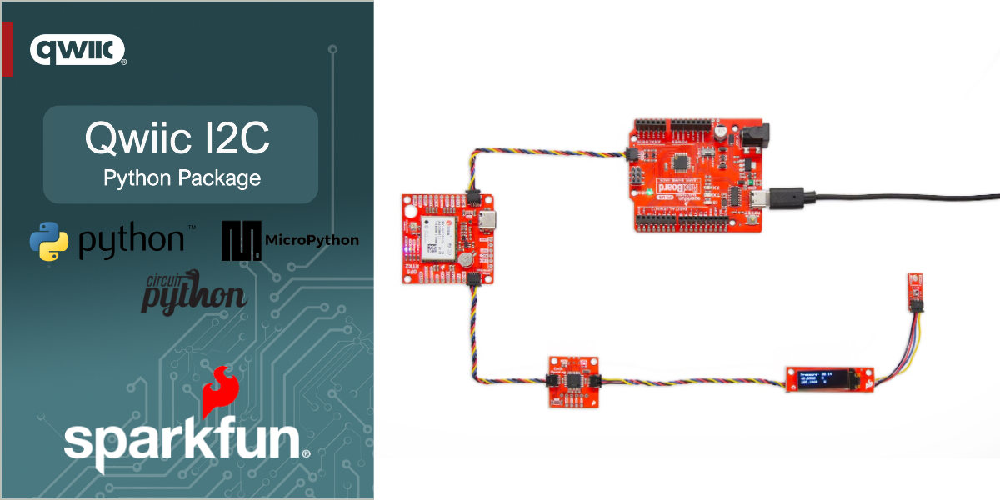

# SparkFun Qwiic I2C - Python Package


Platform independent I2C bus layer for the SparkFun [Qwiic ecosystem](https://www.sparkfun.com/qwiic). Every SparkFun Qwiic Python driver uses it to talk to its device, on CPython (Linux), MicroPython and CircuitPython.

It is part of the [SparkFun Qwiic Python package](https://github.com/sparkfun/Qwiic_Py).

## Contents

* [Supported Platforms](#supported-platforms)
* [Installation](#installation)
* [Usage](#usage)
* [Timing Helpers](#timing-helpers)
* [Documentation](#documentation)
* [Migrating from 2.x](#migrating-from-2x)

## Supported Platforms

| Python | Backend module | Native bus object | Boards tested |
| --- | --- | --- | --- |
| CPython on Linux | `qwiic_i2c_linux` | `smbus2.SMBus` | Raspberry Pi, NVIDIA Jetson Orin Nano |
| MicroPython | `qwiic_i2c_micropython` | `machine.I2C`, `machine.SoftI2C` | RP2040, RP2350, ESP32 boards |
| CircuitPython | `qwiic_i2c_circuitpython` | `busio.I2C` | RP2040, RP2350, ESP32 boards |

Every module is a single flat file with no relative or dynamic imports, so the package also works on platforms that load each file as an independent module.

## Installation

### CPython (pip)

```sh
python3 -m venv ~/sparkfun_venv
~/sparkfun_venv/bin/pip install sparkfun-qwiic-i2c
```

### MicroPython (mip)

```sh
mpremote mip install github:sparkfun/Qwiic_Py/qwiic_i2c
```

This installs `qwiic_i2c.py` and `qwiic_i2c_micropython.py`. Every Qwiic driver installs it automatically as a dependency.

### CircuitPython (circup)

```sh
circup bundle-add sparkfun/Qwiic_Py
circup install qwiic_i2c
```

## Usage

Most programs never call qwiic_i2c directly. Each driver uses the default bus when none is given, and accepts a bus as its first argument, or as `i2c_bus=`. A bus can be a native bus object or a qwiic_i2c bus:

```python
import machine, qwiic_bme280

sensor = qwiic_bme280.QwiicBME280()                    # default bus, default address
sensor = qwiic_bme280.QwiicBME280(0x76)                # default bus, other address
bus = machine.SoftI2C(scl=machine.Pin(5), sda=machine.Pin(4))
sensor = qwiic_bme280.QwiicBME280(bus)                 # this bus, default address
sensor = qwiic_bme280.QwiicBME280(bus, 0x76)           # this bus, other address
```

Drivers sort these out with `qwiic_i2c.device_args(address, i2c_bus)`: an address is always an int, and a bus never is.

Use `get_i2c_bus()` to create or share a bus yourself.

```python
import qwiic_i2c

i2c = qwiic_i2c.get_i2c_bus()              # the board's default Qwiic bus
print([hex(a) for a in i2c.scan()])

# Wrap a bus object you already have (for example a second Qwiic port)
import machine                                 # MicroPython
i2c = qwiic_i2c.get_i2c_bus(machine.SoftI2C(scl=machine.Pin(5), sda=machine.Pin(4)))

i2c = qwiic_i2c.get_i2c_bus(bus_id=7)       # Linux: /dev/i2c-7
i2c = qwiic_i2c.get_i2c_bus(sda=4, scl=5)   # MicroPython: pins

import qwiic_bme280
sensor = qwiic_bme280.QwiicBME280(i2c_bus=i2c)
```

`get_i2c_bus()` accepts:

| Argument | Result |
| --- | --- |
| nothing, or `None` | The shared default bus, created on first use |
| an existing qwiic_i2c bus | Returned unchanged |
| a native bus object (`machine.I2C`, `machine.SoftI2C`, `busio.I2C`, `smbus2.SMBus`) | Wrapped in the platform's backend |
| anything else | Passed to the backend's constructor (`sda`, `scl`, `freq` on MicroPython and CircuitPython, `bus_id` on Linux) |

On a MicroPython port without a known default bus (anything other than RP2, ESP32, XBee and i.MX RT), pass a `machine.I2C` object.
`set_default_i2c_bus(bus)` changes the default bus: every driver created without a bus uses it from then on. `bus` is a qwiic_i2c bus or a native bus object. Pass `None` to go back to the platform default. Drivers that already exist keep their bus.

```python
qwiic_i2c.set_default_i2c_bus(machine.SoftI2C(scl=machine.Pin(5), sda=machine.Pin(4)))
sensor = qwiic_bme280.QwiicBME280()            # uses the SoftI2C bus
```

Driver methods. Every `register` argument can be `None` (no register), an int (an 8-bit register), or the bytes of a wider register, most significant byte first (`[0x01, 0x0F]` for register 0x010F). With a register, a read writes the register and then reads after a repeated start.

| Method | Description |
| --- | --- |
| `read_block(address, register, num_bytes)` | Read bytes |
| `write_block(address, register, data)` | Write bytes |
| `read_byte(address, register=None)` | Read one byte |
| `write_byte(address, register, value)` | Write one byte; with `register=None`, just the byte (a command) |
| `read_word(address, register=None, byteorder="little")` | Read a 16-bit word; `byteorder="big"` for high byte first |
| `write_word(address, register, value, byteorder="little")` | Write a 16-bit word |
| `is_device_connected(address)` | True if a device acknowledges the address |
| `scan()` | Addresses of every device on the bus |

A backend for a new platform implements only `read_block`, `write_block`, `is_device_connected` and `scan`; the byte and word methods are built on them in `I2CBus`. `qwiic_i2c.register_bytes(register)` turns any register argument into the bytes to send.

## Timing Helpers

Drivers use these instead of the `time` module, because some platforms have none and the others disagree on what it offers. They exist on every driver object and as module functions.

| Function | Description |
| --- | --- |
| `delay_ms(ms)` | Block for at least `ms` milliseconds |
| `delay_us(us)` | Block for at least `us` microseconds |
| `ticks_ms()` | Millisecond counter for measuring intervals; it may wrap |
| `ticks_diff(end, start)` | `end - start` in milliseconds, correct across a wrap |

```python
start = i2c.ticks_ms()
while i2c.ticks_diff(i2c.ticks_ms(), start) < 100:
    ...
```

## Documentation

The API reference is at [docs.sparkfun.com/Qwiic_Py/qwiic_i2c](https://docs.sparkfun.com/Qwiic_Py/qwiic_i2c/).

## Migrating from 2.x

Version 3 keeps one name per method. The camelCase twins are gone, and the bus object is called a bus rather than a driver, so it isn't confused with the device drivers.

| 2.x | 3.0 |
| --- | --- |
| `getI2CDriver()`, `get_i2c_driver()` | `get_i2c_bus()` |
| `I2CDriver` (base class) | `I2CBus` |
| `i2c_driver=` argument of every device driver | `i2c_bus=` (or pass the bus first) |
| `isDeviceConnected()`, `ping()` | `is_device_connected()` |
| `readByte`, `readWord`, `readBlock` | `read_byte`, `read_word`, `read_block` |
| `writeByte`, `writeWord`, `writeBlock` | `write_byte`, `write_word`, `write_block` |
| `writeCommand(address, command)` | `write_byte(address, None, command)` |
| `writeReadBlock(address, [reg_hi, reg_lo], n)` | `read_block(address, [reg_hi, reg_lo], n)` |
| `readWord`/`writeWord` were little-endian only | `byteorder="big"` for high byte first |
| `isPlatform()` | `is_platform()` |
| `driver.i2cbus` | `bus.native_bus` |
| `LinuxI2C(iBus=n)` (ignored `n`) | `LinuxI2C(bus_id=n)` |
| `get_i2c_driver()` returned `None` on an unsupported platform | raises `RuntimeError` |
| `qwiic_i2c` package (`qwiic_i2c/__init__.py`, ...) | flat modules `qwiic_i2c.py` + `qwiic_i2c_<platform>.py` |
| The default bus on RP2 and ESP32 ran at 400 kHz, ignoring the 100 kHz default (too fast for some ATtiny-based boards) | It runs at 100 kHz, or the `freq=` you pass |
## License

MIT. See [LICENSE](LICENSE).
